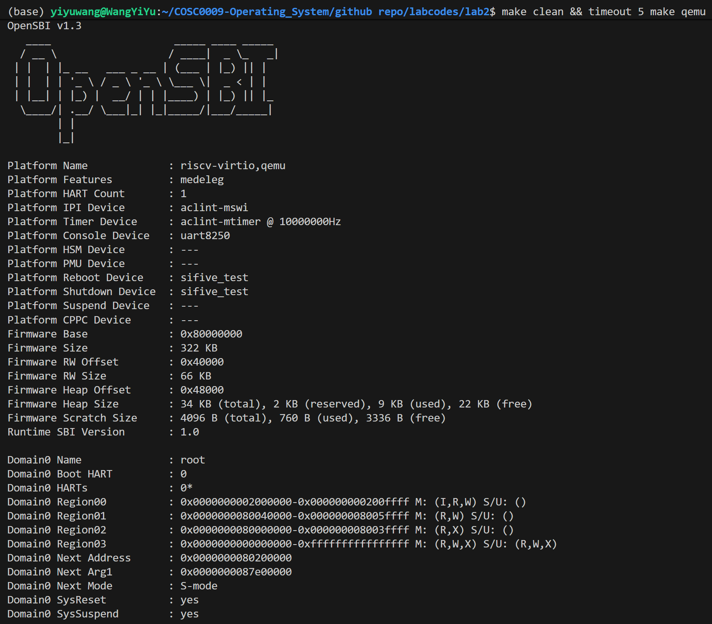
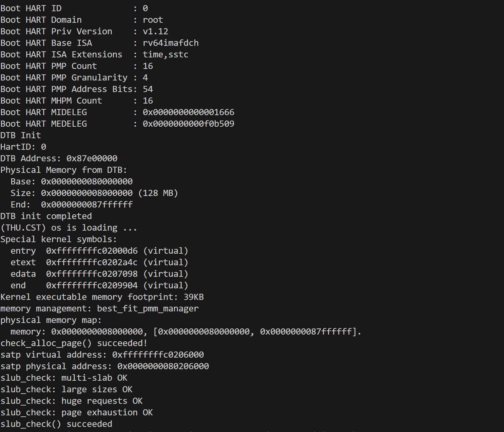
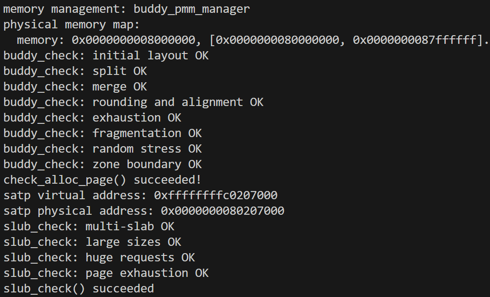
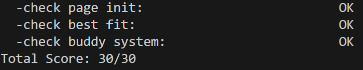

# 操作系统实验报告

## 实验基本信息

| 项目         | 内容                                           |
| ------------ | ---------------------------------------------- |
| **实验名称** | Lab 2:物理内存和页表                           |
| **小组成员** | 2414007-王奕瑜、2414015-鲁昕宁、2411622-张雨函 |
| **完成日期** | 2026-10-20                                     |

### 小组分工

练习如何分工？

|      成员      |                                         负责的练习/模块                                          |
| :------------: | :----------------------------------------------------------------------------------------------: |
| 2414007-王奕瑜 |          4.1 实现物理内存探测与页描述符初始化功能、4.4 buddy system（伙伴系统）分配算法          |
| 2414015-鲁昕宁 | 4.5 Challenge：硬件的可用物理内存范围的获取方法、4.6 Challenge：任意大小的内存单元 slub 分配算法 |
| 2411622-张雨函 |          4.2 理解first-fit 连续物理内存分配算法、4.3 实现 Best-Fit 连续物理内存分配算法、4.7 分支任务：gdb 调试页表查询过程          |

实验报告如何分工？

|      成员      |     负责的实验报告内容     |
| :------------: | :------------------------: |
| 2414007-王奕瑜 | 3.2.1, 3.2.3, 4.1, 4.4, 五 |
| 2414015-鲁昕宁 |  3.1, 3.2.4, 4.5, 4.6, 六  |
| 2411622-张雨函 | 一 ，3.2.2 , 4.2, 4.3, 4.7 |

---

## 一、实验目的

本实验的主要目的是：

1. 理解 Sv39 分页机制：掌握 RISC-V 三级页表结构、虚实地址映射原理及 TLB 的作用。

2. 掌握物理内存初始化流程：理解 DTB 内存探测、物理页描述符管理及空闲内存区域的初始化方法。

3. 掌握物理页分配算法：分析 First-Fit，实现 Best-Fit 和 Buddy System，理解页面分配、分裂、回收与合并机制。

4. 理解 SLUB 对象分配机制：掌握基于物理页的小对象内存分配、释放与复用方法。

5. 掌握内核调试与测试方法：利用 QEMU、GDB 及测试程序验证内存管理功能，分析地址翻译过程。


## 二、实验环境

你们使用的 AI 工具

|      成员      | AI 编程工具 |     底层模型      | 备注 |
| :------------: | :---------: | :---------------: | :--: |
| 2414007-王奕瑜 | Claude Code | Claude Sonnet 5.5 |  无  |
| 2414015-鲁昕宁 |   Cursor    |     Grok 4.7      |  无  |
| 2411622-张雨函 |  Codex      |      GPT 6        |  无  |

**说明：**

- **AI 编程工具**：指具体使用的终端工具、编辑器插件、桌面应用或浏览器界面
- **底层模型**：指该工具使用的大语言模型及版本

---

## 三、实验整体逻辑分析

### 3.1 本章节的逻辑主线

### 3.2 功能的逐步实现

#### 3.2.1 物理内存探测与页描述符初始化

本实验首先实现的是物理内存探测与页描述符初始化（`page_init()`），原因有以下几点：

1. **它是所有后续物理内存管理功能的前提。** 无论是 First-Fit、Best-Fit 还是 Buddy System，分配器管理的对象都是"以页为单位的空闲物理内存"。如果内核还不知道有多少物理内存、这些内存位于哪个地址范围，分配器就没有可以管理的对象，`alloc_pages()`/`free_pages()` 也就无从谈起。
2. **操作系统需要为每个物理页记录状态。** 分配算法依赖 `Page` 描述符中的引用计数、`PG_reserved`、`PG_property` 和 `property` 等信息来区分"已被占用"和"空闲"的页面，并把空闲块串成链表。这些描述符必须在分配器工作之前统一建立，并且初始状态应当是"全部保留"，避免尚未规划好的页面被提前分配出去。
3. **必须保护已经被占用的内存。** DRAM 的低地址部分被 OpenSBI 占用，随后是内核镜像，而 `Page` 描述符数组本身也要占用物理内存。如果不在初始化时把这些区域排除，分配器就可能把它们当作空闲页发出去，造成内核代码、数据或描述符被覆盖。同时还需要处理页面对齐、虚拟地址与物理地址的换算（`va_pa_offset`），否则空闲区的起止位置会算错。
4. **它把"硬件信息"和"分配算法"衔接起来。** `page_init()` 从设备树获取内存范围，再通过 `init_memmap()` 把初始空闲区交给当前的 `pmm_manager`，使上层分配算法不必关心内存信息来自何处，只需面向统一的接口实现。

因此，我们先完成物理内存初始化，建立"可管理物理页"的初始状态；之后才能在此基础上理解并实现各种页分配算法，并通过 `check_alloc_page()` 验证分配与释放的正确性。

#### 3.2.2 Best-fit 分配算法

Best-Fit 是一种连续内存分配算法，核心思想是从所有能够满足分配请求的空闲内存块中选择容量最小的空闲块进行分配，以减少本次分配产生的剩余空间。

设当前空闲块集合为 $F=\{B_1,B_2,\ldots,B_m\}$，其中 $|B_i|$ 表示第 $i$ 个空闲块包含的物理页数。当申请 $n$ 个连续物理页时，Best-Fit 的选择规则为 $B^*=\arg\min_{B_i\in F,\ |B_i|\ge n}|B_i|$,即选择满足 $|B_i|\ge n$ 且大小最小的空闲块。如果不存在满足要求的空闲块，则分配失败，返回 `NULL`。

例如，假设空闲链表中依次存在 12、8、5、20 页的空闲块，当请求分配 6 页时：

- First-Fit：选择第一个满足要求的 12 页块，分配后剩余 6 页。
- Best-Fit：遍历整个空闲链表，选择 8 页块，分配后剩余 2 页。

相比 First-Fit，Best-Fit 能够使每次分配选择的空闲块更加接近请求大小，但需要遍历全部空闲块，且可能产生较多难以再次利用的小块。

1. **数据结构设计。**本实验在 `kern/mm/best_fit_pmm.c` 中实现 Best-Fit 分配器，复用 ucore 提供的物理页描述符 `struct Page` 和空闲区域结构 `free_area_t`。

  1. 空闲区域管理

使用 `static free_area_t free_area` 保存空闲内存管理信息，其中：

- `free_list`：双向循环链表，按物理地址升序组织空闲块。
- `nr_free`：记录当前空闲物理页总数。

  2. 物理页描述符

使用 `struct Page` 维护页面状态，其中：

- `flags`：通过 `PG_reserved` 和 `PG_property` 标识页面状态。
- `property`：记录连续空闲块的页数，仅在空闲块首页有效。
- `page_link`：将空闲块首页连接到空闲链表。
- `ref`：记录页面引用计数。

采用这种设计，不需要额外维护独立的空闲块数组，直接利用已有的页面描述符完成空闲区域管理。

2. **核心函数实现分析。**
  1. `best_fit_init()`：初始化分配器

该函数通过 `list_init(&free_list)` 初始化空闲链表，并将 `nr_free` 设置为 0。

执行完成后，分配器处于空闲链表为空、空闲页总数为 0 的初始状态，等待物理内存初始化模块登记可用页面。

  2. `best_fit_init_memmap()`：初始化空闲内存区域**

该函数接收连续物理页的起始描述符 `base` 和页数 `n`，将其注册为可分配的空闲块。

具体流程如下：

    1. 检查 `n > 0`，并确认待初始化页面处于保留状态。
    2. 遍历连续页面，清除页面标志、`property` 和引用计数。
    3. 将首页的 `property` 设置为 `n`，并设置 `PG_property` 标志。
    4. 更新空闲页总数 `nr_free += n`。
    5. 按物理地址升序将空闲块首页插入 `free_list`。

由于空闲链表按照地址顺序组织，后续释放页面时只需要检查相邻链表节点，就可以判断是否存在能够合并的连续空闲块。

  3. `best_fit_alloc_pages()`：连续物理页分配

这是 Best-Fit 算法的核心函数，负责根据请求页数选择最合适的空闲块。

首先检查请求页数是否合法，并判断 `n` 是否超过当前空闲页总数。如果总空闲页数不足，直接返回 `NULL`。

随后遍历整个空闲链表，使用以下条件选择最优块：

```c
p->property >= n && (best == NULL || p->property < best->property)
```

其中，`p->property >= n` 保证当前块能够满足请求；`p->property < best->property` 保证选中的块是当前找到的最小可容纳块。

与 First-Fit 在找到第一个满足条件的块后立即停止不同，Best-Fit 必须遍历完整链表。当多个候选块大小相同时，当前实现保留第一个找到的块，即选择地址较低的空闲块。

找到目标块后，根据其大小分为两种情况：

- **大小恰好相等**：直接从空闲链表中移除整个块。
- **空闲块大于请求大小**：从块的起始位置分配 `n` 页，将剩余部分作为新的空闲块重新插入原链表位置。

假设选中的块为 8 页，请求为 6 页，则分裂后的剩余块从 `best + 6` 开始，其 `property` 为 2。

完成分配后，执行 `nr_free -= n`，清除原块首页的 `PG_property` 标志，并将其 `property` 置为 0，最后返回分配区域的首页描述符。

  4. `best_fit_free_pages()`：物理页释放与空闲块合并

该函数负责将已分配的连续物理页归还空闲链表，并合并物理地址相邻的空闲块。

首先遍历待释放页面，检查页面不是保留页或已有空闲块首页，随后清理页面状态，将释放区域的首页设置为新的空闲块头，并执行 `nr_free += n`。

然后按照物理地址升序将该空闲块插入链表，并依次尝试向前、向后合并。

向前合并的判断条件为：

```c
prev + prev->property == base
```

若成立，说明前一个空闲块的结束位置恰好等于当前块起点，将两个块合并，并更新块首页。

向后合并的判断条件为：

```c
base + base->property == next
```

若成立，说明当前块与后一个空闲块在物理地址上连续，将其合并为更大的空闲块。

例如，原本存在一个 3 页空闲块和一个 4 页空闲块，中间有 2 页已分配区域。当中间 2 页释放后，分配器首先将其与前面的 3 页合并，再与后面的 4 页合并，最终形成一个 9 页连续空闲块。

通过上述机制，可以减少外部碎片，提高后续大块连续内存请求成功的可能性。

  5. `best_fit_nr_free_pages()`：查询空闲页数量

该函数直接返回 `nr_free`，用于获取当前可分配物理页总数。

  6. `best_fit_pmm_manager`：注册分配器

通过定义 `const struct pmm_manager best_fit_pmm_manager`，将上述初始化、分配、释放、计数和测试函数注册到统一的物理内存管理接口中。

随后在 `kern/mm/pmm.c` 的 `init_pmm_manager()` 中，将默认分配器设置为 `&best_fit_pmm_manager`。初始化完成后，系统的 `alloc_pages()`、`free_pages()` 等统一接口便会调用相应的 Best-Fit 实现。

当前 Best-Fit 使用按地址排序的双向链表维护空闲块。设链表中共有 $m$ 个空闲块，其复杂度为：

| 操作 | 时间复杂度 | 原因 |
|---|---|---|
| 初始化分配器 | $O(1)$ | 初始化链表及计数 |
| 空闲区域登记 | $O(n+m)$ | 初始化 $n$ 页并查找插入位置 |
| 分配页面 | $O(m)$ | 遍历全部空闲块寻找最优块 |
| 释放页面 | $O(n+m)$ | 重置 $n$ 页状态并查找插入位置 |
| 查询空闲页数 | $O(1)$ | 直接返回 `nr_free` |


#### 3.2.3 伙伴系统分配算法

在 First-Fit 和 Best-Fit 之后，我们继续实现伙伴系统（Buddy System），原因有以下几点：

1. **First-Fit/Best-Fit 的开销和碎片问题。** 二者都用一条按地址排序的空闲链表，分配时要线性扫描，释放时要按地址找位置才能合并，最坏情况下代价与空闲块个数成正比；而且长期运行后，大小不一的空闲块散布在内存里，外部碎片会越来越严重。伙伴系统把空闲块限定为 2 的幂大小，用按阶分开的链表使分配和释放的代价只与阶数（`log N`）有关，是对前两种算法缺点的直接改进。
2. **伙伴系统让"合并"变得简单且可靠。** 块的大小和对齐都是 2 的幂，一个块的伙伴地址只需把页号的某一位取反即可算出，不必再遍历链表找相邻块，这也是 Linux 内核物理页分配器采用它的原因。
3. **它是后续内存管理功能的页级基础。** 后面的 SLUB 等任意大小对象分配器，需要先从页级分配器取得整页，再在页内切分小对象；伙伴系统正好提供"按 2 的幂页数分配、自然对齐"的页级接口。
4. **便于对比不同分配策略。** 前两个算法的内部状态都是"一条链表 + `property`"，伙伴系统则需要多条链表、分裂与合并、区间边界等新的机制。把三种算法接到同一个`pmm_manager`框架上，可以体会到"同一接口、不同策略"的设计，也能通过它们各自的碎片表现比较其优缺点。

#### 3.2.4 slub 分配算法

---

## 四、实验内容与实现

### 4.1 实现物理内存探测与页描述符初始化功能

**负责人：** 2414007-王奕瑜

#### 4.1.1 模块功能描述

**需要实现/修改的函数：**

```c
static void page_init(void);  // kern/mm/pmm.c
```

**功能说明：**

`page_init()`由`pmm_init()`在`init_pmm_manager()`之后调用，是物理内存管理中"硬件信息"与"页分配器"之间的桥梁。它不接收参数，也不返回结果，完成后需要保证：

- **地址换算与内存范围探测：** 设置`va_pa_offset`为内核线性映射的虚实偏移`PHYSICAL_MEMORY_OFFSET`；通过`get_memory_base()`和`get_memory_size()`读取设备树探测到的 DRAM 起始地址和大小，输出`physical memory map`信息；若设备树没有提供有效的内存信息，则`panic`终止初始化。
- **确定可管理上界`npage`：** 以设备树内存末端（不超过内核管理的上界`PHYSICAL_MEMORY_END`）对应的物理页号作为`npage`，描述符需要覆盖`[nbase, npage)`中的每个物理页。
- **建立`Page`描述符数组：** 把`pages`放在内核镜像末尾符号`end`之后的第一个页边界，先将整个数组清零，再把每个描述符都置为保留状态（`PG_reserved`），防止尚未规划好的页面被提前分配。
- **排除已占用内存、注册空闲区：** OpenSBI、内核镜像以及描述符数组本身占用的物理内存都不能分配。函数先用`PADDR()`把描述符数组末尾的虚拟地址换算成物理地址，向上按页对齐得到空闲区起点，把内存末端向下按页对齐得到终点（不足一页的尾部丢弃）；仅当两者之间存在完整页面时，才通过`pa2page()`取得起始描述符并调用`init_memmap()`，把这些页面交给当前`pmm_manager`管理。

初始化完成后的物理内存布局如下：

```text
0x80000000      0x80200000    end(物理)    pages(对齐)     mem_begin             mem_end(对齐)  0x88000000
|   OpenSBI    |  内核镜像    | 对齐空隙 | Page 描述符数组 | 对齐空隙 |   可分配的连续物理页   | 尾部不足一页 |
|<------------------- reserved ------------------------>|          |<---- init_memmap --->|
```

**与其他模块的交互：**

- 依赖`dtb_init()`（`kern/driver/dtb.c`）提前解析设备树并保存内存起点和大小；
- 通过`init_memmap()`调用当前`pmm_manager`的`init_memmap`接口，把初始空闲页交给 First-Fit / Best-Fit 等分配器；
- 之后的`check_alloc_page()`、`alloc_pages()`、`free_pages()`都以这里建立的`pages`、`npage`和空闲区为基础。

#### 4.1.2 最终提示词

以下是经过迭代优化后，最终成功实现该功能的提示词：

````markdown
[PROMPT]
**任务**：修改`kern/mm/pmm.c`，在标有`//lab2 function1 YOUR CODE`的位置实现`static void page_init(void)`，完成物理内存探测与`Page`描述符初始化：根据设备树提供的物理内存信息建立描述符数组，并把排除 OpenSBI、内核镜像和描述符数组占用空间后的完整空闲页面交给当前`pmm_manager`管理。

**操作要求**：你必须在项目中修改实际文件，保留现有代码，只在标记位置补全，不要改动`pmm_init()`等其他函数。将标记注释中的`YOUR CODE`替换为学号`2414007`（保留`lab2 function1`）。为新增代码添加英文 Doxygen 注释，`@author`写`Yiyu Wang(2414007)`。

**输出要求**：直接进行文件操作，使用下面[RELY]、[GUARANTEE]、[SPECIFICATION]部分的信息，以工程真实代码为准，不要引入无关功能。

[RELY]
地址与页面宏：

- `PGSIZE`（4096）、`PGSHIFT`（12）、`PPN(addr)`（`addr >> PGSHIFT`）：`kern/mm/mmu.h`
- `ROUNDUP(a, n)`、`ROUNDDOWN(a, n)`：`libs/defs.h`，结果类型与`a`相同
- `PHYSICAL_MEMORY_OFFSET`（`0xFFFFFFFF40000000`，内核线性映射的虚实偏移）、`PHYSICAL_MEMORY_END`（`0x88000000`，内核管理的物理内存上界）：`kern/mm/memlayout.h`
- `DRAM_BASE`（`0x80000000`）：`libs/riscv.h`
- `PADDR(kva)`：`kern/mm/pmm.h`，把内核虚拟地址转换为物理地址（`kva - va_pa_offset`），`kva`小于`KERNBASE`时 panic

全局变量（`kern/mm/pmm.c`）：

- `struct Page *pages;`——`Page`描述符数组的虚拟起始地址
- `size_t npage;`——内核可管理的物理页号上界（不含）
- `uint64_t va_pa_offset;`——虚拟地址与物理地址之差
- `const size_t nbase;`——DRAM 起始位置对应的物理页号，`DRAM_BASE / PGSIZE`

页描述符与状态宏（`kern/mm/memlayout.h`）：

- `struct Page { int ref; uint64_t flags; unsigned int property; list_entry_t page_link; };`
- `SetPageReserved(page)`、`PageReserved(page)`：设置/测试`PG_reserved`位；该位为 1 表示页面被内核占用，不能参与分配

已有函数：

- `uint64_t get_memory_base(void)`、`uint64_t get_memory_size(void)`（`kern/driver/dtb.h`）：返回设备树中的内存起始物理地址和字节数；设备树无效时返回 0
- `panic(fmt, ...)`（`kern/debug/assert.h`中的宏，输出信息并终止内核）、`int cprintf(const char *fmt, ...)`
- `void *memset(void *s, char c, size_t n)`（`libs/string.h`）
- `static void init_memmap(struct Page *base, size_t n)`（`kern/mm/pmm.c`）：把`base`开始的`n`个页面作为初始空闲区交给当前`pmm_manager`，要求这些页面此时都带有`PG_reserved`
- `static inline struct Page *pa2page(uintptr_t pa)`（`kern/mm/pmm.h`）：返回`&pages[PPN(pa) - nbase]`，`PPN(pa) >= npage`时 panic
- 链接符号`extern char end[];`：内核镜像末尾的**虚拟**地址

物理内存布局（默认 QEMU，DRAM 为`[0x80000000, 0x88000000)`）：

- `[0x80000000, 0x80200000)`被 OpenSBI 占用
- `[0x80200000, end 对应的物理地址)`被内核代码和数据占用
- `Page`数组紧接在内核镜像之后，按页对齐，覆盖物理页号区间`[nbase, npage)`，自身也占用物理内存
- 虚拟地址、物理地址、物理页号和`Page`描述符地址是四种不同的量，不能混用

[GUARANTEE]
必须实现：

```c
static void page_init(void);  // kern/mm/pmm.c
```

`page_init()`不接收参数，也不返回结果，由`pmm_init()`调用。允许新增辅助函数，但必须是`static`的，只在`pmm.c`内部使用，不得改变其他公开接口。

[SPECIFICATION]
**page_init**

- Pre-Condition：`init_pmm_manager()`已经执行，`pmm_manager`已指向某个分配器并完成其`init()`；`dtb_init()`已经执行；内核已通过启动页表在线性映射下运行。
- Post-Condition：`va_pa_offset`、`npage`和`pages`被正确设置；已向控制台输出设备树探测到的物理内存范围；`[nbase, npage)`内的每个页面都有描述符，内核镜像和描述符数组所在的页面保持保留状态且不会进入空闲区；描述符数组之后所有完整的空闲页面已通过`init_memmap()`注册给当前`pmm_manager`。
- Case 1：设备树没有提供有效的物理内存信息。此时无法确定可管理的范围，必须终止初始化，不得继续建立描述符。
- Case 2：设备树信息有效。依次完成：设置虚实偏移；输出探测到的内存范围；根据设备树内存末端和内核可管理的上界确定`npage`；把描述符数组放在内核镜像之后的第一个页边界，并使所有描述符在空闲区建立之前处于保留状态；换算出描述符数组末尾的物理地址，其向上按页对齐作为空闲区起点，设备树内存末端向下按页对齐作为空闲区终点，再把两者之间的页面注册为初始空闲区。
- Case 3：描述符数组之后已没有可用的完整页面（空闲区起点不小于终点）。此时不得调用`init_memmap()`。
- Requirements：
  - 不足一页的内存末尾不能交给分配器。
  - 描述符数组所在内存的初始内容不可假定为零，各描述符的状态必须由本函数显式确定。
  - 比较或传递地址前，必须明确它是虚拟地址还是物理地址，并做相应的转换。
  - 不得修改`best_fit_pmm.c`等其他文件。
````

#### 4.1.3 实现迭代过程

本模块的实现经历了 1 次迭代，过程如下：

---

##### 第一次迭代

使用上述提示词生成`page_init()`后，在 Best-Fit 模块尚未完成的状态下，用本实验提供的测试文件对该函数单独验证：把`tools/test_lab2.c`注入临时目录并运行`make grade`，同时用`make qemu`观察完整启动输出。

> 说明：由于`best_fit_pmm.c`中尚无`best_fit_pmm_manager`，仓库在这一阶段无法直接链接，因此测试在临时副本中进行，副本里仅为`best_fit_pmm.c`补了一个占位用的`best_fit_pmm_manager`（仅为通过链接，不含任何 Best-Fit 逻辑）。第一次运行`make grade`时，占位代码缺少`basic_check()`/`best_fit_check()`依赖的`free_list`和`nr_free`定义，编译报错；这是测试环境的问题，与`page_init()`的提示词无关，补全占位定义后重新运行即可。

**最终结果：**

测试结果：

- ✅ 编译通过
- ✅ `check page init`通过，输出`[Test 1] Page Init: PASS`
- ✅ `make qemu`输出了`physical memory map: memory: 0x0000000008000000, [0x0000000080000000, 0x0000000087ffffff].`，随后`check_alloc_page() succeeded!`，说明空闲区已被`pmm_manager`正确接收，First-Fit 的自检可以在其上正常分配和释放
- ⚠️ `[Test 2] Best-Fit`在这一阶段为`WRONG`，原因是 Best-Fit 属于任务二，尚未实现，不属于本模块

该测试从以下角度检验了`page_init()`：`va_pa_offset`是否等于`PHYSICAL_MEMORY_OFFSET`；`npage`是否等于设备树内存末端的物理页号；`pages`是否非空、页对齐且位于内核`end`之后；空闲页数是否合理；内核镜像尾页和描述符数组所在页面是否仍为保留状态；`page2pa()`与`pa2page()`是否互逆。

本次生成的代码在测试中一次通过，没有需要再调整提示词的问题。

### 4.2 理解first-fit 连续物理内存分配算法

**负责人：** 2411622-张雨函

通过阅读 `kern/mm/default_pmm.c`，理解 First-Fit 连续物理内存分配算法的实现原理，重点分析空闲链表管理、连续页面分配、空闲块分裂、页面释放及相邻空闲块合并机制，并探讨该算法的优化空间。

#### 4.2.1 First-Fit 算法原理

First-Fit 算法采用**首次适应策略**：按照空闲链表顺序查找，选择第一个能够满足请求大小的连续空闲块进行分配。

设空闲块集合为 $F=\{B_1,B_2,\ldots,B_m\}$，当申请 $n$ 个连续物理页时，算法选择：

$$
B^*=B_k,\quad k=\min\{i\mid |B_i|\ge n\}
$$

即按照链表顺序选择第一个大小不小于 $n$ 的空闲块。该算法无需遍历全部空闲块，但可能导致内存碎片问题。

#### 4.2.2 核心数据结构

First-Fit 使用 `free_area_t` 管理空闲内存：

```c
static free_area_t free_area;

#define free_list (free_area.free_list)
#define nr_free (free_area.nr_free)
```

其中：

- `free_list`：按物理地址升序组织的双向循环链表。
- `nr_free`：当前空闲物理页总数。
- `Page.property`：记录空闲块的连续页数。
- `PG_property`：标记空闲块首页。
- `Page.page_link`：将空闲块首页连接到链表。

通过记录空闲块首页和块大小，无需将每一个空闲页单独插入链表。

#### 4.2.3 核心函数实现分析

1. default_init()：初始化分配器

```c
static void default_init(void) {
    list_init(&free_list);
    nr_free = 0;
}
```

初始化双向循环链表，并将空闲页数设置为 0，为后续物理内存注册做准备。

2. `default_init_memmap()`：注册空闲内存

该函数接收连续物理页起点 `base` 和页数 `n`，主要执行：

  1. 遍历页面，清除保留标志、属性及引用计数。
  2. 将 `base->property` 设置为 `n`。
  3. 设置块首页的 `PG_property` 标志。
  4. 执行 `nr_free += n`。
  5. 按物理地址顺序将空闲块插入链表。

该函数将 `page_init()` 识别出的可用内存交给 First-Fit 分配器管理。

3. `default_alloc_pages()`：连续页面分配

```c
while ((le = list_next(le)) != &free_list) {
    struct Page *p = le2page(le, page_link);
    if (p->property >= n) {
        page = p;
        break;
    }
}
```

算法遍历空闲链表，找到第一个大小不小于请求页数的空闲块后立即停止。找到目标块后，将其从链表中移除。如果原空闲块大于请求大小，则执行分裂：

```c
if (page->property > n) {
    struct Page *p = page + n;
    p->property = page->property - n;
    SetPageProperty(p);
    list_add(prev, &(p->page_link));
}
```


最后执行 `nr_free -= n`，清除原块首页的 `PG_property` 标志，返回分配区域的 `Page` 指针。
如果没有满足条件的连续空闲块，则返回 `NULL`。

4. `default_free_pages()`：页面释放与合并

释放函数首先恢复页面状态，并按物理地址顺序将释放区域插入空闲链表。

随后检查前后空闲块是否连续。

向前合并条件：

```c
if (p + p->property == base)
```

向后合并条件：

```c
if (base + base->property == p)
```

若相邻块满足连续条件，则合并块大小，删除被合并块的链表节点，并清除其 `PG_property` 标志。这一机制能够减少外部碎片，提高连续物理内存的利用率。

5. `default_nr_free_pages()`：空闲页统计

该函数直接返回 `nr_free`，用于获取当前空闲物理页总数，时间复杂度为 $O(1)$。

#### 4.2.4 算法测试分析

源码提供 `basic_check()` 和 `default_check()` 两个测试函数。

| 测试函数 | 验证内容 |
|---|---|
| `basic_check()` | 单页分配、地址合法性、页面不重叠、分配失败与释放后重新分配 |
| `default_check()` | 空闲链表一致性、多页分配、空闲块分裂、相邻块合并及空闲页计数恢复 |

其中，`default_check()` 通过构造局部空闲区域，验证连续页面分配和释放后的合并行为，并检查空闲链表中的页面总数是否与 `nr_free` 一致。

需要注意，当前工程默认使用 Best-Fit，因此上述 First-Fit 测试函数属于源码提供的验证机制，并不意味着当前默认构建已经单独执行了 `default_check()`。

#### 4.2.5 算法复杂度与优化分析

设空闲链表包含 $m$ 个空闲块，释放或初始化的页面数为 $n$。

| 操作 | 时间复杂度 |
|---|---|
| 初始化分配器 | $O(1)$ |
| 注册空闲内存 | $O(n+m)$ |
| 分配连续页面 | 最坏 $O(m)$ |
| 释放并合并页面 | $O(n+m)$ |
| 查询空闲页数 | $O(1)$ |

First-Fit 的主要问题及优化方向如下：

1. **搜索效率**：空闲块数量较多时，线性遍历开销较大，可采用分级空闲链表或树形数据结构加速查找。
2. **外部碎片**：频繁分配和释放可能形成大量不连续的小块，可通过更高效的合并机制改善。
3. **分配策略**：首次适应不一定能够合理利用不同大小的空闲块，可采用 Best-Fit，选择满足请求的最小空闲块。
4. **连续大块管理**：可进一步采用 Buddy System，通过按阶管理和伙伴合并提高页面分配与回收效率。


### 4.3 实现 Best-Fit 连续物理内存分配算法


**负责人：** 2411622-张雨函

本实验在理解 First-Fit 连续物理内存分配算法的基础上，实现 Best-Fit 物理页分配算法，并将其接入 ucore 操作系统的物理内存管理框架。
主要实验任务如下：

1. 阅读 `kern/mm/default_pmm.c`，理解 First-Fit 分配器的初始化、空闲块管理、页面分配与回收机制。
2. 参考 `struct pmm_manager` 统一接口，在 `kern/mm/best_fit_pmm.c` 中实现 Best-Fit 分配器。
3. 使用双向循环链表管理连续空闲物理页，实现最佳空闲块搜索、页面分裂和相邻块合并。
4. 在 `kern/mm/pmm.c` 中注册 Best-Fit 分配器，使其成为默认物理内存管理器。
5. 保留实验框架提供的 `basic_check()` 和 `best_fit_check()`，通过 QEMU 运行及自动评分验证实现。
6. 分析 Best-Fit 与 First-Fit 的差异，并讨论算法在时间复杂度和内存碎片控制方面的优化空间。

本实验主要涉及以下文件：

| 文件 | 作用 |
|---|---|
| `kern/mm/default_pmm.c` | First-Fit 参考实现 |
| `kern/mm/best_fit_pmm.c` | Best-Fit 算法的主要实现文件 |
| `kern/mm/best_fit_pmm.h` | Best-Fit 管理器的外部声明 |
| `kern/mm/pmm.c` | 选择并初始化物理内存管理器 |
| `kern/mm/pmm.h` | 定义统一的 `pmm_manager` 接口 |
| `kern/mm/memlayout.h` | 定义 `struct Page` 和空闲区域数据结构 |
| `libs/list.h` | 提供双向循环链表操作 |
| `tools/test_lab2.c` | 提供实验评分测试 |

#### 4.3.2 Best-Fit 算法原理

Best-Fit 的核心思想是在所有能够满足当前分配请求的空闲内存块中，选择容量最小的空闲块进行分配。

设当前空闲内存块集合为：

$$
F=\{B_1,B_2,\ldots,B_m\}
$$

其中，$|B_i|$ 表示第 $i$ 个空闲块的页数。当申请 $n$ 个连续物理页时，Best-Fit 的选择策略为：

$$
B^*=\arg\min_{B_i\in F,\ |B_i|\ge n}|B_i|
$$

即在满足 $|B_i|\ge n$ 的空闲块中，选择最小的一个。如果没有足够大的连续空闲块，则返回 `NULL`。

两种算法的主要区别如下：

| 对比项目 | First-Fit | Best-Fit |
|---|---|---|
| 选择策略 | 第一个满足要求的空闲块 | 满足要求的最小空闲块 |
| 搜索方式 | 找到合适块后停止 | 遍历所有空闲块 |
| 搜索开销 | 取决于首个合适块的位置 | 与整个空闲链表长度有关 |
| 分配后的剩余空间 | 不一定最小 | 当前分配的剩余空间最小 |
| 碎片问题 | 可能产生外部碎片 | 可能产生较多小空闲块 |

Best-Fit 的优势是能够避免在当前分配中不必要地使用更大的空闲块，但不代表长期运行后的碎片情况一定优于 First-Fit。

#### 4.3.3 Best-Fit 数据结构设计

本实验沿用 First-Fit 的内存管理框架，使用 `struct Page` 和 `free_area_t` 管理空闲页面。

1. 物理页描述符

`kern/mm/memlayout.h` 中定义：

```c
struct Page {
    int ref;
    uint64_t flags;
    unsigned int property;
    list_entry_t page_link;
};
```

各字段作用如下：

| 字段 | 功能 |
|---|---|
| `ref` | 记录页面引用计数 |
| `flags` | 保存页面状态标志 |
| `property` | 在空闲块首页记录连续空闲页数量 |
| `page_link` | 将空闲块首页连接到双向链表 |

其中，`property` 用于标识某个页面是否为空闲块首页。

2. 空闲区域管理结构

`free_area_t` 定义如下：

```c
typedef struct {
    list_entry_t free_list;
    unsigned int nr_free;
} free_area_t;
```

Best-Fit 的管理状态在 `best_fit_pmm.c` 中定义：

```c
static free_area_t free_area;

#define free_list (free_area.free_list)
#define nr_free (free_area.nr_free)
```

其中：

- `free_list`：保存空闲块首页，按照物理地址升序组织。
- `nr_free`：记录全部空闲物理页的数量，而不是空闲块的数量。

采用地址有序链表，是为了在释放页面时能够方便地判断前后空闲块是否连续。

#### 4.3.4 Best-Fit 核心函数实现

本实验实现了五个管理函数，并通过 `best_fit_pmm_manager` 将其注册到统一的物理内存管理框架。

1. `best_fit_init()`：分配器初始化


```c
static void best_fit_init(void) {
    list_init(&free_list);
    nr_free = 0;
}
```

该函数完成两个操作：

  1. 调用 `list_init()`，将空闲链表初始化为空的双向循环链表。
  2. 将 `nr_free` 初始化为 0。

此时分配器仅完成内部管理结构的初始化，并没有真正登记空闲物理页。

后续由 `page_init()` 调用 `init_memmap()`，将实际可用的物理内存交给分配器管理。

2. `best_fit_init_memmap()`：初始化空闲内存区域


```c
static void best_fit_init_memmap(struct Page *base, size_t n) {
    assert(n > 0);

    for (struct Page *p = base; p != base + n; p++) {
        assert(PageReserved(p));
        p->flags = p->property = 0;
        set_page_ref(p, 0);
    }

    base->property = n;
    SetPageProperty(base);
    nr_free += n;

    list_entry_t *le = &free_list;

    while ((le = list_next(le)) != &free_list) {
        struct Page *page = le2page(le, page_link);

        if (base < page) {
            list_add_before(le, &base->page_link);
            return;
        }
    }

    list_add(list_prev(&free_list), &base->page_link);
}
```

该函数负责将物理内存初始化模块提供的连续空闲页面登记到分配器。具体步骤如下：

  1. 初始化页面状态

通过循环遍历 `base` 到 `base+n` 之间的所有页面，检查其原本是否为保留状态，并清空 `flags`、`property` 和引用计数， `page_init()` 在确定空闲范围前，会将受管理页面统一标记为保留状态。

  2. 创建空闲块首页

```c
base->property = n;
SetPageProperty(base);
```

将 `base` 设置为连续空闲块首页，并将 `property` 设置为该空闲块包含的页数。

  3. 更新空闲页计数

```c
nr_free += n;
```

  4. 按地址顺序插入空闲链表

遍历空闲链表，找到第一个地址大于 `base` 的空闲块，将当前块插入它之前。如果所有现有空闲块地址都小于 `base`，则将新块插入链表末尾。这样能够保证空闲链表中的块始终按地址升序排列。

3. `best_fit_alloc_pages()`：最佳适应页面分配

该函数是本次实验的核心，也是 Best-Fit 与 First-Fit 的主要区别所在。

```c
static struct Page *best_fit_alloc_pages(size_t n) {
    assert(n > 0);

    if (n > nr_free)
        return NULL;

    struct Page *best = NULL;
    list_entry_t *le = &free_list;

    while ((le = list_next(le)) != &free_list) {
        struct Page *p = le2page(le, page_link);

        if (p->property >= n &&
            (best == NULL || p->property < best->property)) {
            best = p;
        }
    }

    if (best == NULL)
        return NULL;

    list_entry_t *prev = list_prev(&best->page_link);
    size_t old_size = best->property;

    list_del(&best->page_link);

    if (old_size > n) {
        struct Page *remaining = best + n;

        remaining->property = old_size - n;
        SetPageProperty(remaining);

        list_add(prev, &remaining->page_link);
    }

    nr_free -= n;

    ClearPageProperty(best);
    best->property = 0;

    return best;
}
```

整个分配过程可以分为四个阶段。

  1. 第一阶段：检查分配条件

```c
assert(n > 0);

if (n > nr_free)
    return NULL;
```

首先保证请求页数大于 0。

如果请求页数大于当前空闲页总数，说明不可能满足请求，直接返回 `NULL`。

需要注意，总空闲页数足够并不代表一定能够成功分配，因为空闲页面可能分散在多个不连续的块中。

  2. 第二阶段：搜索最佳空闲块

```c
struct Page *best = NULL;

while ((le = list_next(le)) != &free_list) {
    struct Page *p = le2page(le, page_link);

    if (p->property >= n &&
        (best == NULL || p->property < best->property)) {
        best = p;
    }
}
```

遍历全部空闲块，对每个候选块检查：

```c
p->property >= n
```

保证该空闲块能够满足当前请求。

同时通过：

```c
best == NULL || p->property < best->property
```

不断更新目前找到的最小可容纳块。

这是 Best-Fit 算法最关键的判断条件。

由于采用严格的小于比较，如果存在多个相同大小的候选块，程序会保留第一个找到的块。又因为链表按地址升序排列，因此会优先选择低地址块。

  3. 第三阶段：分配并分裂空闲块

找到最佳空闲块后，先将其从空闲链表中移除：

```c
list_del(&best->page_link);
```

如果原空闲块大小大于请求页数，则需要分裂：

```c
if (old_size > n) {
    struct Page *remaining = best + n;

    remaining->property = old_size - n;
    SetPageProperty(remaining);

    list_add(prev, &remaining->page_link);
}
```

通过 `best+n` 计算剩余块首页，并在其描述符中记录剩余页数。由于分配后的剩余部分仍然处于原空闲块位置，代码直接将其插入原链表位置，从而继续保持地址顺序。如果 `old_size == n`，则整个块被分配，无需重新插入空闲链表。

  4. 第四阶段：更新页面状态及空闲页数量

```c
nr_free -= n;

ClearPageProperty(best);
best->property = 0;

return best;
```

将空闲页总数减少 `n`，并清除原块首页的空闲属性，防止已分配区域继续被识别为空闲块。最后返回分配区域首页对应的 `struct Page *`。因此，Best-Fit 的分配过程可概括为：

```text
申请 n 个连续物理页
        |
        v
检查 n 是否合法
        |
        v
判断总空闲页数是否足够
        |
        v
遍历所有空闲块
        |
        v
选择最小可容纳空闲块
        |
        v
是否找到合适的块？
   |             |
   否            是
   |             |
返回 NULL        v
             移除原空闲块
                 |
                 v
           是否需要分裂？
            |        |
            否       是
            |        |
            |      创建剩余块
            |        |
            |      重新入链
            |        |
            +----+---+
                 |
                 v
          更新 nr_free
                 |
                 v
          清理块首页状态
                 |
                 v
          返回 Page 指针
```

4. `best_fit_free_pages()`：页面释放与合并

物理页面释放后，如果只是将其简单加入空闲链表，可能会产生多个相邻的小块。因此 Best-Fit 在释放页面时，还需要将与当前块物理地址连续的前后空闲块合并。

```c
static void best_fit_free_pages(struct Page *base, size_t n) {
    assert(n > 0);

    for (struct Page *p = base; p != base + n; p++) {
        assert(!PageReserved(p) && !PageProperty(p));
        p->flags = 0;
        p->property = 0;
        set_page_ref(p, 0);
    }

    base->property = n;
    SetPageProperty(base);
    nr_free += n;

    list_entry_t *le = &free_list;

    while ((le = list_next(le)) != &free_list) {
        struct Page *page = le2page(le, page_link);

        if (base < page) {
            list_add_before(le, &base->page_link);
            break;
        }
    }

    if (le == &free_list)
        list_add(list_prev(&free_list), &base->page_link);

    le = list_prev(&base->page_link);

    if (le != &free_list) {
        struct Page *prev = le2page(le, page_link);

        if (prev + prev->property == base) {
            prev->property += base->property;

            ClearPageProperty(base);
            list_del(&base->page_link);

            base = prev;
        }
    }

    le = list_next(&base->page_link);

    if (le != &free_list) {
        struct Page *next = le2page(le, page_link);

        if (base + base->property == next) {
            base->property += next->property;

            ClearPageProperty(next);
            list_del(&next->page_link);
        }
    }
}
```
具体步骤如下：

  1. 恢复页面状态

通过遍历待释放页面，检查其没有被标记为保留页或空闲块首页，并将页面状态清零。随后设置：

```c
base->property = n;
SetPageProperty(base);
nr_free += n;
```

把释放区域登记成一个新的空闲块。

  2. 按地址顺序插入空闲链表

比较当前块 `base` 与链表中已有空闲块的地址，将其插入合适位置。

  3. 与前一个空闲块合并

判断是否可以合并的条件：

```c
if (prev + prev->property == base)
```

其中：

- `prev` 是前一个空闲块的首页。
- `prev->property` 是前一个空闲块的页数。
- `prev + prev->property` 表示前一个块的结束位置。

如果结束位置恰好等于 `base`，说明两个块连续，可以合并。

合并时：

```c
prev->property += base->property;
ClearPageProperty(base);
list_del(&base->page_link);
base = prev;
```

将当前块合并到前一个块，并以地址更低的块作为新首页。

  4. 与后一个空闲块合并

判断条件：

```c
if (base + base->property == next)
```

如果当前块结束位置正好等于下一个块首页，则两个块连续，可以合并。合并操作：

```c
base->property += next->property;
ClearPageProperty(next);
list_del(&next->page_link);
```

通过先向前合并、再向后合并，可以一次性将释放区域及其前后连续空闲块合并为一个更大的空闲块。该机制有助于减少外部碎片，使后续连续物理页请求更容易得到满足。

5. `best_fit_nr_free_pages()`：查询空闲页面数量

```c
static size_t best_fit_nr_free_pages(void) {
    return nr_free;
}
```

函数直接返回当前空闲页总数，时间复杂度为 $O(1)$。由于分配器在初始化、分配和释放时始终维护 `nr_free`，因此查询时无需重新遍历空闲链表。

6. 注册 Best-Fit 分配器

在 `best_fit_pmm.c` 中定义：

```c
const struct pmm_manager best_fit_pmm_manager = {
    .name = "best_fit_pmm_manager",
    .init = best_fit_init,
    .init_memmap = best_fit_init_memmap,
    .alloc_pages = best_fit_alloc_pages,
    .free_pages = best_fit_free_pages,
    .nr_free_pages = best_fit_nr_free_pages,
    .check = best_fit_check,
};
```

该结构将 Best-Fit 的管理函数与 ucore 统一物理内存管理接口对应起来。在 `kern/mm/pmm.c` 的 `init_pmm_manager()` 中，当前实现通过条件编译选择分配器：

```c
static void init_pmm_manager(void) {
#ifdef PMM_BUDDY
    pmm_manager = &buddy_pmm_manager;
#else
    pmm_manager = &best_fit_pmm_manager;
#endif

    cprintf("memory management: %s\n", pmm_manager->name);
    pmm_manager->init();
}
```

在未定义 `PMM_BUDDY` 时，系统默认使用 Best-Fit。此时，上层调用：

```c
alloc_pages(n);
free_pages(base, n);
nr_free_pages();
```

均会通过 `pmm_manager` 转发到相应的 Best-Fit 函数。

整个初始化与调用关系如下：

```text
kern_init()
    |
    v
pmm_init()
    |
    +-- init_pmm_manager()
    |       |
    |       +-- 选择 best_fit_pmm_manager
    |       |
    |       +-- best_fit_init()
    |
    +-- page_init()
    |       |
    |       +-- 计算可用物理内存区间
    |       |
    |       +-- init_memmap()
    |               |
    |               +-- best_fit_init_memmap()
    |
    +-- check_alloc_page()
            |
            +-- best_fit_check()
                    |
                    +-- basic_check()
```

因此，Best-Fit 不需要自行探测物理内存，而是由 `page_init()` 找出可用的物理页，再交由 Best-Fit 分配器管理。

#### 4.3.5 实验实现过程

1. 阅读 First-Fit 参考实现

首先分析 `kern/mm/default_pmm.c` 中的：

- `default_init()`
- `default_init_memmap()`
- `default_alloc_pages()`
- `default_free_pages()`
- `default_nr_free_pages()`

明确空闲链表、页面描述符、分裂和合并机制。由于找到第一个满足要求的空闲块就执行 `break`，因此 First-Fit 无法保证选择最小可容纳块。

2. 实现 Best-Fit 搜索策略

参考 First-Fit 的管理逻辑，修改空闲块选择方式：

```c
if (p->property >= n &&
    (best == NULL || p->property < best->property)) {
    best = p;
}
```

并去掉找到第一个可用块后立即退出的行为，确保遍历全部空闲块。

3. 实现块分裂与页面回收

复用 First-Fit 中的页面描述符管理机制，完成：

- 从选中块首页分配请求页面。
- 将剩余部分重新登记为空闲块。
- 维护 `PG_property` 与 `property`。
- 释放页面后按地址重新插入空闲链表。
- 检查并合并前后连续空闲块。
- 更新 `nr_free`。

4. 接入 PMM 统一管理框架

在 `best_fit_pmm.c` 中注册 `best_fit_pmm_manager`，并在 `pmm.c` 中将其设置为默认分配器。

5. 执行 QEMU 测试

在 `lab2` 目录中执行：

```bash
make clean
make qemu
```

观察输出中的管理器名称，以及页面分配器自检是否通过。

6. 执行自动评分

运行：

```bash
make clean
make grade
```

检查页面初始化、Best-Fit 和 Buddy System 的评分结果。实验验证 Best-Fit 分配器成功接入 ucore 内核，能够正确管理连续物理页，并通过原始算法自检和实验自动评分。

#### 4.3.7 Best-Fit 算法复杂度分析

设当前空闲链表共有 $m$ 个空闲块，待初始化或释放的连续页面数量为 $n$。

| 操作 | 时间复杂度 | 原因 |
|---|---|---|
| `best_fit_init()` | $O(1)$ | 初始化链表及计数 |
| `best_fit_init_memmap()` | $O(n+m)$ | 初始化页面并寻找插入位置 |
| `best_fit_alloc_pages()` | $O(m)$ | 遍历全部空闲块寻找最佳块 |
| `best_fit_free_pages()` | $O(n+m)$ | 重置页面状态并按地址插入 |
| `best_fit_nr_free_pages()` | $O(1)$ | 直接返回空闲页计数 |

当前实现中，Best-Fit 与 First-Fit 使用相同的地址有序链表结构。主要区别在于搜索阶段：

- First-Fit 找到第一个满足要求的空闲块即可返回。
- Best-Fit 必须遍历完整的空闲链表，因此分配操作的最坏时间复杂度为 $O(m)$。

在释放操作中，由于需要维持地址有序链表，仍然可能需要扫描全部空闲块才能找到正确的插入位置。因此，Best-Fit 的主要性能开销集中在空闲块查找过程。

#### 4.3.8 Best-Fit 的改进空间

虽然当前算法通过了实验测试，但在搜索效率和内存碎片控制方面仍然存在进一步优化空间。

1. 优化空闲块搜索结构

当前 Best-Fit 使用单条按地址排序的双向链表，每次分配都需要遍历全部空闲块。可以考虑使用按块大小排序的平衡树，例如红黑树。分配时查找大小不小于请求值的最小节点，可以将最佳块查找复杂度降低到 $O(\log m)$。但由于释放时还需要识别相邻地址，因此可以同时维护地址索引，或者设计兼顾地址与大小的信息结构。

2. 采用分级空闲链表

可以根据空闲块大小划分多个尺寸区间，每个尺寸区间维护独立的空闲链表。分配时首先定位可能满足请求的尺寸区间，再在候选区间中查找合适块，从而减少需要遍历的空闲块数量。

3. 改善外部碎片问题

Best-Fit 虽然能够使当前分配留下的剩余空间最小，但可能产生许多很小的空闲块。当后续出现较大的连续页面请求时，即使总空闲页数足够，也可能因为空闲块不连续而分配失败。可以通过更高效的空闲块合并策略、分级管理机制，或者使用 Buddy System 管理物理页面，改善这一问题。

4. 加强分配器测试

当前测试已经覆盖了基本分配、最佳适应选择、分裂、合并及空闲页计数恢复。可以增加多轮随机分配与释放、不同请求规模下的分配成功率测试等测试，进一步评估 Best-Fit 在实际工作负载中的性能

#### 4.3.9 AI 辅助实现提示词

根据本次实验要求，需要设计 Prompt，利用 AI 辅助完成 Best-Fit 算法实现。

以下按照仓库 `docs/prompt.md` 中实际保存的 `[PROMPT]`、`[RELY]`、`[GUARANTEE]` 和 `[SPECIFICATION]` 四部分整理关键内容。

**[PROMPT] 实现目标**

在 `kern/mm/best_fit_pmm.c` 中实现完整的 Best-Fit 连续物理内存分配器，并修改 `kern/mm/pmm.c`，将默认物理内存管理器切换为 `best_fit_pmm_manager`。

分配策略为：从所有能够满足请求的空闲块中，选择大小最小的块进行分配。

**[RELY] 已有代码及约束**

参考 `default_pmm.c` 中的 First-Fit 实现，以及 `pmm.h` 定义的统一物理内存管理接口。

复用：

- `struct Page` 和 `free_area_t`。
- `free_list` 和 `nr_free`。
- `property` 和 `PG_property`。
- `libs/list.h` 提供的双向链表操作。

不得修改实验框架提供的 `basic_check()` 和 `best_fit_check()`。

**[GUARANTEE] 必须完成的功能**

实现 Best-Fit 初始化、空闲区域登记、连续物理页分配、页面释放、空闲页计数，并定义完整的 `best_fit_pmm_manager`。

确保内核使用 Best-Fit，而不是原有的 First-Fit。

**[SPECIFICATION] 功能要求**

1. 使用双向链表管理连续空闲物理页。
2. 申请 `n` 页时，遍历全部空闲块，选择最小可容纳块。
3. 对大于请求大小的空闲块进行分裂，并重新登记剩余部分。
4. 释放页面后按照地址顺序插入空闲链表。
5. 自动合并前后物理地址连续的空闲块。
6. 正确维护页面标志、块大小和空闲页总数。
7. 无法满足分配请求时返回 `NULL`。
8. 正确注册各管理函数并通过已有测试。

#### 4.3.10 实验总结

通过分析 First-Fit 物理内存管理机制，在 ucore 的统一 PMM 框架下完成了 Best-Fit 连续物理页分配器的实现。与 First-Fit 相比，Best-Fit 的主要改进是通过遍历全部空闲块，选择满足当前请求的最小空闲块。其余页面管理操作仍沿用空闲块描述符、双向链表、页面分裂及相邻块合并机制。实验实现了以下功能：

1. 初始化并维护按物理地址排序的空闲链表。
2. 搜索并选择最小可容纳空闲块。
3. 分配连续物理页并管理分裂后的剩余空闲块。
4. 回收页面并合并前后相邻空闲块。
5. 维护准确的空闲页总数。
6. 通过 `pmm_manager` 将 Best-Fit 接入内核。

Best-Fit 成功通过内核自检，并在 Lab2 自动评分中获得对应检查项的通过结果。通过本次实验进一步理解了操作系统中连续物理页分配、空闲内存组织、内存碎片管理和分配算法设计之间的关系，同时认识到 Best-Fit 在查找效率及长期碎片控制方面的局限，为后续 Buddy System 伙伴分配算法奠定了基础。

### 4.4 buddy system（伙伴系统）分配算法

**负责人：** [2414007-王奕瑜]

#### 4.4.1 模块功能描述

**需要实现/修改的函数：**

```c
extern const struct pmm_manager buddy_pmm_manager;  // kern/mm/buddy_pmm.h

static void buddy_init(void);                                 // kern/mm/buddy_pmm.c
static void buddy_init_memmap(struct Page *base, size_t n);
static struct Page *buddy_alloc_pages(size_t n);
static void buddy_free_pages(struct Page *base, size_t n);
static size_t buddy_nr_free_pages(void);
static void buddy_check(void);

static void init_pmm_manager(void);                           // kern/mm/pmm.c（条件编译接入）
```

##### 第一部分：伙伴系统算法简介

伙伴系统把可用内存划分为大小为`2^k`页的块，`k`称为阶（order），每一阶维护一条空闲链表，每个块的起始页号都是自身大小的整数倍（自然对齐）。若两个同阶块恰好是同一个`2^(k+1)`块的两半，它们互为**伙伴**，页号只在第`k`位不同，因此伙伴的页号可以直接用异或算出：`buddy_ppn = ppn ^ (1 << k)`。

- **分配**：把请求页数向上取整到`2^k`，从`k`阶开始向高阶找第一条非空链表；如果取到的是更高阶的块，就逐级对半分裂，一半留用，另一半挂入低一阶的链表。
- **释放**：把块放回对应阶的链表；如果它的伙伴也是同阶的空闲块，就把二者合并成高一阶的块，并重复检查，直到伙伴不空闲或达到最大阶。
- **例子**：64 页的块上申请 1 页，会依次分裂成 32+16+8+4+2+1+1，其中 1 页被分配，其余各阶各留一块；把这 1 页释放，会沿着相反的路径逐级合并回 64 页。

它的特点是分配和释放的时间只与阶数有关，合并只需要检查伙伴，不会因为长期运行而出现越来越多无法合并的小块；代价是请求大小要取整到 2 的幂，存在内部碎片。

##### 第二部分：设计思路

| 设计点   | 做法                                                                                                                       | 原因                                                                                                                                                                   |
| -------- | -------------------------------------------------------------------------------------------------------------------------- | ---------------------------------------------------------------------------------------------------------------------------------------------------------------------- |
| 数据结构 | `buddy_area_t`含 16 条空闲链表（0 至 15 阶）和空闲页总数；块首页带`PG_property`，`property`记录块的页数                    | 完全复用`struct Page`，不需要位图或额外元数据，也与 First-Fit/Best-Fit 对`property`的约定一致                                                                          |
| 对齐基准 | 用**绝对物理页号**判断对齐并计算伙伴                                                                                       | `page_init()`交来的空闲区起点（如`0x80346`）并不是 2 的幂对齐，以绝对页号对齐才能得到正确的伙伴关系                                                                    |
| 初始化   | `init_memmap`把区间贪心切成最大的自然对齐块，每块调用同一个释放函数                                                        | 起点和页数任意时都不浪费页面，以 5.3 节伙伴系统内核中起点为`0x8034b`、共 31925 页的空闲区为例，只会切成 10 个块（1、4、16、32、128、1024、2048、4096、8192、16384 页） |
| 管理区间 | 记录`[zone_start, zone_end)`，合并时伙伴必须落在区间内                                                                     | 区间两端的块，其伙伴可能是保留页或根本没有描述符的地址，不加判断会越界访问或错误合并                                                                                   |
| 分配     | 取目标阶或更高阶最小非空链表的第一个块；分裂时保留低地址的一半，高地址的一半挂入链表                                       | 取链表头是`O(1)`；总是保留低半，结果可预测，便于测试                                                                                                                   |
| 释放     | 循环：算伙伴 → 检查区间 → 检查伙伴是同阶空闲块 → 摘下伙伴并取较低地址为新块首页 → 阶数加一                                 | 合并只依赖伙伴判断，不需要地址有序的链表                                                                                                                               |
| 请求取整 | `alloc_pages(n)`实际消耗`2^ceil(log2 n)`页，`free_pages(base, n)`须传相同的`n`；对齐、区间、保留页等前置条件用`assert`检查 | 与经典伙伴系统一致；非法释放立刻暴露，而不是悄悄破坏链表                                                                                                               |
| 接入内核 | `pmm.c`中用宏`PMM_BUDDY`选择管理器，`Makefile`的`make PMM=buddy`定义该宏，默认仍是 Best-Fit                                | 不改变任务二已通过的 Best-Fit 与`make grade`中的`[Test 2]`，同时可以单独运行伙伴系统                                                                                   |

##### 第三部分：测试设计

测试分为两层：`buddy_check()`负责检验算法本身，`test_buddy_system()`负责把它接入`make grade`。

**隔离方式。** `buddy_check()`先从现有空闲内存中取出一个 64 页、自然对齐的块作为测试区，保存分配器状态，然后在空链表、管理区间收窄到该块的状态下运行场景，最后还原状态并归还该块。这样测试不依赖机器上的具体地址，也不会影响真实空闲内存，并且无论当前使用的是哪个管理器都可以运行（`make grade`中当前管理器是 Best-Fit，测试区由`test_buddy_system()`从中取出 256 页提供）。

**覆盖的核心行为和边界情况：**

| 场景           | 覆盖内容                                                                                        |
| -------------- | ----------------------------------------------------------------------------------------------- |
| 初始布局       | 对齐的 64 页恰好形成一个 6 阶块                                                                 |
| 分裂           | 申请 1 页后，0 至 5 阶各剩一块，返回的是低地址的一半，各块的`property`正确                      |
| 伙伴寻址与对齐 | 后续申请取到相邻页，互为伙伴的两页页号只在最低位不同                                            |
| 合并           | 伙伴未释放时不合并；伙伴释放后逐级链式合并回 6 阶块                                             |
| 取整与对齐     | 申请 1、2、3、4、5、8、9、16、17、33 页时，实际消耗的页数和块的自然对齐都正确                   |
| 耗尽与非法大小 | 整块耗尽后再申请返回`NULL`；65 页、`2^15`页、`2^15 + 1`页、`(size_t)-1`页都返回`NULL`且状态不变 |
| 外部碎片       | 两个互不为伙伴的 16 页块被释放时不合并，空闲 32 页却申请不到 32 页；补齐后才合并                |
| 随机压力       | 固定种子，3000 轮随机申请和释放，逐页检查已分配块互不重叠、自然对齐、不越界，最后恢复为整块     |
| 区间边界       | 区间外的空闲伙伴不被合并，区间末端之后和区间起点之前两个方向都测试                              |

**为什么能够有效检验实现。**

1. **精确的期望值。** 分裂、合并、取整等场景的布局是确定的，测试直接断言每个块的页号、阶数、`property`和各阶块数，而不仅仅是"没有崩溃"。
2. **全局不变式。** 每一步之后都用`verify_lists()`检查：块首页带`PG_property`且不是保留页、`property`等于块大小、页号自然对齐、位于管理区间内、伙伴不是同阶空闲块（即合并彻底）、各块页数之和等于空闲页数。这样即使某个场景没有直接断言，错误的链表状态也会被发现。
3. **随机压力测试补足人工场景的盲区。** 重叠分配、重复分配、遗漏合并等问题往往只在特定的分配释放序列下出现，逐页占用表可以直接发现这些问题。
4. **变异验证。** 我们向实现中逐个植入 9 类典型错误（伙伴地址、不合并、分裂留错半边、请求不取整、计数不更新、不检查区间、合并时不比较阶数、摘链不清标志、初始化不考虑对齐），测试全部能够发现，说明它不是"只要不崩溃就通过"的弱测试（详见 4.4.3）。

#### 4.4.2 最终提示词

##### 4.4.2.1 设计阶段

````markdown
[PROMPT]
**任务**：新增`kern/mm/buddy_pmm.c`和`kern/mm/buddy_pmm.h`，实现 Buddy System 物理内存管理器`buddy_pmm_manager`，并接入内核：修改`kern/mm/pmm.c`的`init_pmm_manager()`，在定义了宏`PMM_BUDDY`时选用`buddy_pmm_manager`，否则保持默认的`best_fit_pmm_manager`；修改`Makefile`，使`make PMM=buddy`能够定义该宏。

**操作要求**：你必须在项目中创建和修改实际文件，不要只输出代码片段。保留现有代码，不要修改`default_pmm.c`、`best_fit_pmm.c`、`struct pmm_manager`和`struct Page`。在`buddy_pmm.c`开头和`pmm.c`的接入处加上注释`//lab2 function3 2414007`。为新增代码添加英文 Doxygen 注释，`@author`写`Yiyu Wang(2414007)`。

**输出要求**：直接进行文件操作，使用下面[RELY]、[GUARANTEE]、[SPECIFICATION]部分的信息，以工程真实代码为准，不要引入无关功能。

[RELY]
物理内存管理器接口（`kern/mm/pmm.h`）：

- `struct pmm_manager { const char *name; void (*init)(void); void (*init_memmap)(struct Page *base, size_t n); struct Page *(*alloc_pages)(size_t n); void (*free_pages)(struct Page *base, size_t n); size_t (*nr_free_pages)(void); void (*check)(void); };`
- `pmm_manager`全局指针指向当前使用的分配器，`alloc_pages()`/`free_pages()`只是把调用转发给它

页描述符与地址换算（`kern/mm/memlayout.h`、`kern/mm/pmm.h`）：

- `struct Page { int ref; uint64_t flags; unsigned int property; list_entry_t page_link; };`
- `PG_reserved`：为 1 表示页面被内核占用，不能参与分配；`PG_property`：为 1 表示该页是某个空闲块的首页，此时`property`为该块的页数
- `SetPageProperty(p)`、`ClearPageProperty(p)`、`PageProperty(p)`、`PageReserved(p)`、`le2page(le, member)`
- `extern struct Page *pages;`、`extern const size_t nbase;`、`ppn_t page2ppn(struct Page *)`：`pages[i]`对应物理页号`i + nbase`
- `set_page_ref(page, val)`

其他：

- `libs/list.h`：`list_init`、`list_add`、`list_del`、`list_next`、`list_empty`，均为 O(1) 的双向循环链表操作
- `assert(x)`（`kern/debug/assert.h`）、`cprintf`

初始空闲区的特点（由`page_init()`调用`init_memmap()`一次）：

- 区间内每个页面都带有`PG_reserved`
- 起始物理页号可以是任意对齐（例如`0x80346`），页数通常也不是 2 的幂
- 默认 QEMU 只有 128MiB 内存，共 2^15 页，因此最大块不超过 2^15 页

[GUARANTEE]
必须实现：

```c
extern const struct pmm_manager buddy_pmm_manager;  // kern/mm/buddy_pmm.h
```

`buddy_pmm.c`中为`struct pmm_manager`的六个成员各提供一个`static`函数（`init`、`init_memmap`、`alloc_pages`、`free_pages`、`nr_free_pages`、`check`）。允许新增`static`辅助函数，只在`buddy_pmm.c`内部使用。`check`在本阶段只需提供一个只检查空闲链表一致性的最小实现，完整的测试由测试阶段的提示词生成。

[SPECIFICATION]
**数据组织**

- 空闲内存以 2^k 页的块为单位管理，k 称为阶，取值 0 到 15；每一阶有各自的空闲链表，块的首页通过`page_link`挂入。
- 每个块按自身大小自然对齐：块首页的物理页号（而不是相对某个基址的序号）是 2^k 的整数倍。
- 同一阶的两个块若恰好是同一个 2^(k+1) 块的两半，则互为伙伴，二者的物理页号只在第 k 位不同。
- 只有空闲块的首页带`PG_property`，其`property`记录块的页数，与其他分配器的约定一致；已分配页面的`PG_property`为 0，保留页面不得被修改。

**buddy_init**

- Post-Condition：所有阶的空闲链表为空，空闲页数为 0，没有任何受管理的区间。

**buddy_init_memmap**

- Pre-Condition：`base`起的`n`页都带`PG_reserved`，`n > 0`。
- Post-Condition：这些页面被清除保留标志、引用计数为 0，并全部进入空闲链表；记录受管理的物理页号区间，之后只有区间内的页面才可能被合并。
- Requirements：
  - 起点或页数不满足对齐或 2 的幂时，不得浪费页面，应把区间切成尽可能大的、自然对齐的块。
  - 允许被多次调用，管理区间取所有区间的并集。

**buddy_alloc_pages**

- Pre-Condition：`n > 0`。
- Post-Condition：返回一个自然对齐的块的首页，该块含 2^k 页，k 为能容纳`n`页的最小阶；空闲页数相应减少 2^k。
- Case 1：对应阶的空闲链表非空。直接取出一个块。
- Case 2：对应阶为空但更高阶有块。取最小的非空高阶块逐级分裂：每次分裂保留低地址的一半继续使用，高地址的一半挂入低一阶的空闲链表。
- Case 3：`n`超过最大块或没有足够大的空闲块。返回`NULL`，空闲状态不变。

**buddy_free_pages**

- Pre-Condition：`base`是之前用同一个`n`分配得到的块首页；该块自然对齐，位于受管理区间内，其页面既不是保留页也不是空闲块首页。
- Post-Condition：空闲页数增加 2^k；该块回到空闲链表，并尽可能与伙伴合并，合并后的块以较低地址的块为首页。
- Case 1：伙伴不在受管理区间内、不是空闲块首页、或阶数不同。不合并，直接挂入对应阶的链表。
- Case 2：伙伴是同阶空闲块。把它从链表摘下并合并成高一阶的块，再对新块重复上述判断，直到不能合并或达到最大阶。
- Requirements：违反前置条件时用`assert`终止，不得悄悄破坏空闲链表。

**buddy_nr_free_pages**

- Post-Condition：返回所有空闲链表中页面总数。
````

##### 4.4.2.2 测试阶段

````markdown
[PROMPT]
**任务**：为上一份提示词生成的 Buddy System 分配器设计测试：在`kern/mm/buddy_pmm.c`中实现`static void buddy_check(void)`（即`buddy_pmm_manager.check`），并在`tools/test_lab2.c`中新增`test_buddy_system()`，通过`tools/test_lab2.h`声明，`tools/inject.py`注入到`pmm_init()`末尾，`tools/grade.sh`新增一项`[Test 3] Buddy System: PASS`的检查（10 分）。

**操作要求**：你必须在项目中修改实际文件。不要修改分配算法本身的代码；如果测试发现了算法缺陷，只报告问题，不要自行改算法。测试失败时用`assert`终止内核，成功时每个场景输出一行`buddy_check: <场景名> OK`。不得破坏已有的`[Test 1]`和`[Test 2]`。为新增代码添加英文 Doxygen 注释，`@author`写`Yiyu Wang(2414007)`。

**输出要求**：直接进行文件操作，使用下面[RELY]、[GUARANTEE]、[SPECIFICATION]部分的信息，以工程真实代码为准，不要引入无关功能。完成后请对分配算法逐个植入至少 8 类典型错误（如伙伴地址算错、不合并、分裂留错一半、请求不取整、计数不更新、不检查区间边界、合并时不比较阶数、摘链后不清标志），重新运行评分，报告没有被测试发现的错误并补充用例。

[RELY]
设计阶段产物（`kern/mm/buddy_pmm.c`中的`static`标识符，测试与它们在同一文件内）：

- `BUDDY_MAX_ORDER`（15）、`buddy_area`（含`free_list[0..15]`和`nr_free`）、`zone_start`、`zone_end`（受管理区间，物理页号，左闭右开）
- `block_insert(p, order)`、`block_remove(p)`、`block_free(p, order)`、`range_free(base, n)`
- `buddy_init()`、`buddy_alloc_pages(n)`、`buddy_free_pages(base, n)`
- 块首页带`PG_property`且`property == 2^order`；`page2ppn()`、`pages`、`nbase`

现有测试框架：

- `tools/test_lab2.c`已有`test_page_init()`和`test_best_fit()`，`tools/inject.py`在临时副本的`pmm_init()`末尾依次调用它们；此时当前管理器是 Best-Fit
- `tools/grade.sh`用`quick_check '<名称>' '<输出行>'`在串口输出中查找固定字符串，每项 10 分
- 已有`assert`、`cprintf`、`memset`、`alloc_pages`、`free_pages`、`pmm_manager`全局指针

[GUARANTEE]
必须实现：

```c
static void buddy_check(void);   // kern/mm/buddy_pmm.c
void test_buddy_system(void);    // tools/test_lab2.c
```

允许新增`static`辅助函数。

[SPECIFICATION]
**buddy_check**

- Pre-Condition：分配器已初始化并管理着一段空闲内存，当前活动的管理器不一定是 Buddy System。
- Post-Condition：所有场景通过；分配器的空闲链表、空闲页数和管理区间与调用前完全一致。
- Requirements：
  - 测试不得依赖机器上的具体地址：先从现有空闲内存中取出一个 64 页、自然对齐的块作为临时测试区，保存分配器状态，在空链表且管理区间收窄到该块的状态下运行所有场景，最后还原状态并归还该块。
  - 直接调用`buddy_alloc_pages`等`static`函数，不经过`pmm_manager`指针。
  - 每个场景的每一步之后检查空闲链表的不变式：链表中的块首页带`PG_property`、不是保留页、`property`等于块大小、页号自然对齐、位于管理区间内、其伙伴不是同阶空闲块（即已完全合并），并且各块页数之和等于空闲页数。
- Case 1（初始布局）：对齐的 64 页形成一个 6 阶块。
- Case 2（分裂）：申请 1 页得到块首页，剩余形成 0 至 5 阶各一块，且得到的是低地址一半。
- Case 3（伙伴寻址与对齐）：继续申请时依次取到相邻页，互为伙伴的两页页号只在最低位不同。
- Case 4（合并）：以“伙伴未释放”“链式合并”两种顺序释放后，空闲链表恢复为一个 6 阶块。
- Case 5（取整与对齐）：申请 1、2、3、4、5、8、9、16、17、33 页，实际消耗 1、2、4、4、8、8、16、16、32、64 页，返回的块自然对齐。
- Case 6（耗尽与非法大小）：整块申请成功后再申请返回`NULL`；申请 65 页、2^15 页、2^15+1 页、`(size_t)-1`页均返回`NULL`且状态不变。
- Case 7（外部碎片）：4 个 16 页块全部分配后，释放两个互不为伙伴的块，不合并，此时空闲页数为 32 却申请不到 32 页；继续释放后才逐级合并。
- Case 8（随机压力）：固定种子，对 32 个槽位随机申请（1 至 20 页）和释放共 3000 轮，用逐页占用表检查已分配块互不重叠、自然对齐、不越出测试区；结束时全部释放并恢复为一个 6 阶块。
- Case 9（区间边界）：把管理区间收窄为测试区的一半，另一半手工挂为真实的空闲块，释放这一半时不得与区间外的空闲伙伴合并；区间末端之后和区间起点之前两个方向都要测试。

**test_buddy_system**

- Pre-Condition：`pmm_init()`已结束，当前管理器通常是 Best-Fit。
- Post-Condition：串口输出恰好一行`[Test 3] Buddy System: PASS`表示通过；失败时不输出该行（断言失败使内核终止，或输出以`FAIL`开头的原因行）。
- Case 1：当前管理器不是 Buddy System。从当前管理器申请 256 页作为测试区，把它们标成保留页，临时把`pmm_manager`指向`buddy_pmm_manager`，初始化并注册这 256 页，运行`check`，核对空闲页数仍为 256；然后恢复`pmm_manager`，清除测试区页面的标志位，还原给原管理器。
- Case 2：当前管理器就是 Buddy System（用`make PMM=buddy`构建）。直接运行`check`并输出通过。
- Requirements：测试结束后`pmm_manager`必须恢复原值，且不影响`[Test 2]`对管理器身份的检查。
````

#### 4.4.3 实现迭代过程

本模块的实现经历了 2 次迭代。每次迭代以一次完整的测试调用（`make grade`，以及以`make PMM=buddy`构建后启动内核观察自检输出）为界。

---

##### 第一次迭代

使用设计阶段的提示词生成`buddy_pmm.c`并接入内核，再用测试阶段的提示词生成`buddy_check()`、`test_buddy_system()`和评分脚本的修改后，首次运行测试：

- `make grade`：编译通过（开启`-Wall -Werror`），`check page init`、`check best fit`、`check buddy system`均为`OK`，总分 30/30；
- `make clean && make PMM=buddy qemu`：伙伴系统作为真实管理器启动，`buddy_check`的 7 个场景依次输出`OK`，随后`check_alloc_page() succeeded!`。

测试一次通过，但"通过"本身不能说明测试足够强。因此按提示词的要求做了变异验证：向`buddy_pmm.c`中逐个植入一类典型错误，每次都重新运行`make grade`，看测试是否会失败。

| 编号 | 植入的错误                            | `[Test 3]`结果   |
| ---- | ------------------------------------- | ---------------- |
| M1   | 伙伴地址算错（`ppn ^ 1`，与阶数无关） | 失败，已发现     |
| M2   | 释放时从不合并                        | 失败，已发现     |
| M3   | 分裂时留下高地址一半、挂入低地址一半  | 失败，已发现     |
| M4   | 请求页数不向上取整而是向下取整        | 失败，已发现     |
| M5   | 分配后不减少空闲页数                  | 失败，已发现     |
| M6   | 合并时不检查伙伴是否在管理区间内      | **通过，未发现** |
| M7   | 合并时不比较伙伴的阶数                | 失败，已发现     |
| M8   | 摘下伙伴后不清除`PG_property`         | 失败，已发现     |
| M9   | 初始化切块时不考虑自然对齐            | 失败，已发现     |

**遇到的问题：**

- 问题 1：M6 存活，说明测试存在缺口。原因分析：区间边界检查只有在"伙伴恰好是区间之外的、同阶的空闲块"时才会起作用。场景 1 至 8 都在测试区内部进行，测试区最顶层 6 阶块的伙伴在`make grade`的运行环境里恰好不是满足条件的空闲块，这个分支从未被触发。这个缺陷在真实内核中是有危害的：区间两端的块如果错误地与区间外的页面（保留页，甚至没有描述符的地址）合并，会破坏内核或越界访问`pages`数组，而测试对此毫无察觉。

**问题解决策略：**

- 针对问题 1：不依赖测试区周围"碰巧"是什么，而是由测试自己构造出"区间外的真实空闲伙伴"。在测试阶段提示词的 [SPECIFICATION] 中增加 Case 9（区间边界）：把管理区间收窄为测试区的一半，另一半手工挂为空闲块，释放这一半并断言两者没有合并；区间末端之后和区间起点之前两个方向各测一次。同时在 [PROMPT] 的输出要求中写明"植入至少 8 类典型错误做变异验证，报告未被发现的错误并补充用例"。

---

##### 第二次迭代

加入区间边界场景后重新运行测试，并再次植入 M6。

**最终结果：**

经过 2 次迭代，该模块最终：

- ✅ 编译通过（`-Wall -Werror`），`make format-check-c`通过
- ✅ `make grade`三项检查均为`OK`，总分 30/30，`[Test 1]`、`[Test 2]`不受影响
- ✅ `make PMM=buddy qemu`启动后`buddy_check`的 8 个场景（区间边界场景为新增）全部输出`OK`
- ✅ 9 类植入的错误全部被测试发现，其中 M6 在加入 Case 9 后由`[Test 3]`失败暴露
- ✅ 功能符合预期：分配器分裂、合并、取整和边界行为正确，且默认仍使用 Best-Fit

**关键改进点总结：**

1. 在测试阶段提示词的 [PROMPT] 中增加了变异验证的要求：测试通过并不等于测试有效，要主动植入典型错误来检验测试。
2. 在 [SPECIFICATION] 中增加了区间边界场景，要求由测试自己构造"区间外的空闲伙伴"，而不是依赖运行环境中的内存布局。
3. 在 [SPECIFICATION] 中明确了测试的隔离方式（临时测试区、保存并还原状态、收窄管理区间），使同一份`buddy_check()`既能在`make grade`中与 Best-Fit 共存，也能在`make PMM=buddy`下作为真实管理器的自检运行。
4. 在 [RELY] 中给出了评分脚本的匹配方式和`inject.py`的注入位置，避免生成的测试破坏已有的`[Test 2]`对管理器身份的检查。

---

### 4.5 Challenge：硬件的可用物理内存范围的获取方法

**负责人：** 2414015-鲁昕宁

**问题：** 如果 OS 无法提前知道当前硬件的可用物理内存范围，请问你有何办法让 OS 获取可用物理内存范围？

本实验中，内核其实也没有把 128MB 硬编码进去，而是依赖 OpenSBI 通过`a1`寄存器传来的设备树（DTB）。若连这类信息都没有，可以从以下几个层次考虑，优先级从高到低：

1. **向固件/引导程序查询（首选）。** 内存的真实配置在系统上电时就由固件探测过，OS 只需要读取固件提供的结果：
   - **设备树（DTB/FDT）：** RISC-V、ARM 等平台由引导程序传入设备树，`/memory`节点的`reg`属性给出内存的起始地址和长度，`/reserved-memory`节点和 memory reservation block 给出需要避开的区域。这正是本实验使用的方式。
   - **BIOS 的 E820 内存映射：** x86 实模式下可通过`INT 15h, EAX=E820h`反复调用，每次返回一段地址范围及其类型（可用 RAM、保留、ACPI 可回收等）；更老的机器有`INT 15h, AX=E801h/88h`等只返回大小的接口。
   - **UEFI：** 通过`GetMemoryMap()`获得内存描述符数组，其中标明各段的类型和属性。
   - **Multiboot 等引导协议：** 引导器（如 GRUB）把内存映射以数据结构的形式传给内核。
   - **ACPI（如 SRAT/NFIT）：** 在多路、NUMA 或热插拔内存的机器上，补充描述各内存区域的归属和变化。
2. **读取内存控制器或硬件配置寄存器。** 有些嵌入式 SoC 没有设备树，但内存控制器的寄存器（如 DDR 控制器的行列、片选配置）或板级配置寄存器里记录了容量；也可以通过 DIMM 的 SPD 信息读出容量，再结合芯片手册得到地址映射。这种方式依赖具体硬件，通用性差。
3. **自行探测（最后手段）。** 如果前面的信息都拿不到，OS 可以从已知可用的地址（如内核镜像之后）开始，按固定步长（如每 1MB 或每页）向上逐段尝试"写入特征值再读回比较"：
   - 写入的值能读回，说明该地址有 RAM；读不回或总线出错，说明已经越过内存末端或进入空洞；
   - 地址线回绕（别名）时，高位地址会映射到低位地址的同一块 RAM，可以通过"修改一处后检查另一处是否随之改变"来发现容量上限；
   - 探测前应先保存原有内容，探测后恢复，并避开内核、固件和栈所在的区域。

   这种方法有明显的风险：向 MMIO 区域写入会触发外设副作用；访问不存在的地址可能产生访问异常或总线错误，因此需要提前设置异常处理程序，把这类异常当作"该地址无内存"；探测只能判断"能不能读写"，无法区分保留区与普通内存，也无法发现被固件占用的区域，所以通常只作为兜底。

4. **探测之后还要排除不可用的部分。** 无论用哪种方式得到物理内存范围，都要再扣除 OpenSBI/固件、内核镜像、`Page`描述符数组、设备树本身（读完后可回收）、initrd 等已被占用的区域，这与`page_init()`的处理一致。

综上，最可靠的做法是让固件/引导程序以标准格式（设备树、E820、UEFI memory map 等）告诉内核；只有在没有任何此类信息时，才退而采用带异常保护的写读探测。

### 4.6 Challenge：任意大小的内存单元 slub 分配算法

**负责人：** 2414015-鲁昕宁

#### 4.6.1 功能描述

SLUB 是 Linux 内核用来分配小块、固定大小内存对象的分配器。它不直接找一段任意长度的空闲内存，而是先向页分配器要整页，再把这些页切成同样大小的对象。

它分成两层：

- 页分配器按页提供内存。
- 对象分配器把一页或连续几页切成等大的槽。比如 64 字节一类，一页 4096 字节大约能放 64 个对象。申请 64 字节时，只从空闲槽里取一个；释放时把槽还回去。

同一大小（或同一类型）的对象归入一个缓存。缓存里的页有三种状态：

- 空闲：所有槽都没用，整页可以还给页分配器。
- 部分使用：还有空槽，下次优先从这里拿。
- 用满：没有空槽，暂时不再参与分配。

每个对象槽用空闲链表串起来。分配就是摘下一个空闲槽，释放就是挂回去。Linux 的 SLUB 还为每个 CPU 保留一条本地空闲链表，常用路径不用加锁；本地链表空了，再去部分使用的页里取，还不够才向页分配器要新页。

这样做是为了避免小对象直接按页分配。一个几十字节的对象若独占一页，页内大部分空间都浪费了。固定大小的槽把内部碎片限制在“对象实际大小到所在尺寸类”之间，释放也只是归还槽，不必频繁合并、拆开整页。

为了实现与验证的方便，降低各模块间的耦合度，我们的 SLUB 按页分配部分支持在之前已实现的 First-Fit / Best-Fit / Buddy-System 三种方法间切换，重点关注在页内按对象大小切分、分配和释放的部分。

#### 4.6.2 最终提示词

````markdown
[PROMPT]
**任务**：新增 `kern/mm/slub.h` 与 `kern/mm/slub.c`，实现一个简化的 SLUB 对象分配器，并在 `kern/init/init.c` 的 `pmm_init()` 之后调用它的初始化。SLUB 分为两层：第一层按页取得和归还内存，第二层在页内按对象大小切分、分配和释放。第一层不重新实现，只调用已经接入内核的页分配接口；当前 `pmm_manager` 是 First-Fit、Best-Fit 还是 Buddy System，由 `init_pmm_manager()` 的既有选择决定。本任务的重点是第二层。

**操作要求**：你必须在项目中修改和新增实际文件。保留 First-Fit、Best-Fit、Buddy System 及其 `pmm_manager` 实现，不要修改这些分配器，也不要在 SLUB 中引用它们的符号或判断当前用的是哪一种。`kern/mm` 下的 `.c` 会被 Makefile 自动编译，不要为了加入 `slub.c` 去改编译规则。为新增的公开接口添加英文 Doxygen 注释，`@author` 写 `鲁昕宁(2414015)`。

**输出要求**：直接进行文件操作，使用下面 [RELY]、[GUARANTEE]、[SPECIFICATION] 部分的信息，以工程真实代码为准。只实现对象分配所需的尺寸类、页内空闲槽和整页归还，不要实现每 CPU 缓存、锁或调试统计。

[RELY]
页分配只使用以下已有接口（`kern/mm/pmm.h`）。它们转发到当前 `pmm_manager`，因此更换 `init_pmm_manager()` 中的管理器后，SLUB 的页来源自动切换：

- `struct Page *alloc_pages(size_t n)`：分配 `n` 个连续物理页；无法满足时返回 `NULL`
- `void free_pages(struct Page *base, size_t n)`：释放从 `base` 开始的 `n` 个连续物理页
- `alloc_page()`、`free_page(page)`：上述二者在 `n == 1` 时的写法

页与地址（`kern/mm/pmm.h`、`kern/mm/mmu.h`）：

- `PGSIZE` 为 4096
- `page2pa(page)` 返回该页的物理地址
- `va_pa_offset` 是内核线性映射的虚实偏移；页的内核虚拟地址是 `page2pa(page) + va_pa_offset`
- `struct Page` 的 `property`、`flags`、`page_link` 属于页分配器。页在被 `alloc_pages()` 分配出去期间，SLUB 不得把这些字段当作自己的空闲链表或尺寸记录

[GUARANTEE]
必须提供：

```c
void slub_init(void);
void *slub_alloc(size_t size);
void slub_free(void *obj);
```

`slub_alloc()` 按字节数分配一个对象，返回其内核虚拟地址。`slub_free()` 释放该地址；调用者不再次传入大小，分配器自己要能判断这块内存属于哪个尺寸类，或它本身就是一整段按页分配的内存。允许在 `slub.c` 内新增 `static` 辅助函数，不得把它们放进公开头文件，也不得改变 `pmm_manager` 的接口。

[SPECIFICATION]
**slub_init**

- Pre-Condition：`pmm_init()` 已完成，`alloc_pages()` / `free_pages()` 可用。
- Post-Condition：各尺寸类的缓存为空，尚未向页分配器领取页面。重复初始化不得泄漏已经领出的页。

**slub_alloc**

- Pre-Condition：已经调用过 `slub_init()`。`size` 是本次要分配的字节数。
- Post-Condition：成功时返回一块至少 `size` 字节、按该对象尺寸对齐的内核虚拟地址，且不与任何尚未释放的对象重叠。失败时返回 `NULL`，已有对象和页分配器的空闲页数量都保持不变。
- Case 1：`size` 为 0。返回 `NULL`。
- Case 2：`size` 不超过一个页内对象的最大尺寸类。将其向上归入最小的、能装下它的尺寸类。尺寸类是 2 的幂，最小 16 字节，最大不超过 `PGSIZE` 去掉每页管理信息后还能至少放下一个对象的大小。优先从该尺寸类已有的、尚有空槽的页中取一个槽；没有这样的页时，用 `alloc_pages()` 领取新页并切成该尺寸的槽，再取出一个。页内管理信息和空闲槽链表都放在 SLUB 自己的数据或该页内容中。
- Case 3：`size` 大于页内对象的最大尺寸类。直接领取能够覆盖 `size` 的最少连续页数，把起始内核虚拟地址作为对象返回，不再切分。页分配器无法满足时返回 `NULL`。
- Requirements：同一次运行里，对象级分配结果不得依赖当前页分配器是 First-Fit、Best-Fit 还是 Buddy System。三种管理器只影响页从哪里来，不影响尺寸类、切槽和释放规则。

**slub_free**

- Pre-Condition：`obj` 为 `NULL`，或者是仍未释放的、由 `slub_alloc()` 返回的地址。
- Post-Condition：对应对象可以被再次分配。一个页内对象全部释放后，该页通过 `free_pages()` 归还页分配器；按整页分配的对象则按当初领取的页数归还。不得归还仍含有未释放对象的页，也不得把同一页归还两次。
- Case 1：`obj` 为 `NULL`。不执行任何操作。
- Case 2：`obj` 是页内对象。槽回到该页所属尺寸类的空闲槽中。该页上还有其他未释放对象时，页继续留在 SLUB。该页上已经没有未释放对象时，整页归还。
- Case 3：`obj` 是大于页内尺寸类、当初按连续页分配的对象。按分配时的页数归还。
````

#### 4.6.3 实现迭代过程

##### 4.6.3.1 测试用例

- Case 1：`slub_alloc(0)` 返回 `NULL`，空闲页数量不变。`slub_free(NULL)` 后空闲页数量仍不变。
- Case 2：对 16、32、64、128、256、512、1024、2048 字节各分配一个对象。每个地址非空，并按该尺寸对齐；在各自请求的字节范围内写入互不相同的内容后，读回仍然正确，且这些区域互不重叠。
- Case 3：再分配一个 16 字节对象。它与 Case 2 中的 16 字节对象位于同一页。此时释放其中一个，空闲页数量不变；两个都释放后，这一页被归还，空闲页数量比两者都存在时多 1。Case 2 中其余尺寸的对象内容保持不变。
- Case 4：16 字节与 32 字节各保留一个对象时，空闲页数量比两者都不存在时少 2。只释放 16 字节对象后少 1；再释放 32 字节对象后回到两者都不存在时的数量。
- Case 5：先分配两个 16 字节对象，再释放其中一个。随后再分配一个 16 字节对象。新对象与仍存活的对象不重叠，且这次分配不减少空闲页数量。
- Case 6：分配 `PGSIZE + 1` 字节。空闲页数量减少 2，这块区域可按请求的长度写入并读回。释放后空闲页数量增加 2。
- Case 7：连续分配 `PGSIZE + 1` 字节，直到返回 `NULL`。此前成功的对象内容仍然可读，且这次失败不改变空闲页数量。释放全部成功的对象后，空闲页数量回到本情况开始时的值。
- Case 8（第二次迭代补充，多 slab）：对每个尺寸类各分配`2 × (4096 / 尺寸) + 1`个对象，数量超过两页能容纳的槽数，迫使 SLUB 在前面的 slab 已满时继续新建 slab。断言占用页数恰好等于`⌈对象数 / 每页槽数⌉`且不少于 3，每个地址按尺寸对齐、互不相同，内容互不干扰。随后先释放下标为偶数的对象、再释放奇数的，使空 slab 出现在 slab 链表中间而不是表头，最后空闲页数量回到初值。
- Case 9（第二次迭代补充，大对象边界）：请求 2049、4096 字节占 1 页，4097、8192 字节占 2 页，8193 字节占 3 页。占用页数必须等于页分配器对所需页数的实际消耗：用`alloc_pages(n)`前后`nr_free_pages()`的差值实测（Buddy System 会把 3 页向上取整为 4 页，Best-Fit 不会），释放后空闲页数量必须回到初值。大对象和小对象同时存活时互不影响。
- Case 10（第二次迭代补充，页分配器耗尽）：把页分配器的空闲页全部取走，使`nr_free_pages()`为 0。此时 16、2048、`PGSIZE`和`PGSIZE + 1`字节的请求都必须返回`NULL`且不改变状态。还回 1 页后，`PGSIZE + 1`字节（需要 2 页）仍失败，16 字节和`PGSIZE`字节（各需要 1 页）成功；最后把所有页还回，空闲页数量回到初值。
- Case 11（第二次迭代之后的修复，超大请求）：请求`SIZE_MAX`、`SIZE_MAX - 1`、`SIZE_MAX - PGSIZE + 1`、`SIZE_MAX - PGSIZE + 2`、2^63 和 2^40 字节，都必须返回`NULL`，空闲页数量不变，之后正常的大对象分配和释放不受影响。
- Case 12（第三次迭代补充，大对象数量）：同时保留 300 个一页的大对象（`slub_alloc(PGSIZE)`），数量超过旧版 256 项的表，也超过静态描述符池的 64 个。前 64 个对象恰好只占自己的页，不额外占页；之后每 127 个对象多占一页（描述符所在的 slab）。每个地址页对齐、互不相同，写入的内容保持不变。按 3 个一组错开的顺序释放后，空闲页数量回到初值。
- Case 13（第三次迭代补充，描述符分配失败的回滚）：先让 64 个静态描述符全部被占用，再把页分配器的空闲页取走到只剩 1 页。此时`slub_alloc(PGSIZE)`能拿到对象本身的那一页，但拿不到描述符（需要再一页），必须返回`NULL`并把刚拿到的页还回去，空闲页数仍为 1；释放一个大对象后描述符回到静态池，一页的请求又能成功。最后空闲页数量回到初值。

##### 4.6.3.2 第一次迭代：在 Best-Fit 基础上实现 SLUB

**测试结果：**

- ✅ 编译通过
- ✅ `make qemu`输出了`physical memory map: memory: 0x0000000008000000, [0x0000000080000000, 0x0000000087ffffff].`，随后`check_alloc_page() succeeded!`，说明空闲区已被`pmm_manager`正确接收，Best-Fit 的自检可以在其上正常分配和释放
- ✅ `check alloc page`通过
- ✅ `slub check`通过
  上述测试说明 SLUB 已经可以向使用 Best-Fit 的页管理器申请页，并成功按各测试样例的设定对内存进行分配与释放。

##### 4.6.3.3 第二次迭代：在 Buddy-System 基础上实现 SLUB

**负责人：** 2414007-王奕瑜（在 2414015-鲁昕宁 的实现之上补充测试）

**目标：** SLUB 只依赖`alloc_pages()`、`free_pages()`和`nr_free_pages()`，理论上换成 Buddy System 后无需修改。这一轮要验证这个假设，并检查现有自检是否足以说明 SLUB 在 Buddy System 上也正确。

**做法与结果：**

1. **不改 SLUB 代码，换页分配器运行原自检。** 执行`make clean`与`make PMM=buddy qemu`，`slub_init()`和`slub_check()`在`buddy_pmm_manager`之上运行，原有 Case 1–7 全部通过，输出`slub_check() succeeded`。SLUB 的源码在这一步没有任何改动。
2. **审查原自检的覆盖范围，发现两个盲区：**
   - Case 7 本意是"一直分配到返回`NULL`"，但实际运行时循环在第 256 个大对象就结束了，此时还剩约 31400 个空闲页。停下来的原因是`larges[]`表只有 256 项、表满即返回`NULL`，而不是页分配器没有页了。所以"页分配器给不出页时 SLUB 的行为"从未被检验。
   - Case 2–5 中每个尺寸类最多同时存活 2 个对象，从未填满一个 slab。"slab 已满要新建第二个 slab"和"从 slab 链表中间摘掉空 slab"这两条路径没有被检验。
3. **结合 Buddy System 的特点补充三个用例**（Case 8–10，用例内容见 4.6.3.1；后面发现超大请求问题后又补了 Case 11）。其中 Case 9 针对 Buddy System 的取整行为：请求 8193 字节需要 3 页，Buddy 实际占 4 页，要求`free_pages()`传回的页数与`alloc_pages()`取得的一致，才能让空闲页数回到初值；SLUB 在登记表里记录页数，正是为了满足这一点。新用例没有写死"恰好占 N 页"，而是写成"不少于 N 页且能完全归还"，因此在 Best-Fit 和 Buddy 两种页分配器上都成立（第三次迭代把它进一步改成了实测值，见 4.6.3.4）。
4. **用植入错误验证新用例确实有效。**

| 植入的错误                                                      | 原自检（Case 1–7）                       | 补充后的自检                                                                   |
| --------------------------------------------------------------- | ---------------------------------------- | ------------------------------------------------------------------------------ |
| 摘除空 slab 时把`*pp = hdr->next`改成`cache->slabs = hdr->next` | 不能发现，仍输出`slub_check() succeeded` | 内核异常，没有输出`slub_check() succeeded`（在 Case 8 处被发现）               |
| `slab_create()`取消对`alloc_pages()`返回`NULL`的检查            | 未验证                                   | 输出停在`slub_check: large sizes OK`，没有`page exhaustion OK`（Case 10 发现） |

**测试结果：**

在两种页分配器上分别运行，补充后的自检（含 Case 11）均通过：

```text
slub_check: multi-slab OK
slub_check: large sizes OK
slub_check: huge requests OK
slub_check: page exhaustion OK
slub_check() succeeded
```

- ✅ `make qemu`（Best-Fit）输出上述 5 行
- ✅ `make PMM=buddy qemu`（Buddy System）输出上述 5 行
- ✅ `make grade` 仍为 30/30，补充的用例没有影响评分测试

**读代码时发现并修复的两处问题：**

1. **超大请求会让内核 panic。** `alloc_large()`用`ROUNDUP(size, PGSIZE)`算页数，当`size`在`SIZE_MAX`附近（距离`SIZE_MAX`不到一页）时，加法回绕，页数变成 0，随后`alloc_pages(0)`触发页分配器里的`assert(n > 0)`。先写测试复现：补充 Case 11 后，Best-Fit 和 Buddy 两种内核都在`best_fit_pmm.c`/`buddy_pmm.c`的`assertion failed: n > 0`处 panic。修复是在取整之前，若`size > SIZE_MAX - (PGSIZE - 1)`就直接返回`NULL`。修复后 Case 11 在两种内核上都通过。
2. **`SLUB_MAGIC`只写不查。** `slab_create()`会把`SLUB_MAGIC`写进 slab 页首，但`slub_free()`没有检查，传入不是`slub_alloc()`返回的地址时，会把任意页首当作`slab_hdr`去改写。修复是在`slub_free()`定位到页首后加上`assert(hdr->magic == SLUB_MAGIC)`。验证方式：临时让内核释放一个大对象内部的地址`b + PGSIZE + 64`，内核在`assertion failed: hdr->magic == SLUB_MAGIC`处 panic，说明野指针释放被拦住（该探针没有留在代码里）。

**结论：** 假设成立：SLUB 在 Best-Fit 和 Buddy System 上都能正确工作，无需针对页分配器做任何修改。除补上测试盲区外，发现并修复了上述两处问题。仍然没有处理的是重复释放：同一个对象释放两次不能被可靠地检测到。

##### 4.6.3.4 第三次迭代：取消大对象表的容量上限，并把 SLUB 自检接入评分

**负责人：** 2414007-王奕瑜

**目标：** 复核设计报告中记录的几处遗留问题，处理仍然存在的，并把 SLUB 的验证从"启动时顺带运行"变成`make grade`里的正式检查项。

**逐项复核：**

| 遗留问题                                 | 复核结果                                                                                                      | 本轮处理                                                     |
| ---------------------------------------- | ------------------------------------------------------------------------------------------------------------- | ------------------------------------------------------------ |
| 大对象表固定 256 项                      | 仍然存在：同时存活 256 个大对象后，再申请就返回`NULL`，而内存还很充裕                                         | 取消上限（见下）                                             |
| 自检的页数断言与 Buddy System 的取整耦合 | SLUB 本身没有问题（`alloc_pages(n)`与`free_pages(p, n)`成对），问题只在测试：第二次迭代把断言放宽成了"不少于" | 改为实测页分配器的实际消耗，断言恢复为精确相等               |
| `SLUB_MAGIC`只写不查                     | 已在第二次迭代修复，复核代码中`slub_free()`仍有该断言                                                         | 保留；另外在槽地址上加对齐与范围检查，释放 slab 页时清除魔数 |
| 超大请求使`ROUNDUP`回绕                  | 已在第二次迭代修复，`alloc_large()`仍先判断`size > SIZE_MAX - (PGSIZE - 1)`                                   | 保留，Case 11 继续覆盖                                       |
| SLUB 自检没有进入`make grade`            | 仍然存在：评分只有 Test 1–3                                                                                   | 新增 Test 4、Test 5（见下）                                  |

**1. 取消大对象表的容量上限。** 旧版用`larges[256]`登记每个大对象的页数，因为`slub_free()`不带大小。这个 256 没有可以论证的依据：同时存活的大对象个数最多等于物理页数，在 128MB 内存下是 32768，并且随`-m`参数变化；按上界开静态表要约 768KB，也不通用。所以不换一个"更合适的固定值"，而是让数量只受内存限制：

- 每个大对象对应一个描述符`struct large_obj {next, kva, npages}`，挂在按页号哈希的 128 个桶里（桶数只影响速度，不影响容量）。
- 描述符优先取自 64 个静态描述符，不占页；用完后改从 SLUB 自己的 32 字节尺寸类里分配，大约每 127 个大对象多占一页。
- 保留静态池是为了不改变既有约定：一页的请求只需要一页。如果描述符一律从尺寸类分配，页分配器只剩 1 页时，`slub_alloc(PGSIZE)`会因为描述符要再占一页而失败，与 Case 10 矛盾。
- 分配顺序是先取对象的页，再取描述符；描述符取不到时把页还回去，保证失败不改变状态（Case 13）。

**2. 小对象释放不再扫表。** 旧版每次`slub_free()`都先把 256 项表扫一遍。slab 里的槽地址一定不是页对齐的（页首是`slab_hdr`），而大对象的首地址一定页对齐，所以直接看地址低 12 位就能区分，小对象释放变成 O(1)。页对齐的地址必须是仍存活的大对象，否则`assert`失败，这也让大对象的重复释放能被检测到。

**3. 页数断言改为实测。** 新增`page_cost(n)`：调用一次`alloc_pages(n)`，记录`nr_free_pages()`的下降量后再释放。Case 9 用它给出每种大小应占的页数，Best-Fit 下 3 页就是 3，Buddy 下是 4，不必在测试里判断页分配器是哪一种。

**4. 新增用例**：Case 12（300 个大对象）和 Case 13（描述符分配失败回滚），内容见 4.6.3.1。页分配器耗尽的取页逻辑抽成了`hog_pages()`/`unhog_pages()`，Case 10 和 Case 13 共用。

**5. 接入`make grade`。** `tools/test_lab2.c`新增两项，由`inject.py`注入到`pmm_init()`末尾，`grade.sh`各检查一行输出（各 10 分）：

- Test 4：在当前页分配器（Best-Fit）上`slub_init()`并运行`slub_check()`，并核对结束后空闲页数没有变化。
- Test 5：从 Best-Fit 借出 1024 页交给 Buddy System，在它上面重新初始化并运行`slub_check()`，然后恢复`pmm_manager`并归还这 1024 页。借出 1024 页是因为 Case 12 需要 300 多页。这样一次`make grade`就覆盖了 SLUB 在两种页分配器上的表现，不必另外`make PMM=buddy`。

借出区域的逻辑与 Test 3 相同，抽成了`run_on_buddy_region()`，Test 3 和 Test 5 共用。

**6. 用植入错误验证新用例。**

| 植入的错误                                         | 结果                                                                                                          |
| -------------------------------------------------- | ------------------------------------------------------------------------------------------------------------- |
| 描述符分配失败时不把对象的页还回去                 | 内核在 Case 13 的`assert(nr_free_pages() == 1)`处 panic（此前 Case 1–12 全部通过，该错误只有 Case 13 能发现） |
| `free_large()`释放后不归还描述符                   | 内核在`slub_check()`中大对象循环结束后的`assert(nr_free_pages() == pages)`处 panic                            |
| `free_large()`摘链表时把整个桶清空（`*pp = NULL`） | 内核在`free_large()`的`assert(*pp != NULL)`处 panic                                                           |
| 上述第一个错误，用`make grade`                     | Test 4、Test 5 均为`WRONG`，总分 30/50                                                                        |

**测试结果：**

- ✅ `make qemu`（Best-Fit）输出 6 行`slub_check: … OK`和`slub_check() succeeded`
- ✅ `make PMM=buddy qemu`（Buddy System）输出相同的 6 行
- ✅ `make grade`为 50/50（Test 1–5 全部通过）

**结论：** 大对象的数量不再有人为上限，旧版`larges[]`的 256 项限制已经去掉。SLUB 的对象级逻辑仍然不依赖页分配器的种类，页数断言也不再依赖某一种页分配器的取整方式。仍然没有处理的是 slab 槽的重复释放。

### 4.7 分支任务：gdb 调试页表查询过程

**负责人：** 2411622 张雨函

通过 GDB 调试 QEMU 模拟器和运行在 QEMU 中的 RISC-V ucore 内核，观察虚拟地址到物理地址的翻译过程，理解 Sv39 页表遍历与 TLB 缓存机制。

#### 4.7.1 实验原理

RISC-V Sv39 采用三级页表结构，将 64 位寄存器中的规范虚拟地址划分为以下字段：

| 字段 | 位范围 | 作用 |
|---|---|---|
| VPN[2] | 38–30 | 根页表索引 |
| VPN[1] | 29–21 | 中间页表索引 |
| VPN[0] | 20–12 | 末级页表索引 |
| Offset | 11–0 | 页内偏移 |

每级页表包含 512 个 8 字节页表项。

CPU 访问虚拟地址时，首先查询 TLB。如果命中且访问权限满足要求，则直接使用缓存的地址翻译结果；如果未命中，则需要根据 `satp` 指定的根页表进行地址翻译。

Sv39 页表查询流程如下：

```text
CPU 访问虚拟地址 VA
         |
         v
      查询 TLB
         |
    +----+----+
    |         |
   命中      未命中
    |         |
    |         v
    |    读取 satp.PPN
    |         |
    |         v
    |    根页表 Level 2
    |         |
    |    检查 PTE
    |         |
    |    若非叶子表项
    |         v
    |    中间页表 Level 1
    |         |
    |    若非叶子表项
    |         v
    |    末级页表 Level 0
    |         |
    |         v
    |    检查映射权限
    |         |
    |         v
    |    计算物理地址
    |         |
    |    更新 TLB
    |         |
    +----+----+
         |
         v
      访问物理内存
```
Sv39 支持 4 KiB、2 MiB 和 1 GiB 三种页面粒度，因此查询不一定需要经过全部三级页表。如果高层 PTE 已经是合法叶子表项，则可以提前完成地址翻译。

#### 4.7.2 双重 GDB 调试环境

验需要同时调试 QEMU 模拟器和运行在其中的 ucore 内核，因此采用双重 GDB 调试方案。

1. 准备可调试的 QEMU

根据指导书，需要使用带有调试信息的 QEMU 以在地址翻译函数内部设置断点。对于指导书所使用的 QEMU 4.1.1，编译方式为：

```bash
cd qemu-4.1.1
make distclean

./configure \
  --target-list=riscv32-softmmu,riscv64-softmmu \
  --enable-debug

make -j$(nproc)
```

当前项目采用 QEMU 8.2.x，因此实际调试时应优先使用与运行环境一致的 QEMU 8.2.x 源码构建调试版，避免版本差异影响观察结果。编译完成后不需要执行 `sudo make install`，可以直接使用源码构建目录中的 QEMU 可执行文件。

2. 终端一：启动 QEMU

在 Lab2 工程目录执行：

```bash
make QEMU=/path/to/debug-qemu/qemu-system-riscv64 debug
```

其中路径应替换为实际构建得到的 QEMU 可执行文件路径。

`Makefile` 中的关键参数为：

```makefile
-s -S
```

- `-s`：启动 GDB Server，默认监听 TCP 1234 端口。
- `-S`：使模拟 CPU 初始处于暂停状态，等待调试器控制。

3. 终端二：调试 QEMU 源码

首先查询 QEMU 进程 PID：

```bash
pgrep -af qemu-system-riscv64
```

然后附加到目标进程：

```bash
sudo gdb -p <PID>
```

进入 GDB 后：

```gdb
set pagination off
handle SIGPIPE nostop noprint

info threads
```

根据 QEMU 源码中实际存在的符号设置断点：

```gdb
break riscv_cpu_tlb_fill
break get_physical_address
continue
```

如果函数无法被定位，需要确认 QEMU 是否编译了调试符号，以及当前版本中的函数名称和可见性。

4. 终端三：调试 ucore 内核

在另一个终端执行：

```bash
make gdb
```

当前 Makefile 会自动加载 `bin/kernel` 中的符号，并连接 `localhost:1234`。

连接后可执行：

```gdb
break kern_init
continue

info registers
display/i $pc
```

到达内核断点后，使用：

```gdb
x/10i $pc
si
```

查看并单步执行 RISC-V 指令。选择一条访存指令，计算其有效访问地址，再在 QEMU 侧对相应的地址翻译函数设置条件断点，可以减少无关访存造成的频繁中断。

#### 4.7.4 QEMU 地址翻译源码分析

QEMU 采用软件模拟的方式实现 RISC-V 地址翻译机制。在 QEMU 的 RISC-V 相关源码中，主要关注 `target/riscv/cpu_helper.c`；TLB 的通用管理逻辑则需要结合 `accel/tcg/cputlb.c` 等文件分析。

1. `riscv_cpu_tlb_fill()`

该函数主要负责处理需要补充地址翻译缓存的情况。基本流程为：

1. 接收待翻译的虚拟地址。
2. 确定当前访存类型和 MMU 上下文。
3. 调用物理地址翻译函数。
4. 检查翻译结果及物理内存保护权限。
5. 翻译成功后调用 `tlb_set_page()` 等接口建立缓存映射。
6. 翻译失败时根据错误类型触发相应异常。

需要说明的是，该函数不是每次访存都会执行，通常由 QEMU 的软件 TLB 查询路径在未命中或需要慢路径处理时调用。

2. `get_physical_address()`

该函数负责根据当前地址翻译模式，将虚拟地址转换为物理地址。

核心逻辑包括：

- 判断是否启用分页。
- 根据 `satp` 确定根页表。
- 计算当前层 VPN 索引。
- 读取对应的 PTE。
- 检查有效位及读、写、执行权限。
- 判断是继续访问下一级页表，还是已经找到叶子表项。
- 根据叶子表项所在层级计算最终物理地址。

对于 Sv39，普通 4 KiB 页面需要完成三级查询，而 1 GiB 大页可以直接在根页表完成映射。

3. TLB 管理相关代码

QEMU 使用软件数据结构模拟地址翻译缓存。

其基本行为为：

```text
访存请求
   |
   v
软件 TLB 查询
   |
   +-- 命中：使用缓存的翻译结果
   |
   +-- 未命中：
          |
          v
     riscv_cpu_tlb_fill()
          |
          v
     get_physical_address()
          |
          v
     计算物理地址
          |
          v
     tlb_set_page()
          |
          v
     后续访存使用缓存
```

上述流程是需要通过 QEMU 源码和 GDB 验证的主要调用关系，具体调用栈及函数参数以本机 QEMU 版本为准。

#### 4.7.5 Sv39 页表查询实例分析

以当前 Lab2 的启动页表为例，`entry.S` 定义：

```asm
boot_page_table_sv39:
    .zero 8 * 2

    # 恒等映射
    .quad (0x80000 << 10) | 0xcf

    .zero 8 * 508

    # 高地址映射
    .quad (0x80000 << 10) | 0xcf
```

该页表使用两个根页表叶子表项：

- 第 2 项：将 `0x80000000` 起的 1 GiB 虚拟地址区域恒等映射到同一物理区域。
- 第 511 项：将 `0xffffffffc0000000` 起的 1 GiB 高虚拟地址区域映射到 `0x80000000` 起的物理区域。

计算得到：

$$
PTE=0x200000cf
$$

`0xcf` 设置了 V、R、W、X、A、D 标志，因此该表项是有效的 1 GiB 叶子表项。

1. 选择虚拟地址

根据仓库已有的 Best-Fit 运行记录，启动根页表的虚拟地址为：

```text
VA = 0xffffffffc0206000
```

对应物理地址为：

```text
PA = 0x80206000
```

这里选用该地址进行静态推导，不代表已经通过 GDB 捕获到针对此地址的一次实际访存。

2. 计算三级索引

依据 `mmu.h` 中的宏：

```c
#define SV39_VPN0(la) ((((uintptr_t)(la)) >> 12) & 0x1FF)
#define SV39_VPN1(la) ((((uintptr_t)(la)) >> 21) & 0x1FF)
#define SV39_VPN2(la) ((((uintptr_t)(la)) >> 30) & 0x1FF)
```

对于上述虚拟地址：

| 字段 | 计算结果 |
|---|---|
| VPN[2] | 511 |
| VPN[1] | 1 |
| VPN[0] | 6 |
| Offset | 0 |

3. 计算根页表项地址

根据已有的运行记录，根页表物理基址为：

```text
0x80206000
```

每个页表项占 8 字节，VPN[2] 为 511，因此：

$$
PTE_{addr}=0x80206000+511\times8
$$

得到：

$$
PTE_{addr}=0x80206ff8
$$

在该物理地址读取到的预设页表项应为：

```text
0x200000cf
```

4. 判断叶子表项

该页表项包含有效的 R、W、X 权限位，因此可以直接作为 1 GiB 大页映射使用。这意味着地址翻译在 Level 2 已完成，不需要继续读取 Level 1 和 Level 0 页表项。

5. 计算最终物理地址

对于 1 GiB 大页，保留虚拟地址的低 30 位作为页内偏移。因此：

$$
PA = 0x80000000 + (VA \mathbin{\&} 0x3fffffff)
$$

将目标地址代入：

$$
PA=0x80000000+0x00206000
$$

最终得到：

$$
\boxed{PA=0x80206000}
$$

该结果与仓库运行记录中的启动页表物理地址一致，说明静态地址映射关系正确。实际 GDB 调试时，还应在 QEMU 的地址翻译函数中检查索引值、PTE 内容和最终物理地址，以确认软件模拟的执行过程与上述推导一致。

#### 4.7.6 TLB 命中与未命中分析

TLB 缓存已完成的地址翻译结果，避免重复进行多级页表遍历。

| 情况 | 处理过程 |
|---|---|
| TLB 命中 | 使用缓存映射，无需重新遍历页表 |
| TLB 未命中 | 进入地址翻译慢路径，必要时遍历页表并更新 TLB |
| 地址映射无效 | 根据错误类型触发访问异常或页故障 |
| 执行 `sfence.vma` | 同步相关地址翻译状态，使旧的翻译缓存不再被错误使用 |

真实 RISC-V CPU 通常使用硬件 TLB 缓存翻译结果；QEMU 则通过软件数据结构和 TCG 生成的访存路径模拟类似行为。两者在逻辑上都能够减少重复地址翻译开销，但其存储结构和执行方式不同。

此外，在 Bare 模式下访存无需通过 Sv39 页表进行地址翻译；但这不代表 QEMU 必然完全绕过内部的软件地址映射缓存。因此可以对比启用 Sv39 前后的访存路径，观察分页模式对地址翻译过程的影响。

#### 4.7.7 调试问题及解决方法

结合实验指导书，调试过程中需要重点关注以下问题：

1. GDB 无法进入 QEMU 源码

原因可能是使用了缺少调试符号的 QEMU，或者源码与可执行文件版本不匹配。

解决方法：重新编译带调试信息的 QEMU，并确认宿主机 GDB 加载的是对应可执行文件。

2. 地址翻译断点触发过于频繁

由于内核启动涉及大量取指和数据访问，直接对地址翻译函数设置普通断点可能导致频繁暂停。

解决方法：先在 ucore 中确定目标访存地址，再根据当前 QEMU 源码中的参数设置条件断点。

例如，若当前版本的 `riscv_cpu_tlb_fill()` 使用参数 `address`：

```gdb
break riscv_cpu_tlb_fill if address == 0xffffffffc0206000
```

但必须先确认该地址实际被访问，并且对应访问进入该函数的慢路径，否则条件断点不会命中。

3. GDB 显示 SIGPIPE 信号

指导书建议在宿主机 GDB 中执行：

```gdb
handle SIGPIPE nostop noprint
```

避免调试器因部分可忽略的 SIGPIPE 信号而频繁暂停。但仍应结合 QEMU 是否正常运行判断，不应无条件忽略所有信号。

4. 分页开启后观察不到三级遍历

当前内核的启动页表使用 1 GiB 大页映射，根页表第 511 项本身就是叶子表项。

因此，地址翻译在 Level 2 即可结束。这是正常行为，并不意味着三级页表机制失效。

若需要完整观察三级遍历，则必须额外构造合法的 4 KiB 映射，当前实验代码并未实现这一部分。

#### 4.7.8 实验验证记录

由于当前仓库尚未提供完整的双重 GDB 调试日志，以下项目需根据实际调试结果补充。

| 验证项目 | 应记录的内容 |
|---|---|
| QEMU 断点 | 实际命中的函数和源码行 |
| 内核访存指令 | 指令地址、汇编指令、操作数 |
| 虚拟地址 | 实际访问的 VA |
| `satp` | MODE、ASID 和根页表 PPN |
| 页表索引 | VPN[2]、VPN[1]、VPN[0] |
| PTE | 页表项物理地址、实际读取值、权限位 |
| 物理地址 | QEMU 计算得到的 PA |
| TLB 行为 | 命中、未命中或缓存填充的实际证据 |

建议在实际调试后补充以下截图：

- 图 1：QEMU 调试进程与 ucore GDB 连接情况。
- 图 2：ucore 访存指令及寄存器信息。
- 图 3：QEMU 地址翻译函数断点与页表项读取过程。
- 图 4：最终物理地址及 TLB 相关调试结果。

#### 4.7.9 实验总结

本实验通过分析 RISC-V Sv39 分页原理、ucore 启动页表及 QEMU 地址翻译相关代码，梳理了从虚拟地址访问到物理地址生成的主要逻辑。当前内核通过 `entry.S` 设置 `satp`，启用 Sv39 分页，并使用根页表中的 1 GiB 叶子表项完成启动阶段的高地址映射。对示例虚拟地址 `0xffffffffc0206000` 的静态推导得到物理地址 `0x80206000`，与仓库运行记录一致。同时，明确了 QEMU 中地址翻译与 TLB 缓存机制的主要调试入口，以及使用宿主机 GDB 和 RISC-V GDB 协同观察内核访存行为的方法。

通过本实验，可以加深对页表索引、PTE 权限检查、大页映射、TLB 缓存及虚实地址转换等操作系统核心知识的理解。完整的动态调试验证仍需结合实际 GDB 运行记录完成。

## 五、测试与验证

本实验的全部任务（物理内存探测与页描述符初始化、Best-Fit、Buddy System、SLUB）已经合入同一份代码。本节不区分各功能是在哪个阶段完成的，只在**最终代码**上，用仓库自带的命令验证所有功能能够协同工作。所有命令都在`labcodes/lab2`目录下执行，任何人拉取仓库后都可以按本节步骤复现。

### 5.1 测试方法

**环境：** QEMU 8.2（`qemu-system-riscv64`，OpenSBI v1.3），默认 128MB 内存；交叉编译器`riscv64-unknown-elf-gcc`。

**判定方式：** 内核里的所有自检都使用`assert`，任何一项失败都会 panic，后面的输出不再出现。因此，**成功标志行出现在终端里，就说明它之前的所有检查都已经通过**。

**功能与验证手段对应：**

| 功能                            | 验证手段                                                       | 成功标志                                                                                             | 所在小节      |
| ------------------------------- | -------------------------------------------------------------- | ---------------------------------------------------------------------------------------------------- | ------------- |
| 物理内存探测（设备树）          | 启动输出中的内存范围，与手工计算对照；评分 Test 1              | `Physical Memory from DTB`、`physical memory map`与预期一致；`check page init: OK`                   | 5.2、5.4      |
| 页描述符初始化（`page_init()`） | 手工计算空闲区；评分 Test 1                                    | `check page init: OK`                                                                                | 5.2、5.4      |
| Best-Fit 分配器                 | 内核内置自检`check_alloc_page()`；评分 Test 2                  | `check_alloc_page() succeeded!`；`check best fit: OK`                                                | 5.2、5.4      |
| Buddy System 分配器             | 内核内置自检`buddy_check()`的 8 个场景；评分 Test 3            | 8 行`buddy_check: … OK`；`check buddy system: OK`                                                    | 5.3、5.4      |
| SLUB（在两种页分配器上）        | 启动时自动运行`slub_check()`（13 个用例）；评分 Test 4、Test 5 | 6 行`slub_check: … OK`和`slub_check() succeeded`；`check slub: OK`、`check slub on buddy system: OK` | 5.2、5.3、5.4 |
| 构建与代码规范                  | `-Wall -Werror`编译、`clang-format`、`Prettier`                | 无警告；`make format-check`通过                                                                      | 5.5           |

### 5.2 测试一：默认内核（Best-Fit + SLUB）

默认内核使用 Best-Fit 作为物理内存管理器，同时覆盖设备树探测、`page_init()`、Best-Fit 和 SLUB。

**步骤：**

```bash
make clean
make qemu
```

QEMU 启动后内核进入死循环，不会自己退出，看到`slub_check() succeeded`后按`Ctrl+A`再按`X`退出。

**预期输出：**

```text
DTB Init
HartID: 0
DTB Address: 0x87e00000
Physical Memory from DTB:
  Base: 0x0000000080000000
  Size: 0x0000000008000000 (128 MB)
  End:  0x0000000087ffffff
DTB init completed
(THU.CST) os is loading ...
Special kernel symbols:
  entry  0xffffffffc02000d6 (virtual)
  etext  0xffffffffc02031f4 (virtual)
  edata  0xffffffffc0208098 (virtual)
  end    0xffffffffc0209b10 (virtual)
Kernel executable memory footprint: 39KB
memory management: best_fit_pmm_manager
physical memory map:
  memory: 0x0000000008000000, [0x0000000080000000, 0x0000000087ffffff].
check_alloc_page() succeeded!
satp virtual address: 0xffffffffc0206000
satp physical address: 0x0000000080206000
slub_check: multi-slab OK
slub_check: large sizes OK
slub_check: huge requests OK
slub_check: page exhaustion OK
slub_check: many large objects OK
slub_check: descriptor rollback OK
slub_check() succeeded
```





**结果分析：**

1. **内存范围探测正确。** 设备树给出的`Base = 0x80000000`、`Size = 128 MB`、`End = 0x87ffffff`，与`physical memory map`一行完全一致，也和 QEMU 默认配置相符。说明`page_init()`通过`get_memory_base()`/`get_memory_size()`读到了`dtb_init()`保存的结果。
2. **内存布局与手工计算一致。** 以本次输出为例：
   - `end = 0xffffffffc0209b10`，向上按页对齐得到`pages = 0xffffffffc020a000`，对应物理地址`0x8020a000`；
   - 页数`npage - nbase = 0x88000 - 0x80000 = 32768`，每个`struct Page`占 40 字节，描述符数组共`0x140000`字节（1280KB），末尾物理地址为`0x8034a000`，已按页对齐；
   - 因此空闲区为`[0x8034a000, 0x88000000)`，共`0x7cb6 = 31926`页，约 124.7MB；OpenSBI、内核镜像和描述符数组所在的页面保持保留，没有进入空闲链表。
3. **Best-Fit 工作正常。** `memory management: best_fit_pmm_manager`说明当前用的是 Best-Fit，`check_alloc_page() succeeded!`说明它自带的`basic_check()`和`best_fit_check()`全部通过。这个自检运行在`page_init()`建立的空闲区上，所以也间接证明了初始化的正确。
4. **SLUB 工作正常。** `slub_check()`是在`pmm_init()`之后自动运行的，先依次检查 0 字节与`NULL`、8 个尺寸类的对齐与互不重叠、同页对象共用与整页归还、槽的复用、大对象，以及连续分配大对象直到页分配器没有页为止（Case 1–7，全部通过后才会打印最后一行），再打印 6 行补充用例的结果：多 slab（Case 8）、大对象页数边界（Case 9）、超大请求（Case 11）、页分配器耗尽（Case 10）、300 个大对象同时存活（Case 12）、描述符分配失败的回滚（Case 13）。最后每个用例都核对了`nr_free_pages()`，说明没有泄漏页。

### 5.3 测试二：Buddy System 内核（Buddy System + SLUB）

用`PMM=buddy`重新构建内核，让`init_pmm_manager()`选用`buddy_pmm_manager`。这一步同时验证 Buddy System 本身，以及 SLUB 换用另一种页分配器后依然正确。

**步骤：**

```bash
make clean
make PMM=buddy qemu
```

必须先`make clean`：Makefile 不跟踪编译选项，不清理会沿用上一次的目标文件。

**预期输出（从`memory management`开始）：**

```text
memory management: buddy_pmm_manager
physical memory map:
  memory: 0x0000000008000000, [0x0000000080000000, 0x0000000087ffffff].
buddy_check: initial layout OK
buddy_check: split OK
buddy_check: merge OK
buddy_check: rounding and alignment OK
buddy_check: exhaustion OK
buddy_check: fragmentation OK
buddy_check: random stress OK
buddy_check: zone boundary OK
check_alloc_page() succeeded!
satp virtual address: 0xffffffffc0208000
satp physical address: 0x0000000080208000
slub_check: multi-slab OK
slub_check: large sizes OK
slub_check: huge requests OK
slub_check: page exhaustion OK
slub_check: many large objects OK
slub_check: descriptor rollback OK
slub_check() succeeded
```



**结果分析：**

1. **Buddy System 可以作为真实的物理内存管理器运行。** `memory management: buddy_pmm_manager`说明`PMM_BUDDY`接入生效，内核继续正常启动。
2. **8 个场景逐项通过。** 8 行`buddy_check`依次对应：初始布局、分裂、合并、取整与对齐、耗尽、外部碎片、随机压力、区间边界。
3. **空闲区的切块符合设计。** 本次内核里空闲区起点为物理页号`0x8034b`（描述符数组比 Best-Fit 内核晚一页结束，因为 Buddy 内核更大），共 31925 页。起点不是 2 的幂次对齐，`init_memmap`贪心地把它切成 1、4、16、32、128、1024、2048、4096、8192、16384 页共 10 个自然对齐的块，总和恰为 31925，没有浪费一页。
4. **SLUB 在 Buddy System 上同样通过。** 6 行`slub_check: … OK`的输出与 5.2 相同。其中 Case 9 特别针对 Buddy 的取整（3 页会占 4 页）：断言的页数是实测值，并要求归还时页数一致，这一项通过，说明 SLUB 登记的页数与页分配器的取整行为配合正确。
5. **两种内核的数值略有不同属正常现象。** Buddy 内核代码更大（含`buddy_check`），`end`、`pages`和空闲页数都随之变化，所以与 5.2 的数值不同。

### 5.4 测试三：自动评分

`make grade`把工作区复制到`/tmp/lab2_grade`，注入`tools/test_lab2.c`中的五个评分测试，在 QEMU 中运行，不改动工作区的源码。

**步骤：**

```bash
make clean
make grade
```

**预期输出：**

```text
  -check page init:                          OK
  -check best fit:                           OK
  -check buddy system:                       OK
  -check slub:                               OK
  -check slub on buddy system:               OK
Total Score: 50/50
```



**结果分析：**

1. **Test 1（Page Init）通过：** `va_pa_offset`等于`PHYSICAL_MEMORY_OFFSET`，`npage`等于设备树内存末端的物理页号，`pages`页对齐并位于`end`之后，空闲页数大于 0 且不超过总页数，内核尾页和描述符数组所在页保持保留，`page2pa()`与`pa2page()`互逆。
2. **Test 2（Best-Fit）通过：** 评分内核默认使用 Best-Fit，`pmm_manager`指向`best_fit_pmm_manager`。
3. **Test 3（Buddy System）通过：** 这个测试在默认的 Best-Fit 内核里，从 Best-Fit 取出 256 页交给 Buddy System 跑完自检再归还，并恢复`pmm_manager`，所以不影响 Test 1、Test 2。
4. **Test 4（SLUB）通过：** 在 Best-Fit 上`slub_init()`后运行`slub_check()`，全部 13 个用例通过，且结束后空闲页数与运行前相同，说明 SLUB 没有泄漏页。`slub_check()`里任何一处`assert`失败都会 panic，这一行就不会出现。
5. **Test 5（SLUB on Buddy System）通过：** 从 Best-Fit 借出 1024 页给 Buddy System，在其上重新初始化 SLUB 并运行同一份`slub_check()`，再恢复`pmm_manager`、归还这些页。这样不需要`make PMM=buddy`，一次评分就同时覆盖了 SLUB 在两种页分配器上的表现，也让 5.3 的结论进入了自动评分。
6. **评分覆盖五项功能。** 如果把 SLUB 里的某个错误植入进去（例如大对象描述符分配失败时不归还页），Test 4、Test 5 都会变成`WRONG`，总分降到 30/50。

### 5.4 结论

| 任务                                   | 验证结果                                                                     |
| -------------------------------------- | ---------------------------------------------------------------------------- |
| 物理内存探测与页描述符初始化           | 通过：范围与手工计算一致，Test 1 通过                                        |
| First-Fit 理解（思考题）               | 无需运行测试，见 4.2                                                         |
| Best-Fit 分配器                        | 通过：`check_alloc_page()` 与 Test 2                                         |
| Buddy System 分配器                    | 通过：8 个`buddy_check`场景与 Test 3                                         |
| SLUB（Best-Fit、Buddy 两种页分配器上） | 通过：13 个用例，两种内核都输出`slub_check() succeeded`；Test 4、Test 5 通过 |
| 综合评分                               | `make grade`为 50/50                                                         |

全部功能在最终代码上协同工作，实验任务完成。

---

## 六、实验总结与收获

### 6.1 对操作系统的理解

### 6.2 AI 协作开发的经验

---
