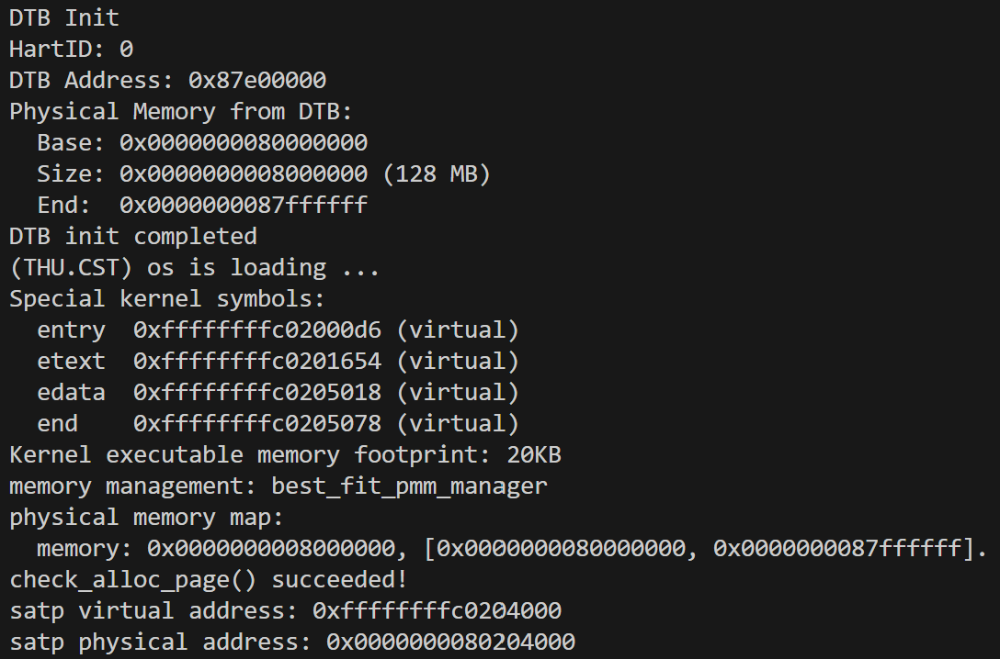
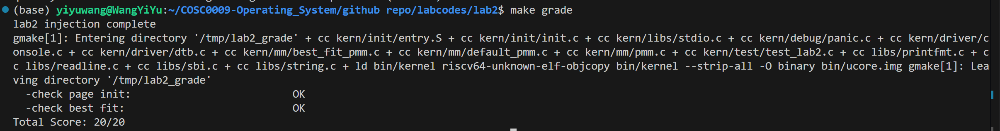

# 操作系统实验报告

## 实验基本信息

| 项目         | 内容                                           |
| ------------ | ---------------------------------------------- |
| **实验名称** | Lab 2:物理内存和页表                           |
| **小组成员** | 2414007-王奕瑜、2414015-鲁昕宁、2411622-张雨函 |
| **完成日期** | 2026-10-20                                     |

### 小组分工

练习如何分工？

|      成员      | 负责的练习/模块 |
| :------------: | :-------------: |
| 2414007-王奕瑜 |                 |
| 2414015-鲁昕宁 |                 |
| 2411622-张雨函 |                 |

实验报告如何分工？

|      成员      | 负责的实验报告内容 |
| :------------: | :----------------: |
| 2414007-王奕瑜 |                    |
| 2414015-鲁昕宁 |                    |
| 2411622-张雨函 |                    |

---

## 一、实验目的

---

## 二、实验环境

你们使用的 AI 工具

|      成员      | AI 编程工具 | 底层模型 | 备注 |
| :------------: | :---------: | :------: | :--: |
| 2414007-王奕瑜 |             |          |      |
| 2414015-鲁昕宁 |             |          |      |
| 2411622-张雨函 |             |          |      |

**说明：**

- **AI 编程工具**：指具体使用的终端工具、编辑器插件、桌面应用或浏览器界面
- **底层模型**：指该工具使用的大语言模型及版本

---

## 三、实验整体逻辑分析

### 3.1 本章节的逻辑主线

### 3.2 功能的逐步实现

#### 3.2.1 物理内存探测与页描述符初始化

本实验首先实现的是物理内存探测与页描述符初始化（`page_init()`），原因有以下几点：

1. **它是所有后续物理内存管理功能的前提。** 无论是 First-Fit、Best-Fit 还是 Buddy System，分配器管理的对象都是"以页为单位的空闲物理内存"。如果内核还不知道有多少物理内存、这些内存位于哪个地址范围，分配器就没有可以管理的对象，`alloc_pages()`/`free_pages()` 也就无从谈起。
2. **操作系统需要为每个物理页记录状态。** 分配算法依赖 `Page` 描述符中的引用计数、`PG_reserved`、`PG_property` 和 `property` 等信息来区分"已被占用"和"空闲"的页面，并把空闲块串成链表。这些描述符必须在分配器工作之前统一建立，并且初始状态应当是"全部保留"，避免尚未规划好的页面被提前分配出去。
3. **必须保护已经被占用的内存。** DRAM 的低地址部分被 OpenSBI 占用，随后是内核镜像，而 `Page` 描述符数组本身也要占用物理内存。如果不在初始化时把这些区域排除，分配器就可能把它们当作空闲页发出去，造成内核代码、数据或描述符被覆盖。同时还需要处理页面对齐、虚拟地址与物理地址的换算（`va_pa_offset`），否则空闲区的起止位置会算错。
4. **它把"硬件信息"和"分配算法"衔接起来。** `page_init()` 从设备树获取内存范围，再通过 `init_memmap()` 把初始空闲区交给当前的 `pmm_manager`，使上层分配算法不必关心内存信息来自何处，只需面向统一的接口实现。

因此，我们先完成物理内存初始化，建立"可管理物理页"的初始状态；之后才能在此基础上理解并实现各种页分配算法，并通过 `check_alloc_page()` 验证分配与释放的正确性。

---

## 四、实验内容与实现

### 4.1 实现物理内存探测与页描述符初始化功能

**负责人：** 2414007-王奕瑜

#### 4.1.1 模块功能描述

**需要实现/修改的函数：**

```c
static void page_init(void);  // kern/mm/pmm.c
```

**功能说明：**

`page_init()`由`pmm_init()`在`init_pmm_manager()`之后调用，是物理内存管理中"硬件信息"与"页分配器"之间的桥梁。它不接收参数，也不返回结果，完成后需要保证：

- **地址换算与内存范围探测：** 设置`va_pa_offset`为内核线性映射的虚实偏移`PHYSICAL_MEMORY_OFFSET`；通过`get_memory_base()`和`get_memory_size()`读取设备树探测到的 DRAM 起始地址和大小，输出`physical memory map`信息；若设备树没有提供有效的内存信息，则`panic`终止初始化。
- **确定可管理上界`npage`：** 以设备树内存末端（不超过内核管理的上界`PHYSICAL_MEMORY_END`）对应的物理页号作为`npage`，描述符需要覆盖`[nbase, npage)`中的每个物理页。
- **建立`Page`描述符数组：** 把`pages`放在内核镜像末尾符号`end`之后的第一个页边界，先将整个数组清零，再把每个描述符都置为保留状态（`PG_reserved`），防止尚未规划好的页面被提前分配。
- **排除已占用内存、注册空闲区：** OpenSBI、内核镜像以及描述符数组本身占用的物理内存都不能分配。函数先用`PADDR()`把描述符数组末尾的虚拟地址换算成物理地址，向上按页对齐得到空闲区起点，把内存末端向下按页对齐得到终点（不足一页的尾部丢弃）；仅当两者之间存在完整页面时，才通过`pa2page()`取得起始描述符并调用`init_memmap()`，把这些页面交给当前`pmm_manager`管理。

初始化完成后的物理内存布局如下：

```text
0x80000000      0x80200000    end(物理)    pages(对齐)     mem_begin             mem_end(对齐)  0x88000000
|   OpenSBI    |  内核镜像    | 对齐空隙 | Page 描述符数组 | 对齐空隙 |   可分配的连续物理页   | 尾部不足一页 |
|<------------------- reserved ------------------------>|          |<---- init_memmap --->|
```

**与其他模块的交互：**

- 依赖`dtb_init()`（`kern/driver/dtb.c`）提前解析设备树并保存内存起点和大小；
- 通过`init_memmap()`调用当前`pmm_manager`的`init_memmap`接口，把初始空闲页交给 First-Fit / Best-Fit 等分配器；
- 之后的`check_alloc_page()`、`alloc_pages()`、`free_pages()`都以这里建立的`pages`、`npage`和空闲区为基础。

#### 4.1.2 最终提示词

以下是经过迭代优化后，最终成功实现该功能的提示词：

````markdown
[PROMPT]
**任务**：修改`kern/mm/pmm.c`，在标有`//lab2 function1 YOUR CODE`的位置实现`static void page_init(void)`，完成物理内存探测与`Page`描述符初始化：根据设备树提供的物理内存信息建立描述符数组，并把排除 OpenSBI、内核镜像和描述符数组占用空间后的完整空闲页面交给当前`pmm_manager`管理。

**操作要求**：你必须在项目中修改实际文件，保留现有代码，只在标记位置补全，不要改动`pmm_init()`等其他函数。将标记注释中的`YOUR CODE`替换为学号`2414007`（保留`lab2 function1`）。为新增代码添加英文 Doxygen 注释，`@author`写`Yiyu Wang(2414007)`。

**输出要求**：直接进行文件操作，使用下面[RELY]、[GUARANTEE]、[SPECIFICATION]部分的信息，以工程真实代码为准，不要引入无关功能。

[RELY]
地址与页面宏：

- `PGSIZE`（4096）、`PGSHIFT`（12）、`PPN(addr)`（`addr >> PGSHIFT`）：`kern/mm/mmu.h`
- `ROUNDUP(a, n)`、`ROUNDDOWN(a, n)`：`libs/defs.h`，结果类型与`a`相同
- `PHYSICAL_MEMORY_OFFSET`（`0xFFFFFFFF40000000`，内核线性映射的虚实偏移）、`PHYSICAL_MEMORY_END`（`0x88000000`，内核管理的物理内存上界）：`kern/mm/memlayout.h`
- `DRAM_BASE`（`0x80000000`）：`libs/riscv.h`
- `PADDR(kva)`：`kern/mm/pmm.h`，把内核虚拟地址转换为物理地址（`kva - va_pa_offset`），`kva`小于`KERNBASE`时 panic

全局变量（`kern/mm/pmm.c`）：

- `struct Page *pages;`——`Page`描述符数组的虚拟起始地址
- `size_t npage;`——内核可管理的物理页号上界（不含）
- `uint64_t va_pa_offset;`——虚拟地址与物理地址之差
- `const size_t nbase;`——DRAM 起始位置对应的物理页号，`DRAM_BASE / PGSIZE`

页描述符与状态宏（`kern/mm/memlayout.h`）：

- `struct Page { int ref; uint64_t flags; unsigned int property; list_entry_t page_link; };`
- `SetPageReserved(page)`、`PageReserved(page)`：设置/测试`PG_reserved`位；该位为 1 表示页面被内核占用，不能参与分配

已有函数：

- `uint64_t get_memory_base(void)`、`uint64_t get_memory_size(void)`（`kern/driver/dtb.h`）：返回设备树中的内存起始物理地址和字节数；设备树无效时返回 0
- `panic(fmt, ...)`（`kern/debug/assert.h`中的宏，输出信息并终止内核）、`int cprintf(const char *fmt, ...)`
- `void *memset(void *s, char c, size_t n)`（`libs/string.h`）
- `static void init_memmap(struct Page *base, size_t n)`（`kern/mm/pmm.c`）：把`base`开始的`n`个页面作为初始空闲区交给当前`pmm_manager`，要求这些页面此时都带有`PG_reserved`
- `static inline struct Page *pa2page(uintptr_t pa)`（`kern/mm/pmm.h`）：返回`&pages[PPN(pa) - nbase]`，`PPN(pa) >= npage`时 panic
- 链接符号`extern char end[];`：内核镜像末尾的**虚拟**地址

物理内存布局（默认 QEMU，DRAM 为`[0x80000000, 0x88000000)`）：

- `[0x80000000, 0x80200000)`被 OpenSBI 占用
- `[0x80200000, end 对应的物理地址)`被内核代码和数据占用
- `Page`数组紧接在内核镜像之后，按页对齐，覆盖物理页号区间`[nbase, npage)`，自身也占用物理内存
- 虚拟地址、物理地址、物理页号和`Page`描述符地址是四种不同的量，不能混用

[GUARANTEE]
必须实现：

```c
static void page_init(void);  // kern/mm/pmm.c
```

`page_init()`不接收参数，也不返回结果，由`pmm_init()`调用。允许新增辅助函数，但必须是`static`的，只在`pmm.c`内部使用，不得改变其他公开接口。

[SPECIFICATION]
**page_init**

- Pre-Condition：`init_pmm_manager()`已经执行，`pmm_manager`已指向某个分配器并完成其`init()`；`dtb_init()`已经执行；内核已通过启动页表在线性映射下运行。
- Post-Condition：`va_pa_offset`、`npage`和`pages`被正确设置；已向控制台输出设备树探测到的物理内存范围；`[nbase, npage)`内的每个页面都有描述符，内核镜像和描述符数组所在的页面保持保留状态且不会进入空闲区；描述符数组之后所有完整的空闲页面已通过`init_memmap()`注册给当前`pmm_manager`。
- Case 1：设备树没有提供有效的物理内存信息。此时无法确定可管理的范围，必须终止初始化，不得继续建立描述符。
- Case 2：设备树信息有效。依次完成：设置虚实偏移；输出探测到的内存范围；根据设备树内存末端和内核可管理的上界确定`npage`；把描述符数组放在内核镜像之后的第一个页边界，并使所有描述符在空闲区建立之前处于保留状态；换算出描述符数组末尾的物理地址，其向上按页对齐作为空闲区起点，设备树内存末端向下按页对齐作为空闲区终点，再把两者之间的页面注册为初始空闲区。
- Case 3：描述符数组之后已没有可用的完整页面（空闲区起点不小于终点）。此时不得调用`init_memmap()`。
- Requirements：
  - 不足一页的内存末尾不能交给分配器。
  - 描述符数组所在内存的初始内容不可假定为零，各描述符的状态必须由本函数显式确定。
  - 比较或传递地址前，必须明确它是虚拟地址还是物理地址，并做相应的转换。
  - 不得修改`best_fit_pmm.c`等其他文件。
````

#### 4.1.3 实现迭代过程

本模块的实现经历了 1 次迭代，过程如下：

---

##### 第一次迭代

使用上述提示词生成`page_init()`后，在 Best-Fit 模块尚未完成的状态下，用本实验提供的测试文件对该函数单独验证：把`tools/test_lab2.c`注入临时目录并运行`make grade`，同时用`make qemu`观察完整启动输出。

> 说明：由于`best_fit_pmm.c`中尚无`best_fit_pmm_manager`，仓库在这一阶段无法直接链接，因此测试在临时副本中进行，副本里仅为`best_fit_pmm.c`补了一个占位用的`best_fit_pmm_manager`（仅为通过链接，不含任何 Best-Fit 逻辑）。第一次运行`make grade`时，占位代码缺少`basic_check()`/`best_fit_check()`依赖的`free_list`和`nr_free`定义，编译报错；这是测试环境的问题，与`page_init()`的提示词无关，补全占位定义后重新运行即可。

**最终结果：**

测试结果：

- ✅ 编译通过
- ✅ `check page init`通过，输出`[Test 1] Page Init: PASS`
- ✅ `make qemu`输出了`physical memory map: memory: 0x0000000008000000, [0x0000000080000000, 0x0000000087ffffff].`，随后`check_alloc_page() succeeded!`，说明空闲区已被`pmm_manager`正确接收，First-Fit 的自检可以在其上正常分配和释放
- ⚠️ `[Test 2] Best-Fit`在这一阶段为`WRONG`，原因是 Best-Fit 属于任务二，尚未实现，不属于本模块

该测试从以下角度检验了`page_init()`：`va_pa_offset`是否等于`PHYSICAL_MEMORY_OFFSET`；`npage`是否等于设备树内存末端的物理页号；`pages`是否非空、页对齐且位于内核`end`之后；空闲页数是否合理；内核镜像尾页和描述符数组所在页面是否仍为保留状态；`page2pa()`与`pa2page()`是否互逆。

本次生成的代码在测试中一次通过，没有需要再调整提示词的问题。

### 4.2 理解first-fit 连续物理内存分配算法

**负责人：** [学号-姓名]

### 4.3 实现 Best-Fit 连续物理内存分配算法

**负责人：** [学号-姓名]

### 4.4 buddy system（伙伴系统）分配算法

**负责人：** [学号-姓名]

---

### 4.5 Challenge：硬件的可用物理内存范围的获取方法

**负责人：** 2414007-王奕瑜

**问题：** 如果 OS 无法提前知道当前硬件的可用物理内存范围，请问你有何办法让 OS 获取可用物理内存范围？

本实验中，内核其实也没有把 128MB 硬编码进去，而是依赖 OpenSBI 通过`a1`寄存器传来的设备树（DTB）。若连这类信息都没有，可以从以下几个层次考虑，优先级从高到低：

1. **向固件/引导程序查询（首选）。** 内存的真实配置在系统上电时就由固件探测过，OS 只需要读取固件提供的结果：
   - **设备树（DTB/FDT）：** RISC-V、ARM 等平台由引导程序传入设备树，`/memory`节点的`reg`属性给出内存的起始地址和长度，`/reserved-memory`节点和 memory reservation block 给出需要避开的区域。这正是本实验使用的方式。
   - **BIOS 的 E820 内存映射：** x86 实模式下可通过`INT 15h, EAX=E820h`反复调用，每次返回一段地址范围及其类型（可用 RAM、保留、ACPI 可回收等）；更老的机器有`INT 15h, AX=E801h/88h`等只返回大小的接口。
   - **UEFI：** 通过`GetMemoryMap()`获得内存描述符数组，其中标明各段的类型和属性。
   - **Multiboot 等引导协议：** 引导器（如 GRUB）把内存映射以数据结构的形式传给内核。
   - **ACPI（如 SRAT/NFIT）：** 在多路、NUMA 或热插拔内存的机器上，补充描述各内存区域的归属和变化。
2. **读取内存控制器或硬件配置寄存器。** 有些嵌入式 SoC 没有设备树，但内存控制器的寄存器（如 DDR 控制器的行列、片选配置）或板级配置寄存器里记录了容量；也可以通过 DIMM 的 SPD 信息读出容量，再结合芯片手册得到地址映射。这种方式依赖具体硬件，通用性差。
3. **自行探测（最后手段）。** 如果前面的信息都拿不到，OS 可以从已知可用的地址（如内核镜像之后）开始，按固定步长（如每 1MB 或每页）向上逐段尝试"写入特征值再读回比较"：
   - 写入的值能读回，说明该地址有 RAM；读不回或总线出错，说明已经越过内存末端或进入空洞；
   - 地址线回绕（别名）时，高位地址会映射到低位地址的同一块 RAM，可以通过"修改一处后检查另一处是否随之改变"来发现容量上限；
   - 探测前应先保存原有内容，探测后恢复，并避开内核、固件和栈所在的区域。

   这种方法有明显的风险：向 MMIO 区域写入会触发外设副作用；访问不存在的地址可能产生访问异常或总线错误，因此需要提前设置异常处理程序，把这类异常当作"该地址无内存"；探测只能判断"能不能读写"，无法区分保留区与普通内存，也无法发现被固件占用的区域，所以通常只作为兜底。

4. **探测之后还要排除不可用的部分。** 无论用哪种方式得到物理内存范围，都要再扣除 OpenSBI/固件、内核镜像、`Page`描述符数组、设备树本身（读完后可回收）、initrd 等已被占用的区域，这与`page_init()`的处理一致。

综上，最可靠的做法是让固件/引导程序以标准格式（设备树、E820、UEFI memory map 等）告诉内核；只有在没有任何此类信息时，才退而采用带异常保护的写读探测。

### 4.6 Challenge：任意大小的内存单元 slub 分配算法

**负责人：** [学号-姓名]

---

## 五、测试与验证

### 5.1 物理内存探测、页描述符初始化与 Best-Fit 分配器综合测试

**负责人：** 2414007-王奕瑜

#### 5.1.1 测试目的

`make grade`使用的测试文件`tools/test_lab2.c`同时覆盖了本实验的两项核心功能，因此本节是对它们的综合验证：

- **Test 1（Page Init）：** 验证`page_init()`是否正确探测物理内存范围、建立`Page`描述符数组并划分出空闲区；
- **Test 2（Best-Fit）：** 验证在该空闲区之上，Best-Fit 分配器的分配、释放与合并是否符合"选择最小的足够大空闲块"的策略。

同时通过`make qemu`观察完整的启动输出，人工核对内存探测结果与内核自检结果。

#### 5.1.2 测试环境

- 运行环境：QEMU（`qemu-system-riscv64`）+ OpenSBI，默认 128MB 内存；
- 分配器：`best_fit_pmm_manager`（`init_pmm_manager()`中选用）；
- 代码状态：`page_init()`与 Best-Fit 均已实现，在完整仓库中直接构建。

#### 5.1.3 测试步骤与结果

**步骤 1：编译并运行内核，观察启动输出**

```bash
make qemu
```

与本功能相关的输出如下（QEMU 通过`Ctrl+A` 再按`X`退出）：

```text
DTB init completed
(THU.CST) os is loading ...
Special kernel symbols:
  entry  0xffffffffc02000d6 (virtual)
  etext  0xffffffffc0201654 (virtual)
  edata  0xffffffffc0205018 (virtual)
  end    0xffffffffc0205078 (virtual)
Kernel executable memory footprint: 20KB
memory management: best_fit_pmm_manager
physical memory map:
  memory: 0x0000000008000000, [0x0000000080000000, 0x0000000087ffffff].
check_alloc_page() succeeded!
satp virtual address: 0xffffffffc0204000
satp physical address: 0x0000000080204000
```



**步骤 2：运行评分测试**

```bash
make grade
```

该命令把测试文件注入内核后重新编译并运行，输出如下：

```text
  -check page init:                          OK
  -check best fit:                           OK
Total Score: 20/20
```



#### 5.1.4 结果分析

1. **内存范围探测正确。** `Physical Memory from DTB`与`physical memory map`两处输出一致：DRAM 起始地址为`0x80000000`，大小为`0x08000000`（128MB），末端为`0x87ffffff`，与 QEMU 默认配置相符。这说明`page_init()`通过`get_memory_base()`/`get_memory_size()`读到了`dtb_init()`保存的结果，并正确计算了范围末端。
2. **内存布局与手工计算一致。** 以本次运行为例：
   - `end = 0xffffffffc0205078`，向上按页对齐后`pages`位于虚拟地址`0xffffffffc0206000`，对应物理地址`0x80206000`；
   - `npage - nbase = 0x88000 - 0x80000 = 32768`个页面，每个`struct Page`占 40 字节，描述符数组共`0x140000`字节（1280KB），末尾为物理地址`0x80346000`，已按页对齐；
   - 因此空闲区为`[0x80346000, 0x88000000)`，共`0x7cba = 31930`页，约 124.7MB。
   - 内核镜像和描述符数组所在页面保持保留，没有进入空闲链表。
3. **Test 1 通过，说明初始化满足设计约束。** `[Test 1] Page Init: PASS`表示：`va_pa_offset`等于`PHYSICAL_MEMORY_OFFSET`、`npage`等于设备树内存末端的物理页号、`pages`页对齐并位于`end`之后、空闲页数大于 0 且不超过总页数、内核尾页和描述符数组所在页保持保留，以及`page2pa()`与`pa2page()`互逆。
4. **Test 2 通过，说明 Best-Fit 在该空闲区上工作正常。** `memory management: best_fit_pmm_manager`表明当前使用的是 Best-Fit；`check_alloc_page() succeeded!`说明其内置自检（`basic_check()`与`best_fit_check()`）通过；`check best fit: OK`进一步验证了 Best-Fit 的选择策略。Test 2 依赖`page_init()`建立的描述符与空闲链表，它的通过也从侧面印证了初始化的正确性。
5. **综合结论。** 两项评分均为 OK，总分 20/20，物理内存探测、页描述符初始化与 Best-Fit 分配器三者能够协同工作，本部分功能符合预期。

> 注：地址和空闲页数等具体数值会随内核镜像大小变化，代码修改后重新运行会略有不同，属于正常现象。

---

## 六、实验总结与收获

### 6.1 对操作系统的理解

### 6.2 AI 协作开发的经验

---
