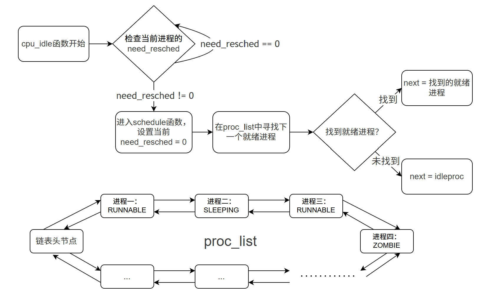

## lab4: 进程管理

在前面的实验中，我们已经完成了物理内存管理和基础页表机制的实现，使内核具备了对物理内存页的分配与管理能力，并能够建立起虚拟地址到物理地址的基本映射结构。本实验将在此基础上进一步扩展，完成以下两方面内容：首先，通过引入虚拟内存描述结构，管理进程或线程的虚拟地址空间布局，为每个执行实体提供逻辑上的运行空间；其次，本实验将实现线程控制块、上下文切换和调度器等内容，从而实现多线程并发执行，使内核能够调度多个执行实体轮流使用 CPU 运行。

## 实验目的

- 了解虚拟内存管理的基本结构，掌握虚拟内存的组织与管理方式
- 了解内核线程创建/执行的管理过程
- 了解内核线程的切换和基本调度过程

## 实验内容

在前面的实验中，我们已经完成了物理内存管理和基础页表机制的实现，使内核具备了对物理内存页的分配与管理能力，并能够建立起虚拟地址到物理地址的基本映射结构。但当前系统仍然只能以单一执行流的方式运行，无法并发执行多个任务，也尚未体现虚拟内存机制在进程或线程隔离中的作用。

本实验将在此基础上进一步扩展，完成以下两方面内容：

首先，**进一步完善虚拟内存管理，实现基本的地址空间结构**。通过引入虚拟内存描述结构，管理进程或线程的虚拟地址空间布局，为每个执行实体提供逻辑上的运行空间。与后续实验中的缺页异常和页面置换不同，本实验中的虚拟内存仍采用**预映射方式**，即在建立地址空间时一次性完成所有需要的页表映射，不涉及按需分配或页面置换。

其次，**引入内核线程机制，实现多执行流并发运行能力**。内核线程是一种特殊形式的“进程”。当一个程序加载到内存中运行时，首先通过ucore OS的内存管理子系统分配合适的空间，然后就需要考虑如何分时使用CPU来“并发”执行多个程序，让每个运行的程序（这里用线程或进程表示）“感到”它们各自拥有“自己”的CPU。本实验将实现线程控制块、上下文切换和调度器等内容，从而实现多线程并发执行，使内核能够调度多个执行实体轮流使用 CPU 运行。

内核线程与用户进程的区别如下：

| 比较项   | 内核线程         | 用户进程                   |
| -------- | ---------------- | -------------------------- |
| 运行模式 | 仅在内核态运行   | 在用户态和内核态之间切换   |
| 地址空间 | 共享内核地址空间 | 拥有独立的用户虚拟地址空间 |

通过本实验，系统将从“单一执行流的内核”发展为“支持多线程调度的内核”，并完成基本的虚拟内存环境框架搭建，为后续实现用户进程、系统调用、缺页异常处理和页面置换等功能奠定基础。

需要注意的是，在ucore的调度和执行管理中，**对线程和进程做了统一的处理**。且由于ucore内核中的所有内核线程共享一个内核地址空间和其他资源，所以这些内核线程从属于同一个唯一的内核进程，即ucore内核本身。

### 练习

本实验按“虚拟内存页操作 -> 进程创建与初始化 -> 进程调度”三条主线展开，核心目标是让内核从“已经具备物理内存管理和基础页表能力”进一步走到“能够创建线程、登记线程、调度线程并完成上下文切换”。对应的执行链可以概括为 `kern_init -> pmm_init -> pic_init/idt_init -> vmm_init -> proc_init -> cpu_idle -> schedule -> proc_run -> switch_to`，其中前半段负责把地址空间准备好，后半段负责让第一个可运行线程真正跑起来。

本实验依赖实验2/3。请使用你此前设计的提示词生成相应实验代码，并将生成结果填写到本实验代码中标有“lab2”/“lab3”注释的对应位置，确保代码能够正确编译。

#### 功能模块一：虚拟内存页操作功能（设计提示词借助 ai 完成）

要求实现的函数有：

```c
int page_insert(pde_t *pgdir, struct Page *page, uintptr_t la, uint32_t perm);(kern/mm/pmm.c)
void page_remove(pde_t *pgdir, uintptr_t la);(kern/mm/pmm.c)
```

整个功能模块的具体功能为：这个模块负责在现有多级页表框架上完成最基本的映射维护，也就是把物理页挂到指定线性地址上，以及把已有映射安全地撤销掉。`page_insert` 负责建立或更新映射，`page_remove` 负责删除映射，它们共同决定一个线性地址最终对应哪一页物理内存，同时也决定物理页引用计数是否正确、页表状态是否一致、TLB 是否需要失效。这个模块完成后，页表测试、静态内核映射检查以及后续线程地址空间相关逻辑才有可靠基础。

整个功能模块的注意事项为：这里最关键的是保持“页表项内容、物理页引用计数、TLB 状态”三者同步。`page_insert` 不能简单覆盖旧项，而要正确处理原地址已经映射到同一物理页、或者原地址已经映射到其他物理页这两种情况；`page_remove` 也不能假定目标地址一定存在有效映射。由于 `get_pte(pgdir, la, 1)` 可能需要分配中间级页表页，所以映射建立过程本身可能失败，调用路径必须能正确返回错误并保持系统状态干净。所有页表更新完成后都要考虑对应 TLB 失效，否则测试中会出现看似已更新、实际上仍在使用旧翻译结果的情况。

整个功能模块应该满足的对外的接口为：对外只需要提供“建立映射”和“撤销映射”两个动作。`page_insert` 成功时应让指定线性地址稳定映射到目标物理页，并把权限位设置为调用者要求的状态；失败时应返回 `-E_NO_MEM`，且不能留下半完成映射。`page_remove` 则应作为一个幂等删除接口存在，目标地址有映射时删除映射、无映射时安静返回，不应把“未映射地址”当作异常情况。

整个功能模块可以借助的接口函数、结构体、数据结构为：这个模块主要依赖 `get_pte()`、`pte_create()`、`pte2page()`、`page_ref_inc()`、`page_ref_dec()`、`set_page_ref()`、`alloc_page()`、`free_page()`、`tlb_invalidate()`、`flush_tlb()` 等现成接口，也依赖 `pde_t`、`pte_t`、`struct Page`、`pages`、`boot_pgdir_va` 以及页表权限位宏 `PTE_V`、`PTE_U`、`PTE_W`、`PTE_R`。其中 `get_pte()` 负责定位目标页表项，后续两个函数则在此基础上完成映射建立和映射删除。

#### 功能模块二：进程创建及初始化功能（设计提示词借助 ai 完成）

要求实现的函数有：

```c
static struct proc_struct *alloc_proc(void);(kern/process/proc.c)
void proc_init(void);(kern/process/proc.c)
int kernel_thread(int (*fn)(void *), void *arg, uint32_t clone_flags);(kern/process/proc.c)
int do_fork(uint32_t clone_flags, uintptr_t stack, struct trapframe *tf);(kern/process/proc.c)
static void copy_thread(struct proc_struct *proc, uintptr_t esp, struct trapframe *tf);(kern/process/proc.c)
static int copy_mm(uint32_t clone_flags, struct proc_struct *proc);(kern/process/proc.c)
```

整个功能模块的具体功能为：这个模块负责把系统中“已经能运行内核代码”推进到“已经能创建并登记多个内核线程”。`alloc_proc` 负责得到一个干净的进程控制块，`proc_init` 负责把当前执行现场包装成 `idleproc` 并创建第一个真正的内核线程 `initproc`，`kernel_thread` 负责把函数入口和参数整理成线程首次运行所需的临时上下文，`do_fork` 负责把这些信息和内核栈、PID、链表、状态位等资源真正组合成一个可运行实体，`copy_thread` 负责把 trapframe 和 context 安放到新线程自己的内核栈上，而 `copy_mm` 则在当前实验阶段承担地址空间处理接口的占位作用。这个模块完成后，系统里至少要存在 `idleproc` 和 `initproc` 两个关键线程，并且 `initproc` 需要能够在后续调度中被真正切换执行。

整个功能模块的注意事项为：这里最容易出错的是“线程生命周期状态”和“资源挂接顺序”不一致。`alloc_proc` 必须把 PCB 置于安全空白状态，避免后续代码误用未初始化字段；`proc_init` 中的 `idleproc` 并不是普通 fork 出来的线程，而是直接复用当前执行现场，所以它的 PID、内核栈、调度标记和 `current` 位置都带有特殊含义；`kernel_thread` 与 `copy_thread` 必须配合 `forkret`、`forkrets`、`__trapret` 形成正确的首次运行链路；`do_fork` 则必须正确处理失败清理、PID 分配、链表挂接和唤醒顺序，否则会出现资源泄漏、僵尸结构或线程状态错误。当前阶段的 `copy_mm` 不做真正的用户地址空间复制，但仍需要维持函数形态完整，方便后续实验继续扩展。

整个功能模块应该满足的对外的接口为：这个模块提供的是“线程从哪里来、如何进入系统、如何第一次运行”的完整外部接口。`alloc_proc` 应返回一个已完成基础字段初始化的 PCB；`proc_init` 执行后应保证进程管理全局结构、`idleproc`、`current` 和 `initproc` 都处于可用状态；`kernel_thread` 应把普通函数包装成可创建线程的上下文并返回新线程 PID；`do_fork` 应返回新线程 PID 或负错误码；`copy_thread` 与 `copy_mm` 则作为内部辅助接口，分别负责首次运行现场和地址空间处理。

整个功能模块可以借助的接口函数、结构体、数据结构为：这个模块主要依赖 `struct proc_struct`、`struct context`、`struct trapframe`、`list_entry_t`、`proc_list`、`hash_list`、`idleproc`、`initproc`、`current`、`nr_process` 等核心数据结构和全局变量，也依赖 `kmalloc()`、`kfree()`、`memset()`、`memcpy()`、`alloc_pages()`、`free_pages()`、`page2kva()`、`kva2page()`、`set_proc_name()`、`find_proc()`、`get_pid()`、`wakeup_proc()`、`list_init()`、`list_add()`、`boot_pgdir_pa`、`bootstack`、`read_csr(sstatus)`、`SSTATUS_SPP`、`SSTATUS_SPIE`、`SSTATUS_SIE`、`kernel_thread_entry`、`forkret`、`forkrets` 等已有接口与符号。

#### 功能模块三：进程调度（设计提示词借助 ai 完成）

要求实现的函数有：

```c
void cpu_idle(void);(kern/process/proc.c)
void schedule(void);(kern/schedule/sched.c)
void proc_run(struct proc_struct *proc);(kern/process/proc.c)
void switch_to(struct context *from, struct context *to);(kern/process/switch.s)
```

整个功能模块的具体功能为：这个模块负责把已经创建出来的内核线程真正交给 CPU 执行。`cpu_idle` 作为空闲线程的执行主体，持续等待调度需求；`schedule` 负责从进程链表中选出下一个可运行线程；`proc_run` 负责在安全的临界区内切换当前线程、页表和执行现场；`switch_to` 则负责最底层的寄存器上下文保存与恢复。这个模块完成后，系统不再只是“拥有线程对象”，而是已经具备让 `initproc` 从 `idleproc` 手中接管 CPU 的能力。

整个功能模块的注意事项为：这里最重要的是切换过程必须保持原子性。`schedule` 和 `proc_run` 都需要在关键区域内避免被中断打断，否则当前线程、页表和实际执行现场之间可能出现不一致。`schedule` 负责选择正确的 runnable 线程，并在找不到可运行线程时退回 `idleproc`；`proc_run` 负责更新 `current`、切换页表并调用 `switch_to`；`switch_to` 只做上下文保存和恢复，不参与调度策略判断。新线程第一次运行时之所以能走到正确入口，是因为前一个模块已经把它的 `context.ra` 和 `trapframe` 预先组织成了 `forkret -> forkrets -> __trapret` 这条恢复链路。

整个功能模块应该满足的对外的接口为：对外而言，`cpu_idle` 应持续作为空闲循环存在，检测到需要重调度时调用 `schedule`；`schedule` 应完成一次合法的调度选择并触发进程切换；`proc_run` 应让目标线程成为当前运行线程并完成页表切换；`switch_to` 则应根据两个 `struct context` 指针完成从旧线程到新线程的寄存器状态迁移。

整个功能模块可以借助的接口函数、结构体、数据结构为：这个模块主要依赖 `struct proc_struct`、`struct context`、`read_csr()`、`write_csr()`、`SATP_MODE_SV39`、`RISCV_PGSHIFT`、`boot_pgdir_pa`、`flush_tlb()`、`proc_list`、`current`、`idleproc`、`need_resched`、`runs`、`PROC_RUNNABLE`、`local_intr_save()`、`local_intr_restore()`、`switch_to()`、`list_next()`、`le2proc()` 以及 `forkret`、`forkrets`、`__trapret` 这一条首次运行恢复链路。注意 `libs/riscv.h` 中的 `lsatp()` 是 Sv32 遗留，无法表达 Sv39 的 satp，本实验中不可用；`kern/mm/pmm.c` 中的 `enable_paging()` 为正确写法参照。

#### 扩展练习 Challenge

1.  说明语句 `local_intr_save(intr_flag); ... local_intr_restore(intr_flag);` 是如何实现开关中断的。
2.  深入理解不同分页模式的工作原理（思考题）。

`get_pte()` 函数位于 `kern/mm/pmm.c`，用于在页表中查找或创建页表项，从而实现对指定线性地址对应的物理页的访问和映射操作。这在操作系统的分页机制下，是虚拟内存与物理内存建立映射关系的关键基础。

- `get_pte()` 函数中有两段形式类似的代码，结合 `sv32`、`sv39`、`sv48` 的异同，解释这两段代码为什么如此相像。
- 目前 `get_pte()` 函数将页表项查找和页表页分配合并在一个函数里，你认为这种写法好吗？有没有必要把两个功能拆开？

### 项目组成

```
├── Makefile
├── kern
│   ├── debug
│   │   ├── assert.h
│   │   ├── kdebug.c
│   │   ├── kdebug.h
│   │   ├── kmonitor.c
│   │   ├── kmonitor.h
│   │   ├── panic.c
│   │   └── stab.h
│   ├── driver
│   │   ├── clock.c
│   │   ├── clock.h
│   │   ├── console.c
│   │   ├── console.h
│   │   ├── dtb.c
│   │   ├── dtb.h
│   │   ├── intr.c
│   │   ├── intr.h
│   │   ├── kbdreg.h
│   │   ├── picirq.c
│   │   └── picirq.h
│   ├── init
│   │   ├── entry.S
│   │   └── init.c
│   ├── libs
│   │   ├── readline.c
│   │   └── stdio.c
│   ├── mm
│   │   ├── default_pmm.c
│   │   ├── default_pmm.h
│   │   ├── kmalloc.c
│   │   ├── kmalloc.h
│   │   ├── memlayout.h
│   │   ├── mmu.h
│   │   ├── pmm.c
│   │   ├── pmm.h
│   │   ├── vmm.c
│   │   └── vmm.h
│   ├── process
│   │   ├── entry.S
│   │   ├── proc.c
│   │   ├── proc.h
│   │   └── switch.S
│   ├── schedule
│   │   ├── sched.c
│   │   └── sched.h
│   ├── sync
│   │   └── sync.h
│   └── trap
│       ├── trap.c
│       ├── trap.h
│       └── trapentry.S
├── libs
│   ├── atomic.h
│   ├── defs.h
│   ├── elf.h
│   ├── error.h
│   ├── hash.h
│   ├── list.h
│   ├── printfmt.c
│   ├── riscv.h
│   ├── sbi.h
│   ├── stdarg.h
│   ├── stdio.h
│   ├── stdlib.h
│   ├── string.c
│   └── string.h
└── tools
    ├── boot.ld
    ├── function.mk
    ├── gdbinit
    ├── grade.sh
    ├── kernel.ld
    ├── sign.c
    └── vector.c
```

相对与实验三，实验四中主要改动如下：

- kern/process/ （新增进程管理相关文件）
  - proc.[ch]：新增：实现进程、线程相关功能，包括：创建进程/线程，初始化进程/线程，处理进程/线程退出等功能
  - entry.S：新增：内核线程入口函数kernel_thread_entry的实现
  - switch.S：新增：上下文切换，利用堆栈保存、恢复进程上下文
- kern/init/
  - init.c：修改：完成虚拟内存管理初始化和进程系统初始化，并在内核初始化后切入idle进程
- kern/mm/
  - kmalloc.[ch]：新增：定义和实现了新的kmalloc/kfree函数。具体实现是基于slab分配的简化算法 （基本上与本次实验没有太直接的联系，了解kmalloc和kfree如何使用即可）。
  - memlayout.h：增加slab物理内存分配相关的定义与宏 （可不用理会）。
  - pmm.[ch]：修改：加入完整的页表管理功能（get_pte/page_insert/page_remove等），实现虚拟内存映射与地址转换；在pmm.c中添加了调用kmalloc_init函数,取消了老的kmalloc/kfree的实现；在pmm.h中取消了老的kmalloc/kfree的定义
  - vmm.[ch]：新增：定义并实现虚拟内存区域（VMA）管理，包括 mm_struct（内存管理结构）和 vma_struct（虚拟内存区域结构），提供 VMA 的创建、查找、插入和销毁等功能
- kern/trap/
  - trapentry.S：增加了汇编写的函数forkrets，用于do_fork调用的返回处理。
- kern/schedule/
  - sched.[ch]：新增：实现FIFO策略的进程调度

## 虚拟内存管理

### 基本原理概述

#### 虚拟内存

什么是虚拟内存？简单地说是指程序员或CPU“看到”的内存。但有几点需要注意：

1.  虚拟内存单元不一定有实际的物理内存单元对应，即实际的物理内存单元可能不存在；
2.  如果虚拟内存单元对应有实际的物理内存单元，那二者的地址一般是不相等的；
3.  通过操作系统实现的某种内存映射可建立虚拟内存与物理内存的对应关系，使得程序员或CPU访问的虚拟内存地址会自动转换为一个物理内存地址。

那么这个“**虚拟**”的作用或意义在哪里体现呢？在操作系统中，虚拟内存其实包含多个虚拟层次，在不同的层次体现了不同的作用。首先，在有了**分页机制**后，程序员或CPU“看到”的地址已经不是实际的物理地址了，这已经有一层虚拟化，我们可简称为**内存地址虚拟化**。有了**内存地址虚拟化**，我们就可以通过设置**页表项**来限定软件运行时的访问空间，确保软件运行不越界，完成**内存访问保护**的功能。

通过内存地址虚拟化，可以使得软件在没有访问某虚拟内存地址时不分配具体的物理内存，而只有在实际访问某虚拟内存地址时，操作系统再动态地分配物理内存，建立虚拟内存到物理内存的页映射关系，这种技术称为**按需分页**（demand paging）。把不经常访问的数据所占的内存空间临时写到硬盘上，这样可以腾出更多的空闲内存空间给经常访问的数据；当CPU访问到不经常访问的数据时，再把这些数据从硬盘读入到内存中，这种技术称为**页换入换出**（page　swap in/out）~~，但是这段我们目前的ucore中还没有实现~~。这种内存管理技术给了程序员更大的内存“空间”，从而可以让更多的程序在内存中并发运行。

### 页表项设计思路

我们定义一些对sv39页表项（Page Table Entry）进行操作的宏。这里的定义和我们在Lab2里介绍的定义一致。

有时候我们把多级页表中较高级别的页表（“页表的页表”）叫做`Page Directory`。在实验二中我们知道sv39中采用的是三级页表，那么在这里我们把页表项里从高到低三级页表的页码分别称作PDX1, PDX0和PTX(Page Table Index)。

```c
// kern/mm/mmu.h
#ifndef __KERN_MM_MMU_H__
#define __KERN_MM_MMU_H__

#ifndef __ASSEMBLER__
#include <defs.h>
#endif /* !__ASSEMBLER__ */

// A linear address 'la' has a four-part structure as follows:
//
// +--------9-------+-------9--------+-------9--------+---------12----------+
// | Page Directory | Page Directory |   Page Table   | Offset within Page  |
// |     Index 1    |    Index 2     |                |                     |
// +----------------+----------------+----------------+---------------------+
//  \-- PDX1(la) --/ \-- PDX0(la) --/ \--- PTX(la) --/ \---- PGOFF(la) ----/
//  \-------------------PPN(la)----------------------/
//
// The PDX1, PDX0, PTX, PGOFF, and PPN macros decompose linear addresses as shown.
// To construct a linear address la from PDX(la), PTX(la), and PGOFF(la),
// use PGADDR(PDX(la), PTX(la), PGOFF(la)).

// RISC-V uses 39-bit virtual address to access 56-bit physical address!
// Sv39 virtual address:
// +----9----+----9---+----9---+---12--+
// |  VPN[2] | VPN[1] | VPN[0] | PGOFF |
// +---------+----+---+--------+-------+
//
// Sv39 physical address:
// +----26---+----9---+----9---+---12--+
// |  PPN[2] | PPN[1] | PPN[0] | PGOFF |
// +---------+----+---+--------+-------+
//
// Sv39 page table entry:
// +----26---+----9---+----9---+---2----+-------8-------+
// |  PPN[2] | PPN[1] | PPN[0] |Reserved|D|A|G|U|X|W|R|V|
// +---------+----+---+--------+--------+---------------+

// page directory index
#define PDX1(la) ((((uintptr_t)(la)) >> PDX1SHIFT) & 0x1FF)
#define PDX0(la) ((((uintptr_t)(la)) >> PDX0SHIFT) & 0x1FF)

// page table index
#define PTX(la) ((((uintptr_t)(la)) >> PTXSHIFT) & 0x1FF)

// page number field of address
#define PPN(la) (((uintptr_t)(la)) >> PTXSHIFT)

// offset in page
#define PGOFF(la) (((uintptr_t)(la)) & 0xFFF)

// construct linear address from indexes and offset
#define PGADDR(d1, d0, t, o) ((uintptr_t)((d1) << PDX1SHIFT | (d0) << PDX0SHIFT | (t) << PTXSHIFT | (o)))

// address in page table or page directory entry
// 把页表项里存储的地址拿出来
#define PTE_ADDR(pte)   (((uintptr_t)(pte) & ~0x3FF) << (PTXSHIFT - PTE_PPN_SHIFT))
#define PDE_ADDR(pde)   PTE_ADDR(pde)

/* page directory and page table constants */
#define NPDEENTRY       512                    // page directory entries per page directory
#define NPTEENTRY       512                    // page table entries per page table

#define PGSIZE          4096                    // bytes mapped by a page
#define PGSHIFT         12                      // log2(PGSIZE)
#define PTSIZE          (PGSIZE * NPTEENTRY)    // bytes mapped by a page directory entry
#define PTSHIFT         21                      // log2(PTSIZE)

#define PTXSHIFT        12                      // offset of PTX in a linear address
#define PDX0SHIFT       21                      // offset of PDX0 in a linear address
#define PDX1SHIFT       30                      // offset of PDX0 in a linear address
#define PTE_PPN_SHIFT   10                      // offset of PPN in a physical address

// page table entry (PTE) fields
#define PTE_V     0x001 // Valid
#define PTE_R     0x002 // Read
#define PTE_W     0x004 // Write
#define PTE_X     0x008 // Execute
#define PTE_U     0x010 // User
```

上述代码定义了一些与内存管理单元（Memory Management Unit, MMU）相关的宏和常量，用于操作线性地址和物理地址，以及页表项的字段。

### 使用多级页表实现虚拟存储

要实现虚拟存储，页表必须常驻内存，并且支持按需建立、更新和撤销映射。这里最重要的接口是 `page_insert()`、`page_remove()`、`page_remove_pte()` 和 `get_pte()`，它们都位于 `kern/mm/pmm.c` 中。

这部分的重点不在于记住某一段固定代码，而在于理解这些函数之间的分工：`get_pte()` 负责定位页表项，必要时创建中间级页表；`page_insert()` 负责把物理页挂到指定线性地址上，并同步更新权限和引用计数；`page_remove()` 与 `page_remove_pte()` 则负责撤销映射并清理旧状态。实现时要特别注意引用计数和 TLB 刷新，否则映射关系可能和页表内容不同步。

在调试 `check_pgdir()` 一类测试时，重点应该放在三件事上：映射是否真的建立成功、同一物理页被多次映射时引用计数是否正确、以及删除映射后旧页表项是否被彻底清掉。理解这些现象，比机械记住某一段代码更重要。

下面给出 `check_pgdir()` 的测试片段，便于结合现象理解页表接口的作用：

```c
static void check_pgdir(void) {
    // assert(npage <= KMEMSIZE / PGSIZE);
    // The memory starts at 2GB in RISC-V
    // so npage is always larger than KMEMSIZE / PGSIZE
    assert(npage <= KERNTOP / PGSIZE);
    //boot_pgdir是页表的虚拟地址
    assert(boot_pgdir != NULL && (uint32_t)PGOFF(boot_pgdir) == 0);
    assert(get_page(boot_pgdir, 0x0, NULL) == NULL);
    //get_page()尝试找到虚拟内存0x0对应的页，现在当然是没有的，返回NULL

    struct Page *p1, *p2;
    p1 = alloc_page();//拿过来一个物理页面
    assert(page_insert(boot_pgdir, p1, 0x0, 0) == 0);//把这个物理页面通过多级页表映射到0x0
    pte_t *ptep;
    assert((ptep = get_pte(boot_pgdir, 0x0, 0)) != NULL);
    assert(pte2page(*ptep) == p1);
    assert(page_ref(p1) == 1);

    ptep = (pte_t *)KADDR(PDE_ADDR(boot_pgdir[0]));
    ptep = (pte_t *)KADDR(PDE_ADDR(ptep[0])) + 1;
    assert(get_pte(boot_pgdir, PGSIZE, 0) == ptep);
    //get_pte查找某个虚拟地址对应的页表项，如果不存在这个页表项，会为它分配各级的页表

    p2 = alloc_page();
    assert(page_insert(boot_pgdir, p2, PGSIZE, PTE_U | PTE_W) == 0);
    assert((ptep = get_pte(boot_pgdir, PGSIZE, 0)) != NULL);
    assert(*ptep & PTE_U);
    assert(*ptep & PTE_W);
    assert(boot_pgdir[0] & PTE_U);
    assert(page_ref(p2) == 1);

    assert(page_insert(boot_pgdir, p1, PGSIZE, 0) == 0);
    assert(page_ref(p1) == 2);
    assert(page_ref(p2) == 0);
    assert((ptep = get_pte(boot_pgdir, PGSIZE, 0)) != NULL);
    assert(pte2page(*ptep) == p1);
    assert((*ptep & PTE_U) == 0);

    page_remove(boot_pgdir, 0x0);
    assert(page_ref(p1) == 1);
    assert(page_ref(p2) == 0);

    page_remove(boot_pgdir, PGSIZE);
    assert(page_ref(p1) == 0);
    assert(page_ref(p2) == 0);

    assert(page_ref(pde2page(boot_pgdir[0])) == 1);
    free_page(pde2page(boot_pgdir[0]));
    boot_pgdir[0] = 0;//清除测试的痕迹

    cprintf("check_pgdir() succeeded!\n");
}
```

在 `entry.S` 中，我们虽然构造了一个简单映射使得内核能够运行在虚拟空间上，但是这个映射是比较粗糙的。

我们知道一个程序通常含有下面几段：

- `.text`段：存放代码，需要是可读、可执行的，但不可写。
- `.rodata` 段：存放只读数据，顾名思义，需要可读，但不可写亦不可执行。
- `.data` 段：存放经过初始化的数据，需要可读、可写。
- `.bss`段：存放经过零初始化的数据，需要可读、可写。与 `.data` 段的区别在于由于我们知道它被零初始化，因此在可执行文件中可以只存放该段的开头地址和大小而不用存全为 0的数据。在执行时由操作系统进行处理。

我们看到各个段需要的访问权限是不同的。但是现在使用一个大大页(Giga Page)进行映射时，它们都拥有相同的权限，那么在现在的映射下，我们甚至可以修改内核 `.text` 段的代码，因为我们通过一个标志位 `W=1` 的页表项就可以完成映射，但这显然会带来安全隐患。

因此，我们考虑对这些段分别进行重映射，使得他们的访问权限可以被正确设置。虽然还是每个段都还是映射以同样的偏移量映射到相同的地方，但实现过程需要更加精细。

这里还有一个小坑：对于我们最开始已经用特殊方式映射的一个大大页(Giga Page)，该怎么对那里面的地址重新进行映射？这个过程比较麻烦。但大家可以基本理解为放弃现有的页表，直接新建一个页表，在新页表里面完成重映射，然后把satp指向新的页表，这样就实现了重新映射。

## 内核线程管理

在真正进入本节的讨论前，我们先来谈一谈何为进程，为什么需要进程。

### 进程与线程

在操作系统中，我们经常谈到的两个概念就是进程与线程的概念。这两个概念虽然有许多相似的地方，但也有很多的不同。

我们平时编写的源代码，经过编译器编译就变成了可执行文件，我们管这一类文件叫做**程序**。而当一个程序被用户或操作系统启动，分配资源，装载进内存开始执行后，它就成为了一个**进程**。进程与程序之间最大的不同在于进程是一个“正在运行”的实体，而程序只是一个不动的文件。进程包含程序的内容，也就是它的静态的代码部分，也包括一些在运行时在可以体现出来的信息，比如堆栈，寄存器等数据，这些组成了进程“正在运行”的特性。

如果我们只关注于那些“正在运行”的部分，我们就从进程当中剥离出来了**线程**。一个进程可以对应一个线程，也可以对应很多线程。这些线程之间往往具有相同的代码，共享一块内存，但是却有不同的CPU执行状态。相比于线程，进程更多的作为一个资源管理的实体（因为操作系统分配网络等资源时往往是基于进程的），这样线程就作为可以被调度的最小单元，给了调度器更多的调度可能。

### 我们为什么需要进程

进程的一个重要特点在于其可以调度。在我们操作系统启动的时候，操作系统相当是一个初始的进程。之后，操作系统会创建不同的进程负责不同的任务。用户可以通过命令行启动进程，从而使用计算机。想想如果没有进程会怎么样？所有的代码可能需要在操作系统编译的时候就打包在一块，安装软件将变成一件非常难的事情，这显然对于用户使用计算机是不利的。

另一方面，从2000年开始，CPU越来越多的使用多核心的设计。这主要是因为芯片设计师们发现在一个核心上提高主频变得越来越难（这其中有许多原因，相信组成原理课上已经有过介绍），所以采用多个核心，将利用多核性能的任务交给了程序员。在这种环境下，操作系统也需要进行相应的调整，以适应这种多核的趋势。使用进程的概念有助于各个进程同时的利用CPU的各个核心，这是单进程系统往往做不到的。

但是，多进程的引入其实远早于多核心处理器。在计算机的远古时代，存在许多“巨无霸”计算机。但是，如果只让这些计算机服务于一个用户，有时候又有点浪费。有没有可能让一个计算机服务于多个用户呢（哪怕只有一个核心）？分时操作系统解决了这个问题，就是通过时间片轮转的方法使得多个用户可以“同时”使用计算资源。这个时候，引入进程的概念，成为操作系统调度的单元就显得十分必要了。

### 如何进行进程管理

综合以上可以看出，操作系统的确离不开进程管理。从某种程度上，我们可以把操作系统的控制流看作是一个内核线程。这次将首先接触的是内核线程的管理。内核线程是一种特殊的进程，内核线程与用户进程的区别有两个：内核线程只运行在内核态而用户进程会在在用户态和内核态交替运行；所有内核线程直接使用共同的ucore内核内存空间，不需为每个内核线程维护单独的内存空间而用户进程需要维护各自的用户内存空间。从内存空间占用情况这个角度上看，我们可以把线程看作是一种共享内存空间的轻量级进程。

为了管理这些线程，必须设计用于描述线程的数据结构，即进程控制块（在这里也可叫做线程控制块）。如果要让内核线程运行，我们首先要创建内核线程对应的进程控制块，还需把这些进程控制块通过链表连在一起，便于随时进行插入，删除和查找操作等进程管理事务。这个链表就是进程控制块链表。然后在通过调度器（scheduler）来让不同的内核线程在不同的时间段占用CPU执行，调度器会按照一定策略选择哪个线程获得CPU执行权，实现对CPU的分时共享。那lab4中是如何一步一步实现这个过程的呢？

接下来将主要介绍进程创建所需的重要数据结构--进程控制块proc_struct，以及ucore创建并执行内核线程idleproc和initproc的两种不同方式，特别是创建initproc的方式将被延续到后面的实验中，扩展为创建用户进程的主要方式。另外，还初步涉及了进程调度（后续实验涉及并会扩展）和进程切换内容。

### 设计关键数据结构

#### 进程控制块

在实验四中，进程管理信息用struct proc_struct表示，在*kern/process/proc.h*中定义如下：

```c
struct proc_struct {
    enum proc_state state;                  // Process state
    int pid;                                // Process ID
    int runs;                               // the running times of Proces
    uintptr_t kstack;                       // Process kernel stack
    volatile bool need_resched;             // bool value: need to be rescheduled to release CPU?
    struct proc_struct *parent;             // the parent process
    struct mm_struct *mm;                   // Process's memory management field
    struct context context;                 // Switch here to run process
    struct trapframe *tf;                   // Trap frame for current interrupt
    uintptr_t pgdir;                        // the base addr of Page Directroy Table(PDT)
    uint32_t flags;                         // Process flag
    char name[PROC_NAME_LEN + 1];           // Process name
    list_entry_t list_link;                 // Process link list
    list_entry_t hash_link;                 // Process hash list
};
```

下面重点解释一下几个比较重要的成员变量：

- `mm`：这里面保存了内存管理的信息，包括内存映射，虚存管理等内容。具体内在实现可以参考之前的章节。
- `state`：进程所处的状态。uCore中进程状态有四种：分别是`PROC_UNINIT`、`PROC_SLEEPING`、`PROC_RUNNABLE`、`PROC_ZOMBIE`。
- `parent`：里面保存了进程的父进程的指针。在内核中，只有内核创建的idle进程没有父进程，其他进程都有父进程。进程的父子关系组成了一棵进程树，这种父子关系有利于维护父进程对于子进程的一些特殊操作。
- `context`：`context`中保存了进程执行的上下文，也就是几个关键的寄存器的值。这些寄存器的值用于在进程切换中还原之前进程的运行状态（进程切换的详细过程在后面会介绍）。切换过程的实现在`kern/process/switch.S`。
- `tf`：`tf`里保存了进程的中断帧。当进程从用户空间跳进内核空间的时候，进程的执行状态被保存在了中断帧中（注意这里需要保存的执行状态数量不同于上下文切换）。系统调用可能会改变用户寄存器的值，我们可以通过调整中断帧来使得系统调用返回特定的值。
- `pgdir`：即页目录（Page Directory）的基址。在 RISC-V 架构中，CPU 通过 `satp` 寄存器找到当前页表的根节点，从而进行地址翻译。`pgdir` 字段保存的就是每个进程的页表根节点的物理地址。当进行进程切换时，内核需要将下一个要运行进程的 `pgdir` 值加载到 `satp` 寄存器中，这样才能正确地切换到新的地址空间。
- `kstack`: 每个线程都有一个内核栈，并且位于内核地址空间的不同位置。对于内核线程，该栈就是运行时的程序使用的栈；而对于普通进程，该栈是发生特权级改变的时候使保存被打断的硬件信息用的栈。uCore在创建进程时分配了 2 个连续的物理页（参见memlayout.h中KSTACKSIZE的定义）作为内核栈的空间。这个栈很小，所以内核中的代码应该尽可能的紧凑，并且避免在栈上分配大的数据结构，以免栈溢出，导致系统崩溃。kstack记录了分配给该进程/线程的内核栈的位置。主要作用有以下几点。首先，当内核准备从一个进程切换到另一个的时候，需要根据kstack 的值正确的设置好 tss （可以回顾一下在实验一中讲述的 tss 在中断处理过程中的作用），以便在进程切换以后再发生中断时能够使用正确的栈。其次，内核栈位于内核地址空间，并且是不共享的（每个线程都拥有自己的内核栈），因此不受到 mm 的管理，当进程退出的时候，内核能够根据 kstack 的值快速定位栈的位置并进行回收。uCore 的这种内核栈的设计借鉴的是 linux 的方法（但由于内存管理实现的差异，它实现的远不如 linux 的灵活），它使得每个线程的内核栈在不同的位置，这样从某种程度上方便调试，但同时也使得内核对栈溢出变得十分不敏感，因为一旦发生溢出，它极可能污染内核中其它的数据使得内核崩溃。如果能够通过页表，将所有进程的内核栈映射到固定的地址上去，能够避免这种问题，但又会使得进程切换过程中对栈的修改变得相当繁琐。感兴趣的同学可以参考 linux kernel 的代码对此进行尝试。

为了管理系统中所有的进程控制块，uCore维护了如下全局变量（位于*kern/process/proc.c*）：

● static struct proc \*current：当前占用CPU且处于“运行”状态进程控制块指针。通常这个变量是只读的，只有在进程切换的时候才进行修改，并且整个切换和修改过程需要保证操作的原子性，目前至少需要屏蔽中断。可以参考 switch_to 的实现。

● static struct proc \*initproc：本实验中，指向一个内核线程。本实验以后，此指针将指向第一个用户态进程。

● static list_entry_t hash_list[HASH_LIST_SIZE]：所有进程控制块的哈希表，proc_struct中的成员变量hash_link将基于pid链接入这个哈希表中。

● list_entry_t proc_list：所有进程控制块的双向线性列表，proc_struct中的成员变量list_link将链接入这个链表中。

#### 进程上下文

在操作系统中，**进程上下文**指的是进程在某一时刻的运行现场。为了让进程在被打断后能够原样继续，我们需要把当下的 CPU 状态保存下来。直观地理解，可以先把它看作把所有寄存器的值都保存到内存里，稍后再原样恢复回寄存器。等该进程再次被调度时，再把这些值恢复回去，这个过程就叫做**上下文的保存与恢复**。实际实现中，为了避免不必要的开销，我们并不真的保存所有寄存器，而只保存足以恢复执行现场的那一部分。

进程上下文使用结构体`struct context`保存，其中包含了`ra`，`sp`，`s0~s11`共14个寄存器。

可能感兴趣的同学就会问了，为什么我们不需要保存所有的寄存器呢？这里我们巧妙地利用了编译器对于函数的处理。我们知道寄存器可以分为调用者保存（caller-saved）寄存器和被调用者保存（callee-saved）寄存器。因为线程切换在一个函数当中（我们下一小节就会看到），所以编译器会自动帮助我们生成保存和恢复调用者保存寄存器的代码，在实际的进程切换过程中我们只需要保存被调用者保存寄存器就好啦！

下一小节，我们来看一看到底如何进行进程的切换。

### 创建并执行内核线程

建立进程控制块（proc.c中的alloc_proc函数）后，现在就可以通过进程控制块来创建具体的进程/线程了。首先，考虑最简单的内核线程，它通常只是内核中的一小段代码或者函数，没有自己的“专属”空间。这是由于在uCore OS启动后，已经对整个内核内存空间进行了管理，通过设置页表建立了内核虚拟空间（即boot_pgdir指向的二级页表描述的空间）。所以uCore OS内核中的所有线程都不需要再建立各自的页表，只需共享这个内核虚拟空间就可以访问整个物理内存了。从这个角度看，内核线程被uCore OS内核这个大“内核进程”所管理。

#### 创建第 0 个内核线程 idleproc

`idleproc`是一个在操作系统中常见的概念，用于表示空闲进程。在操作系统中，空闲进程是一个特殊的进程，它的主要目的是在系统没有其他任务需要执行时，占用 CPU 时间，同时便于进程调度的统一化。

在init.c::kern_init函数调用了proc.c::proc_init函数。proc_init函数启动了创建内核线程的步骤。首先当前的执行上下文（从kern_init 启动至今）就可以看成是uCore内核（也可看做是内核进程）中的一个内核线程的上下文。为此，uCore通过给当前执行的上下文分配一个进程控制块以及对它进行相应初始化，将其打造成第0个内核线程 -- idleproc。具体步骤如下：

首先需要初始化进程链表。进程链表就是把所有进程控制块串联起来的数据结构，可以记录和追踪每一个进程。

随后，调用 `alloc_proc` 函数通过 `kmalloc` 获得 `proc_struct` 结构的一块内存，作为第 0 个进程控制块，并对其中的成员做初步初始化。这里会把控制块设置到“刚创建、尚未运行”的状态，同时补上几个和内核线程身份直接相关的初始值，例如进程状态、pid 以及页目录基址等。

上述初始化的含义是：进程状态先置为“初始”态，表示它已经被创建但还没有进入调度；pid 先设为 `-1`，表示身份还未分配；页目录基址则指向内核已经建立好的页表。由于这是内核线程，所以它们共享同一个内核地址空间，也就从属于同一个内核执行环境。

接下来，`proc_init` 会把 `idleproc` 进一步初始化为一个可调度的内核线程：给它分配合法的 `pid`，把状态改成 `PROC_RUNNABLE`，让它使用启动阶段已经准备好的 `bootstack`，并把 `need_resched` 置位，使调度器能够尽快切换到后续线程。这个过程的意义是把“刚创建的 PCB”变成“可以接管 CPU 的内核线程”。

接下来，在下一小节中我们将对第一个真正的内核进程进行初始化（因为`idle`进程仅仅算是“继承了”ucore的运行）。我们的目标是使用新的内核进程进行一下内核初始化的工作。

#### 创建第 1 个内核线程 initproc

第0个内核线程主要工作是完成内核中各个子系统的初始化，然后就通过执行cpu_idle函数开始过退休生活了。所以uCore接下来还需创建其他进程来完成各种工作，但idleproc内核子线程自己不想做，于是就通过调用kernel_thread函数创建了一个内核线程init_main。在实验四中，这个子内核线程的工作就是输出一些字符串，然后就返回了（参看init_main函数）。但在后续的实验中，init_main的工作就是创建特定的其他内核线程或用户进程（实验五涉及）。

在操作系统中，进程的创建通常是通过“复制”现有进程的状态来完成的。我们称这种创建进程的方式为“复制进程”。每个新进程都会通过复制当前进程（也称为父进程）的资源（如进程控制块、内核栈等）来实现自身的初始化。所有进程的上下文（包括寄存器状态）都通过中断帧来保存。当新进程创建时，我们需要复制当前进程的中断帧，以确保新进程能够继承父进程的状态。这个过程非常重要，因为它保证了每个进程都可以独立运行并且正确地处理中断和上下文切换。

然而，在操作系统启动初期，系统并没有父进程可以用来复制。因此，为了能够“创造”第一个进程，我们需要手动构造一个空的进程中断帧，并将其作为“模板”来进行复制。这样做可以确保我们有一个有效的中断帧，供后续进程使用。

在uCore操作系统中，第一个内核线程的创建是通过 kernel_thread 函数来实现的。这个函数负责为新的内核线程创建一个初始化好的中断帧，并通过调用 do_fork 函数将其转化为一个新的进程。

下面我们来分析一下创建内核线程的函数kernel_thread（还未实现）。

在内核线程创建的过程中，kernel_thread 函数通过一个局部变量 tf 来放置保存内核线程的临时中断帧。这个中断帧保存了该进程的寄存器状态、栈指针、程序计数器（PC）等关键信息。由于第一个进程（initproc）是由操作系统手动创建的，并没有父进程可以供其复制，因此在创建这个进程时，我们需要使用一个“空的”中断帧模板来初始化。这样做的目的是为了后续的进程创建能够复用这个模板，从而实现代码的通用性和复用性。

随后，kernel_thread函数将中断帧的指针传递给do_fork函数，而do_fork函数会调用copy_thread函数来在新创建的进程内核栈上专门给进程的中断帧分配一块空间。

给中断帧分配完空间后，就需要构造新进程的中断帧，具体过程是：首先给tf进行清零初始化，随后设置设置内核线程的参数和函数指针。要特别注意对tf.status的赋值过程，其读取sstatus寄存器的值，然后根据特定的位操作，设置SPP和SPIE位，并同时清除SIE位，从而实现特权级别切换、保留中断使能状态并禁用中断的操作。

do_fork是创建线程的主要函数。kernel_thread函数通过调用do_fork函数最终完成了内核线程的创建工作。下面我们来分析一下do_fork函数的实现（练习2）。do_fork函数主要做了以下7件事情：

1.  分配并初始化进程控制块（`alloc_proc`函数）
2.  分配并初始化内核栈（`setup_kstack`函数）
3.  根据`clone_flags`决定是复制还是共享内存管理系统（`copy_mm`函数）
4.  设置进程的中断帧和上下文（`copy_thread`函数）
5.  把设置好的进程加入链表
6.  将新建的进程设为就绪态
7.  将返回值设为线程id

这里需要注意的是，如果上述前3步执行没有成功，则需要做对应的出错处理，把相关已经占有的内存释放掉。`copy_mm` 函数在本实验中不做实际的地址空间复制，因为当前创建的是内核线程，`current->mm` 本来就是 `NULL`；`proc->mm` 描述的是用户态地址空间，后续实验才会真正用到。

在这里我们需要尤其关注`copy_thread`函数（用于将当前进程的中断帧复制到新进程的内核栈中，还未实现）。

我们首先在上面分配的内核栈上分配出一片空间来保存`trapframe`。然后，我们将`trapframe`中的`a0`寄存器（返回值）设置为0，说明这个进程是一个子进程。之后我们将上下文中的`ra`设置为了`forkret`函数的入口，并且把`trapframe`放在上下文的栈顶。在下一个小节，我们会看到这么做之后ucore是如何完成进程切换的。

#### 调度并执行内核线程 initproc

在 uCore 执行完 `proc_init` 函数后，就创建好了两个内核线程：`idleproc` 和 `initproc`。此时，uCore 当前的执行现场就是 `idleproc`。当执行到 `init` 函数的最后一个函数 `cpu_idle` 之前，uCore 的所有初始化工作就已经完成了。`idleproc` 将通过执行 `cpu_idle` 函数主动让出 CPU，让其他内核线程得以执行，具体过程如下：

首先，判断当前内核线程 `idleproc` 的 `need_resched` 是否不为 0。回顾前面“创建第一个内核线程 `idleproc`”的描述，`proc_init` 函数在初始化 `idleproc` 时就把 `idleproc->need_resched` 置为 1，因此会马上调用 `schedule()` 函数去寻找其他处于“就绪态”（即 `PROC_RUNNABLE`）的进程执行。

> **须知：uCore 中的进程状态**
>
> 在 uCore 操作系统中，进程在其生命周期中会经历四种基本状态：
>
> - **PROC_UNINIT（未初始化）**：进程控制块刚被创建，尚未完成初始化
> - **PROC_RUNNABLE（就绪/运行）**：进程已准备好运行，可能正在等待 CPU 或正在 CPU 上执行
> - **PROC_SLEEPING（睡眠/阻塞）**：进程因等待某个事件或资源而暂时无法执行
> - **PROC_ZOMBIE（僵尸）**：进程已执行完毕，等待父进程回收其资源
>
> 在 `schedule` 函数中，只有处于 `PROC_RUNNABLE` 状态的进程才会被选中执行。进程状态的切换将在后续章节详细介绍。

进程调度是多线程系统并发执行的基础。调度器通过一定的调度算法，在特定的调度点上触发调度，最终完成进程切换。其核心思想是：在调度点到达时，从可运行线程（`PROC_RUNNABLE`）中选择一个线程，并通过 `switch_to` 完成上下文切换。

在实验四中，调度点唯一位于 `cpu_idle` 函数中。当 `idleproc` 发现 `need_resched == 1` 时，会调用 `schedule()` 来触发调度。

uCore 在这里实现的时一个最简单的 FIFO 调度器。`schedule()` 的执行逻辑可以概括为以下几步：

1.  将当前内核线程 `current->need_resched` 置为 0。
2.  在 `proc_list` 链表中查找下一个处于 `PROC_RUNNABLE` 状态的线程或进程 `next`。
3.  找到合适的进程后，调用 `proc_run()` 函数，保存当前进程`current`的执行现场（进程上下文），恢复新进程的执行现场，完成进程切换。



其中，在 `proc_list` 中查找下一个就绪进程时，会有三种情况：

1.  **当前进程不是 `idleproc`**：从当前进程的下一个位置开始查找，实现 Round-Robin 轮转调度。
2.  **当前进程是 `idleproc`**：从链表头开始查找，给所有进程平等机会。
3.  **找不到就绪进程**：遍历整个链表都没找到，则最后使用 `idleproc` 保底。

至此，找到下一个就绪进程后，新的进程 `next` 就开始执行了。由于 `proc_list` 中当前只有两个内核线程，而 `idleproc` 需要让出 CPU 给 `initproc`。我们可以看到 `schedule()` 通过查找`proc_list` 进程队列，只会找到一个处于“就绪”态的 `initproc` 内核进程，并调用 `proc_run()`，最终通过 `switch_to` 完成两个执行现场的切换。具体流程如下：

1.  将当前运行的进程设置为要切换过去的进程。
2.  将页表切换到新进程的页表。
3.  使用 `switch_to` 切换到新进程的上下文。

`switch_to` 函数（位于 `switch.S`，还未实现）会保存前一个进程的寄存器上下文，恢复新进程的上下文，从而完成真正的 CPU 上的切换。函数参数是前一个进程和后一个进程的执行现场：process context。在上一节“设计进程控制块”中，描述了`context`结构包含的要保存和恢复的寄存器。`switch_to`函数的执行流就是将需要保存的寄存器进行保存和调换。其中的a0和a1是RISC-V 架构中通用寄存器，它们用于传递参数，也就是说a0指向原进程，a1指向目的进程。

在之前我们也已经谈到过了，这里只需要调换被调用者保存寄存器即可。由于我们在初始化时把上下文的`ra`寄存器设定成了`forkret`函数的入口，所以这里会返回到`forkret`函数。`forkrets`函数很短，位于kern/trap/trapentry.S：

```armasm
    .globl forkrets
forkrets:
    # set stack to this new process's trapframe
    move sp, a0
    j __trapret
```

这里把传进来的参数，也就是进程的中断帧放在了`sp`，这样在`__trapret`中就可以直接从中断帧里面恢复所有的寄存器啦！我们在初始化的时候对于中断帧做了一点手脚，`epc`寄存器指向的是`kernel_thread_entry`，`s0`寄存器里放的是新进程要执行的函数，`s1`寄存器里放的是传给函数的参数。在`kernel_thread_entry`函数中：

```armasm
.text
.globl kernel_thread_entry
kernel_thread_entry:        # void kernel_thread(void)
    move a0, s1
    jalr s0

    jal do_exit
```

我们把参数放在了`a0`寄存器，并跳转到`s0`执行我们指定的函数！这样，一个进程的初始化就完成了。至此，我们实现了基本的进程管理，并且成功创建并切换到了我们的第一个内核进程。

## 实验报告要求

1.  基于 `markdown` 格式完成实验报告，以文本说明为主。
2.  说明自己对本章节整体逻辑线的理解，即本章节是按照什么顺序、围绕哪些功能逐步实现的。
3.  说明自己对每个功能的核心函数或功能模块的理解。
4.  说明每个练习的 `spec` 是怎么写的，`prompt` 是怎么写的。
5.  说明在使用提示词让 AI 生成代码的过程中出现了什么 bug，以及你是怎么解决的。
6.  列出你认为本实验中重要的知识点，以及与对应 OS 原理中的知识点，并简要说明二者的含义、关系和差异。
7.  列出你认为 OS 原理中很重要、但在本实验中没有对应上的知识点。

从 oslab 网站上取得实验代码后，进入目录 `labcodes/lab4`，完成实验要求的各个练习。在目录 `labcodes/lab4` 下存放实验报告，推荐使用 `markdown` 格式。每个小组建立一个 gitee 或 github 仓库，对于 lab4 中的编程任务，完成编写之后，再通过 `git push` 命令把代码和报告上传到仓库，最后请提前或按时提交到 git 网站。

注意有“lab4”的注释，代码中所有需要完成的地方（challenge 除外）都有“lab4”和“YOUR CODE”的注释，请在提交时特别注意保持注释，并将“YOUR CODE”替换为自己的学号，并把所有标有对应注释的部分填上正确的代码。
