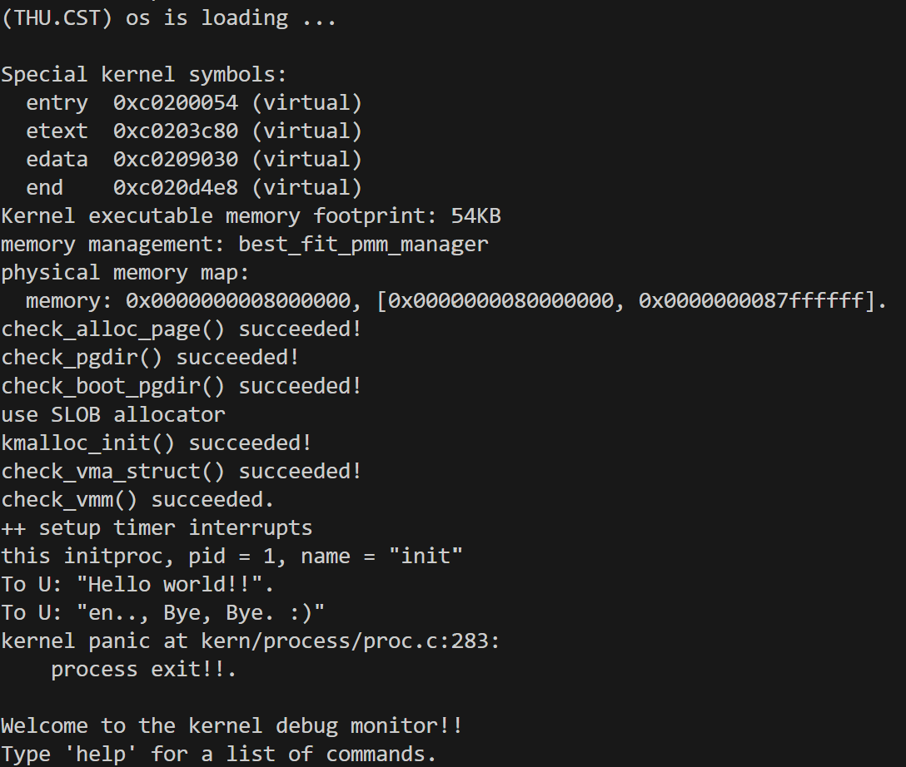
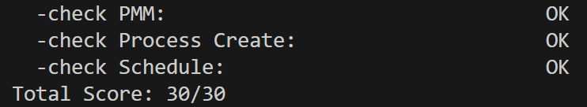
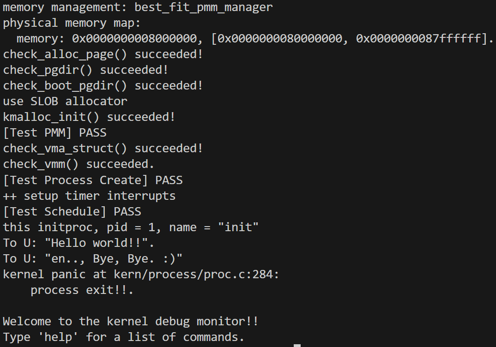
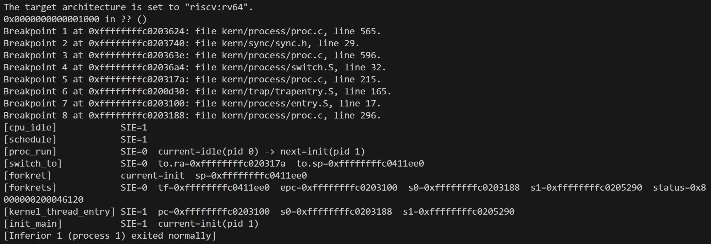

# 操作系统实验报告

## 实验基本信息

|     项目     |                      内容                      |
| :----------: | :--------------------------------------------: |
| **实验名称** |                 Lab4：进程管理                 |
| **小组成员** | 2414007-王奕瑜、2414015-鲁昕宁、2411622-张雨函 |
| **完成日期** |                   2026-11-22                   |

### 小组分工

练习如何分工？

|      成员      |               负责的练习/模块               |
| :------------: | :-----------------------------------------: |
| 2414007-王奕瑜 |      功能模块三：进程调度、Challenge 1      |
| 2414015-鲁昕宁 | 功能模块一：虚拟内存页操作功能、Challenge 2 |
| 2411622-张雨函 |      功能模块二：进程创建及初始化功能       |

实验报告如何分工？

|      成员      |  负责的实验报告内容  |
| :------------: | :------------------: |
| 2414007-王奕瑜 | 3.2.3, 4.3, 4.4, 五  |
| 2414015-鲁昕宁 | 3.1, 3.2.1, 4.1, 4.5 |
| 2411622-张雨函 |  一, 3.2.2, 4.2, 六  |

---

## 一、实验目的

本实验的主要目的是：

1. 理解操作系统进程管理的基本流程：掌握进程控制块（PCB）、进程状态、进程链表和 PID 哈希表在内核中的作用，理解从启动执行流到可调度内核线程的登记过程。

2. 掌握进程创建及初始化方法：实现 PCB 初始化、`idleproc` 和 `initproc` 的建立，理解内核栈、Trap frame、context 以及父子进程关系之间的联系。

3. 理解内核线程的首次运行机制：掌握 `kernel_thread()`、`do_fork()`、`copy_thread()` 和 `copy_mm()` 的职责，理解线程函数、参数、地址空间和共享内核页表的传递方式。

4. 理解进程调度与上下文切换：掌握 `cpu_idle()`、`schedule()`、`proc_run()` 和 `switch_to()` 的协作过程，理解如何在可运行线程之间保存和恢复寄存器上下文。

5. 掌握进程管理代码的调试与验证方法：通过编译、链表和状态检查以及 QEMU 运行结果，验证进程创建、资源回收、首次运行现场和调度切换是否满足实验要求。

---

## 二、实验环境

你们使用的 AI 工具

|      成员      | AI 编程工具 |     底层模型      | 备注 |
| :------------: | :---------: | :---------------: | :--: |
| 2414007-王奕瑜 | Claude Code | Claude Sonnet 5.5 |  无  |
| 2414015-鲁昕宁 |   Cursor    |     Grok 4.7      |  无  |
| 2411622-张雨函 |     GPT     |       GPT-6       |  无  |

**说明：**

- **AI 编程工具**：指具体使用的终端工具、编辑器插件、桌面应用或浏览器界面
- **底层模型**：指该工具使用的大语言模型及版本

---

## 三、实验整体逻辑分析

### 3.1 本章节的逻辑主线

本章的主线是“内核怎样为多个执行流准备地址空间，再让它们轮流使用 CPU”。实验三结束时，Trap 已经能进入 `trap()` 再返回，但页表里只有启动时写好的两项 1 GiB 大页，还不能按页增删映射，也没有第二个可运行的线程。实验四先补上映射的建立和撤销，再把当前执行现场登记成线程，最后在线程之间切换。

这条链按依赖关系排开：

1. **按页维护映射。** `get_pte()` 沿 Sv39 的三级页表找到叶子槽，缺的中间页表可以当场分配。`page_insert()` 把一页物理内存挂到指定虚拟地址上，并维护引用计数；`page_remove()` 撤销映射，计数降到 0 时归还这一页。页表项改完后对该虚拟地址执行 `sfence.vma`。没有这一步，后面的自检无法确认虚拟地址和物理页是否一致，线程即使创建出来也没有可靠的页表可以切换。
2. **把执行流登记成线程。** `alloc_proc()` 得到一块空白的进程控制块。`proc_init()` 把当前现场做成 `idleproc`，再用 `kernel_thread()` 创建运行 `init_main` 的 `initproc`。`do_fork()` 分配内核栈和 PID，并把线程挂进进程链表。本实验的内核线程共用启动页表，`copy_mm()` 不复制用户地址空间。
3. **让线程真正跑起来。** `cpu_idle()` 在需要调度时调用 `schedule()`。`schedule()` 从链表里选一个 `PROC_RUNNABLE` 的线程，没有则回到 `idleproc`。`proc_run()` 更换 `current` 和 `satp`，`switch_to()` 保存、恢复被调用者保存寄存器。新线程第一次被切换进去时，返回地址指向 `forkret`，再经 `forkrets` 和 `__trapret` 进入线程函数。

因此，后面各节的顺序是：先完成虚拟地址到物理页的映射维护，再创建并登记内核线程，最后实现调度和上下文切换。

### 3.2 功能的逐步实现

#### 3.2.1 功能模块一：虚拟内存页操作功能

虚拟内存页操作放在进程创建之前。线程控制块里的 `pgdir` 只保存页表的物理地址；页表项里写什么、引用计数怎么变，要先有 `page_insert()` 和 `page_remove()`。

1. **中间页表和叶子分开处理。** `get_pte(pgdir, la, 1)` 保证 VPN[2] 和 VPN[1] 两级页表存在，返回叶子槽的地址。叶子项由 `page_insert()` 填写。`page_remove()` 调用 `get_pte(..., 0)`，页表不存在就返回，不会为了删除映射去分配新页。
2. **同一页可以被多个虚拟地址引用。** 每建立一处映射，`page_ref` 加 1。撤销时减 1，减到 0 才 `free_page()`。`check_pgdir()` 把同一页先后映射到 `0` 和 `PGSIZE`，引用计数应为 2；两处都撤销后回到 0。新映射的引用先加上，再处理旧映射。目标页和旧页是同一页时，把多加的一次减回，这一页不会在替换过程中被释放。
3. **换权限和换页是两条路径。** 目标地址已经映射到同一物理页时，只改权限位，引用计数和空闲页数量都保持不变。已经映射到别的页时，先经 `page_remove_pte()` 卸掉旧页，再写入新项。地址上没有映射时，直接填写叶子项。
4. **页表项、引用计数和 TLB 一起更新。** 写入或清掉叶子项之后调用 `tlb_invalidate()`，对这个虚拟地址执行 `sfence.vma`。叶子项带写权限时同时置 `PTE_R`：RISC-V 里 `W` 为 1 而 `R` 为 0 的项不能当作普通数据页。有读、写或执行权限时再置 `PTE_A` 和 `PTE_D`。这样做是为了可移植：有的 RISC-V 实现遇到 `A` 或 `D` 为 0 的页会直接报缺页，而不是由硬件自动更新。我们在 QEMU 8.2.2 上做过对照实验，去掉这两位后测试照样通过（见 5.5 的 E3），说明 QEMU 8.2.2 会自己更新它们，这两位在本实验环境中不是必需的。

#### 3.2.2 功能模块二：进程创建及初始化功能

进程创建模块位于整个执行链的中间位置。页表和内存管理已经提供了 PCB 分配、内核栈分配以及共享内核地址空间所需的基础，调度模块则需要一个状态完整、已经登记并带有初始上下文的进程对象。因此，本模块必须先把“当前启动执行流”和“目标内核线程函数”转换为统一的 `proc_struct`。

本模块的实现顺序如下：

1. **建立 PCB 的安全初始状态。** `alloc_proc()` 使用 `kmalloc()` 分配 `struct proc_struct`，将状态设为 `PROC_UNINIT`，PID 设为 `-1`，清零运行次数、内核栈、重调度标志、父进程、地址空间、Trap frame、上下文、标志和名称，并把链表节点初始化为未链接状态。内核线程共享启动页表，因此 `pgdir` 初始化为 `boot_pgdir_pa`。

2. **把启动执行流登记为 `idleproc`。** `proc_init()` 先初始化进程链表和 PID 哈希表，再把一个新 PCB 配置为 PID 0 的可运行空闲线程。`idleproc` 复用当前正在使用的 `bootstack`，不通过普通 `do_fork()` 分配新栈；`current` 指向 `idleproc`，并将 `need_resched` 置为 1，使初始化结束后能够立即进入调度。

3. **创建第一个普通内核线程。** `proc_init()` 调用 `kernel_thread(init_main, "Hello world!!", 0)`。`kernel_thread()` 在调用者栈上构造临时 `struct trapframe`，将线程函数放入 `s0`、参数放入 `s1`，把 `epc` 设置为 `kernel_thread_entry`，并根据当前 `sstatus` 设置 `SPP`、`SPIE`、清除 `SIE`，使线程首次 `sret` 后仍在 S 模式运行并恢复中断使能。

4. **分配 PCB 和独立内核栈。** `do_fork()` 依次调用 `alloc_proc()` 和 `setup_kstack()`。普通内核线程拥有自己的两页内核栈，Trap frame 放在这个栈上，context 保存在 PCB 中；发生内存不足时，必须释放已经分配的 PCB 或内核栈。

5. **处理地址空间。** `copy_mm()` 保留了进程创建接口。当前实验创建的都是内核线程，父进程 `current->mm` 为 `NULL`，因此子线程的 `mm` 保持为 `NULL` 并直接成功返回。对于存在地址空间且带有 `CLONE_VM` 的情况，接口可以共享父进程的 `mm`；真正的用户地址空间复制留给后续实验。

6. **构造首次运行现场。** `copy_thread()` 将 Trap frame 复制到新内核栈顶部，设置子线程返回值寄存器 `a0 = 0`，为内核线程设置栈指针，并令 context 的 `ra = forkret`、`sp = trapframe`。这样，第一次执行 `switch_to()` 恢复该 context 时，会进入 `forkret()`，随后通过 `forkrets()` 和 `__trapret` 恢复 Trap frame。

7. **分配 PID、登记并唤醒。** 在关闭中断的临界区内，`do_fork()` 分配 PID，设置 `parent = current`，将 PCB 加入 `proc_list` 和 `hash_list`，更新进程计数，最后调用 `wakeup_proc()` 将状态从 `PROC_UNINIT` 改为 `PROC_RUNNABLE`。只有完成登记后才允许调度器看到该线程，从而避免出现半初始化的可运行进程。

完成这些步骤后，系统中至少存在 PID 0 的 `idleproc` 和 PID 1 的 `initproc`。`initproc` 具有独立内核栈、有效的 `context.ra` 和 `context.sp`，状态为 `PROC_RUNNABLE`，父进程为 `idleproc`，并等待调度模块将 CPU 交给它。

---

#### 3.2.3 功能模块三：进程调度

模块一、二结束时，系统里已经存在 `idleproc` 和 `initproc` 两个 PCB，但 `initproc` 只是一个"登记在册、状态为 RUNNABLE"的对象，没有任何机制能让 CPU 真正转到它上面。模块三补的就是这最后一环：`cpu_idle` 让 `idleproc` 持续检查是否需要重调度，`schedule` 在 `proc_list` 里挑出下一个可运行线程，`proc_run` 在关中断的临界区里更新 `current`、切换页表，最后由 `switch_to` 保存和恢复寄存器上下文。因此它放在最后实现，原因是它依赖前两个模块的结果。

与其他模块的关联如下：

- 与模块二：`schedule` 扫描的是 `do_fork` 挂入 `proc_list` 的 PCB，并依赖 `wakeup_proc` 设置的 `PROC_RUNNABLE`；`proc_init` 把 `idleproc->need_resched` 置 1，`cpu_idle` 才会第一次调用 `schedule`；`copy_thread` 预先把 `context.ra` 设为 `forkret`、`context.sp` 设为 trapframe，`switch_to` 的 `ret` 才能第一次进入新线程。
- 与模块一：所有线程共享的 `boot_pgdir_pa` 来自启动阶段建立的页表，`proc_run` 把它写进 `satp` 时沿用了 `pmm.c` 里 `enable_paging` 的 Sv39 写法。
- 与后续实验：lab4 的调度点只有 `cpu_idle`；后面的实验会让 `do_exit`、`do_wait` 等路径也调用 `schedule`，这时本模块的接口不用改动。

---

## 四、实验内容与实现

### 4.1 功能模块一：虚拟内存页操作功能

**负责人：** [2414015-鲁昕宁]

#### 4.1.1 模块功能描述

**需要实现的函数**（位于 `kern/mm/pmm.c`）：

```c
int page_insert(pde_t *pgdir, struct Page *page, uintptr_t la, uint32_t perm);
void page_remove(pde_t *pgdir, uintptr_t la);
```

同文件内还有一个 `static` 的 `page_remove_pte()`，供上面两个函数卸掉一条已经找到的有效映射。

**功能说明：**

`get_pte()` 已经能沿 Sv39 走到叶子槽。本模块负责叶子项本身：建立映射、替换映射、撤销映射，并让引用计数和 TLB 与页表项一致。

1. **`page_insert()`。** `get_pte(pgdir, la, 1)` 得到叶子槽；中间页表分配失败则返回 `-E_NO_MEM`，不写叶子项。成功时先把 `page` 的引用计数加 1。该地址已映射到同一页时，把多加的一次减回，只更新权限。已映射到其他页时，调用 `page_remove_pte()` 卸掉旧页。然后用 `pte_create()` 写入新项。`pte_create()` 会置 `PTE_V`。调用者给出 `PTE_W` 时补上 `PTE_R`；这项具有读、写或执行权限时再补上 `PTE_A` 和 `PTE_D`。最后 `tlb_invalidate(pgdir, la)`。
2. **`page_remove()`。** `get_pte(pgdir, la, 0)` 查找叶子。页表不存在，或 `PTE_V` 未置位，直接返回。否则交给 `page_remove_pte()`：引用计数减 1，降到 0 则 `free_page()`，清掉该项，再让该虚拟地址的 TLB 项失效。

引用计数和写回页表项的顺序是：

```c
page_ref_inc(page);
if (*ptep & PTE_V) {
    struct Page *mapped = pte2page(*ptep);
    if (mapped == page) {
        page_ref_dec(page);
    } else {
        page_remove_pte(pgdir, la, ptep);
    }
}
if (perm & PTE_W) {
    perm |= PTE_R;
}
if (perm & (PTE_R | PTE_W | PTE_X)) {
    perm |= PTE_A | PTE_D;
}
*ptep = pte_create(page2ppn(page), perm);
tlb_invalidate(pgdir, la);
```

#### 4.1.2 最终提示词

以下是用于生成练习中虚拟内存页操作的提示词：

````markdown
[PROMPT]
**任务**：修改 `kern/mm/pmm.c`，实现虚拟内存页操作：补全 `page_insert()` 和 `page_remove()`。`get_pte()` 已经负责沿 Sv39 查找叶子页表项，并在 `create` 非 0 时分配缺失的中间页表。本任务只维护叶子映射、物理页引用计数和对应虚拟地址的 TLB。

**操作要求**：你必须在项目中修改实际文件，保留现有代码，只在标记 `LAB4 function1` 处补全。不得修改 `get_pte()`、`get_page()`、`check_pgdir()`、`check_boot_pgdir()` 以及 `pte_create()` 的定义。不得改两个公开函数的签名，不得新增文件。允许在本文件内新增 `static` 的 `page_remove_pte()`。把标记注释中的 `YOUR CODE` 替换为学号 `2414015`，保留 `LAB4 function1` 字样。

**输出要求**：直接进行文件操作，使用下面 [RELY]、[GUARANTEE]、[SPECIFICATION] 部分的信息，以工程中的真实代码为准，不要引入无关功能。

[RELY]

1. 待补全的函数已在 `kern/mm/pmm.h` 中声明：

```c
int page_insert(pde_t *pgdir, struct Page *page, uintptr_t la, uint32_t perm);
void page_remove(pde_t *pgdir, uintptr_t la);
```

`pgdir` 是根页表的内核虚拟地址。`la` 不必按页对齐。`perm` 是调用者给出的权限位，测试中会出现 `0`、`PTE_U | PTE_W` 和 `PTE_W | PTE_R`。

2. 已有的页表与页描述符操作：

```c
pte_t *get_pte(pde_t *pgdir, uintptr_t la, bool create);
struct Page *pte2page(pte_t pte);
ppn_t page2ppn(struct Page *page);
pte_t pte_create(uintptr_t ppn, int type); /* 结果已含 PTE_V */
int page_ref_inc(struct Page *page);
int page_ref_dec(struct Page *page);
void free_page(struct Page *page);
void tlb_invalidate(pde_t *pgdir, uintptr_t la);
```

`get_pte(..., 1)` 在中间页表无法分配时返回 `NULL`。`get_pte(..., 0)` 在页表缺失时返回 `NULL`，不分配。`PTE_V` 未置位的叶子槽仍然会返回指针，调用者自己判断。`-E_NO_MEM` 在 `libs/error.h` 中。

3. 权限位（`kern/mm/mmu.h`）：`PTE_V`、`PTE_R`、`PTE_W`、`PTE_X`、`PTE_U`、`PTE_A`、`PTE_D`。`R`、`W`、`X` 全为 0 的有效项表示指向下一级页表。`W` 为 1 时该项还必须可读，才能作为数据页。

[GUARANTEE]
需要交付的公开函数只有：

```c
int page_insert(pde_t *pgdir, struct Page *page, uintptr_t la, uint32_t perm);
void page_remove(pde_t *pgdir, uintptr_t la);
```

允许新增 `static void page_remove_pte(pde_t *pgdir, uintptr_t la, pte_t *ptep)`，不得放进头文件。

[SPECIFICATION]
**page_insert**

Pre-Condition：`pgdir` 指向一张可用的根页表。`page` 是已分配的物理页。`la` 是要映射的虚拟地址。

Post-Condition：成功时该虚拟地址所在页映射到 `page`，叶子项含 `PTE_V` 和调用者要求的权限，`page` 的引用计数比调用前多 1（若该地址原先已经映射到同一页，则计数不变）。返回 0。失败时返回 `-E_NO_MEM`，不写入这个叶子项。

Case 1：该地址没有有效映射。引用计数加 1，写入叶子项。

Case 2：该地址已经映射到 `page`。只更新权限。引用计数与调用前相同，这一页不被释放，空闲页数量不变。

Case 3：该地址已经映射到另一页。先撤销旧映射；旧页引用计数降到 0 时归还该页。新页引用计数加 1。

Requirements：

- 新页的引用计数先增加，再撤销旧映射。这样 Case 2 不会在更新权限的过程中把 `page` 释放。
- 调用者给出 `PTE_W` 时，叶子项同时具有 `PTE_R`。具有 `PTE_R`、`PTE_W` 或 `PTE_X` 时，同时置 `PTE_A` 和 `PTE_D`。
- 叶子项写入之后，使 `la` 的 TLB 项失效。

**page_remove**

Pre-Condition：`pgdir` 指向一张可用的根页表。`la` 可以已有映射，也可以没有。

Post-Condition：该地址不再有有效叶子映射，对应 TLB 项失效。映射的物理页引用计数减 1，降到 0 时该页回到空闲链表。地址原本没有映射时，页表和空闲页数量都不变。

Requirements：查找叶子时不得分配新的中间页表。
````

#### 4.1.3 实现迭代过程

本模块的实现经历了 1 次迭代，过程如下：

---

##### 第一次迭代

**最终结果：**

使用 4.1.2 的提示词生成的代码在第一次测试中就满足页映射的要求，因此没有需要修复的问题。模块二、三当时还没有函数体，链接时临时补了空的 `proc_init()` 和调用 `sbi_shutdown()` 的 `cpu_idle()`，只为让内核跑完 `pmm_init()`。这两段临时代码随后已从 `pmm.c` 中删除。QEMU 输出如下：

- ✅ `check_alloc_page() succeeded!`
- ✅ `check_pgdir() succeeded!` 覆盖了未映射地址、同一页的两处映射（引用计数为 2）、用另一页替换其中一处（旧页引用计数回到 0）以及两次 `page_remove()`。
- ✅ `check_boot_pgdir() succeeded!` 把同一物理页映射到 `0x100` 和 `0x100 + PGSIZE`，经前一个虚拟地址写入的字符串能从后一个虚拟地址读回。这说明叶子项的 `PTE_R`、`PTE_W` 和 TLB 失效都生效。
- 进程创建和调度尚未实现，这次没有把整份 `make grade` 当作本模块的通过标准。

---

### 4.2 进程创建及初始化功能

**负责人：** 2411622-张雨函

#### 4.2.1 模块功能描述

**需要实现的函数：**

```c
static struct proc_struct *alloc_proc(void);
void proc_init(void);
int kernel_thread(int (*fn)(void *), void *arg, uint32_t clone_flags);
int do_fork(uint32_t clone_flags, uintptr_t stack, struct trapframe *tf);
static void copy_thread(struct proc_struct *proc, uintptr_t esp, struct trapframe *tf);
static int copy_mm(uint32_t clone_flags, struct proc_struct *proc);
```

这些函数共同完成“从当前启动执行流创建出可调度内核线程”的过程。模块的核心不是简单分配一个结构体，而是让 PCB、内核栈、Trap frame、context、PID、链表状态和地址空间字段在创建完成后彼此一致。

**1. PCB 初始化：**

`alloc_proc()` 从内核堆分配 PCB，并将所有字段置于可预测的空状态：`state = PROC_UNINIT`、`pid = -1`、`runs = 0`、`kstack = 0`、`need_resched = 0`、`parent = NULL`、`mm = NULL`、`tf = NULL`、`flags = 0`。上下文和进程名称清零，`list_link` 与 `hash_link` 自指初始化，`pgdir` 指向共享的 `boot_pgdir_pa`。该函数返回的对象不能直接被调度，必须由后续创建流程补全身份和运行现场。

**2. idleproc 和 initproc 建立：**

`proc_init()` 初始化 `proc_list` 及全部 PID 哈希桶，将当前启动上下文包装为 `idleproc`。`idleproc` 使用 PID 0 和 `bootstack`，状态为 `PROC_RUNNABLE`，并将 `need_resched` 置位。随后通过 `kernel_thread()` 创建运行 `init_main()` 的 `initproc`，设置其名称为 `init`，使其成为 PID 1 的可运行内核线程。

**3. 内核线程入口现场：**

`kernel_thread()` 使用临时 Trap frame 传递函数指针和参数。`s0` 保存线程函数，`s1` 保存参数，`epc` 指向 `kernel_thread_entry`。`status` 的位操作保证线程通过 `sret` 返回到 S 模式，并在返回后允许中断。这个约定与 `kern/process/entry.S` 中的实现对应：入口代码把 `s1` 移到 `a0`，再通过 `s0` 调用线程函数。

**4. do_fork 和资源生命周期：**

`do_fork()` 按固定顺序完成 PCB、内核栈、地址空间和首次运行现场的准备，然后在关中断临界区内完成 PID 分配、父子关系设置、链表登记和唤醒。任何前置步骤失败，都沿相反顺序释放已经获得的资源；只有调用 `wakeup_proc()` 后，PCB 才从 `PROC_UNINIT` 进入 `PROC_RUNNABLE`。

**5. Trap frame 和 context 的关系：**

Trap frame 用于 `__trapret` 恢复完整寄存器和控制状态，context 只保存 `switch_to()` 需要的 `ra`、`sp`、`s0`～`s11`。新线程的 context 设置为 `ra = forkret`，其 `sp` 指向内核栈顶部的 Trap frame。首次切换时先恢复 context，再由 `forkret → forkrets → __trapret` 恢复 Trap frame，最后跳转到 `kernel_thread_entry`。

**6. copy_mm 的阶段性实现：**

本实验不创建用户进程，因此 `current->mm` 通常为 `NULL`，`copy_mm()` 不进行真正的页表复制。实现保留 `CLONE_VM` 分支用于共享已有 `mm`，非共享地址空间的复制由后续实验扩展。这样既满足当前内核线程的需求，也保持了未来扩展所需的接口。

#### 4.2.2 最终提示词

下面是本模块实际采用的提示词结构。提示词保留了实验手册中的接口边界，并把代码身份标记指定为 `2411622`。

```markdown
[PROMPT]
任务：修改 kern/process/proc.c，在 `//LAB4 function2 YOUR CODE` 标记处完成进程创建及初始化功能。只实现功能模块二，不修改模块一的 pmm.c、模块三的 sched.c/proc_run/cpu_idle，也不修改 switch.S、Trap 入口或其他任务代码。将标记中的 YOUR CODE 替换为 2411622，并保留 `LAB4 function2` 字样。

目标：完成 alloc_proc、proc_init、kernel_thread、do_fork、copy_thread、copy_mm，使内核能够建立 idleproc 和 initproc，并为后续调度准备可运行的内核线程。

操作要求：直接修改工程中的实际文件，保留已有函数和注释。实现必须遵循当前仓库的真实结构、头文件和函数接口，不新增无关文件，不改变公开函数签名。每条失败路径都要释放此前已经分配的资源。

[RELY]

1. struct proc_struct 包含 state、pid、runs、kstack、need_resched、parent、mm、context、tf、pgdir、flags、name、list_link 和 hash_link。
2. PROC_UNINIT、PROC_RUNNABLE 是本模块需要使用的进程状态；CLONE_VM 表示共享地址空间。
3. boot_pgdir_pa 是共享内核页表根的物理地址；bootstack 是启动执行流使用的内核栈；KSTACKPAGE 和 KSTACKSIZE 描述普通线程的内核栈大小。
4. 可调用 kmalloc/kfree、alloc_pages/free_pages、page2kva/kva2page、memset/memcpy、list_init/list_add、find_proc、get_pid、hash_proc、wakeup_proc、local_intr_save/local_intr_restore。
5. kernel_thread_entry 约定从 s0 取线程函数、从 s1 取参数；forkret/forkrets/__trapret 负责首次运行恢复链。
6. RISC-V sstatus 中 SSTATUS_SPP、SSTATUS_SPIE、SSTATUS_SIE 分别用于首次返回的特权级、先前中断使能状态和当前中断使能状态。

[GUARANTEE]
必须实现以下函数：
static struct proc_struct *alloc_proc(void);
void proc_init(void);
int kernel_thread(int (*fn)(void *), void *arg, uint32_t clone_flags);
int do_fork(uint32_t clone_flags, uintptr_t stack, struct trapframe *tf);
static void copy_thread(struct proc_struct *proc, uintptr_t esp, struct trapframe *tf);
static int copy_mm(uint32_t clone_flags, struct proc_struct *proc);

不得修改模块三的 `//LAB4 function3 YOUR CODE` 区域，不得把调度策略写入本模块。

[SPECIFICATION]
alloc_proc：

- 分配失败返回 NULL；成功后 state=PROC_UNINIT、pid=-1、runs=0、kstack=0、need_resched=0。
- parent、mm、tf 置 NULL，context 清零，pgdir=boot_pgdir_pa，flags=0，name 清空。
- 初始化 list_link/hash_link，使 PCB 尚未加入任何链表。

proc_init：

- 初始化 proc_list 和所有 hash_list 桶。
- 创建 PID 0 的 idleproc，状态为 PROC_RUNNABLE，名称为 idle，kstack 使用 bootstack，need_resched 置 1，current 指向 idleproc。
- 通过 kernel_thread(init_main, "Hello world!!", 0) 创建 initproc，设置名称为 init，并保证其 PID 为 1、状态为 PROC_RUNNABLE、父进程为 idleproc。
- 创建失败时应 panic，不能留下空的 initproc。

kernel_thread：

- 在调用者栈上清零临时 trapframe。
- gpr.s0 保存 fn，gpr.s1 保存 arg，epc 设置为 kernel_thread_entry。
- 从当前 sstatus 出发设置 SPP 和 SPIE，清除 SIE。
- 调用 do_fork(clone_flags | CLONE_VM, 0, &tf)，返回 PID 或负错误码。

do_fork：

- 按 alloc_proc、setup_kstack、copy_mm、copy_thread、PID/链表登记、wakeup_proc 的顺序执行。
- alloc_proc、setup_kstack 或 copy_mm 失败时释放已获得的资源并返回负错误码。
- 在关中断临界区内设置 PID、parent，加入 proc_list/hash_list，更新进程数量并唤醒子线程。
- 成功返回新线程 PID，且新线程只能在 wakeup_proc 后变为 PROC_RUNNABLE。

copy_thread：

- 在新线程内核栈顶部预留 struct trapframe，并复制模板。
- 设置子线程 gpr.a0=0；esp 非零时使用 esp，否则将栈指针设为 Trap frame 地址。
- proc->tf 指向新 Trap frame，context.ra=forkret，context.sp 指向该 Trap frame。

copy_mm：

- 当前父进程没有 mm 时保持子进程 mm=NULL 并返回 0。
- 如果存在 mm 且设置 CLONE_VM，可共享父进程 mm。
- 不实现当前实验不需要的用户地址空间复制，但保留完整函数接口和错误返回约定。
```

#### 4.2.3 实现迭代过程

本模块的实现经历了两次代码迭代，重点集中在 C 语言声明顺序和完整构建边界的确认。

##### 第一次迭代：完成六个函数的主体

第一次实现按照接口契约补全了 PCB 初始化、`proc_init()`、`kernel_thread()`、`do_fork()`、`copy_thread()` 和 `copy_mm()`。主要实现决策如下：

- 使用 `kmalloc(sizeof(struct proc_struct))` 分配 PCB，并显式初始化每个字段和两个链表节点，避免后续调度读取未初始化指针。
- `idleproc` 不经过 `setup_kstack()`，直接复用 `bootstack`；普通线程通过 `alloc_pages(KSTACKPAGE)` 获得独立内核栈。
- `kernel_thread()` 通过临时 Trap frame 传递 `fn`、`arg` 和 `kernel_thread_entry`，并按 RISC-V `sstatus` 语义设置 SPP、SPIE 和 SIE。
- `do_fork()` 将资源分配和链表登记分开，登记与唤醒放在关中断临界区内，并在中途失败时回收 PCB 和内核栈。
- `copy_thread()` 把 Trap frame 放在栈顶，设置 `a0=0`、`context.ra=forkret` 和 `context.sp=frame`，确保首次切换能进入恢复链。

##### 第二次迭代：修复静态函数声明顺序

第一次编译时，`do_fork()` 位于 `copy_thread()` 和 `copy_mm()` 定义之前，编译器先按隐式声明处理调用，之后遇到 `static` 定义时报告“static declaration follows non-static declaration”。这不是接口逻辑错误，而是 C 文件中辅助函数声明顺序不符合当前编译选项的要求。

修复方法是在 `do_fork()` 前增加：

```c
static void copy_thread(struct proc_struct *proc, uintptr_t esp,
                        struct trapframe *tf);
static int copy_mm(uint32_t clone_flags, struct proc_struct *proc);
```

修复后重新编译 `proc.c`，不再出现隐式声明和类型冲突。`git diff --check` 也通过，说明本次报告对应的代码修改没有引入空白错误。

##### 验证结果与边界

当前模块的源文件单独编译通过。仓库提供的完整 Lab4 链接仍依赖模块一的 `page_insert()`/`page_remove()` 和模块三的 `cpu_idle()` 等函数；这些函数属于其他任务，本次没有修改，因此不能把完整链接结果误写成模块二独立实现的测试结果。模块二的可验证结果是：PCB 初始化字段完整、`idleproc` 使用 PID 0 和 `bootstack`、`initproc` 具备 PID 1 和有效首次运行 context、失败路径包含资源回收。

---

### 4.3 功能模块三：进程调度

**负责人：** [2414007-王奕瑜]

#### 4.3.1 模块功能描述

**需要实现的函数：**

```c
void cpu_idle(void);                                // kern/process/proc.c
void schedule(void);                                // kern/schedule/sched.c
void proc_run(struct proc_struct *proc);            // kern/process/proc.c
void switch_to(struct context *from, struct context *to);  // kern/process/switch.S
```

**功能说明：**

本模块负责把已经创建好的内核线程真正交给 CPU 执行。它不关心线程是怎么创建出来的，只关心"谁来决定切换、选谁、怎么切"。四个函数分成三层：

| 层次   | 函数        | 职责                                                                |
| ------ | ----------- | ------------------------------------------------------------------- |
| 触发层 | `cpu_idle`  | 空闲线程的主循环，发现 `need_resched` 就进入调度                    |
| 策略层 | `schedule`  | 选择下一个线程（FIFO + Round-Robin），不碰寄存器                    |
| 机制层 | `proc_run`  | 在关中断下更新 `current`、切换页表，然后调用 `switch_to`            |
| 机制层 | `switch_to` | 保存旧线程、恢复新线程的被调用者保存寄存器，用 `ret` 完成控制流转移 |

**1. `cpu_idle`：触发调度**

`cpu_idle` 是 `idleproc` 的函数体，是一个不返回的循环：每一轮读取 `current->need_resched`，非零就调用 `schedule()`。`need_resched` 声明为 `volatile`，每一轮都会重新读内存。`proc_init` 在构造 `idleproc` 时把它置 1，所以 `kern_init` 调用 `cpu_idle` 后第一轮就会进入调度，这也是 `initproc` 能第一次拿到 CPU 的原因。lab4 中调度点只有这一个。

```c
void cpu_idle(void) {
    while (1) {
        if (current->need_resched) {
            schedule();
        }
    }
}
```

**2. `schedule`：选择下一个线程**

`schedule` 在 `local_intr_save` / `local_intr_restore` 之间完成全部工作，这样扫描 `proc_list` 的过程中不会被时钟中断打断：

1. 先把 `current->need_resched` 清零，避免同一次请求被重复处理；
2. 确定扫描起点 `last`：`current == idleproc` 时取链表头 `&proc_list`，否则取 `&current->list_link`。这是因为 `idleproc` 不在 `proc_list` 中，它调度时应从链表第一个 PCB 开始，让所有线程有平等的机会；其他线程调度时从自己的下一个位置开始，形成 Round-Robin；
3. 从 `last` 的下一个节点开始，环形走一圈，回到 `last` 为止。链表头结点 `proc_list` 不是内嵌在 `proc_struct` 里的，遇到它必须跳过，不能调用 `le2proc`；
4. 找到第一个 `state == PROC_RUNNABLE` 的 PCB 就选中；整圈都没有就选 `idleproc`；
5. `next->runs++`，并且只有 `next != current` 才调用 `proc_run`。

```c
last = (current == idleproc) ? &proc_list : &(current->list_link);
le = last;
while ((le = list_next(le)) != last) {
    if (le == &proc_list) continue;               // skip the list head
    next = le2proc(le, list_link);
    if (next->state == PROC_RUNNABLE) break;
    next = NULL;
}
if (next == NULL) next = idleproc;                // nothing runnable: fall back to idle
next->runs++;
if (next != current) proc_run(next);
```

**3. `proc_run`：切换的临界区**

`proc == current` 时直接返回。否则先保存旧线程指针 `prev`，然后在关中断区间内依次做三件事，顺序是固定的：

1. `current = proc`：必须在切换栈之前更新，这样新线程一醒来读到的 `current` 就是它自己；
2. 切页表：`write_csr(satp, SATP_MODE_SV39 << 60 | proc->pgdir >> RISCV_PGSHIFT)`，再 `flush_tlb()`。写法对照 `pmm.c` 的 `enable_paging`，没有使用 Sv32 遗留的 `lsatp()`。lab4 中所有线程共用 `boot_pgdir_pa`，写入的值与当前相同，因此这一步不改变行为，但保证了以后进程有自己页表时这个函数仍然正确；
3. `switch_to(&prev->context, &proc->context)`。

`switch_to` 返回时，CPU 上跑的已经是另一个线程。对于旧线程，`switch_to` 的"返回"发生在它下一次被调度回来的时刻，这时才会执行 `local_intr_restore`，把中断状态还原成进入前的样子。对于一个从未运行过的新线程，它不会从 `proc_run` 返回，而是直接从 `forkret` 开始，退出内核时由 `sret` 根据 trapframe 里的 `sstatus.SPIE` 恢复中断。

**4. `switch_to`：寄存器级切换**

`switch_to` 用汇编实现，`a0` 指向旧线程的 `struct context`，`a1` 指向新线程的。它的做法是：把 `ra`、`sp`、`s0~s11` 共 14 个寄存器依次存到 `n * REGBYTES(a0)`，再从 `n * REGBYTES(a1)` 依次取回，最后 `ret`。偏移量与 `struct context` 的字段顺序一一对应。

只保存这 14 个寄存器的原因是：`switch_to` 是被 `proc_run` 当作普通函数调用的，按照 RISC-V 调用约定，调用者保存寄存器（`a*`、`t*`）已经由编译器在调用前后保存，需要由 `switch_to` 负责保存的只剩被调用者保存寄存器和 `ra`、`sp`。`ret` 会跳转到新上下文里恢复出来的 `ra`：对运行过的线程，这是它上次调用 `switch_to` 之后的位置；对新线程，这是 `copy_thread` 设置的 `forkret`，从而接入 `forkret -> forkrets -> __trapret -> kernel_thread_entry -> init_main` 这条首次运行链路。

**整体执行流程：**

```text
kern_init -> cpu_idle (idleproc, need_resched = 1)
          -> schedule: 从链表头找到 initproc (RUNNABLE)
          -> proc_run(initproc): current = initproc, satp, switch_to
          -> switch_to: ret 到 initproc->context.ra = forkret
          -> forkret -> forkrets(tf) -> __trapret -> sret
          -> kernel_thread_entry -> init_main(arg)
```

#### 4.3.2 最终提示词

以下是最终用于实现该功能的提示词（同时汇总在 [prompt.md](./prompt.md) 的 2.1 节）：

```markdown
[PROMPT]
**任务**：补全 lab4 的"进程调度"功能模块。涉及三个文件：`kern/process/proc.c`（空闲线程循环 `cpu_idle` 与切换入口 `proc_run`）、`kern/schedule/sched.c`（调度器 `schedule`）、`kern/process/switch.S`（寄存器级上下文切换 `switch_to`）。这一模块的目标是让 `idleproc` 能够把 CPU 交给已经创建好的 `initproc`。

**操作要求**：你必须在项目中修改实际文件，保留现有代码和 Doxygen 注释，只在带有 `LAB4 function3` 标记的位置补全。把标记中的 `YOUR CODE` 换成学号 `2414007`，并且 `proc.c` 中的 `cpu_idle` 与 `proc_run` 各保留一行独立的标记。新增的代码要写必要的英文 Doxygen / 行内注释。不要修改 `struct context` 的字段顺序，不要修改与本模块无关的函数。

**输出要求**：直接进行文件操作，使用下面 [RELY]、[GUARANTEE]、[SPECIFICATION] 部分的信息，以工程中的真实代码为准，不要引入抢占、优先级、时间片等本实验没有要求的功能。

[RELY]

- 数据结构（`kern/process/proc.h`）：
  - `struct context`，字段顺序固定为 `ra, sp, s0, s1, ..., s11`，共 14 个机器字；
  - `struct proc_struct`，本模块用到 `state`、`runs`、`need_resched`（volatile）、`pgdir`（页目录的物理地址）、`context`、`list_link`；
  - 进程状态 `PROC_RUNNABLE` 等。
- 全局变量：`current`（正在占用 CPU 的 PCB）、`idleproc`（第 0 个线程，**不在** `proc_list` 中）、`proc_list`（带头结点的循环双向链表，头结点不是 `proc_struct`，各 PCB 通过 `list_link` 挂入）。
- 已有函数与宏：
  - 链表：`list_next()`、`le2proc(le, member)`；
  - 临界区：`local_intr_save(flag)`、`local_intr_restore(flag)`（`kern/sync/sync.h`，嵌套安全）；
  - 页表相关：`write_csr(satp, v)`、`SATP_MODE_SV39`（模式字段在 satp 的最高 4 位）、`RISCV_PGSHIFT`、`flush_tlb()`（`libs/riscv.h`、`kern/mm/pmm.h`）；`kern/mm/pmm.c` 的 `enable_paging()` 展示了 Sv39 下 satp 的正确写法；`libs/riscv.h` 里的 `lsatp()` 是 Sv32 遗留，不能使用；
  - 汇编：`libs/riscv.h` 提供 `REGBYTES`、`STORE`、`LOAD`；`switch.S` 需要自己 `#include <riscv.h>`；
  - 声明：`void switch_to(struct context *from, struct context *to);` 已在 `proc.c` 中声明；`schedule()` 在 `sched.h`；`cpu_idle` 在 `proc.h` 中声明为 `noreturn`。
- 已由其他模块保证的前提：
  - 新线程第一次运行时，`context.ra` 是 `forkret`，`context.sp` 是它的 trapframe，所以第一次 `switch_to` 的 `ret` 会进入 `forkret -> forkrets -> __trapret -> kernel_thread_entry`；
  - 所有 PCB 的 `pgdir` 都是启动页表 `boot_pgdir_pa`；
  - `proc_init` 已把 `idleproc->need_resched` 置 1，`do_fork` 通过 `wakeup_proc` 把新线程置为 `PROC_RUNNABLE` 并挂入 `proc_list`。

[GUARANTEE]
必须实现的函数（签名不得改变）：

- `void cpu_idle(void);`（`kern/process/proc.c`）
- `void schedule(void);`（`kern/schedule/sched.c`）
- `void proc_run(struct proc_struct *proc);`（`kern/process/proc.c`）
- `void switch_to(struct context *from, struct context *to);`（`kern/process/switch.S`，汇编，全局符号）

不需要新增辅助函数；如果确实需要，必须是 `static` 的，不能改变公开接口。

[SPECIFICATION]
**cpu_idle**

- Pre-Condition：当前执行流是 `idleproc`，`kern_init` 已经开启中断，`current == idleproc`。
- Post-Condition：函数永不返回；只要有线程请求重新调度，就一定会进入 `schedule`。
- Requirements：空闲线程自己不阻塞、不睡眠；判断重调度标志时必须每次都从内存重新读取。

**schedule**

- Pre-Condition：调用者是当前正在运行的线程（本实验中就是 `idleproc` 或某个内核线程），`current` 有效，`proc_list` 中的 PCB 状态一致。
- Post-Condition：调用者的重调度请求已被清除；如果存在其他可运行线程，CPU 已经被交给选中的线程，本函数在调用者下次被切换回来时才返回；如果没有任何可运行线程，调用者保持占用 CPU（退回 `idleproc`）。
- Case 1（调用者是 `idleproc`）：由于 `idleproc` 不在 `proc_list` 中，从链表的第一个 PCB 开始查找，让链表里的线程有平等的机会。
- Case 2（调用者不是 `idleproc`）：从调用者在链表中的下一个位置开始，环形查找一整圈（Round-Robin），最后才轮到调用者自己。
- Case 3（没有 `PROC_RUNNABLE` 线程）：选择 `idleproc` 作为下一个线程。
- Case 4（选中的线程就是 `current`）：不做切换，直接返回。
- Requirements：
  1. 整个"清标志 + 选择 + 切换"过程必须处于关中断的临界区内，且嵌套安全；
  2. 环形查找一圈即止，且必须跳过链表头结点，不能把头结点当成 PCB 解释；
  3. 被选中线程的 `runs` 计数加 1；
  4. 只负责选择策略（FIFO/轮转），不直接操作寄存器。

**proc_run**

- Pre-Condition：`proc` 是 `PROC_RUNNABLE` 的有效 PCB；调用者在 `current` 对应的线程里。
- Post-Condition：`current == proc`，页表根已指向 `proc->pgdir` 且旧的地址翻译缓存已失效，CPU 的寄存器上下文已从旧线程切换到 `proc`；本函数在旧线程被重新调度回来时才返回。
- Case 1（`proc == current`）：什么也不做，直接返回。
- Case 2（`proc != current`）：先保存旧线程的 PCB 指针，再依次完成"更新 `current`"、"切换页表"、"切换寄存器上下文"。
- Requirements：
  1. 整个切换过程必须关中断，并且在 `switch_to` 返回后（即旧线程被切换回来时）恢复进入前的中断状态；
  2. `current` 必须在切换栈之前更新，这样新线程里读到的 `current` 才是它自己；
  3. 页表只在 `pgdir` 的物理页号和 Sv39 模式位组合后写入，之后必须使旧映射的 TLB 失效；
  4. 新线程第一次运行不会从这里返回，它直接从 `forkret` 开始。

**switch_to**

- Pre-Condition：`a0` 指向旧线程的 `struct context`，`a1` 指向新线程的 `struct context`；调用发生在关中断状态下，调用方式与普通 C 函数调用相同。
- Post-Condition：旧线程的 `ra`、`sp`、`s0~s11` 已按 `struct context` 的字段顺序保存到 `*from`；这些寄存器已从 `*to` 加载；控制流已转移到新线程保存的 `ra`。
- Requirements：
  1. 只保存/恢复被调用者保存寄存器，不碰 `a0~a7`、`t0~t6`；
  2. 每个寄存器在结构体中的偏移必须与 `struct context` 一致，按机器字宽计算；
  3. 必须先保存全部旧寄存器再加载新寄存器，最后以 `ret` 结束；
  4. 不做任何调度决策，也不访问 `current`。
```

#### 4.3.3 实现迭代过程

本模块的实现经历了 1 次迭代，过程如下：

---

##### 第一次迭代

**测试方式：** 模块一、二当时还没有合入，仓库里无法链接，所以我在一个 `/tmp` 临时副本里补了一份只用于本地验证的 `page_insert`、`page_remove` 和进程创建函数（不提交到仓库），再把本模块的代码放进去，依次进行了：

1. `make`：编译、链接；
2. `make grade`：`check PMM`、`check Process Create`、`check Schedule`；
3. `make qemu`：观察启动输出，确认 `initproc` 被调度。

**最终结果：**

经过 1 次迭代，该模块最终：

- ✅ 编译通过（无与本模块相关的 warning）
- ✅ `make grade` 中 `check PMM`、`check Process Create`、`check Schedule` 全部 OK，总分 30/30
- ✅ `make qemu` 输出了 `this initproc, pid = 1, name = "init"` 以及两条 `To U: ...`，说明 `idleproc -> initproc` 的切换以及 `forkret -> forkrets -> __trapret -> kernel_thread_entry` 链路都正确
- ✅ 功能符合预期：随后 `init_main` 返回、`do_exit` 按 lab4 的设计 panic 并进入 kernel monitor，这属于预期行为

第一次生成的代码没有出现需要修复的 bug，所以只有 1 次迭代。提示词的 [RELY] 和 [SPECIFICATION] 里预先写明了下面几个这类模块里常见的易错点（它们是否是“没有出 bug”的原因没有做对照实验，这里只是列出）：

- 链表头结点不是 PCB：`schedule` 的环形扫描必须跳过 `&proc_list`，否则 `le2proc` 会把头结点当成 `proc_struct` 读出垃圾的 `state`；
- 寄存器偏移必须与 `struct context` 一致：提示词中固定了字段顺序 `ra, sp, s0~s11`，并要求按机器字宽计算偏移；
- `idleproc` 不在 `proc_list` 中：提示词区分了"调用者是 `idleproc`"和"不是"的两种扫描起点，否则 `idleproc` 调度时会从 `idleproc->list_link`（全 0）开始走；
- 不能使用 `lsatp()`：提示词在 [RELY] 里点明它是 Sv32 遗留，并指向 `enable_paging` 作为参照写法；
- `proc_run` 的顺序和中断恢复：提示词要求 `current` 在切换栈之前更新，且整个过程关中断。

---

### 4.4 Challenge 1

**负责人：** [2414007-王奕瑜]

> 说明语句 `local_intr_save(intr_flag); ... local_intr_restore(intr_flag);` 是如何实现开关中断的。

**一句话回答：** `local_intr_save` 先读出 `sstatus.SIE`，把它保存到 `intr_flag`，再在中断原本开启时清除 `SIE`；`local_intr_restore` 只在 `intr_flag` 为 1 时重新置位 `SIE`。中断的开关由 `sstatus` 的一位完成，`intr_flag` 保存的是进入临界区之前的状态，所以这对语句可以嵌套使用。

**1. 宏展开后的实际代码。** 两个宏定义在 `kern/sync/sync.h`，底层的开关函数在 `kern/driver/intr.c`：

```c
static inline bool __intr_save(void) {
    if (read_csr(sstatus) & SSTATUS_SIE) {   // 中断当前是开着的吗
        intr_disable();                      // 是：关掉
        return 1;                            // 并记下“原来是开的”
    }
    return 0;                                // 否：什么也不做，记下“原来就是关的”
}
static inline void __intr_restore(bool flag) {
    if (flag) {
        intr_enable();                       // 只有原来是开的，才重新打开
    }
}
#define local_intr_save(x)   do { x = __intr_save(); } while (0)
#define local_intr_restore(x) __intr_restore(x);

void intr_enable(void)  { set_csr(sstatus, SSTATUS_SIE); }    // csrrs：sstatus |=  SIE
void intr_disable(void) { clear_csr(sstatus, SSTATUS_SIE); }  // csrrc：sstatus &= ~SIE
```

因此 `local_intr_save(intr_flag)` 等价于：用 `csrr` 读 `sstatus`，测 `SIE`（第 1 位，`0x2`），为 1 则执行一条 `csrrc sstatus, 0x2` 并令 `intr_flag = 1`，否则令 `intr_flag = 0`。`local_intr_restore(intr_flag)` 等价于：`intr_flag` 为 1 则执行一条 `csrrs sstatus, 0x2`。

**2. 硬件上关中断意味着什么。** `SIE` 是 S 模式下中断的全局开关。它清零后，S 模式的时钟、外部、软件中断都不会被响应，请求只是保持挂起，等 `SIE` 重新置位后再进入 `stvec`。它与 `sie` 寄存器里各个中断源的使能位互相独立：`clock_init()` 置位的是 `sie.STIE`，`local_intr_save` 不碰它。两者都为 1，时钟中断才会进入内核。另外，中断屏蔽对异常无效：缺页、非法指令、`ebreak` 仍会进入 `stvec`，所以临界区内不能自己制造异常。

**3. 为什么要保存标志，而不是直接关、再直接开。** 如果写成“进入时 `intr_disable()`，退出时 `intr_enable()`”，嵌套的临界区会出错：内层退出时无条件开中断，外层剩下的部分就失去了保护。实验里这种嵌套是真实存在的：`schedule()` 在关中断的区间内调用 `proc_run()`，而 `proc_run()` 自己也有一对 `local_intr_save/restore`。我们用 GDB 在 `schedule`、`proc_run` 入口读 `sstatus.SIE`，结果为：

```text
[schedule]            SIE=1     <- 外层 save 之前，中断是开的 (intr_flag = 1)
[proc_run]            SIE=0     <- 外层已关；内层 save 读到 SIE=0，intr_flag = 0
[switch_to]           SIE=0
```

内层保存的是 0，所以内层的 `local_intr_restore` 什么也不做，真正把中断打开的是外层的那一次 `restore`。这就是“保存旧状态、按旧状态恢复”的意义：每一层只把现场还原到自己进入前的样子，嵌套深度不影响正确性。

**4. 与线程切换的配合。** 第 3 点中外层的 `local_intr_restore` 对一个新线程不会被执行：新线程第一次运行不会从 `switch_to` 返回，而是直接进入 `forkret`。它的中断由 `sret` 恢复：`kernel_thread()` 在临时 Trap frame 里设置了 `SPIE = 1`，`sret` 把 `SPIE` 拷回 `SIE`。GDB 追踪也印证了这一点：

```text
[forkrets]            SIE=0  ... status=0x8000000200046120   (bit5 SPIE = 1, bit1 SIE = 0)
[kernel_thread_entry] SIE=1
```

这与硬件在进入 Trap 时的动作是对称的：Trap 发生时 `SPIE ← SIE`、`SIE ← 0`，`sret` 时 `SIE ← SPIE`。所以中断处理函数运行时本来就是关中断的，不需要在 `trap()` 里再调用一次 `local_intr_save`。

**5. 使用范围与限制。**

1. 它只屏蔽当前 hart 的中断。本实验只有单核，这就足够保护 PID 分配、`proc_list` 修改（`do_fork`）、`current` 与页表切换（`proc_run`）、空闲页链表（`alloc_pages`/`free_pages`）、`schedule()` 扫描链表等短临界区。多核场景还需要自旋锁，`kmalloc.c` 里的 `spin_lock_irqsave` 就被宏定义成了 `local_intr_save`，正是单核下的简化。
2. 临界区必须很短，且不能睡眠或调度。关中断期间到来的时钟中断只会推迟处理，不会丢失，但时间拖得太久会让时钟节拍不均匀。
3. 严格地说，`read_csr`、`set_csr`、`clear_csr` 是不带 `"memory"` 约束的 `asm volatile`。它们彼此不会被重排，但理论上编译器可以把临界区内的普通访存移到 CSR 指令之外。本实验在 `-O2` 下没有出现问题，Linux 的 `local_irq_save` 则额外加了编译器屏障，这是需要知道的差别。
4. `local_intr_save` 用 `do { } while (0)` 包起来，是为了让宏在 `if` 后面不加花括号时仍表现为一条语句。而 `local_intr_restore` 的定义自带一个分号，所以 `local_intr_restore(flag);` 实际会展开出一个空语句，不影响使用。

---

### 4.5 Challenge 2

**负责人：** [2414015-鲁昕宁]

> 深入理解不同分页模式的工作原理（思考题）。
> `get_pte()` 函数位于 `kern/mm/pmm.c`，用于在页表中查找或创建页表项，从而实现对指定线性地址对应的物理页的访问和映射操作。这在操作系统的分页机制下，是虚拟内存与物理内存建立映射关系的关键基础。
>
> - `get_pte()` 函数中有两段形式类似的代码，结合 `sv32`、`sv39`、`sv48` 的异同，解释这两段代码为什么如此相像。
> - 目前 `get_pte()` 函数将页表项查找和页表页分配合并在一个函数里，你认为这种写法好吗？有没有必要把两个功能拆开？

Sv32、Sv39、Sv48 用的是同一套页表项，差别是虚拟地址有多长、中间要走几级。每一级页表都占一页。项的低 10 位是标志，`V` 为 0 表示这一项空着；`V` 为 1 且 `R`、`W`、`X` 都是 0，表示这一项指向下一级页表，物理页号在高位；`R`、`W`、`X` 有一位为 1，这一项才是叶子，指向数据页。页内偏移不参加查找，原样拼到物理地址末尾。

| 模式 | 虚拟地址 | 级数 | 每级下标                       | 页表项 | 一页能放的项 |
| ---- | -------- | ---- | ------------------------------ | ------ | ------------ |
| Sv32 | 32 位    | 2    | 10、10 位，加上 12 位页内偏移  | 4 字节 | 1024         |
| Sv39 | 39 位    | 3    | 9、9、9 位，加上 12 位页内偏移 | 8 字节 | 512          |
| Sv48 | 48 位    | 4    | 四个 9 位，加上 12 位页内偏移  | 8 字节 | 512          |

本实验是 Sv39。`get_pte()` 里那两段代码是根页表（`PDX1`，即 VPN[2]）和中间页表（`PDX0`，即 VPN[1]）。两段都做同一件事：用本级下标取出一项；`PTE_V` 已置位就沿着 `PDE_ADDR` 走到下一级；未置位且 `create` 非 0 就分配一页、清零、把引用计数设为 1，再写成只带 `PTE_V` 的非叶项。最后用 `PTX`（VPN[0]）返回叶子槽的地址，叶子本身不在这里分配。

它们长得一样，是因为非叶项在每一级的格式相同。Sv32 只有一级非叶页表，这样的代码只会出现一次；Sv48 有三级非叶页表，就会再抄一段，下标换成 VPN[3]。级数变了，每一级的动作没有变。

查找和分配放在一个函数里，靠 `create` 区分，对本实验是够用的。`page_insert()` 传入 1，缺的中间页表顺手建好；`page_remove()` 和 `get_page()` 传入 0，不会因为一次查询就领走物理页。调用处不用自己写三级循环。

它的问题是失败时会留下半截页表。第一级分配成功、第二级 `alloc_page()` 失败时，函数返回 `NULL`，已经挂上的那一页不会收回。`create == 0` 的路径也因此不再是纯粹的查询。两段几乎相同的代码也说明，Sv48 不能靠再复制一段来扩展。

更清楚的拆法是：沿页表往下走只负责读；“这一级不存在就分配一页并挂上”单独做一个内部函数，由 `create` 决定走不走。分配失败时由这个函数把本轮已经挂上的页表页释放掉。对外仍可以只留 `get_pte()`，不必再给调用者两个入口。叶子页仍由 `page_insert()` 填写，因为那一页是数据页，不是下一级页表。

---

## 五、测试与验证

**负责人：** [2414007-王奕瑜]

本节记录我们对 lab4 最终代码做的全部验证。测试环境为 WSL2 下的 QEMU 8.2.2（自带 OpenSBI v1.3）和 `riscv64-unknown-elf-gcc` 15.1，所有命令都在 `labcodes/lab4` 目录下执行。验证按由浅入深的顺序进行：先确认能够编译，再运行内核观察启动输出，然后用 `make grade` 检查三个功能模块，接着用 GDB 单步追踪 `idleproc` 到 `initproc` 的切换过程，最后做一次故意引入错误的对照实验，并检查代码格式和学号标记。

### 5.1 编译

我们先清理旧的编译产物，再完整编译一遍：

```bash
make clean && make
```

编译依次输出各个源文件的 `+ cc ...` 行，最后输出 `+ ld bin/kernel` 和 `riscv64-unknown-elf-objcopy ... bin/ucore.img`，没有任何错误，生成了 `bin/kernel`（217120 字节的 ELF）和 `bin/ucore.img`（36912 字节的裸二进制镜像）。编译过程只有一条警告，来自骨架代码 `kern/mm/kmalloc.c` 第 177 行：

```text
+ cc kern/init/entry.S
+ cc kern/init/init.c
  ...
+ cc kern/mm/kmalloc.c
kern/mm/kmalloc.c: In function '__slob_free_pages':
kern/mm/kmalloc.c:177:25: warning: passing argument 1 of 'kva2page' makes pointer from integer without a cast [-Wint-conversion]
  ...
+ cc kern/mm/pmm.c
+ cc kern/mm/vmm.c
+ cc kern/process/entry.S
+ cc kern/process/proc.c
+ cc kern/process/switch.S
+ cc kern/schedule/sched.c
  ...
+ ld bin/kernel
riscv64-unknown-elf-objcopy bin/kernel --strip-all -O binary bin/ucore.img
```

【请在此处插入截图 5-1：执行 `make clean && make` 的终端输出，需要能看到 `+ cc kern/process/proc.c`、`+ cc kern/process/switch.S`、`+ cc kern/schedule/sched.c`、那条 kmalloc.c 警告和最后的 `+ ld bin/kernel`】


分析：

1. **我们补全的文件都编译、链接通过。** `pmm.c`、`proc.c`、`sched.c` 和汇编文件 `switch.S` 都在输出中出现，没有 error，也没有来自这些文件的 warning。`switch.S` 能够汇编，说明 `#include <riscv.h>` 提供的 `STORE`、`LOAD`、`REGBYTES` 用法正确。`proc.c` 中 `do_fork()` 之前对 `copy_thread()`、`copy_mm()` 的 `static` 声明也让编译器不再报声明顺序的错误（见 4.2.3）。
2. **唯一的警告不属于我们的代码。** `kmalloc.c:177` 是实验骨架自带的写法，`kva` 是整数却传给了需要指针的 `kva2page()`。GCC 15 把这类问题默认当作错误，所以 `Makefile` 里加了 `-Wno-error=int-conversion -Wno-error=incompatible-pointer-types`，把它降为警告。这个函数在 `kmalloc_init()` 的自检中没有走到出错路径，我们没有改动它。
3. **镜像大小合理。** `ucore.img` 约 36 KB，比 lab3 的 28 KB 大了一些，增加的是 `proc.c`、`vmm.c`、`kmalloc.c`、`sched.c` 和 `hash.c` 的代码。

### 5.2 运行内核，观察启动输出

接着我们启动内核：

```bash
make qemu
```

QEMU 先输出 OpenSBI v1.3 的启动信息，随后是内核自己的输出。我们截取其中从物理内存管理开始的部分：

```text
memory management: best_fit_pmm_manager
physical memory map:
  memory: 0x0000000008000000, [0x0000000080000000, 0x0000000087ffffff].
check_alloc_page() succeeded!
check_pgdir() succeeded!
check_boot_pgdir() succeeded!
use SLOB allocator
kmalloc_init() succeeded!
check_vma_struct() succeeded!
check_vmm() succeeded.
++ setup timer interrupts
this initproc, pid = 1, name = "init"
To U: "Hello world!!".
To U: "en.., Bye, Bye. :)"
kernel panic at kern/process/proc.c:302:
    process exit!!.

Welcome to the kernel debug monitor!!
Type 'help' for a list of commands.
```

内核最后停在 kernel monitor 的提示符处，等待输入。我们按 `Ctrl-A` 再按 `X` 退出 QEMU。

【请在此处插入截图 5-2：`make qemu` 的终端输出，需要包含从 `memory management: best_fit_pmm_manager` 到 `Type 'help' for a list of commands.` 的全部内容】



分析：

1. **模块一在启动阶段已经被检查过。** `check_pgdir() succeeded!` 覆盖了未映射地址、同一页的两处映射（引用计数为 2）、用另一页替换其中一处（旧页的引用计数回到 0）以及两次 `page_remove()`。`check_boot_pgdir() succeeded!` 把同一物理页映射到 `0x100` 和 `0x100 + PGSIZE`，用前一个虚拟地址写入的字符串能从后一个虚拟地址读回，说明叶子项的 `PTE_R`、`PTE_W` 和 TLB 失效都生效。这些检查如果没有通过，内核会在 `assert` 处 panic，后面的输出就不会出现。
2. **模块二、三的链路在屏幕上留下了证据。** 输出 `this initproc, pid = 1, name = "init"` 说明：`proc_init()` 创建的 `initproc` 的 PID 是 1，名字是 `init`（来自 `set_proc_name`），并且它真的运行了。按上面的调用链，能执行到 `init_main` 就说明 `cpu_idle → schedule → proc_run → switch_to → forkret → forkrets → __trapret → kernel_thread_entry` 的每一环都通了。两行 `To U: ...` 中的第一行输出了传给线程的参数 `"Hello world!!"`，说明 `kernel_thread()` 放在 `s1` 中的参数通过 Trap frame 正确到达了 `init_main` 的 `arg`。
3. **`kernel panic ... process exit!!` 是预期的结尾。** `init_main()` 返回后，`kernel_thread_entry` 接着调用 `do_exit()`。lab4 的 `do_exit()` 只有一条 `panic("process exit!!.\n")`（`proc.c:302`），真正的退出回收留给后续实验。因此这次 panic 说明 `init_main` 已经正常返回，是整个流程走到末尾的标志，而不是缺陷。
4. **屏幕上没有出现 `100 ticks`。** lab4 的时钟中断处理保留了“每 100 次打印一次”的逻辑，但这次运行在几毫秒内就被 `do_exit` 的 panic 终止，尚未累计到 100 次时钟中断；panic 处理函数还会关闭中断（`panic.c` 中的 `intr_disable()`），所以停在 kernel monitor 后也不会再有 tick 输出。所以这里没有 tick 输出是正常的，而不是时钟中断没有工作。
5. **内存管理器是 Best-Fit。** 输出 `memory management: best_fit_pmm_manager`，说明 lab2 回填的 Best-Fit 分配器被 `default_pmm_manager` 导出并生效。`kmalloc_init() succeeded!` 说明 `alloc_proc()` 依赖的 `kmalloc()` 已经可用。

### 5.3 自动评分测试 `make grade`

然后我们运行课程提供的评分脚本：

```bash
make grade
```

脚本会先清理工作区，把代码复制到临时目录 `/tmp/lab4_grade`，由 `tools/inject.py` 在三个位置插入测试钩子：`pmm_init()` 结尾处调用 `test_lab4_pmm_basic()`，`proc_init()` 结尾处调用 `test_lab4_process_create()`，`init_main()` 开头调用 `test_lab4_schedule()`。随后编译、在 QEMU 中运行，并在串口输出里查找期望的字符串。我们得到的结果为：

```text
  -check PMM:                                OK
  -check Process Create:                     OK
  -check Schedule:                           OK
Total Score: 30/30
```

【请在此处插入截图 5-3：`make grade` 的最后几行，需要包含三条 `OK` 和 `Total Score: 30/30`】



三个检查全部通过，总分 30/30。为了看清每个检查在内核里实际输出了什么，我们又在 `/tmp` 的临时副本里复现了脚本的前几步，并直接查看串口输出：

```bash
rm -rf /tmp/lab4_check && mkdir /tmp/lab4_check
tar -C . --exclude=.git --exclude=.vscode --exclude=bin --exclude=obj -cf - . | tar -C /tmp/lab4_check -xf -
python3 tools/inject.py /tmp/lab4_check
cd /tmp/lab4_check && make
timeout 10 qemu-system-riscv64 -machine virt -nographic -bios default \
    -kernel bin/ucore.img -serial file:/tmp/lab4_check.out -monitor none -no-reboot
sed -n '/memory management/,$p' /tmp/lab4_check.out
```

得到的输出为：

```text
memory management: best_fit_pmm_manager
physical memory map:
  memory: 0x0000000008000000, [0x0000000080000000, 0x0000000087ffffff].
check_alloc_page() succeeded!
check_pgdir() succeeded!
check_boot_pgdir() succeeded!
use SLOB allocator
kmalloc_init() succeeded!
[Test PMM] PASS
check_vma_struct() succeeded!
check_vmm() succeeded.
[Test Process Create] PASS
++ setup timer interrupts
[Test Schedule] PASS
this initproc, pid = 1, name = "init"
To U: "Hello world!!".
To U: "en.., Bye, Bye. :)"
kernel panic at kern/process/proc.c:303:
    process exit!!.
```

【请在此处插入截图 5-4：上述 `sed` 命令的输出，需要能看到 `[Test PMM] PASS`、`[Test Process Create] PASS`、`[Test Schedule] PASS` 三行】



分析：

1. **`[Test PMM] PASS`（模块一，10 分）。** 它出现在 `kmalloc_init()` 之后、`check_vma_struct()` 之前，对应 `pmm_init()` 的结尾。测试分配三页，分别映射到虚拟地址 `0`、`PGSIZE`、`2*PGSIZE`，检查叶子项的 `PTE_V`、`PTE_U`、`PTE_W` 和 `page_ref`；把 `p1` 重新映射到 `PGSIZE` 后，`p1` 的引用计数应为 2、被顶替的 `p2` 应为 0；把 `p3` 以 `PTE_W` 重新映射同一地址时，引用计数仍为 1 且空闲页数量不变。这最后一条正是同一物理页重新映射的情形，对应 `page_insert()` 里“先加引用、发现是同一页再减回”的写法（见 5.5 的对照实验）。最后各页的引用计数都回到 0，并且对未映射地址重复 `page_remove()` 没有出错，说明删除是幂等的。
2. **`[Test Process Create] PASS`（模块二，10 分）。** 它出现在 `proc_init()` 返回之前，此时 `++ setup timer interrupts` 还没有输出，所以 `kern_init` 尚未打开中断。测试断言 `current == idleproc`，`idleproc` 的 `pid == 0`、`state == PROC_RUNNABLE`、`kstack == bootstack`、`parent`、`mm`、`tf` 均为 `NULL`、`runs == 0`、`flags == 0`、`context.ra == 0`，以及 `initproc` 的 `pid == 1`、`state == PROC_RUNNABLE`、`parent == idleproc`、`mm == NULL`、`context.ra` 与 `context.sp` 非零。这些字段与 `alloc_proc()`、`proc_init()`、`do_fork()` 和 `copy_thread()` 的实现一一对应。
3. **`[Test Schedule] PASS`（模块三，10 分）。** 它出现在 `init_main()` 的开头，已经运行在 `initproc` 中。测试用 `kernel_thread()` 再创建两个线程，然后主线程连续 8 次置位 `need_resched` 并调用 `schedule()`；两个新线程各自在循环里置位自己的标志并 `schedule()` 让出 CPU。最后断言两个标志都被置位，说明 `schedule()` 能在三个以上的线程之间轮转，同时 `switch_to` 对已经运行过的线程（不是只对新线程）也能正确保存和恢复上下文。`[Test Schedule] PASS` 之后才出现 `this initproc ...` 三行，也是同样的原因：测试在 `init_main` 的开头执行，之后 `initproc` 才继续往下运行。
4. **注入的 panic 行号与 5.2 相差一行。** 这里是 `proc.c:303`，5.2 中是 `proc.c:302`。临时副本在 `proc.c` 里多插入了一行 `#include <test_lab4.h>`，行号因此加 1，代码本身没有区别。
5. **评分脚本如何判分。** `tools/grade.sh` 检查每一组期望的字符串是否全部出现在串口日志里，缺一则该项得 0。比如我们在 5.5 中故意破坏 `page_insert()` 之后，`[Test PMM] PASS` 消失，同时由于内核在 `pmm_init()` 里就 panic，后面两项也一并失分。

### 5.4 用 GDB 追踪第一次线程切换

评分只看最终输出。为了亲眼确认 `idleproc → initproc` 的切换确实沿着我们设计的链路发生，我们用 GDB 在关键函数上设置断点并打印现场。先把下面的脚本保存为 `/tmp/trace.gdb`：

```gdb
set pagination off
set confirm off
set arch riscv:rv64
file bin/kernel
target remote :1234
break cpu_idle
break schedule
break proc_run
break switch_to
break forkret
break forkrets
break kernel_thread_entry
break init_main
commands 1
silent
printf "[cpu_idle]            SIE=%d\n", ($sstatus>>1)&1
continue
end
commands 2
silent
printf "[schedule]            SIE=%d\n", ($sstatus>>1)&1
continue
end
commands 3
silent
printf "[proc_run]            SIE=%d  current=%s(pid %d) -> next=%s(pid %d)\n", ($sstatus>>1)&1, current->name, current->pid, proc->name, proc->pid
continue
end
commands 4
silent
printf "[switch_to]           SIE=%d  to.ra=%p  to.sp=%p\n", ($sstatus>>1)&1, ((struct context*)$a1)->ra, ((struct context*)$a1)->sp
continue
end
commands 5
silent
printf "[forkret]             current=%s  sp=%p\n", current->name, $sp
continue
end
commands 6
silent
printf "[forkrets]            SIE=%d  tf=%p  epc=%p  s0=%p  s1=%p  status=%#lx\n", ($sstatus>>1)&1, $a0, ((struct trapframe*)$a0)->epc, ((struct trapframe*)$a0)->gpr.s0, ((struct trapframe*)$a0)->gpr.s1, ((struct trapframe*)$a0)->status
continue
end
commands 7
silent
printf "[kernel_thread_entry] SIE=%d  pc=%p  s0=%p  s1=%p\n", ($sstatus>>1)&1, $pc, $s0, $s1
continue
end
commands 8
silent
printf "[init_main]           SIE=%d  current=%s(pid %d)\n", ($sstatus>>1)&1, current->name, current->pid
continue
end
continue
```

然后在两个终端中分别执行：

```bash
# 终端 1：启动 QEMU，停在第一条指令等待 GDB
make debug

# 终端 2：连接 QEMU，执行脚本
riscv64-unknown-elf-gdb -batch -nx -x /tmp/trace.gdb
```

终端 2 输出的追踪结果为：

```text
[cpu_idle]            SIE=1
[schedule]            SIE=1
[proc_run]            SIE=0  current=idle(pid 0) -> next=init(pid 1)
[switch_to]           SIE=0  to.ra=0xffffffffc020317a  to.sp=0xffffffffc0411ee0
[forkret]             current=init  sp=0xffffffffc0411ee0
[forkrets]            SIE=0  tf=0xffffffffc0411ee0  epc=0xffffffffc0203100  s0=0xffffffffc0203188  s1=0xffffffffc0205290  status=0x8000000200046120
[kernel_thread_entry] SIE=1  pc=0xffffffffc0203100  s0=0xffffffffc0203188  s1=0xffffffffc0205290
[init_main]           SIE=1  current=init(pid 1)
```

我们另用 `nm bin/kernel` 查符号地址，得到 `forkret = 0xffffffffc020317a`、`init_main = 0xffffffffc0203188`、`kernel_thread_entry = 0xffffffffc0203100`。

【请在此处插入截图 5-5：终端 2 中 GDB 输出的 8 行追踪结果（以 `[cpu_idle]` 开头、以 `[init_main]` 结尾）；如果方便，可把终端 1 的 `make debug` 一并截入】



分析：

1. **调用顺序与设计一致。** 8 个断点按 `cpu_idle → schedule → proc_run → switch_to → forkret → forkrets → kernel_thread_entry → init_main` 的顺序依次命中，每个只命中一次。`proc_run` 一行显示 `current` 从 `idle(pid 0)` 切换到 `init(pid 1)`，说明 `schedule()` 从链表里选中了唯一的 `PROC_RUNNABLE` 线程。
2. **新线程的首次运行链被地址印证。** `switch_to` 的参数里 `to.ra = 0xffffffffc020317a` 正好是 `nm` 查出来的 `forkret` 地址，说明 `copy_thread()` 设置的 `context.ra = forkret` 生效；`switch_to` 中的 `ret` 随后跳到这里。`to.sp = 0xffffffffc0411ee0`，而 `forkret` 命中时的 `sp` 与之相等，也等于 `forkrets` 收到的 `tf`，说明 `context.sp` 确实指向 `copy_thread()` 放在新内核栈顶部的 Trap frame。这个值比 `0xffffffffc0412000`（栈顶，即 `kstack + KSTACKSIZE`）低 `0x120` 字节，恰好是 `sizeof(struct trapframe) = 36 × 8 = 288`。
3. **Trap frame 的内容符合 `kernel_thread()` 的约定。** `forkrets` 处看到的 `epc = 0xffffffffc0203100` 与 `kernel_thread_entry` 的地址相同，`s0 = 0xffffffffc0203188` 等于 `init_main` 的地址，`s1` 是传入的字符串 `"Hello world!!"` 的地址。`kernel_thread_entry` 命中时 `pc`、`s0`、`s1` 与此一致，说明 `__trapret` 的 `RESTORE_ALL` 把这三个值原样装回了寄存器，随后 `kernel_thread_entry` 执行 `move a0, s1; jalr s0`，进入 `init_main`。
4. **`sstatus` 的设置正确。** `status = 0x8000000200046120`，低位 `0x6120` 中，第 8 位 `SPP = 1`，第 5 位 `SPIE = 1`，第 1 位 `SIE = 0`，与 `kernel_thread()` 里 `| SSTATUS_SPP | SSTATUS_SPIE` 并清除 `SIE` 的写法一致。`sret` 之后线程仍在 S 模式运行，`SIE` 由 `SPIE` 恢复为 1：`kernel_thread_entry` 和 `init_main` 两行的 `SIE=1` 就是证据。
5. **中断状态的变化与 `local_intr_save` 一致。** `cpu_idle`、`schedule` 入口 `SIE=1`；`proc_run` 入口 `SIE=0`，因为 `schedule()` 已经关了中断，`proc_run` 里的 `local_intr_save` 读到的就是 0，这是 4.4 讲的嵌套情形。新线程直到 `forkrets` 入口 `SIE` 仍为 0，在 `sret` 之后才变成 1，说明它的中断恢复靠的是 Trap frame 里的 `SPIE`，而不是 `proc_run` 里的 `local_intr_restore`，后者对新线程不会被执行。
6. **断点只命中一次的含义。** 8 个函数每个只命中一次，并且 `init_main` 之后 GDB 里没有再出现 `proc_run`。这是因为本次追踪运行的是不带注入测试的代码，只有 `idleproc` 和 `initproc` 两个线程，`initproc` 返回后直接 `do_exit` 而 panic，不再调度。

### 5.5 对照实验、代码格式和标记检查

**对照实验。** 评分通过只能说明代码对这组输入正确。为了确认测试确实在检验我们写的关键逻辑，我们在 `/tmp` 的三份临时副本里分别删掉一处代码，再运行 `tools/inject.py` 和 `tools/grade.sh`（仓库里的代码没有改动）：

| 实验 | 在临时副本中的改动                                                 | 得分  | 现象                                                                                                   |
| ---- | ------------------------------------------------------------------ | ----- | ------------------------------------------------------------------------------------------------------ |
| E1   | 删除 `schedule()` 中 `if (le == &proc_list) continue;`             | 30/30 | 三项全部通过                                                                                           |
| E2   | 删除 `page_insert()` 中“同一页时 `page_ref_dec(page)`”那一行       | 0/30  | 内核在 `test_lab4.c:58` panic：`assertion failed: page_ref(p3) == 1 && nr_free_pages() == free_before` |
| E3   | 删除 `page_insert()` 中“有读写执行权限时置 `PTE_A \| PTE_D`”的三行 | 30/30 | 三项全部通过，`check_boot_pgdir()` 也没有缺页                                                          |

对应的 E2 输出末尾为：

```text
kmalloc_init() succeeded!
kernel panic at kern/test/test_lab4.c:58:
    assertion failed: page_ref(p3) == 1 && nr_free_pages() == free_before
```

【请在此处插入截图 5-6：E2 实验中 QEMU 输出的 panic 行，以及 `Total Score: 0/30`】


分析：

1. **E2 说明模块一的测试确实检查了引用计数的处理。** 删掉这一行后，把已映射的页再次映射到同一地址会让引用计数多加一次，测试里 `page_ref(p3) == 1` 的断言立刻失败。因为这个 panic 发生在 `pmm_init()` 里，`proc_init()` 和 `init_main()` 都没有机会运行，所以另外两项也得 0 分。这也解释了 4.1.2 提示词中为什么要明确写出“同一页”这个情形。
2. **E1 说明评分测试没有覆盖这个边界，代码里的写法仍然必要。** 删掉对链表头的跳过之后，三项依然通过。原因是测试中链表头 `proc_list` 被 `le2proc` 当作一个 `proc_struct` 读出的 `state` 恰好不等于 `PROC_RUNNABLE`，这取决于 `proc_list` 前面若干字节（`list_link` 在 `proc_struct` 中的偏移处）恰好存放着什么全局数据，是碰巧成立，而不是逻辑正确。换一种内存布局或增加全局变量，这个读取的结果就可能变化。所以 `schedule()` 中显式跳过链表头是必须保留的，并且不能靠评分通过来证明它是多余的。我们把这个发现记录在这里，是为了说明“`make grade` 通过”不等于“所有边界都被测试过”。
3. **E3 说明 `PTE_A`、`PTE_D` 在本环境里不是必需的。** 去掉之后，包括 `check_boot_pgdir()` 在内的所有检查照常通过，说明 QEMU 8.2.2 在访问时会自动更新这两位。我们保留这两位的预置，是因为规范允许实现选择“`A`/`D` 为 0 就触发缺页”（Svade 行为），预置后代码不依赖具体的模拟器或硬件。

**代码格式。** 我们用项目自带的 Makefile 目标检查格式：

```bash
make format-check
```

输出为：

```text
clang-format: OK
Checking formatting...
All matched files use Prettier code style!
```

其中 C 与头文件由 `clang-format`（规则见 `.clang-format`）检查，Markdown 由 Prettier 检查，两项都通过。

**学号标记。** 我们检查代码中所有 `LAB4` 标记已经把 `YOUR CODE` 换成了学号，并且没有遗留：

```bash
grep -rn "LAB4 function" kern
grep -rn "YOUR CODE" kern libs
```

第一条命令的输出为：

```text
kern/schedule/sched.c:45://LAB4 function3 2414007
kern/process/switch.S:18://LAB4 function3 2414007
kern/process/proc.c:322://LAB4 function2 2411622
kern/process/proc.c:364://LAB4 function2 2411622
kern/process/proc.c:416://LAB4 function2 2411622
kern/process/proc.c:449://LAB4 function2 2411622
kern/process/proc.c:511://LAB4 function2 2411622
kern/process/proc.c:549://LAB4 function2 2411622
kern/process/proc.c:576://LAB4 function3 2414007
kern/process/proc.c:595://LAB4 function3 2414007
kern/mm/pmm.c:401://LAB4 function1 2414015
```

第二条命令没有任何输出。

【请在此处插入截图 5-7：`make format-check` 的输出，以及上面两条 `grep` 命令的输出（可放在同一张截图里）】


分析：

1. **标记与分工一致。** 模块一（`page_insert`、`page_remove`）为 `2414015`，模块二（`alloc_proc`、`proc_init`、`kernel_thread`、`do_fork`、`copy_thread`、`copy_mm` 六个函数各一处标记）为 `2411622`，模块三（`schedule`、`switch_to`、`cpu_idle`、`proc_run`）为 `2414007`，与实验报告开头的小组分工一致。`YOUR CODE` 在 `kern` 与 `libs` 中已经没有残留。
2. **前序实验回填的标记也保留了。** `grep` 只查了 `LAB4`，而 `pmm.c` 的 `lab2 function1 2414007`、`default_pmm.c` 的 `lab2 function2-2 2411622`、`trap.c` 与 `trapentry.S` 的 `lab3 function1/2` 标记也都带着学号，实验指导要求“本实验依赖实验 2/3”并保留这些注释。

### 5.6 小结

`make clean && make` 编译通过；`make qemu` 能把 `initproc` 调度起来并输出三行字符串，随后以预期的 `do_exit` panic 结束；`make grade` 得分 30/30，三个功能模块的检查全部通过；GDB 追踪显示 `idleproc` 到 `initproc` 的第一次切换严格沿 `schedule → proc_run → switch_to → forkret → forkrets → __trapret → kernel_thread_entry → init_main` 的链路发生，Trap frame、context 与 `sstatus` 的取值都与设计一致。对照实验还表明，评分通过并不等于所有边界都被覆盖，`schedule()` 对链表头的处理需要靠代码审查来保证。

---

## 六、实验总结与收获

### 6.1 对操作系统的理解

1. **进程是资源和执行状态的统一管理对象。** `struct proc_struct` 不只是保存一个 PID，它同时关联了状态、父进程、页表、内核栈、Trap frame、上下文和管理链表。操作系统通过 PCB 把一个执行流的身份、资源和恢复现场组织在一起，调度器才能只面对统一的进程接口。

2. **内核线程和用户进程共享管理框架，但地址空间语义不同。** 本实验中的内核线程都运行在内核态并共享 `boot_pgdir_pa`，`mm` 通常为 `NULL`；用户进程则需要独立的用户虚拟地址空间、用户栈和权限边界。uCore 用统一的 PCB 和调度接口描述两者，是为了让后续用户进程可以复用本实验的创建和切换框架。

3. **上下文和 Trap frame 解决的是两个层次的问题。** `context` 只保存函数调用边界上需要切换的 `ra`、`sp` 和 `s0`～`s11`，用于 `switch_to()` 在内核线程之间切换；Trap frame 保存完整通用寄存器和 `sstatus`、`sepc` 等控制状态，用于 Trap 返回或新线程首次 `sret`。把两者混为一谈会导致首次运行链或异常返回现场错误。

4. **进程创建必须同时满足资源一致性和状态一致性。** PCB、内核栈、Trap frame、PID、链表和运行状态是一个整体。`do_fork()` 先分配资源，再登记身份，最后唤醒；如果在资源不足时只返回错误而不释放已分配对象，就会造成内核内存泄漏；如果在 PCB 尚未完成登记时就设为可运行，调度器可能观察到不完整对象。

5. **首次运行是一次人为构造的控制流恢复。** 新线程没有可以直接返回的历史调用点，因此 `copy_thread()` 把 `context.ra` 设为 `forkret`，再通过 `forkrets` 设置 Trap frame 栈指针，最后由 `__trapret` 和 `sret` 跳到 `kernel_thread_entry`。这说明操作系统可以通过预先布置栈和寄存器，把一个普通 C 函数包装成可调度的执行流。

6. **中断屏蔽是进程管理临界区的必要保护。** PID 分配、进程链表登记和唤醒必须作为一个不可被打断的整体完成。`local_intr_save()` 保存原来的中断使能状态并关闭中断，`local_intr_restore()` 按原状态恢复，既保护了临界区，也避免嵌套临界区无条件重新开启中断。

7. **调度器依赖创建模块提供的明确不变量。** 调度器只需要遍历 `proc_list` 并选择 `PROC_RUNNABLE`，但这个简单行为成立的前提是：链表节点已经初始化，PCB 的 context 有效，内核栈可访问，父子关系和页表字段已经设置。模块之间通过这些不变量连接，而不是依赖某个函数内部的隐含状态。

8. **本实验仍处于内核线程阶段。** 虽然已经出现了进程控制块、页表根和地址空间接口，但本实验还没有真正实现用户态隔离、写时复制、缺页异常、页面置换和进程退出回收。它提供的是后续进程实验的骨架，而不是完整的 Unix 进程模型。

### 6.2 AI 协作开发的经验

1. **先确认实际仓库和任务边界，再开始写代码或报告。** 本次工作中，实验手册同时描述了页表、进程创建和调度三个模块，而用户只负责模块二。将函数清单和模块标记对照后，才能避免误改 `pmm.c`、`sched.c` 或 `switch.S`。

2. **提示词要同时写清接口、依赖和禁止修改范围。** 仅说“实现进程创建”容易让生成结果遗漏失败清理或修改调度逻辑。本次提示词明确列出六个函数、PCB 字段、首次运行链、`sstatus` 位和 `//LAB4 function2 2411622` 标记，生成代码才能与仓库真实接口对齐。

3. **把生命周期顺序写成可检查的不变量。** 对 `do_fork()`，提示词按 `alloc_proc → setup_kstack → copy_mm → copy_thread → 登记 → wakeup_proc` 列出步骤，并要求失败时释放前置资源。这比只描述“创建一个线程”更容易发现 PCB 过早进入可运行状态、内核栈泄漏等问题。

4. **架构细节需要和源码中的恢复链一起描述。** `kernel_thread()` 的 `s0/s1/epc` 设置不能脱离 `entry.S` 解释；`copy_thread()` 的 `context.ra=forkret` 和 `context.sp=trapframe` 也必须结合 `forkret`、`forkrets`、`__trapret` 验证。将 C 结构、汇编入口和 RISC-V 调用约定放在同一条链上，能够减少“代码能编译但线程无法首次运行”的风险。

5. **编译错误是验证接口契约的有效反馈。** 第一次编译出现静态函数声明冲突，说明实现逻辑之外还存在 C 语言声明顺序问题。根据编译器信息在 `do_fork()` 前补充辅助函数原型后，`proc.c` 单独编译通过。这个过程说明 AI 生成代码必须经过实际编译，不能只凭文本检查判断完成。

6. **报告中的测试结论必须区分已验证和未验证部分。** 当前完整 Lab4 链接还依赖模块一、模块三，因此报告只记录了模块二源文件编译和差异检查的结果，没有把整套 QEMU 或自动评分结果写成已经通过。对于操作系统实验，准确说明验证边界比填入一个未经运行的“全部通过”更可靠。

7. **代码实现与实验报告应互相校对。** 报告中的 PID、栈、状态、错误路径和首次运行链都可以回到 `proc.c`、`proc.h`、`entry.S` 和测试代码逐项核对。这样既能减少报告与代码不一致，也能在整理报告时发现实现遗漏。
