# 操作系统实验报告

## 实验基本信息

|     项目     |                      内容                      |
| :----------: | :--------------------------------------------: |
| **实验名称** |                 Lab5：用户程序                 |
| **小组成员** | 2414007-王奕瑜、2414015-鲁昕宁、2411622-张雨函 |
| **完成日期** |                   2026-11-29                   |

### 小组分工

练习如何分工？

|      成员      |                                                          负责的练习/模块                                                           |
| :------------: | :--------------------------------------------------------------------------------------------------------------------------------: |
| 2414007-王奕瑜 | 功能模块一：用户态系统调用功能、功能模块二：创建加载第一个用户进程功能、功能模块三：复制用户进程功能、功能模块四：其余系统调用功能 |
| 2414015-鲁昕宁 |                                                                 -                                                                  |
| 2411622-张雨函 |                                 Challenge: Copy on Write 机制、分支任务：gdb 调试系统调用以及返回                                  |

实验报告如何分工？

|      成员      |      负责的实验报告内容       |
| :------------: | :---------------------------: |
| 2414007-王奕瑜 | 3.1, 3.2.1-3.2.4, 4.1-4.4, 五 |
| 2414015-鲁昕宁 |            一, 六             |
| 2411622-张雨函 |        3.2.5, 4.5, 4.6        |

---

## 一、实验目的

本实验的主要目的是：

1. 理解用户态与内核态的边界，以及用户程序如何通过 `ecall` 陷入内核、经 `exception_handler` 和 `syscall()` 获得服务，再通过扩展后的 `RESTORE_ALL` 和 `sret` 返回用户态。
2. 掌握系统调用框架的实现方式：系统调用号与参数在 `trapframe` 中的存放约定、`syscall` 分发表与各个 `sys_*` 的职责，以及内核如何把请求转发到 `do_exit`、`do_fork`、`do_wait` 等进程管理接口。
3. 理解第一个用户进程的创建与装载过程：`init_main`、`user_main`、`kernel_execve`、`do_execve` 和 `load_icode` 如何把嵌入内核镜像的 ELF 装入独立的用户地址空间，并完成从内核线程到用户进程的执行流切换。
4. 掌握用户进程的复制机制：`do_fork` 如何复制 PCB、内核栈、`trapframe` 和用户地址空间（VMA 与页表映射），以及子进程如何从系统调用返回 0。
5. 理解用户进程的生命周期管理：`do_exit` 释放地址空间并进入僵尸态，`do_wait` 回收子进程的内核栈与 PCB，`do_yield` 主动让出 CPU，`do_kill` 请求目标进程退出，以及孤儿进程过继给 `initproc` 的回收闭环。
6. 理解用户地址空间的组织方式：通过 `mm_struct` 与 VMA 描述合法区间，通过 `page_insert` 建立带 `PTE_U` 的映射，通过 `user_mem_check` 校验用户指针，以及用户栈与内核栈在 Trap 路径上的分工（`sscratch` 约定）。

---

## 二、实验环境

你们使用的 AI 工具

|      成员      | AI 编程工具 |     底层模型      | 备注 |
| :------------: | :---------: | :---------------: | :--: |
| 2414007-王奕瑜 | Claude Code | Claude Sonnet 5.5 |  无  |
| 2414015-鲁昕宁 |   Cursor    |     Grok 4.7      |  无  |
| 2411622-张雨函 |     GPT     |       GPT-6       |  无  |

**说明：**

- **AI 编程工具**：指具体使用的终端工具、编辑器插件、桌面应用或浏览器界面
- **底层模型**：指该工具使用的大语言模型及版本

---

## 三、实验整体逻辑分析

### 3.1 本章节的逻辑主线

本章围绕**用户进程管理**这一核心主题展开：把 lab4 中只能运行在 S 态的内核线程，推进到可以运行在 U 态、并在需要时通过系统调用向内核要服务的用户进程，同时让用户进程从创建、运行到退出、回收的整个生命周期在内核中闭合。

整个实验解决的问题是：**如何让用户程序安全、可控地运行在操作系统之上**。它可以拆成三个层次：

1. **用户态与内核态之间的受控通道。** 用户程序运行在受限的 U 态，不能直接访问硬件和内核数据。它只能通过 `ecall` 触发异常进入内核，内核在 trap 入口保存现场、在出口恢复现场，并按系统调用号把请求分发给对应的内核函数，结果再写回用户可见的寄存器。
2. **第一次进入用户态的"鸡生蛋"问题。** 内核启动后一直在 S 态，没有任何"从用户态陷入"留下的现场可以返回。所以必须手工构造一个指向用户程序入口、用户栈和 U 态特权级的 trapframe，再借用异常返回路径（`__trapret` + `sret`）完成第一次特权级切换。
3. **用户进程的生命周期管理。** `fork` 复制地址空间产生子进程，`exec` 用新程序替换当前映像，`exit` 释放资源并变成僵尸，`wait` 回收僵尸的内核栈和 PCB，`yield`、`kill` 控制调度。进程树、地址空间、内核栈和 PCB 的创建与回收必须一一对应，否则会出现僵尸进程、孤儿进程或资源泄漏。

### 3.2 功能的逐步实现

#### 3.2.1 功能模块一：用户态系统调用功能

**为什么需要。** 用户程序没有权限直接使用内核资源，系统调用是它获得内核服务的唯一入口。如果没有这一层，后面的"启动用户进程""复制进程""退出进程"都无法被用户程序触发，也无法在从用户态陷入后正确返回。所以实验首先要打通"用户 `ecall` → 异常入口 → 系统调用分发 → 内核处理 → `sret` 返回用户态"这条链路：扩展 `RESTORE_ALL` 使它能区分返回用户态和返回内核态，让 `exception_handler` 识别 `ecall`，由 `syscall()` 按编号分发到各个 `sys_*`。

**与其他模块的关联。** 它是后面三个模块的基础。模块二里 `kernel_execve` 直接跳到 `__trapret`，依赖本模块扩展后的 `RESTORE_ALL` 才能进入用户态；模块三的 `do_fork` 和模块四的 `do_exit`、`do_yield`、`do_kill`、模块二的 `do_wait`、`do_execve` 都是通过 `sys_fork`、`sys_exit`、`sys_wait` 等处理函数才被用户程序调用的。本模块只做"解包参数并转发"，真正的语义落在后三个模块的 `do_*` 函数里。

---

#### 3.2.2 功能模块二：创建加载第一个用户进程功能

**为什么需要。** 有了系统调用通道，下一步要让第一个用户程序真正跑起来。内核启动时只有 `idleproc` 和 `initproc` 两个内核线程，需要把其中一个"变成"用户进程：`init_main` 创建 `user_main` 线程，`user_main` 调用 `kernel_execve` 加载嵌入内核镜像的 ELF，`do_execve` 回收旧地址空间，`load_icode` 建立新的地址空间并构造 trapframe，最后跳到 `__trapret` 以 `sret` 进入 U 态。`init_main` 则用 `do_wait` 等所有用户进程结束，作为启动流程的收尾点。

**与其他模块的关联。** 这一模块依赖模块一：`kernel_execve` 走的就是模块一扩展过的返回路径，`sscratch` 约定也要在这里被正确建立。它为模块三、模块四提供运行环境：`fork` 和 `exit` 都需要先有一个运行着的用户进程。同时 `do_wait` 与模块四的 `do_exit` 是一对：`do_exit` 把进程变成僵尸并唤醒父进程，`do_wait` 负责最终回收；`init_main` 里的 `do_wait` 循环还承担回收孤儿进程的职责。

---

#### 3.2.3 功能模块三：复制用户进程功能

**为什么需要。** 第一个用户进程只能靠 `kernel_execve` 从内核线程变出来，其他所有用户进程都应当由已有进程通过 `fork` 复制得到。`fork` 要让子进程"在逻辑上继承父进程，在物理上拥有独立的执行实体"，所以不仅要复制 PCB、内核栈和 trapframe，还要复制用户地址空间：按 VMA 复制合法区间，再按页复制内容并建立新的页表映射。

**与其他模块的关联。** 它通过模块一的 `sys_fork` 被用户程序触发，子进程从 `fork` 返回 0 靠的是模块一的 trapframe 返回路径。复制出来的子进程拥有的 `mm`、页表、内核栈和 PCB，都要由模块四的 `do_exit`（地址空间）和模块二的 `do_wait`（内核栈、PCB）回收，所以创建时的引用计数、进程树关系必须和回收时的假设一致。`copy_mm` 里的出错回滚用到了模块四同样使用的 `exit_mmap`、`put_pgdir`、`mm_destroy`。

---

#### 3.2.4 功能模块四：其余系统调用功能

**为什么需要。** 进程的生命周期必须闭环：有创建就要有结束。`do_exit` 让进程释放用户地址空间、变成僵尸、通知父进程并把自己的子进程过继给 `initproc`；`do_yield` 让进程主动让出 CPU；`do_kill` 让一个进程在合适的时机退出。没有它们，进程一旦创建就无法正常结束，父进程的 `wait` 也永远等不到结果。

**与其他模块的关联。** 它们由模块一的 `sys_exit`、`sys_yield`、`sys_kill` 触发；`do_exit` 和模块二的 `do_wait` 通过 `PROC_ZOMBIE`、`wait_state`、`WT_CHILD` 配合工作，`do_kill` 设置的 `PF_EXITING` 由 `trap()` 在返回用户态前检查并调用 `do_exit(-E_KILLED)`。`do_exit` 释放地址空间的方式与模块二的 `do_execve` 一致（先切换到内核页表，再按引用计数释放），它把孤儿过继给 `initproc` 之后，由 `init_main` 的 `do_wait` 循环最终回收，形成完整闭环。

---

#### 3.2.5 Challenge：Copy on Write 机制

**为什么需要。** 普通 fork 如果立即复制父进程的全部用户页，会产生不必要的内存复制。COW 让父子进程先共享物理页，只有某一方真正写入时才复制被写页面，在降低 fork 开销的同时保持写隔离。

**与其他模块的关联。** do_fork 通过 copy_mm 和 dup_mmap 建立共享映射；copy_range 维护父子 PTE 的权限和物理页引用计数；写入共享页产生 CAUSE_STORE_PAGE_FAULT，由 exception_handler 调用 cow_resolve；解析成功后返回并重试原 store。父子进程退出时，page_remove_pte 和 exit_mmap 解除映射，引用计数归零后才释放物理页。waitpid 向用户缓冲区写退出码的路径还验证了内核写入 COW 页。

**状态转换。**

1. 独占可写页：PTE_W=1，PTE_COW=0，物理页引用计数为 1。
2. fork 后共享页：父子映射同一物理页，PTE_W 被清除；原本可写的映射设置 PTE_COW，引用计数至少为 2。
3. 多引用写故障：写入方分配并复制新页，当前进程得到 PTE_W 映射，其他进程继续使用旧页。
4. 单引用 COW 页：其他映射释放后引用计数降为 1，下一次写故障直接恢复 PTE_W 并清除 PTE_COW。
5. 原生只读页：父子可以共享，但不设置 PTE_COW，不能因写故障被升级为可写。

COW 只对合法用户地址生效。cow_resolve 同时检查 VM_WRITE、有效 PTE、PTE_COW 和当前没有 PTE_W；检查、引用计数读取和映射替换由 mm_lock 保护，修改 PTE 后失效对应 TLB 项。失败时沿用原有非法访问处理。

Dirty COW 的风险是权限检查、引用计数判断和实际写入之间的竞态。本实现只在单 hart 环境验证，并在锁保护下先复制或恢复独占页，再重试写指令；不能据此声称已经证明多 hart 下的并发安全性。

---

## 四、实验内容与实现

### 4.1 功能模块一：用户态系统调用功能

**负责人：** [2414007-王奕瑜]

#### 4.1.1 模块功能描述

**需要实现/修改的函数：**

```c
.macro RESTORE_ALL                                   // kern/trap/trapentry.S
void exception_handler(struct trapframe *tf)         // kern/trap/trap.c
void syscall(void)                                   // kern/syscall/syscall.c
static int sys_exit(uint64_t arg[])                  // kern/syscall/syscall.c
static int sys_fork(uint64_t arg[])
static int sys_wait(uint64_t arg[])
static int sys_exec(uint64_t arg[])
static int sys_yield(uint64_t arg[])
static int sys_kill(uint64_t arg[])
static int sys_getpid(uint64_t arg[])
static int sys_putc(uint64_t arg[])
static int sys_pgdir(uint64_t arg[])
void print_pgdir(void)                               // kern/mm/pmm.c（sys_pgdir 依赖，骨架中只有声明）
```

**功能说明：**

这一模块把用户态通过 `ecall` 发出的请求接入内核，再把结果写回用户态寄存器。整条链路由四部分组成：

1. **`RESTORE_ALL`：区分返回用户态和返回内核态。** lab3 的 `RESTORE_ALL` 只服务于纯内核系统，恢复完寄存器就 `sret`。lab5 约定：用户态运行时 `sscratch` 保存内核栈顶，内核态运行时 `sscratch` 为 0，`SAVE_ALL` 靠交换 `sp` 和 `sscratch` 判断陷入来源。因此返回时必须把 `sscratch` 设成正确的值。实现上先从 trapframe 取出 `sstatus` 和 `sepc`，用 `andi` 检查 `SSTATUS_SPP`：`SPP == 1` 说明要返回内核，直接跳过，`sscratch` 保持 `SAVE_ALL` 清零后的 0；`SPP == 0` 说明要返回用户态，把 `sp + 36 * REGBYTES`（本 trapframe 之上，即内核栈顶）写入 `sscratch`，下一次陷入时 `SAVE_ALL` 才能找到内核栈。这一步必须在 `sp` 被换成用户栈指针之前完成，所以放在恢复通用寄存器之前，`x2` 仍然最后一个恢复。宏内的跳转标号用 `LOCAL` 声明，避免多次展开冲突。
2. **`exception_handler`：识别用户态 `ecall`。** 在原有的非法指令、断点分支之外增加 `CAUSE_USER_ECALL` 分支：先把 `tf->epc` 加 4（`ecall` 是 32 位指令），再调用 `syscall()`。必须先前移 `epc`，否则 `sret` 回去会重新执行同一条 `ecall`，系统调用会无限重复。
3. **`syscall()`：取号、取参、分发、写回。** 从 `current->tf` 里读出 `a0` 作为系统调用号，`a1`~`a5` 作为 `arg[0]`~`arg[4]`（与用户库 `user/libs/syscall.c` 的寄存器约定一一对应），调用 `syscalls[num](arg)`，返回值写回 `tf->gpr.a0`，用户程序 `sret` 回去后就从 `a0` 读到结果。用户可以传入任意整数，所以要同时检查 `num >= 0`、`num < NUM_SYSCALLS` 和表项非空；不合法的编号不分发，直接把 `-E_INVAL` 写入 `a0` 并返回，不能 panic，也不能通过空指针调用。
4. **`sys_*`：把统一编号的请求翻译成内核语义。** 这些函数只负责解包参数并转交给进程管理层，真正的权限检查和资源更新都在对应的 `do_*` 里完成：`sys_exit` → `do_exit(arg[0])`；`sys_fork` 以 `clone_flags = 0`、当前 trapframe 的 `sp` 为子进程用户栈指针、当前 trapframe 为模板调用 `do_fork`；`sys_wait` 把 PID 和用户态地址转交 `do_wait`（指针由 `do_wait` 用 `user_mem_check` 检查）；`sys_exec` 把名字、长度、ELF 映像和大小转交 `do_execve`；`sys_yield`、`sys_kill` 对应 `do_yield`、`do_kill`；`sys_getpid` 返回 `current->pid`；`sys_putc` 用 `cputchar` 输出一个字符（用户态不能直接访问控制台，用户库的 `cprintf` 每个字符都经由这个调用）；`sys_pgdir` 调用 `print_pgdir`。
5. **`print_pgdir`：补上骨架缺失的定义。** 骨架里 `print_pgdir` 只有声明，`sys_pgdir` 和用户程序 `pgdir` 都需要它，不实现则链接失败。它利用 `pmm.c` 中已有的 `get_pgtable_items` 和 `perm2str`，从 `satp` 找到当前页表的根，按 Sv39 三级页表逐级把"权限相同的连续有效表项"打印成一行：带 R/W/X 的是叶子（大页或页），不再下降；不带的指向下一级页表，缩进后继续打印。虚拟地址按 Sv39 规则做符号扩展。

一次完整的系统调用就是：`ecall` 进入 `__alltraps`（`SAVE_ALL` 保存现场，`sscratch` 清零）→ `trap()` → `exception_handler` 前移 `epc` → `syscall()` 分发并写回 `a0` → 回到 `__trapret`（`RESTORE_ALL` 恢复现场并设置 `sscratch`）→ `sret` 回到用户态。

#### 4.1.2 最终提示词

以下是经过迭代优化后，最终成功实现该功能的提示词：

````markdown
[PROMPT]
**任务**：补全 lab5 的"用户态系统调用"功能模块。涉及四个文件：`kern/trap/trapentry.S` 中的 `RESTORE_ALL` 宏（扩展为同时支持返回用户态和返回内核态）、`kern/trap/trap.c` 中的 `exception_handler`（增加用户态 `ecall` 的处理）、`kern/syscall/syscall.c` 中的 `syscall()` 分发函数和九个 `sys_*` 处理函数、`kern/mm/pmm.c` 中的 `print_pgdir`（`sys_pgdir` 依赖它，骨架里只有声明没有定义）。

**操作要求**：你必须在项目中修改实际文件，保留现有代码，只在标有 `lab5 function1 YOUR CODE` 的位置补全，并把其中的 `YOUR CODE` 替换为学号 `2414007`；`exception_handler` 里已有的 lab3 分支保持不变。所有新增代码的注释使用英文，函数使用 Doxygen 风格。

**输出要求**：直接进行文件操作，使用下面 [RELY]、[GUARANTEE]、[SPECIFICATION] 部分的信息，以工程真实代码为准，不要引入无关功能。

[RELY]
1. 系统调用约定（`user/libs/syscall.c`、`libs/unistd.h`）：用户态把系统调用号放在 `a0`，参数依次放在 `a1`~`a5`，执行 `ecall`，返回值从 `a0` 读取。编号：`SYS_exit=1, SYS_fork=2, SYS_wait=3, SYS_exec=4, SYS_yield=10, SYS_kill=12, SYS_getpid=18, SYS_putc=30, SYS_pgdir=31`。
2. 陷入框架：`struct trapframe`（`kern/trap/trap.h`）含 `gpr`（其中有 `a0`~`a5`、`sp`）、`status`、`epc`、`tval`、`cause`；`current->tf` 在 `trap()` 里指向本次陷入的 trapframe；`CAUSE_USER_ECALL`（值为 8）表示用户态 `ecall`；`SSTATUS_SPP`、`REGBYTES`、`STORE/LOAD` 来自 `riscv.h`。
3. 内核栈与 `sscratch` 的约定：用户态运行时 `sscratch` 保存内核栈顶，内核态运行时 `sscratch` 为 0。已有的 `SAVE_ALL` 通过交换 `sp` 与 `sscratch` 区分来源，并在栈上建立 36 个字（`36 * REGBYTES`）的 trapframe，随后把 `sscratch` 清零。`__trapret` 先执行 `RESTORE_ALL` 再执行 `sret`。
4. `syscall.c` 中已有分发表 `syscalls[]`（用 `[SYS_xxx] 处理函数` 的形式初始化）和宏 `NUM_SYSCALLS`。
5. 进程管理接口（`kern/process/proc.h`）：`int do_exit(int error_code)`、`int do_fork(uint32_t clone_flags, uintptr_t stack, struct trapframe *tf)`、`int do_wait(int pid, int *code_store)`、`int do_execve(const char *name, size_t len, unsigned char *binary, size_t size)`、`int do_yield(void)`、`int do_kill(int pid)`；`current` 为当前进程。控制台输出函数 `void cputchar(int c)`；错误码 `E_INVAL`（`libs/error.h`）。
6. `pmm.c` 中已有静态辅助函数 `perm2str(int perm)`（把权限位格式化成 3 个字符）和 `get_pgtable_items(left, right, start, table, left_store, right_store)`（在页表 `table[start..right)` 中找下一段"有效且权限相同"的连续表项，返回权限位，找不到返回 0）；Sv39 三级页表常量 `NPDEENTRY`、`NPTEENTRY`、`PDX1SHIFT`、`PDX0SHIFT`、`PTXSHIFT`、`PTE_R/W/X/V/U`、`PDE_ADDR`、`KADDR`；`read_csr(satp)` 可读出当前页表根的物理页号（低 44 位）。

[GUARANTEE]
需要实现或修改以下接口，签名必须与现有声明一致：

```c
.macro RESTORE_ALL                                  // kern/trap/trapentry.S
void exception_handler(struct trapframe *tf)        // kern/trap/trap.c
void syscall(void)                                  // kern/syscall/syscall.c
static int sys_exit(uint64_t arg[])                 // kern/syscall/syscall.c
static int sys_fork(uint64_t arg[])
static int sys_wait(uint64_t arg[])
static int sys_exec(uint64_t arg[])
static int sys_yield(uint64_t arg[])
static int sys_kill(uint64_t arg[])
static int sys_getpid(uint64_t arg[])
static int sys_putc(uint64_t arg[])
static int sys_pgdir(uint64_t arg[])
void print_pgdir(void)                              // kern/mm/pmm.c
```

`sys_*` 必须定义在 `syscalls[]` 之前，保持 `static`。允许在 `pmm.c` 内新增 `static` 辅助函数，不得改变公开接口。

[SPECIFICATION]
**RESTORE_ALL**
- Pre-Condition：`sp` 指向一个完整的 trapframe（`SAVE_ALL` 或 `load_icode()` 构造的）；该 trapframe 的 `status` 与 `epc` 已是希望返回时使用的值。
- Post-Condition：除 `sp` 之外的通用寄存器、`sstatus`、`sepc` 都已按 trapframe 恢复；`sp` 等于被中断代码的 `sp`；`sscratch` 满足"返回用户态则保存内核栈顶，返回内核态则为 0"的约定。
- Case 1：trapframe 的 `sstatus.SPP == 0`（将返回用户态）。把本 trapframe 之上的地址（`sp + 36 * REGBYTES`，即内核栈顶）写入 `sscratch`，这一步必须在 `sp` 被换成用户栈指针之前完成。
- Case 2：`SPP == 1`（将返回内核态）。不改动 `sscratch`，它保持为 0，这样嵌套陷入时 `SAVE_ALL` 能判断出来源是内核。
- Requirements：`sp` 必须是最后一个被恢复的寄存器；`s0~s2` 只用作中转，之后会被 trapframe 中的值覆盖。宏内的标号用 `LOCAL` 声明，保证多次展开不冲突。

**exception_handler**
- Pre-Condition：`tf` 是本次异常的 trapframe，`tf->cause` 的最高位为 0。
- Post-Condition：对 `CAUSE_USER_ECALL`，系统调用已被执行，结果已写入 `tf->gpr.a0`，且 `tf->epc` 已越过那条 `ecall` 指令。
- Case 1：`cause` 为非法指令或断点。保持 lab3 的原有行为。
- Case 2：`cause == CAUSE_USER_ECALL`。先把 `tf->epc` 前移 4 字节（`ecall` 恒为 32 位指令），再交给 `syscall()` 处理；不得先分发后前移。
- Case 3：其他异常。保持原有行为（打印 trapframe）。

**syscall**
- Pre-Condition：由 `exception_handler` 调用，`current->tf` 是发起系统调用的进程的 trapframe。
- Post-Condition：`current->tf->gpr.a0` 中是本次系统调用的返回值。
- Case 1：`a0` 中的编号在 `[0, NUM_SYSCALLS)` 内且对应表项非空。依次取 `a1`~`a5` 作为 `arg[0]`~`arg[4]`，调用处理函数，把返回值写入 `a0`。
- Case 2：编号为负、不小于 `NUM_SYSCALLS`，或表项为空。不得调用任何函数，不得 panic，把 `-E_INVAL` 写入 `a0` 并返回（调用号 0 属于这一类）。
- Requirements：必须同时检查上界、下界和空表项，用户可以传入任意整数。

**各 sys_* 处理函数**（只负责解包参数并调用进程管理接口，真正的语义和检查在 `do_*` 中完成）
- `sys_exit`：`arg[0]` 为退出码，返回 `do_exit` 的结果（成功时不会返回）。
- `sys_fork`：以 `clone_flags = 0`，用户栈指针取当前 trapframe 的 `sp`，当前 trapframe 为模板调用 `do_fork`，返回子进程 PID。
- `sys_wait`：`arg[0]` 是 PID（0 表示任意子进程），`arg[1]` 是用户态地址，转交 `do_wait`；指针的合法性由 `do_wait` 检查。
- `sys_exec`：`arg[0]`、`arg[1]` 是程序名与长度，`arg[2]`、`arg[3]` 是 ELF 映像与大小，转交 `do_execve`。
- `sys_yield`、`sys_kill`：分别调用 `do_yield`、`do_kill(arg[0])`。
- `sys_getpid`：返回 `current->pid`。
- `sys_putc`：把 `arg[0]` 作为字符交给 `cputchar`，返回 0。
- `sys_pgdir`：调用 `print_pgdir()`，返回 0。

**print_pgdir**
- Pre-Condition：在内核态调用，`satp` 指向一个有效的 Sv39 页表。
- Post-Condition：在 BEGIN/END 横幅之间逐级打印当前生效页表，每行对应一段"权限相同的连续有效表项"；不修改任何页表。
- Case 1：表项带有 R/W/X 之一（大页或叶子），只打印该行，不再下降。
- Case 2：表项无 R/W/X（指向下一级页表），打印该行后下降到下一级，行首缩进体现层次。
- Requirements：虚拟地址按 Sv39 规则做符号扩展；通过 `satp` 找到页表根，不依赖 `current`。
````

#### 4.1.3 实现迭代过程

本模块的实现经历了 1 次迭代，过程如下：

---

##### 第一次迭代

提示词生成的代码一次编译通过，没有出现需要修复的问题。

**最终结果：**

经过 1 次迭代，该模块最终：

- ✅ 编译通过
- ✅ 注入的测试 `[Test Syscall] PASS` 通过：伪造的 `SYS_getpid` 的 `ecall` 使 `epc` 前进 4 字节并返回当前 PID，调用号 0 返回 `-E_INVAL`
- ✅ `hello`、`yield`、`pgdir` 等依赖系统调用的用户程序输出符合预期（`make grade` 中对应项全部通过）
- ✅ 功能符合预期

---

### 4.2 功能模块二：创建加载第一个用户进程功能

**负责人：** [2414007-王奕瑜]

#### 4.2.1 模块功能描述

**需要实现/修改的函数：**

```c
static struct proc_struct *alloc_proc(void)                                      // kern/process/proc.c（更新）
int kernel_thread(int (*fn)(void *), void *arg, uint32_t clone_flags)            // （核对，无需修改）
static int init_main(void *arg)                                                  // （更新）
static int user_main(void *arg)
static int kernel_execve(const char *name, unsigned char *binary, size_t size)
int do_wait(int pid, int *code_store)
int do_execve(const char *name, size_t len, unsigned char *binary, size_t size)
static int load_icode(unsigned char *binary, size_t size)
```

**功能说明：**

这一模块让系统从"只有内核线程"推进到"第一个用户程序开始执行"，启动链是：`proc_init` → `init_main` → `user_main` → `kernel_execve` → `do_execve` → `load_icode` → `__trapret`/`sret` → 用户程序入口。

1. **`alloc_proc`（更新）。** 在 lab4 的初始化基础上，给 lab5 新增的字段赋空值：`exit_code = 0`、`wait_state = 0`、`cptr/yptr/optr = NULL`。`kmalloc` 返回的内存不清零，而 `set_links`、`do_wait` 会读这些字段，所以不初始化就是 bug。
2. **`kernel_thread`（核对）。** 它构造的临时 trapframe 使用 `SPP = 1`、`SPIE = 1`、`SIE = 0`，经过扩展后的 `RESTORE_ALL` 会走内核分支（`sscratch` 保持 0），`sret` 后以 S 态、开中断进入 `kernel_thread_entry`，不需要修改。`init_main` 也用它创建 `user_main`。
3. **`init_main`（更新）。** 记录入口处的 `nr_process`，用 `kernel_thread` 创建 `user_main`；然后循环 `do_wait(0, NULL)` 回收所有子进程，每成功一次调用一次 `schedule()`，直到没有子进程；最后打印 `all user-mode processes have quit.`，检查进程树已回到起点（`initproc` 无亲属，`nr_process` 与入口一致，`proc_list` 中只剩 `initproc`），打印 `init check memory pass.`。
4. **`user_main`。** 若构建时定义了 `TEST`（`make build-x`），用 `KERNEL_EXECVE2(TEST, TESTSTART, TESTSIZE)` 启动指定程序，否则用 `KERNEL_EXECVE(exit)`。`kernel_execve` 不返回，返回就 panic。
5. **`kernel_execve`。** 直接调用 `do_execve` 行不通：它只准备好新映像和 trapframe，执行流还在 S 态的内核线程里。当前没有真实的 trap 可以返回，所以用内联汇编手工进入返回路径：把 `sp` 指向 `current->tf`（`load_icode` 写好的、位于内核栈顶的 trapframe），再 `j __trapret`，由 `RESTORE_ALL` 恢复寄存器并设置 `sscratch`，`sret` 后落到用户程序入口。
6. **`do_execve`。** 先用 `user_mem_check` 检查名字在调用者地址空间中可读（内核线程 `mm` 为 NULL，只要求是内核地址），并把名字复制到内核局部缓冲区，因为旧地址空间随后会被销毁。如果有旧 `mm`：先切到内核页表 `boot_pgdir_pa`（同时更新 `current->pgdir`），避免继续使用即将被释放的页表；再把 `mm_count` 减 1，减到 0 时依次 `exit_mmap`（释放页和页表）、`put_pgdir`、`mm_destroy`。然后调用 `load_icode`；成功就更新进程名，失败则旧映像已不存在，只能 `do_exit`。
7. **`load_icode`。** 新建 `mm` 和页目录（`setup_pgdir` 会把内核映射复制进去）；检查 `e_magic`，不对则返回 `-E_INVAL_ELF`；遍历 `PT_LOAD` 段，按 `ELF_PF_X/W/R` 设置 VMA 标志，PTE 权限含 `PTE_U|PTE_V`（可写段同时带 `PTE_R`），用 `mm_map` 建立 VMA，再逐页分配并拷贝 `p_filesz` 字节；`p_memsz` 超出 `p_filesz` 的 bss 部分清零，其中包括文件数据最后一页的剩余部分（刚分配的页内容不是零）。随后建立 `VM_STACK` 用户栈 VMA（`USTACKTOP` 之下 `USTACKSIZE` 字节）；由于本实验没有缺页处理，不能依赖按需分配，所以只为栈顶 4 页分配物理页（`USTACKSIZE` 为 256 页，全部分配会让每次 `fork` 都复制 1 MiB）。接着把新 `mm` 设为当前进程的地址空间：引用计数设为 1，写 `current->mm`、`current->pgdir` 和 `satp`，并刷新 TLB。最后重写 trapframe：`sp = USTACKTOP`、`epc = e_entry`，`status` 清除 `SSTATUS_SPP`（`sret` 返回 U 态）、置位 `SSTATUS_SPIE`（返回后开中断），其余寄存器清零。任何一步失败，都按逆序释放已建立的页、页目录和 `mm_struct`。
8. **`do_wait`。** 若 `code_store` 非 NULL，先用 `user_mem_check` 确认当前进程对它可写，否则返回 `-E_INVAL`。然后在子进程中查找 `PROC_ZOMBIE`：`pid == 0` 遍历所有子进程，否则只看指定的、且 `parent == current` 的子进程。找不到子进程返回 `-E_BAD_PROC`；有子进程但都没退出时，置 `PROC_SLEEPING`、`wait_state = WT_CHILD` 并 `schedule()`，唤醒后若自己已被标记 `PF_EXITING` 就 `do_exit(-E_KILLED)`，否则重新查找。找到僵尸后（`idleproc` 和 `initproc` 绝不回收），保存退出码，关中断从哈希表和进程树中摘除，再释放内核栈和 PCB。这两样东西在子进程执行 `do_exit` 时还在使用，只有父进程能释放。

#### 4.2.2 最终提示词

以下是经过迭代优化后，最终成功实现该功能的提示词：

````markdown
[PROMPT]
**任务**：补全 lab5 的"创建并加载第一个用户进程"功能模块，修改 `kern/process/proc.c`：更新 `alloc_proc`、`kernel_thread`、`init_main`，新增 `user_main`、`kernel_execve`、`do_wait`、`do_execve`、`load_icode`。目标是让内核线程 `init_main` 创建 `user_main`，`user_main` 通过 `kernel_execve` 把自己变成一个运行在用户态的进程，`init_main` 再通过 `do_wait` 等它退出。

**操作要求**：你必须在项目中修改实际文件，保留现有代码，只在标有 `lab5 function2` 的位置补全或更新，并把其中的 `YOUR CODE` 替换为学号 `2414007`；lab4 版本的 `alloc_proc`、`kernel_thread`、`init_main` 是基线，在其上更新，不要删除原有逻辑。所有新增代码的注释使用英文，函数使用 Doxygen 风格。

**输出要求**：直接进行文件操作，使用下面 [RELY]、[GUARANTEE]、[SPECIFICATION] 部分的信息，以工程真实代码为准，不要引入无关功能。

[RELY]
1. 进程控制块 `struct proc_struct`（`proc.h`）：除 lab4 的字段外新增 `exit_code`、`wait_state`、`cptr`、`yptr`、`optr`；状态 `PROC_SLEEPING`、`PROC_ZOMBIE`；等待标志 `WT_CHILD`、`PF_EXITING`；`PROC_NAME_LEN`。`kmalloc` 返回的内存不清零。
2. 地址空间（`vmm.h`、`pmm.h`）：`struct mm_struct`（`pgdir`、`mm_count`）、`mm_create()`、`mm_destroy()`、`mm_map(mm, addr, len, vm_flags, vma_store)`、`exit_mmap()`、`mm_count_inc/dec()`、`user_mem_check(mm, addr, len, write)`、`VM_READ/WRITE/EXEC/STACK`；`setup_pgdir(mm)`、`put_pgdir(mm)`（`proc.c` 内的静态函数）、`pgdir_alloc_page(pgdir, la, perm)`、`page2kva`、`PADDR`、`boot_pgdir_pa`、`lsatp(pa)`、`flush_tlb()`、`PTE_U/R/W/X/V`、`PTE_USER`。
3. ELF（`libs/elf.h`）：`struct elfhdr`（`e_magic`、`e_entry`、`e_phoff`、`e_phnum`）、`struct proghdr`（`p_type`、`p_flags`、`p_offset`、`p_va`、`p_filesz`、`p_memsz`）、`ELF_MAGIC`、`ELF_PT_LOAD`、`ELF_PF_X/W/R`。
4. 用户空间布局（`memlayout.h`）：`USTACKTOP`、`USTACKSIZE`、`USER_ACCESS`。本实验没有缺页处理，页必须在装载时就分配好。
5. trapframe 与返回路径：`struct trapframe`（`gpr.sp`、`epc`、`status`）、`SSTATUS_SPP`、`SSTATUS_SPIE`、`SSTATUS_SIE`；汇编符号 `__trapret`（恢复寄存器并 `sret`，已按 `status.SPP` 区分用户/内核返回）；`current->tf` 指向内核栈顶的 trapframe。
6. 已有的宏 `KERNEL_EXECVE(x)`、`KERNEL_EXECVE2(x, xstart, xsize)`、`__KERNEL_EXECVE`；构建 `make build-x` 时会定义 `TEST`、`TESTSTART`、`TESTSIZE`。
7. 已有函数：`kernel_thread`/`do_fork`、`find_proc`、`unhash_proc`、`remove_links`、`put_kstack`、`set_proc_name`、`schedule`、`do_exit(int)`、`nr_process`、`proc_list`、`initproc`、`idleproc`。错误码 `E_INVAL`、`E_INVAL_ELF`、`E_NO_MEM`、`E_BAD_PROC`、`E_KILLED`。

[GUARANTEE]
需要实现或修改以下函数，签名必须与现有声明一致：

```c
static struct proc_struct *alloc_proc(void)
int kernel_thread(int (*fn)(void *), void *arg, uint32_t clone_flags)
static int init_main(void *arg)
static int user_main(void *arg)
static int kernel_execve(const char *name, unsigned char *binary, size_t size)
int do_wait(int pid, int *code_store)
int do_execve(const char *name, size_t len, unsigned char *binary, size_t size)
static int load_icode(unsigned char *binary, size_t size)
```

`user_main` 必须定义在 `init_main` 之前，`kernel_execve` 必须定义在 `user_main` 之前。允许新增 `static` 辅助函数，不得改变公开接口。

[SPECIFICATION]
**alloc_proc**
- Pre-Condition：无。
- Post-Condition：返回的 PCB 所有字段都处于确定的"空"状态：在 lab4 已有初始化的基础上，`exit_code` 为 0、`wait_state` 为 0、`cptr/yptr/optr` 为 NULL；仍为 `PROC_UNINIT`。
- Case：`kmalloc` 失败时返回 NULL。
- Requirements：`do_wait`、`set_links` 会读取新字段，不得留未初始化的值。

**kernel_thread**
- Post-Condition：沿用 lab4 构造临时 trapframe 的做法，使创建出的线程经 `sret` 以 S 态、开中断的状态进入 `kernel_thread_entry`；该函数也被 `init_main` 用来创建 `user_main`。需要确认它与扩展后的 `RESTORE_ALL` 兼容（`SPP=1` 走内核分支），一般无需改动。

**init_main**
- Pre-Condition：作为 `initproc` 的入口，由 `proc_init` 创建；参数不再使用。
- Post-Condition：`user_main` 对应的整棵子进程树都已被回收，打印 `all user-mode processes have quit.` 和 `init check memory pass.`，返回 0。
- Case 1：入口处记录 `nr_process`；用 `kernel_thread` 创建 `user_main`，创建失败则 panic。
- Case 2：循环调用 `do_wait(0, NULL)`，每成功回收一个子进程就调用一次 `schedule()`，直到没有子进程为止。
- Case 3：循环结束后检查进程表已回到起点：`initproc` 没有任何亲属指针，`nr_process` 等于入口处的值，`proc_list` 中只剩 `initproc`（idleproc 不在链表中）。
- Requirements：**不要**断言空闲物理页数与入口时相等。内核堆（SLOB）在同时存在很多 PCB/mm/VMA（如 forktest）时会向页分配器多要几页且永不归还，`kallocated()` 恒为 0，这样的断言会在没有真实泄漏时失败。

**user_main**
- Post-Condition：不返回；若返回则 panic。
- Case 1：定义了 `TEST` 时，用 `KERNEL_EXECVE2(TEST, TESTSTART, TESTSIZE)` 启动指定程序。
- Case 2：否则用 `KERNEL_EXECVE(exit)` 启动默认程序。

**kernel_execve**
- Pre-Condition：调用者是内核线程，`name` 是内核可读字符串。
- Post-Condition：成功时不返回，CPU 通过 `sret` 进入用户程序入口；失败时返回 `do_execve` 的负错误码。
- Requirements：不能只调用 `do_execve` 就返回，因为那样执行流仍在内核态。成功后必须把 `sp` 指向 `current->tf`（`load_icode` 写好的 trapframe）并跳转到 `__trapret`，复用异常返回路径；用内联汇编实现，并声明 `memory` 破坏。

**do_wait**
- Pre-Condition：`pid == 0` 表示任意子进程，否则指定的子进程；`code_store` 为 NULL 或用户态地址。
- Post-Condition：成功时已回收一个僵尸子进程：退出码写入 `code_store`，它已从哈希表、进程链表和进程树中摘除，内核栈与 PCB 已释放，返回 0。
- Case 1：`code_store` 非 NULL 但对当前进程不可写（`user_mem_check`），返回 `-E_INVAL`，不做任何其他事。
- Case 2：指定的 PID 不存在或不是当前进程的子进程，或当前进程没有任何子进程，返回 `-E_BAD_PROC`。
- Case 3：有子进程但都不是僵尸。当前进程置 `PROC_SLEEPING`、`wait_state = WT_CHILD`，调用 `schedule()`；被唤醒后若 `PF_EXITING` 已置位则 `do_exit(-E_KILLED)`，否则重新查找。
- Case 4：找到僵尸子进程。若它是 `idleproc` 或 `initproc` 则 panic；摘除链表时必须关中断。
- Requirements：内核栈和 PCB 只能由父进程在这里释放，子进程自己在 `do_exit` 中无法释放。

**do_execve**
- Pre-Condition：`name` 在调用者地址空间中可读（内核线程的 `mm` 为 NULL，此时只要求是内核地址）。
- Post-Condition：成功时当前进程拥有新的地址空间和一个可用于启动新程序的 trapframe，进程名已更新，返回 0。
- Case 1：名字不可读，返回 `-E_INVAL`。
- Case 2：当前进程有旧 `mm`。先把名字复制到内核局部缓冲区（旧地址空间随后会被销毁），先切换到内核页表（`boot_pgdir_pa`，同时更新 `current->pgdir`），再把 `mm_count` 减 1，减到 0 时依次 `exit_mmap`、`put_pgdir`、`mm_destroy`，并把 `current->mm` 置 NULL。
- Case 3：`load_icode` 失败。此时旧映像已经没有了，进程无法继续，调用 `do_exit` 退出。
- Requirements：必须先处理旧 `mm` 再装载新程序；名字长度超过 `PROC_NAME_LEN` 时截断。

**load_icode**
- Pre-Condition：`current->mm == NULL`（否则 panic）；`current->tf` 指向内核栈顶的 trapframe。
- Post-Condition：成功时 `current->mm` 为新建的、引用计数为 1 的地址空间，`current->pgdir` 与 `satp` 已指向它；trapframe 被重写为"从用户入口点以用户态开始执行"：除 `sp = USTACKTOP`、`epc = e_entry` 外所有寄存器清零，`status` 清除 `SSTATUS_SPP`、置位 `SSTATUS_SPIE`。
- Case 1：`e_magic` 不是 `ELF_MAGIC`，返回 `-E_INVAL_ELF`。
- Case 2：对每个 `PT_LOAD` 段：`p_filesz > p_memsz` 返回 `-E_INVAL_ELF`；否则按段权限建立 VMA（`PF_R/W/X` 映射为 `VM_READ/WRITE/EXEC`），PTE 权限含 `PTE_U|PTE_V`，写权限同时带 `PTE_R`；从映像逐页拷贝 `p_filesz` 字节，`p_memsz` 超出部分（bss）必须清零，包括文件数据最后一页的剩余部分。
- Case 3：建立 `VM_READ|VM_WRITE|VM_STACK` 的用户栈 VMA，范围是 `USTACKTOP` 之下 `USTACKSIZE` 字节；因为没有缺页处理，只为栈顶的 4 页分配物理页，权限为 `PTE_USER`。
- Case 4：任一步骤分配失败（`-E_NO_MEM`）或出错，必须按已完成的步骤逆序释放：已映射的页和页表（`exit_mmap`，此时 `mm_count` 为 0）、页目录、`mm_struct`。
- Requirements：切换 `satp` 之后要刷新 TLB；`status` 的修改要基于原值，只改 `SPP` 与 `SPIE` 两位。
````

#### 4.2.3 实现迭代过程

本模块的实现经历了 2 次迭代，过程如下：

---

##### 第一次迭代

提示词生成的代码一次编译通过，但在 `make grade` 中除 `forktest` 外都通过，`forktest` 一项失败：

**遇到的问题：**

- 问题1：`forktest` 提示 `missing 'init check memory pass.'`。手动运行 QEMU，`forktest pass.` 已经打印，随后内核 panic：`kernel panic at kern/process/proc.c: assertion failed: nr_free_pages_store == nr_free_pages()`。这是第一版提示词里要求 `init_main` 在回收完所有用户进程后断言空闲物理页数与入口时相等导致的。`exit`、`badarg` 等只创建一个子进程的程序都能通过，而 `forktest` 一次创建 32 个子进程时失败。
- 原因分析：先怀疑是 `copy_range`、`exit_mmap` 有真实的页泄漏，于是在调试副本里把断言临时改成打印"少了多少页"：`exit` 为 0 页，`forktest` 为 3 页，`forktree` 为 2 页。如果是用户页泄漏，32 个进程应当丢失几百页，不可能只差 2~3 页。再看 `kern/mm/kmalloc.c`：内核堆是 SLOB 分配器，同时存在很多 PCB、`mm_struct`、VMA 时会向页分配器多要几页，而 `slob_free` 不会把页还给页分配器；`kallocated()` 也恒为 0，无法用它扣除堆占用。所以差的几页是内核堆的增长，并非泄漏。

**问题解决策略：**

- 针对问题1：修改提示词中 `init_main` 的规格：不再断言空闲物理页数与入口相等，只检查进程表回到了起点（`initproc` 无亲属指针，`nr_process` 等于入口值，`proc_list` 中只剩 `initproc`），并在 Requirements 里写明原因，防止模型再次加入这条断言。

---

##### 第二次迭代

**最终结果：**

经过 2 次迭代，该模块最终：

- ✅ 编译通过
- ✅ 注入的测试 `[Test Process Create] PASS` 通过
- ✅ `hello`、`exit`、`badarg`、`forktest` 等用户程序都能被正确装载、运行并在退出后被 `init_main` 回收，打印 `all user-mode processes have quit.` 和 `init check memory pass.`
- ✅ 功能符合预期

**关键改进点总结：**

1. 在 [SPECIFICATION] 中去掉了 `init_main` 对空闲物理页数的相等断言，并说明了原因（SLOB 堆只增不减、`kallocated()` 恒为 0）。
2. 用调试输出量化"少了几页"而不是凭感觉判断，区分了真实泄漏和堆增长。

---

### 4.3 功能模块三：复制用户进程功能

**负责人：** [2414007-王奕瑜]

#### 4.3.1 模块功能描述

**需要实现/修改的函数：**

```c
static int copy_mm(uint32_t clone_flags, struct proc_struct *proc)                          // kern/process/proc.c（更新）
int do_fork(uint32_t clone_flags, uintptr_t stack, struct trapframe *tf)                    // kern/process/proc.c（更新）
int dup_mmap(struct mm_struct *to, struct mm_struct *from)                                  // kern/mm/vmm.c
int copy_range(pde_t *to, pde_t *from, uintptr_t start, uintptr_t end, bool share)          // kern/mm/pmm.c
```

**功能说明：**

这一模块把父进程复制成子进程，使子进程拥有自己的 PCB、内核栈、trapframe 和用户地址空间，并让用户程序看到"父进程得到子进程 PID，子进程从 `fork` 返回 0"的标准语义。调用链是 `sys_fork` → `do_fork` → `copy_mm` → `dup_mmap` → `copy_range`。

1. **`copy_mm`（更新）。** lab4 版本只处理内核线程（父进程无 `mm`）和 `CLONE_VM` 共享，lab5 补上普通 fork。父进程没有 `mm` 时子进程也没有，`pgdir` 保持 `alloc_proc` 给的内核页表。带 `CLONE_VM` 时直接共享父进程的 `mm`。普通 fork 时：`mm_create` 新建 `mm`，`setup_pgdir` 建页目录（并复制内核映射），在持有父进程 `mm_lock` 的情况下调用 `dup_mmap` 复制地址空间。成功后三种情况都一样：`mm_count_inc`，设置 `proc->mm`，并把 `proc->pgdir` 设为页目录的**物理地址**（`proc_run` 会把它写进 `satp`）。出错回滚按获取的相反顺序：复制了一部分时 `exit_mmap`（此时引用计数仍是 0，满足它的断言），再 `put_pgdir`，最后 `mm_destroy`，使用 `goto` 标号实现。
2. **`do_fork`（更新）。** 在 lab4 的基础上：先检查 `nr_process >= MAX_PROCESS`，返回 `-E_NO_FREE_PROC`；`alloc_proc` 之后立即设置 `proc->parent = current`，并断言父进程 `wait_state == 0`（正在运行的父进程不可能处在 `do_wait` 睡眠中）；`copy_mm` 现在会真正复制地址空间；`copy_thread` 在子进程内核栈顶放置 trapframe（`a0 = 0`，`sp` 为 `stack`）和初始上下文。关中断的临界区里依次完成 `get_pid`、`hash_proc`、`set_links`、`wakeup_proc`。用 `set_links` 取代 lab4 手工操作 `proc_list`，因为它还会维护父进程的子进程链（`cptr/optr/yptr`），`do_exit`、`do_wait` 都依赖这套关系，并且已经自带 `nr_process++`，所以不能再自己递增。`wakeup_proc` 放在临界区最后，保证子进程在所有链接完成之后才对调度器可见。
3. **`dup_mmap`。** 按父进程 `mmap_list` 的顺序遍历每个 VMA：`vma_create` 创建同区间、同标志的 VMA，`insert_vma_struct` 插入子进程（它保持有序并拒绝重叠），再对这个 VMA 的范围调用 `copy_range`，`share` 固定为 0。任何一步失败返回 `-E_NO_MEM`，已复制的部分由调用者 `copy_mm` 用 `exit_mmap` 清理。
4. **`copy_range`。** 逐页遍历 `[start, end)`：源页表某一级不存在时，跳到下一个 `PTSIZE` 边界；源 PTE 有效时，先 `get_pte(to, ..., 1)` 确保目标页表存在，取源 PTE 的 `PTE_USER` 位作为权限，`alloc_page` 分配新页、`memcpy` 复制完整的 4 KiB，再用 `page_insert` 以相同权限（含 `PTE_U`）映射到同一虚拟地址。`page_insert` 内部会设置 A/D 位并维护引用计数。`share != 0` 时不分配新页，直接映射同一物理页；本实验的 `fork` 不使用它，它是为后续 COW 预留的。分配或插入失败返回错误码（`page_insert` 失败时释放刚分配的新页）。循环条件写成 `start != 0 && start < end`，以免区间末尾地址回绕为 0 后死循环。

复制结束后，父子进程在虚拟地址上看到相同的内容，在物理上各自拥有一份，后续的写入互不影响。

#### 4.3.2 最终提示词

以下是经过迭代优化后，最终成功实现该功能的提示词：

````markdown
[PROMPT]
**任务**：补全 lab5 的"复制用户进程"功能模块，涉及三个文件：`kern/process/proc.c` 中更新 `copy_mm` 和 `do_fork`，`kern/mm/vmm.c` 中实现 `dup_mmap`，`kern/mm/pmm.c` 中实现 `copy_range`。目标是让 `fork` 产生的子进程拥有自己的 PCB、内核栈、trapframe、进程树关系和一份独立的用户地址空间副本。

**操作要求**：你必须在项目中修改实际文件，保留现有代码，只在标有 `lab5 function3` 的位置补全或更新，并把其中的 `YOUR CODE` 替换为学号 `2414007`；lab4 版本的 `copy_mm` 和 `do_fork` 是基线，在其上更新，保留它们已有的出错回滚结构。所有新增代码的注释使用英文，函数使用 Doxygen 风格。

**输出要求**：直接进行文件操作，使用下面 [RELY]、[GUARANTEE]、[SPECIFICATION] 部分的信息，以工程真实代码为准，不要引入无关功能。

[RELY]
1. 进程相关（`proc.c`、`proc.h`）：`alloc_proc()`、`setup_kstack()`、`put_kstack()`、`copy_thread(proc, esp, tf)`、`get_pid()`、`set_links(proc)`（把进程挂入 `proc_list`、父进程的子进程链并 `nr_process++`，要求 `proc->parent` 已设置）、`hash_proc(proc)`、`wakeup_proc(proc)`、`setup_pgdir(mm)`、`put_pgdir(mm)`；`current`、`nr_process`、`MAX_PROCESS`；`CLONE_VM`；`struct proc_struct` 的 `parent`、`mm`、`pgdir`、`wait_state`。`local_intr_save/local_intr_restore`。
2. 地址空间（`vmm.h`）：`struct mm_struct`（`mmap_list`、`pgdir`、`mm_lock`）、`struct vma_struct`（`vm_start`、`vm_end`、`vm_flags`、`list_link`）、`le2vma`、`mm_create()`、`mm_destroy()`、`vma_create(start, end, flags)`、`insert_vma_struct(mm, vma)`（保持有序、重叠则断言失败）、`exit_mmap(mm)`（要求 `mm_count == 0`）、`mm_count_inc()`、`lock_mm/unlock_mm`（参数为 NULL 时忽略）。
3. 页表与页（`pmm.h`、`mmu.h`）：`get_pte(pgdir, la, create)`（`create` 为 0 时缺表返回 NULL）、`page_insert(pgdir, page, la, perm)`（成功返回 0，会增加引用计数，遇到不同页的旧映射会先释放）、`pte2page`、`alloc_page()`、`free_page()`、`page2kva`、`PADDR`、`PTE_USER`、`PTE_V`、`PGSIZE`、`PTSIZE`、`ROUNDDOWN`、`USER_ACCESS`、`memcpy`。
4. 错误码 `E_NO_MEM`、`E_NO_FREE_PROC`。

[GUARANTEE]
需要实现或修改以下函数，签名必须与现有声明一致：

```c
static int copy_mm(uint32_t clone_flags, struct proc_struct *proc)             // kern/process/proc.c
int do_fork(uint32_t clone_flags, uintptr_t stack, struct trapframe *tf)       // kern/process/proc.c
int dup_mmap(struct mm_struct *to, struct mm_struct *from)                     // kern/mm/vmm.c
int copy_range(pde_t *to, pde_t *from, uintptr_t start, uintptr_t end, bool share) // kern/mm/pmm.c
```

允许新增 `static` 辅助函数，不得改变公开接口。

[SPECIFICATION]
**copy_mm**
- Pre-Condition：`proc` 是 `do_fork` 刚创建的子进程 PCB，尚未有地址空间。
- Post-Condition：成功时 `proc->mm` 与 `proc->pgdir` 已设置（`pgdir` 是页目录的物理地址，`proc_run` 会把它写入 `satp`），`mm` 的引用计数已加 1。
- Case 1：父进程没有 `mm`（内核线程）。子进程也没有，`proc->mm` 为 NULL，`pgdir` 保持 `alloc_proc` 给的内核页表，返回 0。
- Case 2：带 `CLONE_VM`。子进程直接共享父进程的 `mm`，引用计数加 1，不复制任何内容。
- Case 3：普通 fork。新建 `mm` 和页目录，在持有父进程 `mm_lock` 的情况下调用 `dup_mmap` 复制地址空间。
- Case 4：任一步失败返回 `-E_NO_MEM`，并只释放本函数已经创建的东西：复制了一部分时用 `exit_mmap` 释放已映射的页和页表（此时引用计数为 0），然后释放页目录，最后销毁 `mm`；标号式回滚要与获取顺序相反。
- Requirements：普通 fork 与共享地址空间的线程创建不能混为一谈，二者的引用计数处理必须一致。

**do_fork**
- Pre-Condition：`tf` 不为 NULL，`current` 已设置；`stack` 为子进程的用户栈指针，内核线程时为 0。
- Post-Condition：成功时返回子进程 PID；子进程是 `PROC_RUNNABLE`，已挂入哈希表、进程链表和父进程的子进程链，`nr_process` 已加 1，父进程看到 PID，子进程从 `fork` 得到 0。
- Case 1：`nr_process >= MAX_PROCESS`，返回 `-E_NO_FREE_PROC`。
- Case 2：按顺序执行：分配 PCB 并设置 `parent = current`（此时父进程的 `wait_state` 应为 0，用断言保证）；分配内核栈；调用 `copy_mm`；调用 `copy_thread` 在子进程内核栈上放置 trapframe 和初始上下文。每一步失败都按相反顺序释放已获得的资源后返回错误码。
- Case 3：关中断，在同一个临界区内完成 PID 分配、哈希表插入、`set_links`（而不是手工操作 `proc_list`）和 `wakeup_proc`；之后恢复中断并返回 PID。
- Requirements：子进程必须只在临界区的最后一步才对调度器可见；`do_fork` 不得自己递增 `nr_process`，`set_links` 已经做了。

**dup_mmap**
- Pre-Condition：`to` 是新建的、页目录已建立的空地址空间，`from` 是父进程地址空间，调用者已持有 `from->mm_lock`。
- Post-Condition：`to` 中有与 `from` 相同区间、相同权限标志的 VMA，且每个 VMA 内父进程已映射的页都有子进程自己的物理副本。
- Case 1：按 `from->mmap_list` 的顺序遍历每个 VMA，创建同样的 VMA 并插入 `to`，然后调用 `copy_range` 复制该 VMA 的页，`share` 固定为 0（普通 fork 不共享）。
- Case 2：VMA 分配失败或 `copy_range` 失败，返回 `-E_NO_MEM`，已复制的部分留给调用者用 `exit_mmap` 清理。

**copy_range**
- Pre-Condition：`start`、`end` 页对齐且是用户地址；`to`、`from` 是页目录的内核虚拟地址。
- Post-Condition：`from` 在 `[start, end)` 内每个有效叶子表项，在 `to` 中的同一虚拟地址都有一个有效映射，权限位（含 `PTE_U`）与源表项相同。
- Case 1：`share == 0`。为每个有效页分配一个新物理页，拷贝完整的 4 KiB 内容，再用 `page_insert` 在 `to` 中映射。
- Case 2：`share != 0`。不分配新页，直接在 `to` 中映射同一个物理页（`page_insert` 会增加引用计数）。
- Case 3：源地址对应的页表不存在时，跳到下一个 `PTSIZE` 边界继续；源表项无效时在目标中保持不映射。
- Case 4：目标页表或新页分配失败，返回 `-E_NO_MEM`；`page_insert` 失败时释放刚分配的新页并返回其错误码。
- Requirements：循环必须能处理区间末尾地址回绕到 0 的情况；`page_insert` 后目标页的引用计数应为 1，父子之间不得互相影响。
````

#### 4.3.3 实现迭代过程

本模块的实现经历了 1 次迭代，过程如下：

---

##### 第一次迭代

提示词生成的代码一次编译通过，没有出现需要修复的问题。

**最终结果：**

经过 1 次迭代，该模块最终：

- ✅ 编译通过
- ✅ `exit`（父子进程 `fork` + `waitpid`，检查退出码）、`forktest`（连续创建 32 个子进程）、`badarg`、`yield`、`spin` 等依赖 `fork` 的用户程序全部通过
- ✅ 功能符合预期

---

### 4.4 功能模块四：其余系统调用功能

**负责人：** [2414007-王奕瑜]

#### 4.4.1 模块功能描述

**需要实现/修改的函数：**

```c
int do_exit(int error_code)    // kern/process/proc.c
int do_yield(void)
int do_kill(int pid)
```

**功能说明：**

这一模块实现用户程序生命周期中的"结束、让出和终止"三个动作。

1. **`do_exit`：释放能自己释放的，其余交给父进程。** 进程执行退出逻辑时仍在使用自己的内核栈和 PCB，所以这两样不能自己释放，只能由父进程在 `do_wait` 中回收。其余步骤如下：
   - `idleproc` 和 `initproc` 不允许退出，直接 panic。
   - 如果有 `mm`：先切换到内核页表 `boot_pgdir_pa`（并更新 `current->pgdir`），再把 `mm_count` 减 1；减到 0 才依次 `exit_mmap`（释放页和页表）、`put_pgdir`、`mm_destroy`，最后 `current->mm = NULL`。线程共享 `mm` 时，最后一个退出的才真正释放。
   - 置 `PROC_ZOMBIE`，记录 `exit_code`。
   - 关中断，使进程树不会被别的代码看到半更新的状态：若父进程的 `wait_state == WT_CHILD`，用 `wakeup_proc` 唤醒它；把当前进程的所有子进程过继给 `initproc`（摘出子进程链，设置新 `parent`，挂到 `initproc` 子进程链的头部），如果被过继的子进程已经是僵尸并且 `initproc` 正在等待，唤醒 `initproc`。
   - 恢复中断后调用 `schedule()`，僵尸不会再被调度；如果它竟然返回就 panic。
2. **`do_yield`：只设标志。** 只把 `current->need_resched` 置 1 并返回 0。真正的切换发生在系统调用返回时：`trap()` 在从用户态返回前检查 `need_resched`，调用 `schedule()`。所以不能在 `do_yield` 里直接 `schedule()`，那会让切换发生在内核态系统调用处理中途。
3. **`do_kill`：只发"请退出"的意图。** 用 `find_proc` 找目标进程：不存在返回 `-E_INVAL`；已经带 `PF_EXITING` 返回 `-E_KILLED`；否则置位 `PF_EXITING`，如果目标的 `wait_state` 带 `WT_INTERRUPTED`（例如正在 `do_wait` 里睡眠），用 `wakeup_proc` 唤醒它，让它尽快运行到 `trap()` 或 `do_wait` 的检查点，在那里 `do_exit(-E_KILLED)`。目标进程不会被立即停止。

三者与 `do_wait`、调度器和 `trap()` 一起闭合了进程生命周期：`exit` → 僵尸 → 父进程被唤醒 → `do_wait` 回收内核栈和 PCB；孤儿进程过继给 `initproc` 后由 `init_main` 的 `do_wait` 循环回收。

#### 4.4.2 最终提示词

以下是经过迭代优化后，最终成功实现该功能的提示词：

````markdown
[PROMPT]
**任务**：补全 lab5 的"其余系统调用功能"模块，修改 `kern/process/proc.c`，实现进程退出 `do_exit`、让出 CPU `do_yield` 和终止进程 `do_kill`，使它们与 `do_wait`、调度器和 `trap()` 一起构成完整的进程生命周期闭环。

**操作要求**：你必须在项目中修改实际文件，保留现有代码，只在标有 `lab5 function4 YOUR CODE` 的位置补全，并把其中的 `YOUR CODE` 替换为学号 `2414007`。所有新增代码的注释使用英文，函数使用 Doxygen 风格。

**输出要求**：直接进行文件操作，使用下面 [RELY]、[GUARANTEE]、[SPECIFICATION] 部分的信息，以工程真实代码为准，不要引入无关功能。

[RELY]
1. 进程相关（`proc.h`、`proc.c`）：`current`、`idleproc`、`initproc`、`find_proc(pid)`；`struct proc_struct` 的 `state`、`exit_code`、`flags`、`wait_state`、`parent`、`mm`、`pgdir`、`cptr/yptr/optr`、`need_resched`；状态 `PROC_ZOMBIE`；标志 `PF_EXITING`；等待状态 `WT_CHILD`、`WT_INTERRUPTED`。
2. 调度（`sched.h`、`sched.c`）：`schedule()`（选出下一个可运行进程，僵尸不会被选中）、`wakeup_proc(proc)`（置 `PROC_RUNNABLE` 并清空 `wait_state`；对僵尸进程断言失败）。`local_intr_save/local_intr_restore`。
3. 地址空间：`exit_mmap(mm)`（要求 `mm_count == 0`）、`put_pgdir(mm)`、`mm_destroy(mm)`、`mm_count_dec(mm)`（返回减 1 后的值）；`boot_pgdir_pa`；`lsatp(pa)`、`flush_tlb()`。
4. `trap()` 在从用户态返回前会检查：`current->flags & PF_EXITING` 则调用 `do_exit(-E_KILLED)`；`current->need_resched` 则调用 `schedule()`。`do_wait` 在睡眠时设置 `wait_state = WT_CHILD`。
5. 错误码 `E_INVAL`、`E_KILLED`。`panic()`。

[GUARANTEE]
需要实现以下函数，签名必须与现有声明一致：

```c
int do_exit(int error_code)
int do_yield(void)
int do_kill(int pid)
```

允许新增 `static` 辅助函数，不得改变公开接口。

[SPECIFICATION]
**do_exit**
- Pre-Condition：当前进程不是 `idleproc`，也不是 `initproc`。
- Post-Condition：当前进程处于 `PROC_ZOMBIE`，`exit_code` 已记录；用户地址空间已在没有其他共享者时释放；它的子进程都已交给 `initproc`；等待它的父进程已被唤醒；函数不会返回。
- Case 1：当前进程是 `idleproc` 或 `initproc`，panic。
- Case 2：当前进程有 `mm`。先切换到内核页表（`boot_pgdir_pa`，同时更新 `current->pgdir`），再把 `mm_count` 减 1；减到 0 时依次释放页和页表（`exit_mmap`）、页目录、`mm_struct`；最后把 `current->mm` 置 NULL。内核线程没有 `mm`，跳过这一步。
- Case 3：置状态为 `PROC_ZOMBIE`、记录退出码，然后关中断完成以下两件事，使进程树不会被其他代码看到半更新的状态：若父进程的 `wait_state == WT_CHILD`，唤醒它；把当前进程的每个子进程过继给 `initproc`（摘出子进程链，设置新 `parent`，挂到 `initproc` 的子进程链头部）；若被过继的子进程已经是僵尸且 `initproc` 正在等待子进程，唤醒 `initproc`。
- Case 4：恢复中断后调用 `schedule()`；若返回则说明调度器出了问题，panic。
- Requirements：当前进程的内核栈和 PCB 不能在这里释放，它们仍在被使用，只能由父进程在 `do_wait` 中回收；必须在变成僵尸之前释放完用户地址空间。

**do_yield**
- Post-Condition：`current->need_resched == 1`，返回 0。
- Requirements：不要在函数里直接调用 `schedule()`，让出 CPU 发生在系统调用返回、`trap()` 检查 `need_resched` 的时候。

**do_kill**
- Pre-Condition：`pid` 为任意整数。
- Post-Condition：目标进程被标记为"请退出"，但它不会被立即停止。
- Case 1：`find_proc(pid)` 找不到，返回 `-E_INVAL`。
- Case 2：目标已设置 `PF_EXITING`，返回 `-E_KILLED`，不重复处理。
- Case 3：否则置位目标的 `PF_EXITING`；如果目标的 `wait_state` 带有 `WT_INTERRUPTED`（正在可中断的等待中），用 `wakeup_proc` 唤醒它，使它尽快在 `trap()` 或 `do_wait` 中发现该标志并退出；返回 0。
````

#### 4.4.3 实现迭代过程

本模块的实现经历了 1 次迭代，过程如下：

---

##### 第一次迭代

提示词生成的代码一次编译通过，没有出现需要修复的问题。

**最终结果：**

经过 1 次迭代，该模块最终：

- ✅ 编译通过
- ✅ 注入的测试 `[Test Process Control] PASS` 通过：`do_yield()` 返回 0 且置位 `need_resched`，`do_kill(-1)` 返回 `-E_INVAL`
- ✅ `exit`、`yield`、`spin`、`forktest` 等程序在 `make grade` 中全部通过，手动运行 `make build-waitkill` 验证了 `do_kill` 的唤醒与退出路径；进程退出后 `init_main` 的检查 `init check memory pass.` 成立
- ✅ 功能符合预期

---

### 4.5 Challenge: Copy on Write 机制

**负责人：** [2411622-张雨函]

#### 4.5.1 模块功能描述

**完成说明（2411622张雨函）：** 在普通 `fork` 中共享已映射物理页。原本可写的父子 PTE 清除 `PTE_W` 并设置软件位 `PTE_COW`；原本只读的页面继续共享，但不设置 COW。写入产生 `CAUSE_STORE_PAGE_FAULT` 后，内核仅对位于可写 VMA 且带 COW 标记的有效 PTE 解故障：引用计数大于 1 时分配、复制、替换页面；引用计数为 1 时直接恢复可写权限。其他缺页仍走原有异常路径。

状态转换：`独占可写(ref=1) → fork → 共享只读+COW(ref≥2) → 写故障 → 私有可写(ref=1)`；另一分支在其他引用退出后变成 `只读+COW(ref=1) → 写故障 → 原页恢复可写`。解除映射和进程退出调用现有 `page_remove_pte` / `exit_mmap`，每解除一处映射减少一次引用，计数为零才释放。COW 位与 VMA 的 `VM_WRITE` 必须同时成立，因此原生只读页不会因写故障被升级。

涉及 `kern/mm/mmu.h`、`kern/mm/pmm.c`、`kern/mm/vmm.c`、`kern/mm/vmm.h`、`kern/trap/trap.c` 和新增 `user/cowtest.c`。没有改动其他基础练习的实现。

#### 4.5.2 最终提示词

> 基于现有 Lab5 的 `copy_mm → dup_mmap → copy_range`、`page_insert`、`exception_handler` 与 `do_exit`，实现单核 ucore 的写时复制。普通 fork 共享已映射页；只将原本可写的映射降为只读并加软件 COW 标记，原本只读的映射保持只读。写缺页时验证 VMA 和 PTE；多引用时复制，单引用时原地恢复写权限；维护引用计数和 TLB。异常中的内核写用户缓冲区也应能处理合法 COW 故障。补充父子写入隔离、多子进程共享与退出回收的测试。将改动限定在挑战相关路径，说明测试结果和剩余限制。

#### 4.5.3 实现迭代过程

1. 检查基础代码：普通 fork 原先传入 `share=0`，`copy_range` 对每页分配私有副本；普通用户写故障直接终止进程。确认 `page_insert` / `page_remove_pte` 已经维护映射引用计数。
2. 加入 `PTE_COW`、共享映射与写故障解析。映射子页成功后才清除父页写权限并失效父页的 TLB 项；分配失败时，已降权的父页仍可在下一次写故障中按 `ref=1` 恢复。
3. 增加 `cowtest`：反复 fork，父子分别写全局数据页；`waitpid` 向专门对齐的一页写入退出码，以覆盖内核态写 COW 用户页的路径；再创建四个同时存在的子进程，分别写入并回收。运行 `make build-cowtest`，QEMU 输出 `cowtest pass.`。原有 `forktest`、`exit` 也分别输出 `forktest pass.`、`exit pass.`；`faultreadkernel` 仍因非法访问被终止。

**限制：** 当前实验是单 hart；`mm_lock` 保护同一地址空间的解析，不能直接推断多核并发安全。没有实现文件映射、按需分页或多核 TLB 同步。分配失败回滚通过代码审查和构建验证，未强行耗尽全部物理内存。

#### 4.5.4 问题解答

> 说明该用户程序是何时被预先加载到内存中的？与我们常用操作系统的加载有何区别，原因是什么？

用户 ELF 在构建内核时被编译并作为二进制数据链接进内核镜像；启动时镜像进入内存，`kernel_execve` / `load_icode` 再从其中建立用户页表并复制程序段。常见操作系统在运行时从文件系统读取可执行文件，还可按需装页；本实验用内嵌方式避开文件系统依赖，以便集中练习进程和地址空间管理。

Dirty COW 的关键风险是权限检查与实际写入之间的竞态。此实现只允许具有 `VM_WRITE` 且 PTE 带 `PTE_COW` 的地址恢复写权限；共享页写入时先取得私有副本，再修改映射，避免直接改写其他进程可见的物理页。该设计没有在多核环境中验证，若移植到多核，还需将页面引用计数、PTE 检查与替换组织成跨核同步的原子协议，并处理跨核 TLB 失效。

---

#### 4.5.5 测试结果

手动运行 `make build-cowtest` 后，QEMU 输出 `cowtest pass.`、`all user-mode processes have quit.` 和 `init check memory pass.`。`forktest` 输出 `forktest pass.`，`exit` 输出 `exit pass.`，三项测试都正常进入内核监视器，没有出现 `initproc exit` panic。

完整评分脚本执行结果为 `Total Score: 130/130`，所有基础检查均为 `OK`。COW 专用测试另外覆盖了父子写入隔离、多个子进程同时共享、退出后的回收，以及 `waitpid` 向 COW 用户缓冲区写退出码的路径。

### 4.6 分支任务：gdb 调试系统调用以及返回

**负责人：** [2411622-张雨函]

#### 4.6.1 调试目标和准备

本次使用两个 GDB：RISC-V GDB 通过 QEMU 远程端口观察 ucore 和用户程序；宿主机 GDB 附加 QEMU 进程，观察 RISC-V 指令经过 TCG 翻译后的执行路径。

实验使用 exit 用户程序。用户程序符号不会由 make gdb 自动加载，因此在 RISC-V GDB 中执行：

```gdb
add-symbol-file obj/__user_exit.out
```

随后在 user/libs/syscall.c 的 syscall 函数设置断点，并用 x/i $pc 或 disassemble /r syscall 定位实际 ecall 指令。一次实测中，ecall 位于 0x800102，a0=30（SYS_putc），a1=0x49（字符 I），用户栈为 0x7ffffe40。

#### 4.6.2 ecall 进入内核

用户态断点处记录：

```text
pc = 0x800102
instruction = ecall
a0 = 30
a1 = 0x49
sp = 0x7ffffe40
```

宿主机 GDB 在 QEMU 的 helper_raise_exception 设置条件断点：

```gdb
break helper_raise_exception if exception == 8 && env->priv == 0
```

命中结果为 exception=8、env->pc=0x800102、env->priv=0。调用栈包含 code_gen_buffer、cpu_tb_exec、cpu_loop_exec_tb 和 cpu_exec，说明这条 RISC-V 指令由 TCG 翻译块执行。

在 riscv_cpu_do_interrupt 中，实测 cause=8、async=0、medeleg=0xb109，((medeleg >> 8) & 1)=1。委托完成后，env->priv=1，env->pc=0xffffffffc0200da0，env->sepc=0x800102，env->scause=8，mstatus.SPP=0。QEMU 因此把用户态异常交给 S 态，保存原 pc 和异常原因，并跳转到 stvec 指向的 \_\_alltraps。

#### 4.6.3 ucore 系统调用处理

exception_handler 收到的 trapframe 为 tf->cause=0x8、tf->epc=0x800102、tf->gpr.sp=0x7ffffe40、tf->gpr.a0=30、tf->gpr.a1=0x49，且 tf->status 的 SPP 位为 0。

exception_handler 先把 epc 增加 4，再调用 syscall。因此 syscall 中看到 epc=0x800106、a0=30、a1=0x49。调用栈经过 exception_handler、syscall 和 sys_putc；sys_putc 收到 arg[0]=73，即字符 I，并返回 0。

#### 4.6.4 sret 返回用户态

\_\_trapret 中 RESTORE_ALL 根据 SPP 判断返回特权级，恢复 sstatus、sepc 和用户 sp 后执行 sret。实测 sret 地址为 0xffffffffc0200e66，执行前 sp=0x7ffffe40、sepc=0x800106、sscratch=0xffffffffc04ad000、a0=0。

宿主机 GDB 在 helper_sret 命中时观察到 env->priv=1、env->sepc=0x800106、env->mstatus=0x8000000000046020。helper_sret 返回前 retpc=0x800106、env->priv=0、env->mstatus=0x8000000000046002。

sret 后 RISC-V GDB 观察到 pc=0x800106、sp=0x7ffffe40、a0=0。pc 是 ecall 后的下一条指令，sp 恢复为用户栈，a0 是 SYS_putc 的成功返回值。

#### 4.6.5 QEMU TCG 和调试问题

ecall 的关键路径为：

```text
trans_ecall
  -> helper_raise_exception
  -> riscv_raise_exception
  -> riscv_cpu_do_interrupt
  -> 更新 sepc、scause、mstatus 并跳转 stvec
```

sret 的关键路径为：

```text
翻译后的 sret
  -> helper_sret
  -> 根据 mstatus.SPP 恢复特权级
  -> 返回 sepc
```

TCG 将 RISC-V 指令翻译成宿主机代码，code_gen_buffer 和 cpu_tb_exec 出现在调用栈中。Lab2 的地址翻译调试也经过 TCG，但本次重点是异常、特权级和控制流返回。

调试中遇到的主要问题有：用户程序符号未自动加载，需要 add-symbol-file；安装目录中的 QEMU stripped 版本没有 helper 函数符号，需要改用带 debug_info 的构建；两个 GDB 同时控制运行时，continue 显示 Continuing 代表正在等待另一终端让目标 CPU 执行下一条指令，必须明确交替使用 continue 和 si。

---

## 五、测试与验证

**负责人：** [2414007-王奕瑜]

本节记录我们对 lab5 最终代码做的全部验证。测试环境为 WSL2 下的 QEMU 8.2.2（自带 OpenSBI v1.3）和 `riscv64-unknown-elf-gcc` 15.1.0，所有命令都在 `labcodes/lab5` 目录下执行。验证按由浅入深的顺序进行：先确认能够编译，再启动内核观察默认用户程序的完整运行过程，然后用 `make grade` 检查整体功能，接着单独运行评分脚本注入的内核测试和各个用户程序，最后在副本里故意去掉两处关键实现做对照实验。

需要说明的是，最终代码已经包含了 Challenge 的写时复制：`fork` 时父子进程共享物理页，写入时才复制。因此下面所有涉及 `fork` 的测试验证的都是 COW 版本，这也说明 COW 没有破坏基础功能。

### 5.1 编译

我们先清理旧的编译产物，再完整编译一遍：

```bash
make clean && make
```

编译依次输出各个源文件的 `+ cc ...` 行，共 49 个：内核 23 个、`libs` 4 个、用户程序及用户库 22 个（6 个用户库文件加 16 个测试程序）。最后输出 `+ ld bin/kernel` 和 `riscv64-unknown-elf-objcopy ... bin/ucore.img`，没有任何错误，生成了 `bin/kernel`（924608 字节的 ELF）和 `bin/ucore.img`（665600 字节的裸二进制镜像）。编译过程有两条警告：

```text
+ cc kern/init/entry.S
+ cc kern/init/init.c
  ...
+ cc kern/trap/trap.c
+ cc kern/trap/trapentry.S
+ cc kern/mm/default_pmm.c
+ cc kern/mm/kmalloc.c
kern/mm/kmalloc.c: In function '__slob_free_pages':
kern/mm/kmalloc.c:176:25: warning: passing argument 1 of 'kva2page' makes pointer from integer without a cast [-Wint-conversion]
  ...
+ cc kern/mm/pmm.c
+ cc kern/mm/vmm.c
+ cc kern/process/proc.c
+ cc kern/syscall/syscall.c
  ...
+ cc user/testbss.c
user/testbss.c: In function 'main':
user/testbss.c:53:13: warning: array subscript 1049600 is above array bounds of 'uint32_t[1048576]' {aka 'unsigned int[1048576]'} [-Warray-bounds=]
  ...
+ ld bin/kernel
riscv64-unknown-elf-objcopy bin/kernel --strip-all -O binary bin/ucore.img
```

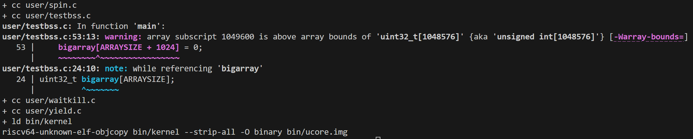

分析：

1. **我们补全的文件都编译、链接通过。** `trapentry.S`、`trap.c`、`syscall.c`、`proc.c`、`vmm.c`、`pmm.c` 都出现在输出中，没有 error，也没有来自这些文件的 warning。`trapentry.S` 能够汇编，说明扩展后的 `RESTORE_ALL` 中 `LOCAL` 标号、`SSTATUS_SPP`、`REGBYTES` 的用法正确。
2. **两条警告都不来自我们的实现。** `kmalloc.c:176` 是实验骨架自带的写法，`kva` 是整数却传给了需要指针的 `kva2page()`；GCC 15 默认把这类问题当作错误，所以 `Makefile` 中加了 `-Wno-error=int-conversion` 把它降为警告。`testbss.c:53` 的警告是测试程序故意写出数组边界之外（`bigarray[ARRAYSIZE + 1024]`），用来验证内核会终止越界访问的进程，编译器如实地指出了这一点，这条警告反而说明测试程序写对了。
3. **用户程序是被链接进内核镜像的。** lab4 的 `ucore.img` 只有 36912 字节，这次增大到 665600 字节。`obj/__user_*.out` 这 16 个用户 ELF 加起来有 620496 字节，约占镜像的 93%。`Makefile` 的链接命令用 `--format=binary` 把它们当作二进制数据块嵌入内核，并导出 `_binary_obj___user_<名字>_out_start`、`_binary_obj___user_<名字>_out_size` 两个符号，这正是 `KERNEL_EXECVE` 宏引用的符号。所以用户程序是在构建内核时就“预先加载”的：它们随内核镜像一起被 QEMU 装入内存，运行时 `load_icode` 再从内存中的 ELF 映像建立用户页表。这与常见操作系统在运行时从文件系统读取可执行文件不同，本实验没有文件系统，只能这样做。

### 5.2 运行内核，观察默认用户程序的完整运行过程

接着我们启动内核。没有指定测试程序时，`user_main` 默认启动 `exit`：

```bash
make qemu
```

QEMU 先输出 OpenSBI v1.3 的启动信息，随后是内核自己的输出。我们截取其中从物理内存管理开始的部分：

```text
memory management: default_pmm_manager
physical memory map:
  memory: 0x0000000008000000, [0x0000000080000000, 0x0000000087ffffff].
check_alloc_page() succeeded!
check_pgdir() succeeded!
check_boot_pgdir() succeeded!
use SLOB allocator
kmalloc_init() succeeded!
check_vma_struct() succeeded!
check_vmm() succeeded.
++ setup timer interrupts
kernel_execve: pid = 2, name = "exit".
I am the parent. Forking the child...
I am parent, fork a child pid 3
I am the parent, waiting now..
I am the child.
100 ticks
100 ticks
100 ticks
100 ticks
100 ticks
100 ticks
100 ticks
waitpid 3 ok.
exit pass.
100 ticks
all user-mode processes have quit.
init check memory pass.
Welcome to the kernel debug monitor!!
Type 'help' for a list of commands.
K>
```

输出停在 `K>` 提示符处，需要按 `Ctrl-A` 再按 `X` 才能退出 QEMU。

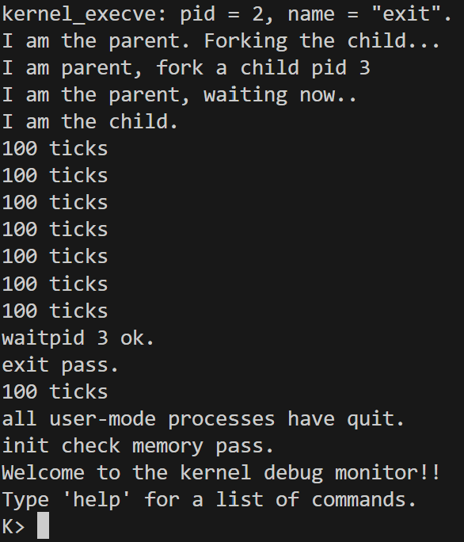

分析：

1. **前面实验的自检仍然通过。** `default_pmm_manager` 是 lab2 回填的 Best-Fit 分配器，`check_pgdir()`、`check_boot_pgdir()` 覆盖 `page_insert`/`page_remove`，`check_vmm()` 覆盖 VMA 的增删查。这些检查失败时内核会在 `assert` 处 panic，后面的输出就不会出现。
2. **第一次进入用户态成功。** `kernel_execve: pid = 2, name = "exit".` 由 `__KERNEL_EXECVE` 宏在调用 `kernel_execve` 之前打印；PID 是 2，因为 0 号是 `idleproc`、1 号是 `initproc`，`user_main` 是 `initproc` 创建的第一个线程。这一行之后的每一行都由 U 态的 `exit` 程序产生，说明 `do_execve`、`load_icode`、构造 trapframe、跳到 `__trapret` 并 `sret` 这条链路是通的：如果 trapframe 里的 `epc`、`sp` 或 `sstatus` 有任何一项不对，内核会在这里直接出现异常或卡死。
3. **每个字符都证明了一次完整的系统调用往返。** 用户库的 `cprintf` 对每个字符调用一次 `sys_putc`，也就是一次 `ecall` 进入内核、一次 `sret` 回到用户态。仅第一行 `I am the parent. Forking the child...` 就有 38 个字符，要往返 38 次。如果 `RESTORE_ALL` 没有把 `sscratch` 恢复成内核栈顶，第二次陷入时 `SAVE_ALL` 就会认错来源，输出不可能完整。
4. **`fork` 的返回值语义正确。** 父进程打印 `fork a child pid 3`，说明 `do_fork` 返回了子进程的 PID（下一个空闲 PID 是 3）；子进程打印 `I am the child.`，说明它从同一条 `ecall` 之后继续运行，并且 `fork` 在它那里返回 0（`copy_thread` 把子进程 trapframe 的 `a0` 置 0）。父进程的 `waiting now..` 先于子进程的输出，是因为 `fork` 之后父进程继续运行，直到它调用 `wait` 睡眠才轮到子进程。
5. **七条 `100 ticks` 对应子进程的七次 `yield`，不是缺陷。** 子进程每次 `yield` 只是置位 `need_resched`，返回用户态前 `trap()` 调用 `schedule()`。此时父进程睡在 `do_wait` 里、`initproc` 睡在 `do_wait` 里，没有其他可运行进程，`schedule()` 只能切到 `idleproc`；而 `idleproc` 只有在 `need_resched` 被置位时才重新调度，这个标志在时钟中断处理里每 100 个节拍（10 ms 一个节拍，即 1 秒）才置位一次。所以每次 `yield` 大约要等 1 秒，`exit` 一共要跑 8 秒左右，与 5.3 中评分脚本记录的耗时一致。
6. **退出码和回收都正确。** 子进程 `exit(magic)` 后，`do_exit` 记录 `exit_code`、变为僵尸并唤醒睡在 `WT_CHILD` 上的父进程；父进程在 `do_wait` 中找到僵尸，把退出码写入用户缓冲区（内核能直接写用户页，是因为 `idt_init` 设置了 `sstatus.SUM`），再释放内核栈和 PCB。`exit` 程序里 `waitpid(pid, &code) == 0 && code == magic` 的断言通过，随后第二次 `waitpid` 和 `wait()` 都返回非 0（`-E_BAD_PROC`），说明子进程的 PCB 确实已从进程树中摘除，于是打印 `waitpid 3 ok.` 和 `exit pass.`。
7. **`init_main` 的收尾检查通过。** `all user-mode processes have quit.` 说明 `init_main` 的 `do_wait(0, NULL)` 循环已经回收了 `user_main`（PID 2），再调用时返回 `-E_BAD_PROC`。`init check memory pass.` 之前的三条断言检查的是进程表：`initproc` 没有任何亲属指针、`nr_process` 回到了入口时的值、`proc_list` 中只剩 `initproc`。这说明 PID 2 和 PID 3 两个进程的 PCB 都被完整地摘除并释放了。
8. **内核最后停在 `K>` 是预期行为。** `initproc` 不能退出（`do_exit` 会因 `initproc exit.` panic），所以 `init_main` 在检查通过后关闭中断，进入 `kmonitor` 轮询控制台输入，评分脚本正是以“到达 `readline`”作为一次运行结束的标志。

### 5.3 自动评分测试 `make grade`

然后我们运行课程提供的评分脚本：

```bash
make grade
```

脚本会先清理工作区，把代码复制到临时目录 `/tmp/lab5_grade`，由 `tools/inject.py` 往副本里注入三个内核测试，然后对 13 个用户程序逐个编译、在 QEMU 中运行，并在串口输出里查找期望的字符串。我们得到的结果为：

```text
badsegment:              (2.2s)
  -check result:                             OK
  -check output:                             OK
divzero:                 (3.7s)
  -check result:                             OK
  -check output:                             OK
softint:                 (2.1s)
  -check result:                             OK
  -check output:                             OK
faultread:               (2.1s)
  -check result:                             OK
  -check output:                             OK
faultreadkernel:         (2.1s)
  -check result:                             OK
  -check output:                             OK
hello:                   (2.1s)
  -check result:                             OK
  -check output:                             OK
testbss:                 (2.1s)
  -check result:                             OK
  -check output:                             OK
pgdir:                   (2.1s)
  -check result:                             OK
  -check output:                             OK
yield:                   (7.2s)
  -check result:                             OK
  -check output:                             OK
badarg:                  (14.0s)
  -check result:                             OK
  -check output:                             OK
exit:                    (9.2s)
  -check result:                             OK
  -check output:                             OK
spin:                    (5.1s)
  -check result:                             OK
  -check output:                             OK
forktest:                (2.1s)
  -check result:                             OK
  -check output:                             OK
Total Score: 130/130
```

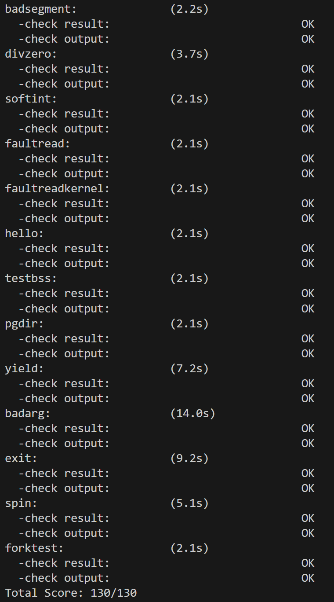

13 个程序的两项检查全部通过，总分 130/130。为了看清每个程序实际验证了什么，我们把它们与功能模块对应起来：

| 程序                                      | 验证的内容                                                                                        | 主要涉及的模块 |
| ----------------------------------------- | ------------------------------------------------------------------------------------------------- | -------------- |
| `hello`                                   | 用户态输出（`sys_putc`）、`getpid`、正常返回到 `exit`                                             | 一、二         |
| `pgdir`                                   | `sys_pgdir` 与 `print_pgdir`，用户页表的布局                                                      | 一、二         |
| `exit`                                    | `fork`、`yield`、`exit`、`waitpid` 的退出码传递和僵尸回收                                         | 一、三、四     |
| `badarg`                                  | `waitpid` 对非法 PID 和非法用户指针的拒绝（`user_mem_check`）                                     | 一、二、三、四 |
| `yield`                                   | `yield` 之后进程能被重新调度                                                                      | 一、四         |
| `spin`                                    | `kill` 一个死循环的子进程，再 `wait` 回收                                                         | 三、四         |
| `forktest`                                | 连续 `fork` 32 个子进程，全部回收后再 `wait` 必须失败                                             | 三、四         |
| `faultread`、`faultreadkernel`、`testbss` | 用户态非法访存时，进程被内核终止，不能出现 `user panic`                                           | 一、四         |
| `badsegment`、`divzero`、`softint`        | 原本针对 x86 的测试，在 RISC-V 上是占位或行为不同，只检查内核仍能正常启动、运行、退出（见 5.5.5） | 二             |

分析：

1. **评分结构。** 每个程序 10 分：其中 7 分来自该程序自己的期望输出（`check result`），3 分来自所有程序共有的内核输出（`check output`），后者包括三条注入测试的 `PASS` 行、`default_pmm_manager`、各项 `check_*() succeeded` 和 `++ setup timer interrupts`。13 个程序共 130 分，全部得分。
2. **四个模块在同一套测试里互相印证。** 每个程序的 `kernel_execve: pid = 2, name = "..."` 行证明模块二的启动链能把不同的 ELF 装载并运行；`exit`、`badarg`、`spin`、`forktest` 的通过证明模块三的 `fork` 和模块四的 `exit`、`kill`、回收在父子进程之间配合正确；所有输出文字都经由模块一的系统调用路径产生。评分时的 `init check memory pass.` 同样要求每个程序结束后进程表回到起点。
3. **耗时差异来自 `yield`。** 多数程序约 2 秒，只是 QEMU 启动加上脚本固定的等待。`yield` 要 7.2 秒（5 次 `yield`）、`exit` 要 10.7 秒（子进程 7 次 `yield`）、`badarg` 要 12.3 秒（子进程 10 次 `yield`）、`spin` 要 5.2 秒（父进程 3 次 `yield`）。这与 5.2 的分析一致：没有其他可运行进程时，每次 `yield` 都要等下一个 100 节拍（约 1 秒）才能被重新调度。
4. **评分在副本上进行，不会修改我们的代码。** 注入的测试位于 `tools/test_lab5.c`，脚本只改 `/tmp/lab5_grade` 里的副本，所以评分通过并不依赖我们在源码中加入任何测试代码。

### 5.4 评分脚本注入的内核测试

评分脚本注入的三个内核测试只在评分副本里存在。为了看清它们的输出，我们复现脚本的前几步，在 `/tmp` 的副本里编译并运行，再直接查看串口输出：

```bash
rm -rf /tmp/lab5_check && mkdir /tmp/lab5_check
tar -C . --exclude=.git --exclude=.vscode --exclude=bin --exclude=obj -cf - . | tar -C /tmp/lab5_check -xf -
python3 tools/inject.py /tmp/lab5_check
cd /tmp/lab5_check && make
timeout 20 qemu-system-riscv64 -machine virt -nographic -bios default \
    -kernel bin/ucore.img -serial file:/tmp/lab5_check.out -monitor none -no-reboot
sed -n '/memory management/,$p' /tmp/lab5_check.out
```

得到的输出为：

```text
memory management: default_pmm_manager
physical memory map:
  memory: 0x0000000008000000, [0x0000000080000000, 0x0000000087ffffff].
check_alloc_page() succeeded!
check_pgdir() succeeded!
check_boot_pgdir() succeeded!
use SLOB allocator
kmalloc_init() succeeded!
check_vma_struct() succeeded!
check_vmm() succeeded.
[Test Process Create] PASS
++ setup timer interrupts
syscall: invalid system call number 0 from pid 1
[Test Syscall] PASS
[Test Process Control] PASS
kernel_execve: pid = 2, name = "exit".
  ...
all user-mode processes have quit.
init check memory pass.
Welcome to the kernel debug monitor!!
Type 'help' for a list of commands.
K>
```

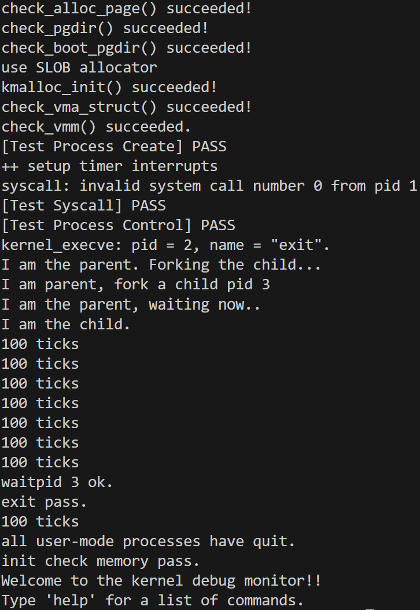

分析：

1. **`[Test Process Create] PASS`（模块二）。** 它出现在 `check_vmm() succeeded.` 之后、`++ setup timer interrupts` 之前，对应 `proc_init()` 的结尾，此时还没有开中断。测试断言 `current == idleproc`，`idleproc` 的 PID 为 0、状态为 `PROC_RUNNABLE`、`mm` 和 `tf` 均为 `NULL`；`initproc` 的 PID 为 1、状态为 `PROC_RUNNABLE`、`parent == idleproc`、`context.ra` 与 `context.sp` 非零。其中 `initproc->parent == idleproc` 正是 `do_fork` 在 `alloc_proc` 之后立即设置 `proc->parent = current` 的结果；`idleproc` 的 `mm` 和 `tf` 为 `NULL`，是因为它是启动时已有的执行流，不是 `fork` 出来的，也没有用户地址空间。
2. **`[Test Syscall] PASS`（模块一）。** 测试在内核里伪造一个 `cause == CAUSE_USER_ECALL`、`epc == 0x1000`、`a0 == SYS_getpid` 的 trapframe，直接交给 `exception_handler`，检查两件事：返回后 `epc` 变成 `0x1004`（前移了 4 字节），`a0` 等于当前进程的 PID；再把调用号改成 0，检查 `a0` 变成 `-E_INVAL`。屏幕上的 `syscall: invalid system call number 0 from pid 1` 就是第二次调用打印的：调用号 0 没有处理函数，`syscall()` 拒绝分发，既没有 panic，也没有通过空指针调用函数；`pid 1` 是因为这个测试运行在 `init_main` 里，当前进程是 `initproc`。
3. **`[Test Process Control] PASS`（模块四）。** 它位于 `init_main` 开头。测试检查 `do_yield()` 返回 0 且 `need_resched` 被置位，`do_kill(-1)` 返回 `-E_INVAL`（不存在的 PID），`do_wait(-1, NULL)` 返回 `-E_BAD_PROC`（不是子进程的 PID）。这三项恰好覆盖了 `do_yield` 只置标志、`do_kill` 先 `find_proc`、`do_wait` 先检查亲子关系的设计。
4. **三条 `PASS` 的位置本身也有意义。** 前一条在中断打开之前，后两条在 `++ setup timer interrupts` 之后、用户程序启动之前，说明三个模块的基础行为在第一个用户进程运行之前就已经正确。

### 5.5 逐个运行用户程序

评分脚本只检查关键字符串。为了看到每个程序完整的运行过程，我们用 `make build-<程序名>` 构建指定程序的镜像，再用 `make qemu` 运行。`build-%` 规则会在编译时定义 `TEST`、`TESTSTART`、`TESTSIZE`，使 `user_main` 通过 `KERNEL_EXECVE2` 启动指定的程序而不是默认的 `exit`。下面各小节中，如无特别说明，输出都只截取 `++ setup timer interrupts` 之后的部分。

#### 5.5.1 `hello` 与 `pgdir`：系统调用与用户页表

```bash
make build-hello && make qemu
make build-pgdir && make qemu
```

`hello` 的输出为：

```text
kernel_execve: pid = 2, name = "hello".
Hello world!!.
I am process 2.
hello pass.
100 ticks
all user-mode processes have quit.
init check memory pass.
```

`pgdir` 的输出为：

```text
kernel_execve: pid = 2, name = "pgdir".
I am 2, print pgdir.
-------------------- BEGIN --------------------
PDE2(002) 0000000000000000-0000000080000000 080000000 -r-
  PDE1(001) 0000000000800000-0000000000a00000 000200000 -r-
    PTE(001) 0000000000800000-0000000000801000 000001000 ur-
  PDE1(001) 000000007fe00000-0000000080000000 000200000 -r-
    PTE(004) 000000007fffc000-0000000080000000 000004000 urw
PDE2(001) 0000000080000000-00000000c0000000 040000000 -rw
PDE2(001) ffffffffc0000000-0000008000000000 040000000 -rw
--------------------- END ---------------------
pgdir pass.
100 ticks
all user-mode processes have quit.
init check memory pass.
```

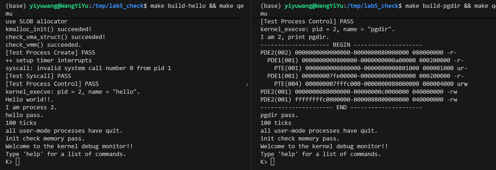

分析：

1. **`hello` 的 PID 是 2。** `getpid()` 通过 `sys_getpid` 返回 `current->pid`。它与 `kernel_execve` 那一行的 PID 相同，说明 `exec` 没有创建新进程：内核线程 `user_main`（PID 2）在原地被替换成了用户程序，只是进程名变成了 `hello`，PID、父子关系都不变。
2. **`print_pgdir` 的每一行是一段“权限相同的连续有效表项”。** 格式依次是层级与表项个数、虚拟地址区间、区间大小、权限。权限列由 `perm2str` 生成：`u` 表示带 `PTE_U`，`r` 固定输出，`w` 表示带 `PTE_W`，`X` 位不显示。
3. **用户部分。** 第一行 `PDE2(002)` 是 Sv39 根页表里的 0 号和 1 号两项，合起来覆盖 `0` 到 `0x80000000` 共 2 GiB 的用户地址空间。它们不带 R/W/X，是指向下一级页表的非叶子项，所以代码继续向下打印。用户代码在 `0x800000` 处只有一页（`ur-`），`user.ld` 把程序链接到 `0x800020`，页对齐后正是这一页；这一页含代码和只读数据，程序能运行说明它也带 `X` 位，只是不显示。栈是 `0x7fffc000` 到 `0x80000000` 共 4 页（`urw`），正好在 `USTACKTOP` 之下，与 `load_icode` 中“栈 VMA 有 1 MiB，但只为栈顶 4 页分配物理页”一致。
4. **内核部分。** 最后两行 `PDE2(001)` 是两个 1 GiB 的大页，直接是叶子，所以没有下一级。它们不带 `u`，用户态不能访问：一个是物理内存的恒等映射（`0x80000000` 起），一个是内核的高地址映射（`0xffffffffc0000000` 起）。这两项是 `setup_pgdir` 从 `boot_pgdir` 复制进每个进程页表的，因此内核代码在系统调用和中断发生时始终在当前页表中可见，不需要切换 `satp`；同时由于没有 `U` 位，用户程序又碰不到它们。最后一行的结束地址 `0000008000000000` 是最后一项之后的地址。

#### 5.5.2 `forktest` 与 `forktree`：大量 `fork`

```bash
make build-forktest && make qemu
make build-forktree && make qemu
```

`forktest` 的输出为：

```text
kernel_execve: pid = 2, name = "forktest".
I am child 31
I am child 30
  ...
I am child 1
I am child 0
forktest pass.
100 ticks
all user-mode processes have quit.
init check memory pass.
```

`forktree` 的输出为（共 31 行，下面截取开头和结尾）：

```text
kernel_execve: pid = 2, name = "forktree".
0002: I am ''
0004: I am '1'
0003: I am '0'
0008: I am '01'
0007: I am '00'
  ...
0012: I am '1011'
0011: I am '1010'
100 ticks
  ...
all user-mode processes have quit.
init check memory pass.
```

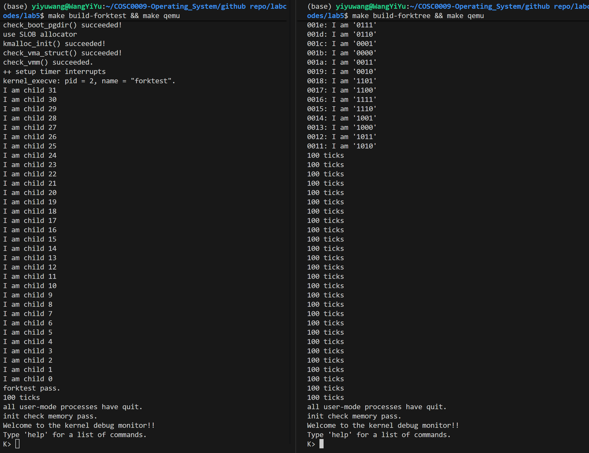

分析：

1. **32 个子进程全部被创建并回收。** `forktest` 的父进程连续 `fork` 32 次，再调用 32 次 `wait()`，最后一次 `wait()` 必须失败。输出 `forktest pass.` 说明 32 次 `wait` 都成功、第 33 次失败（`-E_BAD_PROC`），也就是父进程的子进程链 `cptr/optr` 在每次回收后都被正确维护；随后 `init check memory pass.` 说明这 33 个进程的 PCB 都已被摘除，`nr_process` 回到了起点。
2. **输出顺序是 31 到 0，这是调度顺序决定的。** 父进程 `fork` 32 次期间不会被切走（需要等到下一个 100 节拍才会触发抢占），所以它先创建完所有子进程，才调用 `wait` 睡眠。`set_links` 用 `list_add` 把新进程插在 `proc_list` 的表头，最新的子进程（`n = 31`）排在最前面；`schedule()` 从睡眠的父进程之后开始扫描，最先遇到的就是它。评分脚本只要求出现 31、19、13、0 这几行，并不依赖完整的顺序。
3. **写时复制在这里被大量触发。** 每次 `fork` 都不复制页面，只把可写页降为只读并打上 `PTE_COW`；32 个子进程各自在打印时写栈和数据，都会触发 store page fault 并由 `cow_resolve` 复制页面。32 个子进程全部正确运行并退出，说明引用计数在多次共享、复制、释放之后没有出错。
4. **`forktree` 验证嵌套的 `fork`。** 每个进程先打印自己，再创建 `'0'`、`'1'` 两个子进程，深度到 4 层为止，共 1 + 2 + 4 + 8 + 16 = 31 个进程，PID 从 `0002` 到 `0020`（十六进制），与输出行数一致。这说明子进程自己也能继续 `fork`，进程树的父子关系可以任意嵌套。每个子进程退出前还会 `yield` 一次，整个程序因此跑了近 30 秒，期间有 17 条 `100 ticks`，原因同 5.2 的第 5 点。结尾的 `init check memory pass.` 说明这棵 31 个节点的进程树被 `init_main` 的 `do_wait` 循环全部回收：父进程先于子进程退出时，子进程被过继给 `initproc`，由它回收。

#### 5.5.3 `badarg`：系统调用的参数检查

```bash
make build-badarg && make qemu
```

得到的输出为：

```text
kernel_execve: pid = 2, name = "badarg".
fork ok.
100 ticks
  ...（共 10 条）
badarg pass.
100 ticks
all user-mode processes have quit.
init check memory pass.
```

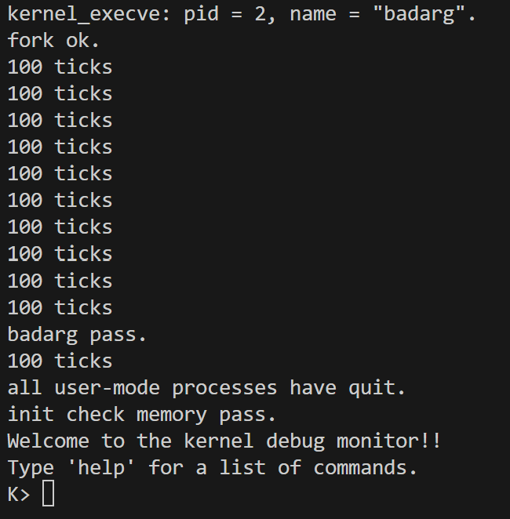

分析：`badarg` 的父进程依次做了三次 `waitpid`：`waitpid(-1, NULL)` 必须失败，因为 `-1` 不是任何子进程的 PID，`do_wait` 中 `find_proc(-1)` 返回 `NULL`，得到 `-E_BAD_PROC`；`waitpid(pid, (void *)0xC0000000)` 必须失败，因为 `0xC0000000` 超出用户地址空间，`do_wait` 在做任何事情之前先用 `user_mem_check` 检查 `code_store` 是否可写，得到 `-E_INVAL`；最后用合法参数 `waitpid(pid, &exit_code)` 必须成功，并得到子进程的退出码 `0xbeaf`。三次断言全部通过，输出 `badarg pass.`，说明 `do_wait` 先检查指针、再检查亲子关系、最后才回收的顺序正确，非法的用户指针不会让内核去写一个不属于用户的地址。输出里十条 `100 ticks` 对应子进程的十次 `yield`。

#### 5.5.4 `spin` 与 `waitkill`：`kill` 的两条路径

```bash
make build-spin && make qemu
make build-waitkill && make qemu
```

`spin` 的输出为：

```text
kernel_execve: pid = 2, name = "spin".
I am the parent. Forking the child...
I am the parent. Running the child...
I am the child. spinning ...
100 ticks
100 ticks
100 ticks
I am the parent.  Killing the child...
kill returns 0
wait returns 0
spin may pass.
100 ticks
all user-mode processes have quit.
init check memory pass.
```

`waitkill` 的输出为：

```text
kernel_execve: pid = 2, name = "waitkill".
wait child 1.
child 2.
child 1.
100 ticks
  ...（共 6 条）
kill parent ok.
100 ticks
  ...（共 6 条）
kill child1 ok.
100 ticks
100 ticks
all user-mode processes have quit.
init check memory pass.
```

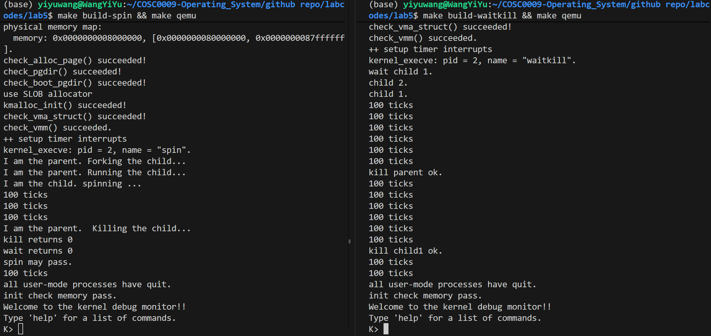

分析：

1. **`spin` 验证 `kill` 一个正在运行的进程。** 子进程是一个不会主动让出 CPU 的死循环。父进程 `yield` 三次让子进程运行，然后调用 `kill(pid)` 得到 0，再 `waitpid` 回收。`do_kill` 只是给子进程置位 `PF_EXITING`，并不停止它；子进程是在下一次时钟中断返回用户态时，由 `trap()` 发现 `PF_EXITING` 后调用 `do_exit(-E_KILLED)` 结束的。这条路径能走通，也说明时钟中断确实能打断一个死循环的用户进程。这里的三条 `100 ticks` 对应父进程的三次 `yield`：父进程每次让出 CPU 后，都要等到下一个置位 `need_resched` 的 100 节拍，才能从死循环的子进程手里拿回 CPU。
2. **`waitkill` 验证 `kill` 一个正在睡眠的进程，以及孤儿的过继。** 进程树是：主进程（PID 2）有两个子进程，`child 1` 是死循环，`child 2` 先 `yield` 六次，然后依次 `kill` 主进程和 `child 1`。主进程此时睡在 `waitpid` 里，`wait_state` 是 `WT_CHILD`，带有 `WT_INTERRUPTED` 位，所以 `do_kill` 在置位 `PF_EXITING` 之后立即 `wakeup_proc` 唤醒它；它醒来后在 `do_wait` 里发现 `PF_EXITING`，调用 `do_exit(-E_KILLED)`。主进程退出时，它的两个子进程变成孤儿，被过继给 `initproc`。随后 `child 2` 杀死死循环的 `child 1` 并正常退出。最后 `init_main` 的 `do_wait` 循环把过继来的两个子进程和 `user_main` 全部回收，打印 `all user-mode processes have quit.` 和 `init check memory pass.`。
3. **这一个程序同时覆盖了 `do_kill`、`do_exit` 的过继、`do_wait` 的 `PF_EXITING` 检查和 `init_main` 的回收循环**，其中任何一环出错，要么出现僵尸进程残留，`init_main` 的进程表断言失败，要么父进程永远睡眠，QEMU 停在这里。输出两段各 6 条 `100 ticks`，对应 `child 2` 的两组各 6 次 `yield`。

#### 5.5.5 异常相关的程序：被内核终止的进程

```bash
make build-faultread && make qemu
make build-faultreadkernel && make qemu
make build-testbss && make qemu
make build-divzero && make qemu
```

`faultread` 的输出为（寄存器内容省略）：

```text
kernel_execve: pid = 2, name = "faultread".
trapframe at 0xffffffffc04acee0
  zero     0x00000000
  ra       0x008000d8
  sp       0x7ffffff0
  ...
  status   0x00046020
  epc      0x008004c6
  tval 0x00000000
  cause    0x0000000d
killed by kernel.
100 ticks
all user-mode processes have quit.
init check memory pass.
```

`faultreadkernel` 与 `testbss` 的差别只在最后几行：

```text
  status   0x00046020
  epc      0x0080052c
  tval 0xfac00000
  cause    0x0000000d
killed by kernel.
```

```text
Making sure bss works right...
Yes, good.  Now doing a wild write off the end...
testbss may pass.
  ...
  status   0x00046020
  epc      0x008005d0
  tval 0x00c02000
  cause    0x0000000f
killed by kernel.
```

`divzero` 的输出为：

```text
kernel_execve: pid = 2, name = "divzero".
value is -1.
user panic at user/divzero.c:32:
    FAIL: T.T

100 ticks
all user-mode processes have quit.
init check memory pass.
```

> 【截图 5-9】`faultread` 与 `testbss` 的输出，需要包含 `cause` 一行和 `killed by kernel.`。

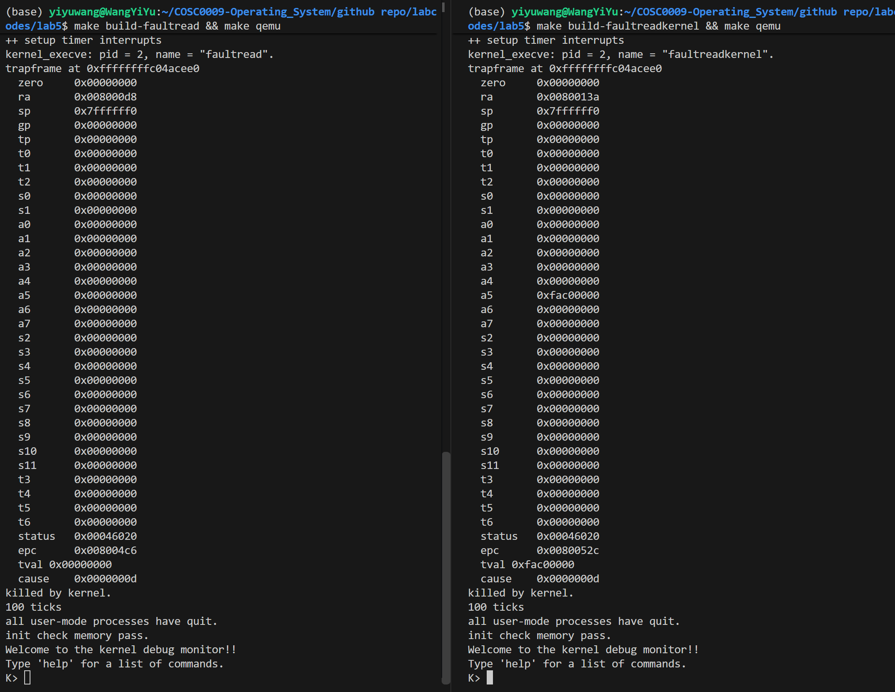

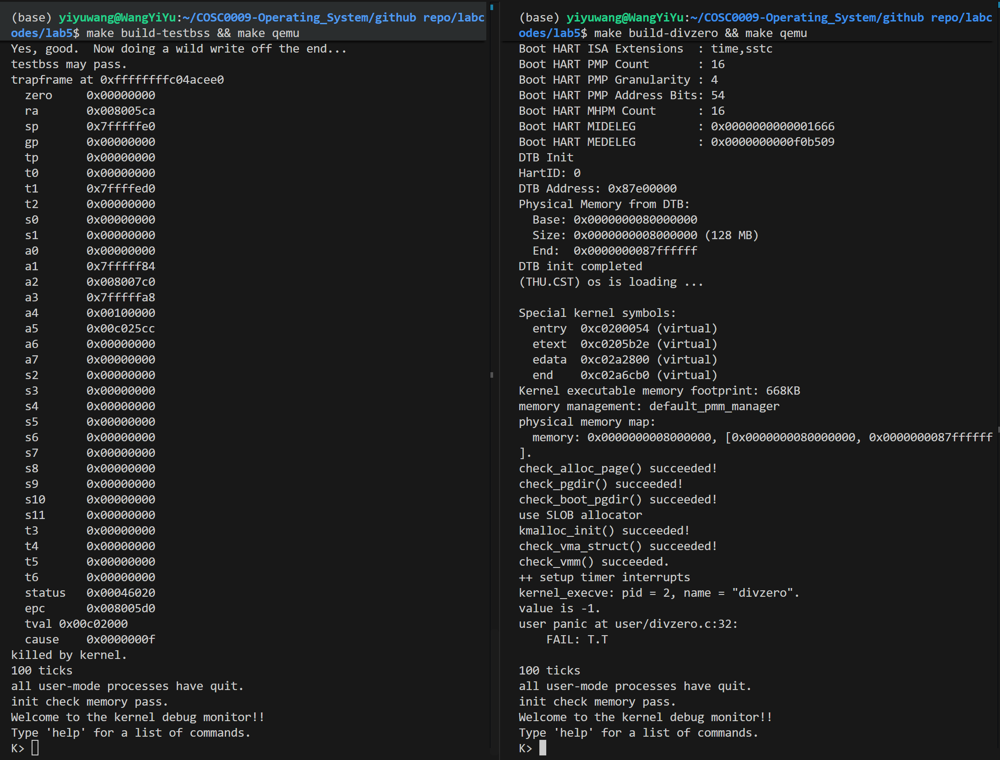

分析：

1. **三种非法访存都被内核识别并终止。** `faultread` 读地址 `0`，`cause = 0xd`（13，load page fault），`tval = 0`；`faultreadkernel` 读 `0xfac00000`，同样是 `cause = 0xd`，`tval` 就是出错地址；`testbss` 先成功地清零并读写了 4 MiB 的 `.bss`，再写到数组末尾之后的 `0xc02000`，`cause = 0xf`（15，store page fault）。这三个地址都不在进程的任何 VMA 里，页表里也没有映射。内核没有按需分页的缺页处理，`exception_handler` 只会先让 `cow_resolve` 判断是不是合法的 COW 写，这三次都不是（地址不在 VMA 内，或没有对应的 PTE），于是落到最后一个分支：打印 trapframe 和 `killed by kernel.`，然后 `do_exit(-E_KILLED)`。
2. **`status = 0x00046020` 说明这些异常来自用户态。** 其中 `SPP`（第 8 位）为 0，表示陷入前处于 U 态，`SPIE`（`0x20`）为 1，`SUM`（`0x40000`）为 1。所以这个分支里 `trap_in_kernel(tf)` 为假，只终止进程，不会 panic。
3. **被杀的进程被完整地回收了。** 三个程序都打印了 `all user-mode processes have quit.` 和 `init check memory pass.`，说明进程被杀之后 `do_exit` 释放了它的地址空间并变成僵尸，`init_main` 的 `do_wait` 正常回收了它，内核状态保持一致，没有因为一个坏进程而 panic 或卡死。没有这个终止分支时，异常返回后会重新执行同一条出错的指令，进程会一直重复缺页，这些程序会跑到评分脚本的超时才结束。
4. **`divzero` 的结果与 x86 不同，属于正常。** RISC-V 的整数除法不会因为除数为 0 而陷入，而是返回 `-1`，所以程序打印 `value is -1.`，随后执行到源码里本来不应到达的 `panic("FAIL: T.T")`，由用户库的 `__panic` 打印 `user panic` 并 `exit(-E_PANIC)`。评分脚本对这个程序只要求出现 `value is -1.` 和 `init check memory pass.`，不禁止 `user panic`，进程正常退出并被回收，所以通过。
5. **`badsegment` 和 `softint` 是 x86 测试的占位。** `badsegment` 原本通过加载 TSS 段选择子触发异常，RISC-V 没有这个概念，程序只调用 `panic`；`softint` 原本执行 `int $14`，该行已被注释掉，程序直接退出。两者都只验证内核能正常启动、运行用户程序并回收，输出中分别是 `user panic at user/badsegment.c:26` 和直接的 `all user-mode processes have quit.`。

### 5.6 COW 测试 `cowtest`

最后我们运行 Challenge 的专用测试：

```bash
make build-cowtest && make qemu
```

得到的输出为：

```text
kernel_execve: pid = 2, name = "cowtest".
cowtest pass.
100 ticks
all user-mode processes have quit.
init check memory pass.
```

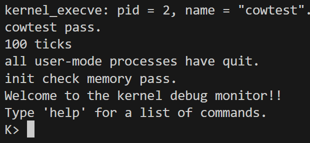

分析：

1. **测试分两个阶段。** 第一阶段重复 12 轮：父进程 `fork` 一个子进程，子进程和父进程分别向同一个全局变量和同一页数组写入不同的值，之后都要读回自己写的值。因为 `fork` 之后两边共享同一物理页，第一次写入必然触发 store page fault，由 `cow_resolve` 复制页面，两边的写入互不可见才能通过断言。第二阶段同时存在 4 个子进程，页面被 5 个进程共享，每个子进程写入自己的值，最后父进程的数据必须保持不变。
2. **内核写 COW 页的路径也被覆盖。** 子进程的退出码通过 `waitpid` 写入一个按页对齐的缓冲区。这次写入由内核执行：`do_wait` 在 S 态向用户页做 store，而这页此时是共享的只读 COW 页，会在内核态触发 store page fault。`exception_handler` 的 COW 分支只检查异常原因和 `current`，不区分来自哪个特权级，所以同样能修复并重试这条 store。
3. **输出 `cowtest pass.` 意味着全部断言通过，且回收正确。** 12 轮 `fork`/`exit`/`wait` 反复共享、复制、释放页面，之后 `init_main` 的进程表检查和 `all user-mode processes have quit.` 都正常，说明引用计数没有出现提前释放（会让另一方读到垃圾数据）或漏释放（会让 `exit_mmap` 的断言失败）。这个测试连同 5.3 中的 `exit`、`forktest` 一起通过，说明 COW 版 `fork` 在功能上与基础版一致。

### 5.7 对照实验

上面的测试都是“正确实现能通过”。为了确认关键设计确实是必要的，而不是碰巧能跑，我们在 `/tmp` 的副本里各去掉一处实现，观察内核的反应，工作区的代码没有改动。

#### 5.7.1 去掉 `exception_handler` 里的 `tf->epc += 4`

```bash
rm -rf /tmp/lab5_mutA && mkdir /tmp/lab5_mutA
tar -C . --exclude=.git --exclude=.vscode --exclude=bin --exclude=obj -cf - . | tar -C /tmp/lab5_mutA -xf -
cd /tmp/lab5_mutA
sed -i '/tf->epc += 4;/d' kern/trap/trap.c
make build-hello
timeout 10 qemu-system-riscv64 -machine virt -nographic -bios default \
    -kernel bin/ucore.img -serial file:/tmp/lab5_mutA.out -monitor none -no-reboot
sed -n '/++ setup timer/,$p' /tmp/lab5_mutA.out | head -6
wc -l /tmp/lab5_mutA.out
```

得到的输出为：

```text
++ setup timer interrupts
kernel_execve: pid = 2, name = "hello".
Hsyscall: invalid system call number 0 from pid 2
syscall: invalid system call number -3 from pid 2
syscall: invalid system call number -3 from pid 2
syscall: invalid system call number -3 from pid 2
54140 /tmp/lab5_mutA.out
```

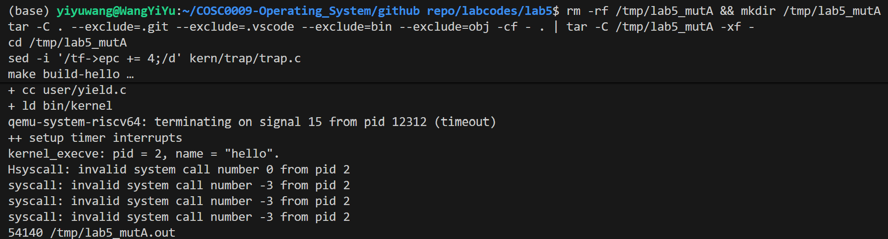

分析：

1. **第一个字符 `H` 能正常输出。** 第一次 `ecall` 的调用号是 `SYS_putc`、参数是字符 `H`，系统调用本身执行成功，返回值 0 写入 `a0`。
2. **返回后程序陷入循环。** 没有前移 `epc`，`sret` 回到的仍然是那条 `ecall`。此时 `a0` 已经被覆盖成上一次的返回值 0，用户程序再次执行 `ecall` 就变成了调用号 0 的系统调用；`syscall()` 拒绝它并把 `-E_INVAL`（即 `-3`）写入 `a0`，下一次 `ecall` 的调用号又变成 `-3`，如此无限重复。10 秒内串口输出文件共有 25203 行，其中 25109 行是同一句 `invalid system call number -3`，`hello` 永远打印不出第二个字符，也到不了 `hello pass.`。
3. **这既说明 `epc` 前移不可省略，也验证了调用号的边界检查。** 调用号 0 和 `-3` 都被拒绝，内核没有 panic，也没有用它们去索引分发表。如果 `syscall()` 没有检查下界，`-3` 会读到 `syscalls[]` 之外的内存并跳转过去，结果将是不可预测的崩溃。

#### 5.7.2 让用户页不带 `PTE_U`

```bash
rm -rf /tmp/lab5_mutE && mkdir /tmp/lab5_mutE
tar -C . --exclude=.git --exclude=.vscode --exclude=bin --exclude=obj -cf - . | tar -C /tmp/lab5_mutE -xf -
cd /tmp/lab5_mutE
sed -i 's/perm = PTE_U | PTE_V;/perm = PTE_V;/' kern/process/proc.c
make build-hello
timeout 10 qemu-system-riscv64 -machine virt -nographic -bios default \
    -kernel bin/ucore.img -serial file:/tmp/lab5_mutE.out -monitor none -no-reboot
sed -n '/++ setup timer/,$p' /tmp/lab5_mutE.out
```

得到的输出为（寄存器内容省略）：

```text
++ setup timer interrupts
kernel_execve: pid = 2, name = "hello".
trapframe at 0xffffffffc04acee0
  ...
  sp       0x80000000
  ...
  status   0x00046020
  epc      0x00800020
  tval 0x00800020
  cause    0x0000000c
killed by kernel.
100 ticks
all user-mode processes have quit.
init check memory pass.
Welcome to the kernel debug monitor!!
Type 'help' for a list of commands.
K>
```

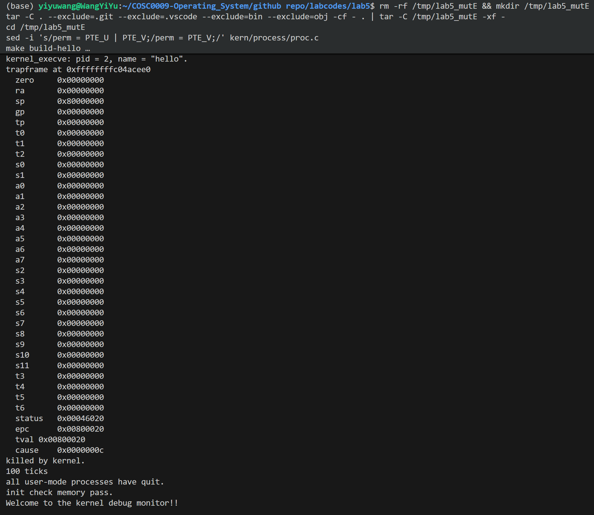

分析：

1. **进程在第一条指令就被终止。** `cause = 0xc`（12，instruction page fault），`epc` 和 `tval` 都是 `0x800020`，也就是 `user.ld` 规定的程序入口。ELF 段的页没有 `PTE_U`，U 态取指时硬件判定为非法访问。这说明 `PTE_U` 是用户与内核页面隔离的硬件基础，`load_icode` 必须为用户页带上它。
2. **这个失败位置本身也证明了启动链的其余部分是对的。** 控制流确实以 U 态到达了 `epc = e_entry`（`status` 的 `SPP` 位为 0），栈指针是 `USTACKTOP`（`sp = 0x80000000`），说明 `load_icode` 构造的 trapframe 和 `kernel_execve` 的 `__trapret` 路径都已经生效，只是页权限不对。
3. **异常终止路径同样可靠。** 进程被 `do_exit(-E_KILLED)` 结束后，`init_main` 回收了它，打印 `all user-mode processes have quit.` 和 `init check memory pass.`，内核仍然停在正常的 `K>` 提示符。

---

## 六、实验总结与收获

### 6.1 对操作系统的理解

1. 本实验中的知识点，以及与 OS 原理的对应：

| 实验中的知识点                                                                                             | 对应的 OS 原理                                 | 含义与差异                                                                                                                                     |
| ---------------------------------------------------------------------------------------------------------- | ---------------------------------------------- | ---------------------------------------------------------------------------------------------------------------------------------------------- |
| 用户库把系统调用号放入 `a0`、参数放入 `a1`～`a5` 后执行 `ecall`；内核在 `syscall()` 里分发，结果写回 `a0`  | 系统调用：用户态获得内核服务的受控入口         | 原理上对应“陷入 + 内核服务例程 + 返回”。本实验用 RISC-V 的 U 态 `ecall` 和统一的 `trapframe`，没有单独的系统调用门或 fast syscall 指令         |
| `RESTORE_ALL` 根据 `sstatus.SPP` 设置 `sscratch`；用户态陷入时 `SAVE_ALL` 用 `sp` 与 `sscratch` 交换栈指针 | 双栈模型：用户栈与内核栈分离                   | 完整操作系统里，用户线程在内核栈上保存 Trap 现场。本实验用 `sscratch` 在两种栈之间切换，规模小，但机制与“用户代码不在内核栈上跑”一致           |
| `kernel_execve` 构造 trap 返回路径；`load_icode` 解析 ELF、建 VMA、装段、设用户栈和 `trapframe`            | 程序装载：把可执行文件映射进地址空间并跳到入口 | 用户程序二进制链接进内核镜像，由 `KERNEL_EXECVE` 宏引用，不是从磁盘或文件系统按路径打开。装载发生在 `exec` 路径上，没有独立的动态链接器        |
| `do_fork` 复制 `mm`、页表和用户页内容；子进程 `trapframe` 里 `a0` 为 0                                     | `fork`：子进程继承父进程映像并得到新执行实体   | 本实验按 VMA 预映射并复制页，没有做写时复制（Challenge 另做）。子进程第一次被调度时的现场由 `copy_thread` 布置，与 lab4 内核线程首次运行链类似 |
| `do_execve` 回收旧 `mm`，`load_icode` 建立新映像；`do_exit` 释放 `mm` 后变僵尸，`do_wait` 回收 PCB         | 进程生命周期：创建、替换映像、退出与收尸       | `init_main` 的 `do_wait` 循环负责收掉用户进程和孤儿，形成与 Unix 中 init 进程收尸相近的结构。没有独立的信号、作业控制或会话                    |
| 访问用户指针前经 `user_mem_check`，页表项带 `PTE_U`                                                        | 内存保护：内核不信任用户地址                   | 检查的是当前进程的 VMA 与页权限，还没有缺页异常驱动的按需分配                                                                                  |

2. 通过整组实验串联起来，可以看到用户进程建立在哪些前提上：

- lab2 的页分配与 `page_insert` 提供物理页和映射维护；lab4 的 PCB、调度与 `switch_to` 提供执行流切换；lab3 的 Trap 保存与恢复提供陷入路径。lab5 在此基础上增加 U 态返回、独立用户页表和用户栈，并把进程管理接口接到系统调用上。
- 一次 `fork` 同时涉及进程对象、内核栈上的 trapframe、用户地址空间和页表引用计数。任一层的约定不一致，都会在 `wait`、`exit` 或调度返回时暴露为僵尸泄漏、页表残留或用户态无法继续执行。

3. OS 原理中很重要、但本实验没有完整对应上的知识点：

- **从文件系统或 loader 装载程序。** 用户 ELF 嵌在镜像里，没有路径解析、解释器和按需读盘。
- **缺页异常与按需分页。** 用户区间在 `exec`/`fork` 时一次性映射，访问未映射页不会进入页故障处理。
- **写时复制。** 标准 `fork` 路径复制物理页；CoW 在 Challenge 中单独讨论。
- **多 hart 与用户态并发。** 仍为单核 FIFO 调度，系统调用与进程管理临界区主要靠关中断保护。
- **完整的用户态运行时。** 用户库只封装少量系统调用；没有完整的 libc、线程库或信号机制。

### 6.2 AI 协作开发的经验

**跨文件的约定要写成可核对的清单，提示词才不容易漏项。** 阅读 4.1.2 可见系统调用模块同时约束汇编、`exception_handler`、`syscall` 九处转发，以及 `print_pgdir` 的链接依赖。单写「实现 syscall」时，模型常会漏 `epc += 4`、漏非法编号返回 `-E_INVAL`，或漏 `RESTORE_ALL` 里对用户态的 `sscratch` 处理。规格文档里把这些写成 Case 和 Requirements，比一段笼统描述更易对照源码验收。
