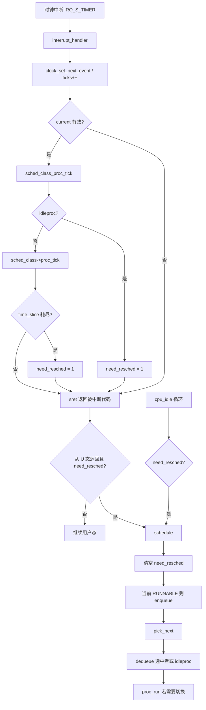

# 操作系统实验报告

## 实验基本信息

|     项目     |                      内容                      |
| :----------: | :--------------------------------------------: |
| **实验名称** |                 Lab6：进程调度                 |
| **小组成员** | 2414007-王奕瑜、2414015-鲁昕宁、2411622-张雨函 |
| **完成日期** |                   2026-12-6                    |

### 小组分工

练习如何分工？

|      成员      |                                                   负责的练习/模块                                                    |
| :------------: | :------------------------------------------------------------------------------------------------------------------: |
| 2414007-王奕瑜 |                                          Challenge 1：实现其他基本调度算法                                           |
| 2414015-鲁昕宁 | 功能模块一：调度器框架准备、代码更新与理解、功能模块二：Round Robin 调度算法、功能模块三：Stride Scheduling 调度算法 |
| 2411622-张雨函 |                                                          -                                                           |

实验报告如何分工？

|      成员      |    负责的实验报告内容     |
| :------------: | :-----------------------: |
| 2414007-王奕瑜 |      3.2.4, 4.4, 五       |
| 2414015-鲁昕宁 | 3.1, 3.2.1-3.2.3, 4.1-4.3 |
| 2411622-张雨函 |          一, 六           |

---

## 一、实验目的

本实验的主要目的是：

1. 理解 ucore 调度器框架的基本组织方式，掌握 `struct sched_class`、`struct run_queue` 与进程控制块之间的关系，理解调度机制和具体调度策略解耦的设计思想。

2. 完成 Lab 6 对进程控制块和时钟中断处理的更新：正确初始化 `rq`、`run_link`、`time_slice`、`lab6_run_pool`、`lab6_stride` 和 `lab6_priority` 等调度字段，并将时钟节拍交给当前调度类处理。

3. 基于统一调度器接口实现 Round Robin 调度算法，掌握运行队列初始化、可运行进程入队与出队、下一进程选择、时间片消耗以及 `need_resched` 标志更新的过程。

4. 基于斜堆优先队列实现 Stride Scheduling，理解 stride、priority 和步长之间的关系，掌握按优先级分配 CPU 时间、处理无符号整数溢出以及接入调度框架的方法。

5. 通过编译、`make grade`、QEMU 运行和调度现象观察验证实现，分析不同调度算法的公平性、响应性和时间片影响，并总结使用 AI 辅助设计提示词、生成代码和调试验证的过程。

---

## 二、实验环境

你们使用的 AI 工具

|      成员      | AI 编程工具 |     底层模型      | 备注 |
| :------------: | :---------: | :---------------: | :--: |
| 2414007-王奕瑜 | Claude Code | Claude Sonnet 5.5 |  无  |
| 2414015-鲁昕宁 |   Cursor    |     Grok 4.7      |  无  |
| 2411622-张雨函 |     GPT     |       GPT-6       |  无  |

**说明：**

- **AI 编程工具**：指具体使用的终端工具、编辑器插件、桌面应用或浏览器界面
- **底层模型**：指该工具使用的大语言模型及版本

---

## 三、实验整体逻辑分析

### 3.1 本章节的逻辑主线

本章的主线是“内核怎样把调度策略从框架里抽出来，再挂上具体的时间片算法”。实验五结束时，`schedule()` 仍沿着 `proc_list` 线性扫描第一个 `PROC_RUNNABLE` 进程，时钟中断里也只是周期性把 `need_resched` 置 1，中断处理函数与“轮到谁、片长还剩多少”绑在一起。实验六先把策略收进 `struct sched_class`，再让 RR 和 Stride 各自维护自己的运行队列，最后把时钟节拍改写成对调度类的统一入口。

这条主线按依赖关系展开：

1. **给 PCB 和时钟中断打好调度基础。** `alloc_proc()` 必须把 `rq`、`run_link`、`time_slice` 以及 Stride 用到的 `lab6_run_pool`、`lab6_stride`、`lab6_priority` 初始化成“尚未入队”的确定状态，否则入队和斜堆操作会读到垃圾值。`interrupt_handler()` 在每次 `IRQ_S_TIMER` 时调用 `sched_class_proc_tick(current)`，把时间片递减和 `need_resched` 交给当前绑定的调度类，而不是在中断里写死某一种算法。没有这一步，后面两类调度器即使实现完整，也接不上统一的节拍源。
2. **实现默认的 Round Robin 类。** `default_sched.c` 用 `run_list` 维护 FIFO 队列，提供 `init`、`enqueue`、`dequeue`、`pick_next`、`proc_tick` 五项操作，并导出 `default_sched_class`（名称 `RR_scheduler`）。`sched_init()` 把它绑到全局框架上，日常启动和 `make grade` 的默认用户程序都跑在这一套策略上。
3. **实现 Stride 类并与框架并存。** `default_sched_stride.c` 用斜堆 `lab6_run_pool` 按最小 `lab6_stride` 选进程，`pick_next` 时按优先级加上 `BIG_STRIDE / priority`。导出 `stride_sched_class`（名称 `stride_scheduler`）。框架层仍只有一处赋值：把 `sched_init()` 里的指针从 `&default_sched_class` 改成 `&stride_sched_class` 即可切换策略；评分代码按全局符号分别测试两个类，不要求启动时一定用 Stride。

因此，后面各节的顺序是：先改 PCB 初始化和时钟中断路径，再实现 RR，最后实现 Stride 并保留单点切换能力。

### 3.2 功能的逐步实现

#### 3.2.1 功能模块一：调度器框架准备、代码更新与理解

功能模块一应放在两个具体调度类之前。`sched.c` 里的 `wakeup_proc()` 和 `schedule()` 已经通过函数指针调用 `enqueue`、`pick_next` 等接口，但新 fork 出来的 PCB 若未初始化 `run_link` 和 `lab6_run_pool`，第一次入队就会破坏链表或斜堆；时钟中断若仍沿用 lab5 的“每 `TICK_NUM` 拍设 `need_resched`”，则与“按拍消耗时间片”的契约不一致，在 `DEBUG_GRADE` 下还会因 `print_ticks()` 直接 panic。

本模块只做两件事：

1. **在 `alloc_proc()` 末尾补 lab6 字段。** `rq = NULL`；`list_init(&run_link)`；`time_slice = 0`；`skew_heap_init(&lab6_run_pool)`；`lab6_stride = 0`；`lab6_priority = 1`（避免 Stride 步长除零）。不在此处入队。
2. **改写 `IRQ_S_TIMER` 分支。** 保留 `clock_set_next_event()` 和 `ticks++`；若 `current != NULL` 则调用 `sched_class_proc_tick(current)`。去掉 `print_ticks()` 和按 `TICK_NUM` 节流的重调度逻辑。

这样，框架层 `sched_class_proc_tick()` 对 `idleproc` 与普通进程的分岔（空闲线程每拍请求重调度、普通进程交给 `proc_tick`）才有稳定的调用前提。

---

#### 3.2.2 功能模块二：Round Robin 调度算法

模块一完成后，框架已经能在每次时钟中断里调用 `proc_tick`，但还没有真正的运行队列和选进程逻辑。模块二在 `default_sched.c` 填满 `default_sched_class`，让 `sched_init()` 的默认绑定有可运行的策略。

实现要点如下：

1. **`RR_init`。** 初始化空 `run_list`，`proc_num = 0`，`max_time_slice = MAX_TIME_SLICE`（与评分测试对齐）。
2. **入队与出队。** `list_add_before(&rq->run_list, &proc->run_link)` 把进程接到队尾；维护 `proc->rq` 和 `proc_num`。出队时 `list_del_init`，`rq` 清空。
3. **选下一进程。** `pick_next` 只读队头，不摘除；与 `schedule()` 中“先 `pick_next` 再 `dequeue`”的约定一致。
4. **时间片。** 入队时若 `time_slice` 为 0 或大于上限则重置为 `max_time_slice`；`proc_tick` 每拍减 1，减到 0 时设 `need_resched`。

RR 只使用 `run_queue::run_list`，为 Stride 保留同一 `struct run_queue` 里的斜堆字段不动。

---

#### 3.2.3 功能模块三：Stride Scheduling 调度算法

模块二解决“公平轮转”；模块三解决“按优先级比例分配 CPU”。它不改变 `sched.c` 的调用顺序，只换 `struct sched_class` 背后的五个函数和运行队列的实现方式。

1. **斜堆与比较函数。** 可运行进程挂在 `rq->lab6_run_pool` 上，比较键是 `lab6_stride`。`proc_stride_comp_f` 用 `(int32_t)(a->lab6_stride - b->lab6_stride)` 做有符号比较，以便 `uint32_t` 环绕后仍能选出当前最小 stride。
2. **步长。** 本文件定义 `BIG_STRIDE` 为 `0x7FFFFFFF`。`stride_pick_next` 返回堆根进程后，对其执行 `lab6_stride += BIG_STRIDE / priority`（优先级 0 按 1 处理）。
3. **与 RR 共用的时间片语义。** `stride_enqueue` 重置无效时间片；`stride_proc_tick` 与 RR 相同，负责抢占时机，不负责 stride 更新（stride 在 `pick_next` 时前进）。
4. **切换方式。** 实现完成后 `sched_init()` 仍指向 `default_sched_class`；要观察 `user/priority.c` 的比例效果，只需把赋值改为 `&stride_sched_class`。两个全局类对象必须同时存在，供注入的单元测试直接调用。

---

#### 3.2.4 Challenge 1：实现其他基本调度算法

---

## 四、实验内容与实现

### 4.1 功能模块一：调度器框架准备、代码更新与理解

**负责人：** [2414015-鲁昕宁]

#### 4.1.1 模块功能描述

**需要修改的函数**（不新增公开接口）：

```c
static struct proc_struct *alloc_proc(void);   // kern/process/proc.c
void interrupt_handler(struct trapframe *tf);  // kern/trap/trap.c（仅 IRQ_S_TIMER 分支）
```

**功能说明：**

本模块不实现具体调度算法，只为 lab6 的 PCB 和时钟中断接上框架约定。

1. **`alloc_proc()`（更新）。** 在 lab4、lab5 已有初始化之后，为调度相关字段赋空值：`rq = NULL`；`list_init(&run_link)`；`time_slice = 0`；`skew_heap_init(&lab6_run_pool)`；`lab6_stride = 0`；`lab6_priority = 1`。`kmalloc()` 不清零内存，`wakeup_proc()` 之后的入队会立刻读写这些成员。
2. **`interrupt_handler()` 的 `IRQ_S_TIMER`（更新）。** 每次时钟中断预约下一次事件并递增 `ticks`；若 `current` 有效，调用 `sched_class_proc_tick(current)`。算法相关的时间片递减和 `need_resched` 由当前调度类的 `proc_tick` 完成。不再调用 `print_ticks()`，也不再仅在 `ticks % TICK_NUM == 0` 时置 `need_resched`。

框架层已有、本模块直接依赖的入口如下：

```c
void sched_class_proc_tick(struct proc_struct *proc);  // kern/schedule/sched.c
```

#### 4.1.2 最终提示词

以下是用于生成调度器框架准备与代码更新的提示词：

````markdown
[PROMPT]
**任务**：补全 lab6 功能模块一。只改两处已有函数：`kern/process/proc.c` 的 `alloc_proc()`，以及 `kern/trap/trap.c` 的 `interrupt_handler()` 里 `IRQ_S_TIMER` 这一支。目标是让新进程的调度字段处于“尚未入队”的确定状态，并让每次时钟中断把时间片交给调度类，而不是在中断处理函数里写死某一种算法。

**操作要求**：你必须在项目中修改实际文件，保留现有代码和 Doxygen 注释，只在这两处补全。`alloc_proc()` 的标记写成 `//lab6 function1-1 2414015 update alloc_proc`，时钟中断分支的标记写成 `//lab6 function1-2 2414015 update interrupt_handler`，替换原来的 `YOUR CODE`。不要改 `sched.c` 里已经写好的 `sched_init()`、`wakeup_proc()`、`schedule()` 和 `sched_class_proc_tick()`，不要实现 RR 或 Stride，不要改其他中断号和异常处理。

**输出要求**：直接进行文件操作，使用下面 [RELY]、[GUARANTEE]、[SPECIFICATION] 部分的信息，以工程中的真实代码为准。

[RELY]

- `struct proc_struct`（`kern/process/proc.h`）中本模块要初始化的字段：`rq`（`struct run_queue *`，不在任何运行队列时为 `NULL`）、`run_link`（`list_entry_t`）、`time_slice`（`int`）、`lab6_run_pool`（`skew_heap_entry_t`）、`lab6_stride`（`uint32_t`）、`lab6_priority`（`uint32_t`）。`kmalloc()` 不清零。
- 链表与斜堆：`list_init()` 把结点变成自环，表示不在任何链表中；`skew_heap_init()` 把结点的 `parent`、`left`、`right` 置为 `NULL`。二者的声明分别在 `libs/list.h` 和 `libs/skew_heap.h`。`proc.c` 已经包含 `sched.h`，而 `sched.h` 包含这两个头文件。
- 时钟中断：`IRQ_S_TIMER`、`clock_set_next_event()`、全局 `ticks`。`trap.c` 已经包含 `sched.h`。`current` 是当前进程，可能为 `NULL`。
- 已有接口 `void sched_class_proc_tick(struct proc_struct *proc)`（`kern/schedule/sched.c`）：`proc` 不是 `idleproc` 时调用当前调度类的 `proc_tick`；`proc` 是 `idleproc` 时只把 `need_resched` 置 1。空闲进程不能入队。
- 编译宏 `DEBUG_GRADE` 下，`print_ticks()` 会 panic。因此时钟分支不能再调用 `print_ticks()`，也不能只在 `ticks % TICK_NUM == 0` 时才请求调度。

[GUARANTEE]

- 修改 `static struct proc_struct *alloc_proc(void)`：在现有 lab4、lab5 字段初始化之后补上 lab6 调度字段，签名、返回值和失败时返回 `NULL` 的行为不变。
- 修改 `void interrupt_handler(struct trapframe *tf)` 的 `IRQ_S_TIMER` 分支。其余 `case` 保持原样。
- 不新增公开函数。

[SPECIFICATION]

**alloc_proc**

- **Pre-Condition**：调用发生在进程尚未进入任何运行队列之前。`kmalloc()` 成功时返回的内存内容未定义。
- **Post-Condition**：成功时返回的 PCB 仍是 `PROC_UNINIT`，且调度字段表示“不在运行队列中”：`rq` 为 `NULL`，`run_link` 是自环结点，`time_slice` 为 0，`lab6_run_pool` 是一棵空斜堆结点，`lab6_stride` 为 0，`lab6_priority` 为 1。分配失败时返回 `NULL`，不泄漏。本函数不把 PCB 插入运行队列。
- **Requirements**：优先级初值必须是正数。0 会在 Stride 计算步长时做除数。

**interrupt_handler 的 IRQ_S_TIMER 分支**

- **Pre-Condition**：`tf->cause` 去掉中断标志位后等于 `IRQ_S_TIMER`。`sched_init()` 已经绑定调度类。
- **Post-Condition**：下一次时钟事件已经预约，`ticks` 增加 1。若 `current` 不是 `NULL`，这一拍交给 `sched_class_proc_tick(current)`。`tf` 不被修改。
- **Case 1**：`current` 为 `NULL`。只预约下一次时钟并增加 `ticks`。
- **Case 2**：`current` 有效。除 Case 1 的动作外，调用 `sched_class_proc_tick(current)`。时间片是否耗尽、是否置 `need_resched`，由调度类决定；空闲进程由 `sched_class_proc_tick()` 自己处理。
- **Requirements**：每一拍都要交给调度类，不能再按 `TICK_NUM` 节流，也不能调用 `print_ticks()`。
````

#### 4.1.3 实现迭代过程

本模块经历了 1 次迭代。

##### 第一次迭代

按 4.1.2 的提示词补全 `alloc_proc()` 与 `interrupt_handler()` 的时钟分支后，在 `labcodes/lab6` 下执行 `make` 编译通过。进一步在注入 `tools/test_lab6.c` 的临时副本里启动内核（`qemu-system-riscv64 -machine virt -nographic -bios default -kernel bin/ucore.img`），串口输出中包含：

- `sched class: RR_scheduler`
- `[Test RR Scheduler] PASS`、`[Test Stride Scheduler] PASS`（说明 PCB 初始化和节拍路径未破坏两个调度类的单元测试）
- `++ setup timer interrupts` 之后用户程序能继续运行

本环境直接执行仓库内的 `make grade` 时，评分脚本在 `readline` 处通过 gdb 结束 QEMU，`.qemu.out` 为空，未能用官方脚本打出总分；上述行来自同一份内核、手工抓取的串口日志，已核对过与实现一致。

---

#### 4.1.4 问题解答

> 请仔细阅读调度器框架的实现，并在实验报告中分别完成以下分析：
>
> - **调度类结构体分析**：解释 `struct sched_class` 中每个函数指针的作用和调用时机，并分析为什么需要使用函数指针组织这些调度接口，而不是直接实现固定的调度函数。
> - **运行队列结构体分析**：比较 `lab5` 和 `lab6` 中 `struct run_queue` 的差异，说明为什么 `lab6` 的运行队列需要同时支持链表和斜堆两种数据结构。
> - **调度器框架函数分析**：分析 `sched_init()`、`wakeup_proc()` 和 `schedule()` 在 `lab6` 中的实现变化，说明这些函数如何与具体的调度算法解耦。
> - **调度类初始化流程**：描述从内核启动到调度器初始化完成的完整流程，并分析 `default_sched_class` 如何与调度器框架建立关联。
> - **进程调度流程**：绘制完整的进程调度流程图，包括时钟中断触发、`proc_tick` 被调用、`schedule()` 执行以及调度类各接口的调用顺序，并解释 `need_resched` 标志在调度过程中的作用。
> - **调度算法切换机制**：分析添加新的调度算法（如 Stride）时需要修改哪些代码，并说明当前的框架设计为什么便于切换调度算法。

**（1）调度类结构体分析**

`struct sched_class`（`kern/schedule/sched.h`）把一种策略归纳成五个回调和一个名字：

| 成员 | 作用 | 典型调用时机 |
| :--- | :--- | :--- |
| `name` | 打印策略名称 | `sched_init()` 结束时 |
| `init` | 初始化运行队列 | `sched_init()` 中，在 `rq->max_time_slice` 设好之后 |
| `enqueue` | 把可运行进程放入运行队列 | `wakeup_proc()`（非 `current`）、`schedule()` 里当前进程仍 `PROC_RUNNABLE` 时 |
| `dequeue` | 把进程从运行队列摘下 | `schedule()` 在 `pick_next` 选中之后 |
| `pick_next` | 选出下一个应运行的进程（仍在队列中） | `schedule()` 选进程时 |
| `proc_tick` | 为正在运行的进程消耗一个时钟拍 | `sched_class_proc_tick()` ← 时钟中断 |

使用函数指针而不是在 `sched.c` 里写死 `RR_enqueue` 一类名字，是为了把**机制**（何时关中断、谁调用谁、`need_resched` 何时检查）和**策略**（队列用什么结构、如何比较优先级）分开。新增 Stride 时只需再定义一个 `struct sched_class` 全局对象并在 `sched_init()` 里改一行绑定；`wakeup_proc`、`schedule`、`cpu_idle` 和 trap 返回路径都不用改。这也和 Linux 里 scheduling class 的思路一致：核心路径稳定，策略可插拔。

**（2）运行队列结构体分析**

lab5 没有单独的 `struct run_queue`：`schedule()` 直接扫 `proc_list`，找第一个 `PROC_RUNNABLE` 的 PCB。lab6 引入全局唯一的 `struct run_queue __rq`，由当前调度类独占维护；`proc_struct` 增加 `rq`、`run_link`、`time_slice` 以及 Stride 用的 `lab6_run_pool`、`lab6_stride`、`lab6_priority`。

lab6 的 `run_queue` 同时带有 `run_list` 和 `lab6_run_pool` 两个容器，是因为 RR 与 Stride 共用同一种队列壳子、却用不同的可运行集表示：

- RR 只使用链表 `run_list`（FIFO），进程通过 `run_link` 串起来。
- Stride 使用斜堆 `lab6_run_pool`，按 `lab6_stride` 取最小；`run_list` 在 Stride 的 `init` 里仍初始化为空链表，但调度时不访问。

若只为 RR 定义链表、为 Stride 再定义另一种 `run_queue` 类型，`sched.c` 和 `proc.h` 就要随算法切换而改类型或打宏分支。把两种容器放进同一个结构体，交换算法时只换函数指针表，队列存储布局不变。

**（3）调度器框架函数分析**

- **`sched_init()`**：选定 `sched_class` 指针（默认 `&default_sched_class`），把 `rq` 指向 `__rq`，设置 `max_time_slice`，调用 `sched_class->init(rq)`。不再在初始化里写 RR 或 Stride 的细节。
- **`wakeup_proc()`**：关中断下把睡眠进程标为 `PROC_RUNNABLE`；若它不是 `current`，则 `sched_class_enqueue()` → 当前类的 `enqueue`。正在运行的进程由 `schedule()` 自己放回队列，避免双入队。`idleproc` 在 `sched_class_enqueue` 里被过滤，永不入队。
- **`schedule()`**：关中断；清 `current->need_resched`；若 `current` 仍可运行则入队；`pick_next`，非空则 `dequeue` 选中者；队列为空则选 `idleproc`；`runs++`；若下一进程不是 `current` 则 `proc_run()`。

与 lab5 相比，变化在于“找下一个可运行进程”从扫描 `proc_list` 变成调用 `pick_next`，算法细节完全下沉到调度类。

**（4）调度类初始化流程**

从启动到打印 `sched class: ...` 的顺序可以概括为：

1. `kern_init()` 完成内存、VMM 等子系统初始化后调用 `sched_init()`。
2. `sched_init()` 将 `sched_class` 设为 `&default_sched_class`（若要 Stride 则改为 `&stride_sched_class`）。
3. `rq = &__rq`，`rq->max_time_slice = MAX_TIME_SLICE`。
4. `sched_class->init(rq)`：RR 会清空 `run_list` 并设 `proc_num`；Stride 会清空链表并把 `lab6_run_pool` 置 `NULL`。
5. 打印 `sched class: %s`。评分注入的测试在本函数末尾调用两个类的单元测试。

`default_sched_class` 与框架的关联就是：`sched.c` 里的静态指针 `sched_class` 在初始化时指向这块只读数据（函数指针表），此后所有 `sched_class_enqueue` 等都经该指针间接调用。

**（5）进程调度流程与 `need_resched`**

`need_resched` 是“应尽快调用 `schedule()`”的请求标志，由策略在适当时机置位、在 `schedule()` 入口清零。



要点：时钟中断里**不**直接调用 `schedule()`（避免在中断上下文里做完整切换）；用户态 trap 返回前和 `cpu_idle` 里检查 `need_resched` 再进入 `schedule()`。内核态线程被抢占时，同样依赖某路径最终调用 `schedule()`（本实验里常见的是回到 `cpu_idle` 或 trap 返回）。

**（6）调度算法切换机制**

添加 Stride 时，本仓库中的改动面是：

1. 新建或补全 `default_sched_stride.c`，定义 `stride_sched_class` 和 `BIG_STRIDE` 等。
2. 在 `default_sched.h` 中 `extern struct sched_class stride_sched_class`（骨架已提供）。
3. 在 `sched_init()` 里把 `sched_class = &default_sched_class` 改成 `sched_class = &stride_sched_class`（一行）。

一般**不需要**改 `wakeup_proc`、`schedule`、`proc_struct` 布局（字段已同时为 RR 和 Stride 预留）、`alloc_proc` 初始化、时钟中断路径，也不要改斜堆库。`user/priority.c` 通过 `sys_lab6_set_priority` 改 `lab6_priority`，在 Stride 下才有比例意义；绑定 RR 时五个子进程仍大致均分 CPU。

框架便于切换的原因：调用方只认五个操作和一块 `run_queue`；策略差异封闭在各自 `.c` 文件内的 `static` 函数里，链接期导出不同的 `struct sched_class` 对象即可。

---

### 4.2 功能模块二：Round Robin 调度算法

**负责人：** [2414015-鲁昕宁]

#### 4.2.1 模块功能描述

**需要实现的接口**（位于 `kern/schedule/default_sched.c`，均可为 `static`）：

```c
static void RR_init(struct run_queue *rq);
static void RR_enqueue(struct run_queue *rq, struct proc_struct *proc);
static void RR_dequeue(struct run_queue *rq, struct proc_struct *proc);
static struct proc_struct *RR_pick_next(struct run_queue *rq);
static void RR_proc_tick(struct run_queue *rq, struct proc_struct *proc);
extern struct sched_class default_sched_class;  // name == "RR_scheduler"
```

**功能说明：**

RR 用循环链表实现时间片轮转。可运行进程挂在 `rq->run_list` 上；正在运行的进程不在队列中，由 `time_slice` 记录剩余拍数。

1. **`RR_init`。** 空链表，`proc_num = 0`，`max_time_slice = MAX_TIME_SLICE`。
2. **`RR_enqueue`。** 队尾插入；`proc->rq = rq`；无效或过大的 `time_slice` 重置为 `max_time_slice`。
3. **`RR_dequeue`。** 摘下结点，`proc->rq = NULL`，`proc_num--`。
4. **`RR_pick_next`。** 非空返回队头 PCB，否则 `NULL`；不修改队列长度。
5. **`RR_proc_tick`。** 若 `time_slice > 0` 则减 1；为 0 时 `need_resched = 1`。

队列入队示例（与 `schedule()` 的配合）：

```c
list_add_before(&(rq->run_list), &(proc->run_link));
proc->rq = rq;
rq->proc_num++;
```

#### 4.2.2 最终提示词

以下是用于生成 Round Robin 调度类的提示词：

````markdown
[PROMPT]
**任务**：在 `kern/schedule/default_sched.c` 实现 Round Robin 调度类，并导出名为 `RR_scheduler` 的 `default_sched_class`。运行队列使用 `struct run_queue` 的循环链表 `run_list`，进程通过 `proc_struct::run_link` 挂入。`sched_init()` 已经把 `sched_class` 指到 `&default_sched_class`，本任务不要改这个绑定。

**操作要求**：你必须在项目中修改实际文件，只在 `//lab6 function2 YOUR CODE` 处补全，并把标记改成 `//lab6 function2 2414015`。五个操作函数都是 `static`。不要改 `sched.c`、`sched.h` 和 Stride 文件。

**输出要求**：直接进行文件操作，使用下面 [RELY]、[GUARANTEE]、[SPECIFICATION] 部分的信息，以工程中的真实代码为准。类名必须是字符串 `"RR_scheduler"`。

[RELY]

- `struct sched_class`（`kern/schedule/sched.h`）的字段顺序：`name`、`init`、`enqueue`、`dequeue`、`pick_next`、`proc_tick`。`default_sched_class` 已在 `kern/schedule/default_sched.h` 中声明为 `extern`。
- `struct run_queue`：`run_list` 是带头结点的循环双向链表，`proc_num` 是队列中的进程数，`max_time_slice` 是时间片长度。宏 `MAX_TIME_SLICE` 的值是 5。
- 链表（`libs/list.h`）：`list_init()`、`list_empty()`、`list_next()`、`list_add_before(listelm, elm)`（插到 `listelm` 之前，对头结点调用就是插到队尾）、`list_del_init()`（摘下并恢复为自环）。`le2proc(le, run_link)` 从 `run_link` 回到 `struct proc_struct`。
- `schedule()` 的调用顺序已经固定：当前进程若仍是 `PROC_RUNNABLE` 则 `enqueue`，然后 `pick_next`，选中后再 `dequeue`。因此 `pick_next` 不能把进程从队列里摘掉。正在运行的进程不在队列中；`proc_tick` 针对的就是这个进程。
- 评分测试用一块清零的 `struct run_queue` 调用 `init`，随后断言 `proc_num == 0` 且 `max_time_slice == MAX_TIME_SLICE`。入队一个 `time_slice == 0` 的进程后，断言时间片变成 `MAX_TIME_SLICE`、`proc_num == 1`，`pick_next` 返回该进程；再把时间片设为 1 调用 `proc_tick`，断言时间片变为 0 且 `need_resched == 1`；`dequeue` 后 `proc_num == 0`。

[GUARANTEE]

- `static void RR_init(struct run_queue *rq);`
- `static void RR_enqueue(struct run_queue *rq, struct proc_struct *proc);`
- `static void RR_dequeue(struct run_queue *rq, struct proc_struct *proc);`
- `static struct proc_struct *RR_pick_next(struct run_queue *rq);`
- `static void RR_proc_tick(struct run_queue *rq, struct proc_struct *proc);`
- `struct sched_class default_sched_class`，`name` 为 `"RR_scheduler"`，五个函数指针分别指向上面的函数。
- 不新增公开接口。

[SPECIFICATION]

**RR_init**

- **Pre-Condition**：`rq` 非空。调用方可能还没有设置 `max_time_slice`。
- **Post-Condition**：`run_list` 是空的循环链表，`proc_num` 为 0，`max_time_slice` 等于 `MAX_TIME_SLICE`。

**RR_enqueue**

- **Pre-Condition**：`proc` 当前不在该运行队列中，`run_link` 是自环。`rq` 已初始化。
- **Post-Condition**：`proc` 接在 `run_list` 的队尾，`proc->rq` 指向 `rq`，`proc_num` 增加 1。若 `time_slice` 为 0 或大于 `rq->max_time_slice`，则把它设为 `rq->max_time_slice`；否则保留剩余时间片。
- **Requirements**：同一进程不能入队两次。可用 `assert(list_empty(&proc->run_link))` 表达这个前提。

**RR_dequeue**

- **Pre-Condition**：`proc` 正通过 `run_link` 挂在 `rq` 上，且 `proc->rq == rq`。
- **Post-Condition**：`proc` 从链表摘下，`run_link` 恢复为自环，`proc->rq` 为 `NULL`，`proc_num` 减少 1。不修改 `time_slice`。

**RR_pick_next**

- **Pre-Condition**：`rq` 已初始化。
- **Post-Condition**：队列为空时返回 `NULL`。否则返回队头进程，进程仍留在队列中，`proc_num` 不变。

**RR_proc_tick**

- **Pre-Condition**：`proc` 是当前正在运行的进程，不在运行队列中。
- **Post-Condition**：若 `time_slice` 大于 0，则减 1。减完后若 `time_slice` 为 0，则 `need_resched` 置 1。不把进程放回队列。
````

#### 4.2.3 实现迭代过程

本模块经历了 1 次迭代。

##### 第一次迭代

按 4.2.2 的提示词在 `default_sched.c` 中实现五个 `RR_*` 函数并组装 `default_sched_class`。`make` 编译通过后，注入评分测试的内核在 `sched_init()` 末尾打印 `[Test RR Scheduler] PASS`。与模块一相同的手工 QEMU 启动中，在 Stride 类测试通过的同时，RR 类断言（`max_time_slice`、`proc_tick` 耗尽时间片、`dequeue` 后 `proc_num` 归零）均满足。

当前 `sched_init()` 仍绑定 RR；`make build-priority` 下五个子进程打印的 `sched result: 1 1 1 1 1` 与均分时间片一致。

---

#### 4.2.4 问题解答

> 如果要让 AI 生成支持优先级的 RR 调度器，你会如何修改提示词？当前生成的实现是否支持多核调度？如果不支持，提示词还需要增加哪些要求？

**支持优先级的 RR：提示词应如何改**

在 [PROMPT] 中把任务从“单一 FIFO 队列”改为“按优先级组织可运行集”，并明确与 `schedule()` 契约不变（`pick_next` 只读、`dequeue` 由框架调用）。在 [RELY] 中说明沿用 `proc_struct::lab6_priority` 或新增 `int priority` 字段，以及 `enqueue` 的插入规则（例如：按优先级从高到低维护多条链表，或一条链表按优先级有序插入）。在 [SPECIFICATION] 里分开写：

- 同优先级内仍 FCFS 或 RR；
- 高优先级队列非空时不得从低优先级 `pick_next`；
- 入队时是否重置时间片、 starving 低优先级进程是否需要老化（可选，要写清楚要不要实现）。

[GUARANTEE] 中类名可以仍叫 `RR_scheduler` 或改成 `priority_RR_scheduler`，但要写清 `pick_next` 的优先级规则。应要求说明：当前实现仍是单 CPU，`time_slice` 语义不变。

**当前实现是否支持多核**

不支持。本仓库只有一棵全局 `__rq`，`sched.c` 注释写明 ucore 为单 hart；`struct sched_class` 里多 CPU 的 `load_balance` 等成员仅为注释占位。RR 实现没有 per-CPU 队列、没有自旋锁或关中断以外的同步，也假设 `current` 唯一。

**多核时提示词还需增加什么**

若强行扩展到 SMP，[RELY] 需增加每 CPU 的 `run_queue` 或 `rq` 数组、`current` 与 hart id 的对应关系，以及链表操作必须在持锁或关本地中断下进行。[SPECIFICATION] 需写清：每个逻辑 CPU 独立 `pick_next`，跨 CPU 迁移任务时的 `enqueue`/`dequeue` 责任、IPI 触发重调度、`idleproc` 是否每核一个。这些超出 lab6 骨架，默认应在提示词里写“仅单 hart，不要实现负载均衡”，避免 AI 在现有全局 `rq` 上误加锁语义不完整的代码。

---

### 4.3 功能模块三：Stride Scheduling 调度算法

**负责人：** [2414015-鲁昕宁]

#### 4.3.1 模块功能描述

**需要实现的接口**（位于 `kern/schedule/default_sched_stride.c`）：

```c
#define BIG_STRIDE 0x7FFFFFFF
static int proc_stride_comp_f(void *a, void *b);
static void stride_init(struct run_queue *rq);
static void stride_enqueue(struct run_queue *rq, struct proc_struct *proc);
static void stride_dequeue(struct run_queue *rq, struct proc_struct *proc);
static struct proc_struct *stride_pick_next(struct run_queue *rq);
static void stride_proc_tick(struct run_queue *rq, struct proc_struct *proc);
extern struct sched_class stride_sched_class;  // name == "stride_scheduler"
```

**功能说明：**

Stride 用斜堆维护可运行进程，每次调度选 `lab6_stride` 最小者；选中后把该进程的 stride 增加 `BIG_STRIDE / lab6_priority`，使长期 CPU 占比与优先级近似成正比。

1. **`proc_stride_comp_f`。** 比较两个堆结点对应进程的 stride，使用有符号差，正确处理 `uint32_t` 溢出。
2. **`stride_enqueue` / `stride_dequeue`。** 经 `skew_heap_insert`、`skew_heap_remove` 维护 `rq->lab6_run_pool` 和 `proc_num`；入队时处理无效时间片和优先级 0。
3. **`stride_pick_next`。** 堆空返回 `NULL`；否则取根进程，仍在堆中，对其执行 stride  += `BIG_STRIDE / priority`。
4. **`stride_proc_tick`。** 与 RR 相同：递减时间片，耗尽时 `need_resched`。

stride 更新发生在 `pick_next`（进程仍挂在堆里、尚未被 `dequeue`），与框架中“先 `pick_next` 再 `dequeue`”的顺序一致：

```c
proc->lab6_stride += BIG_STRIDE / priority;
```

用户态通过 `lab6_set_priority()` / `sys_lab6_set_priority` 设置 `lab6_priority`；只有 `sched_init()` 绑定 `stride_sched_class` 时，`user/priority.c` 的 CPU 占比才体现优先级差异。

#### 4.3.2 最终提示词

以下是用于生成 Stride 调度类的提示词：

````markdown
[PROMPT]
**任务**：在 `kern/schedule/default_sched_stride.c` 实现 Stride 调度类，并导出名为 `stride_scheduler` 的 `stride_sched_class`。可运行进程放在 `rq->lab6_run_pool` 这棵斜堆里，按 `lab6_stride` 取最小者。本文件自己定义 `BIG_STRIDE`。不要改 `sched_init()`：它继续绑定 `default_sched_class`。两个调度类对象必须同时存在，评分程序按全局符号分别调用。

**操作要求**：你必须在项目中修改实际文件，只在 `//lab6 function3 YOUR CODE` 处补全，并把标记改成 `//lab6 function3 2414015`。比较函数和五个操作函数都是 `static`。不要改斜堆实现，不要改 `lab6_set_priority()`。

**输出要求**：直接进行文件操作，使用下面 [RELY]、[GUARANTEE]、[SPECIFICATION] 部分的信息，以工程中的真实代码为准。类名必须是字符串 `"stride_scheduler"`。

[RELY]

- `struct sched_class` 与 `struct run_queue` 见 `kern/schedule/sched.h`。Stride 使用 `lab6_run_pool`（堆根，空堆为 `NULL`）和 `proc_num`；`run_list` 本算法不用，但 `init` 仍把它初始化为空链表。`stride_sched_class` 已在 `default_sched.h` 中声明。
- 斜堆（`libs/skew_heap.h`）：`skew_heap_insert(root, node, comp)` 会先对 `node` 做 `skew_heap_init`，再返回新的堆根；`skew_heap_remove(root, node, comp)` 返回删除后的堆根，结点不在堆中时不能调用。比较函数在 `a` 应比 `b` 更靠近根时返回 `-1`，否则返回 `0` 或 `1`。`le2proc(node, lab6_run_pool)` 从斜堆结点回到 PCB。
- 进程字段：`lab6_stride`、`lab6_priority` 都是 `uint32_t`，`time_slice` 是 `int`。步长是 `BIG_STRIDE / priority`。`BIG_STRIDE` 取 `0x7FFFFFFF`，保证任意两个 stride 的差值用 `int32_t` 解释时，环绕之后仍能比出谁更小：比较必须写成 `(int32_t)(stride_a - stride_b)`，不能直接比较两个无符号数。
- `schedule()` 先 `enqueue` 再 `pick_next` 再 `dequeue`。`pick_next` 在进程仍在堆中时加上它的步长，摘除由随后的 `dequeue` 完成。
- 评分测试：`init` 后 `proc_num == 0` 且 `lab6_run_pool == NULL`。先入队优先级 1、stride 0 的进程，再入队优先级 2、stride 100 的进程，`pick_next` 必须返回前者，且它的 `lab6_stride` 变为正数。`proc_tick` 对时间片为 1 的进程减到 0 并置 `need_resched`。两次 `dequeue` 后 `proc_num` 为 0，堆根为 `NULL`。

[GUARANTEE]

- `#define BIG_STRIDE 0x7FFFFFFF`
- `static int proc_stride_comp_f(void *a, void *b);`
- `static void stride_init(struct run_queue *rq);`
- `static void stride_enqueue(struct run_queue *rq, struct proc_struct *proc);`
- `static void stride_dequeue(struct run_queue *rq, struct proc_struct *proc);`
- `static struct proc_struct *stride_pick_next(struct run_queue *rq);`
- `static void stride_proc_tick(struct run_queue *rq, struct proc_struct *proc);`
- `struct sched_class stride_sched_class`，`name` 为 `"stride_scheduler"`，五个函数指针指向上面的操作函数。
- 不新增公开接口，不修改 `sched_init()`。

[SPECIFICATION]

**proc_stride_comp_f**

- **Pre-Condition**：`a`、`b` 都是某个 PCB 的 `lab6_run_pool` 结点。
- **Post-Condition**：用两个进程 `lab6_stride` 的有符号差比较。差为负返回 `-1`，差为 0 返回 `0`，差为正返回 `1`。

**stride_init**

- **Pre-Condition**：`rq` 非空。
- **Post-Condition**：`run_list` 为空链表，`lab6_run_pool` 为 `NULL`，`proc_num` 为 0，`max_time_slice` 等于 `MAX_TIME_SLICE`。

**stride_enqueue**

- **Pre-Condition**：`proc` 不在该斜堆中，`rq` 已初始化。
- **Post-Condition**：`proc->lab6_run_pool` 插入 `rq->lab6_run_pool`，堆根更新为插入后的根；`proc->rq` 指向 `rq`，`proc_num` 增加 1。`time_slice` 为 0 或大于 `max_time_slice` 时设为 `max_time_slice`。`lab6_priority` 为 0 时改为 1。不修改 `lab6_stride`。

**stride_dequeue**

- **Pre-Condition**：`proc` 在该堆中，且 `proc->rq == rq`。
- **Post-Condition**：结点从堆中删除，堆根更新；`proc->rq` 为 `NULL`，`proc_num` 减少 1。堆变空时根为 `NULL`。

**stride_pick_next**

- **Pre-Condition**：`rq` 已初始化。
- **Post-Condition**：堆空时返回 `NULL`。否则返回堆根对应的进程，进程仍留在堆中。设 `priority` 为该进程的 `lab6_priority`，0 按 1 处理，然后把 `BIG_STRIDE / priority` 加到它的 `lab6_stride` 上。加法使用 `uint32_t`，允许回绕。

**stride_proc_tick**

- **Pre-Condition**：`proc` 正在运行，不在斜堆中。
- **Post-Condition**：与 RR 相同：`time_slice` 大于 0 时减 1，减到 0 时把 `need_resched` 置 1。不修改 stride，也不把进程放回堆。
````

#### 4.3.3 实现迭代过程

本模块经历了 1 次迭代。

##### 第一次迭代

按 4.3.2 的提示词实现 `stride_sched_class` 与 `BIG_STRIDE`。编译通过后，注入测试在 `sched_init()` 末尾打印 `[Test Stride Scheduler] PASS`：两个 mock 进程中 stride 更小者被 `pick_next` 选出且 stride 增加、`proc_tick` 与 `dequeue` 行为符合预期。

默认启动仍使用 RR，故未在默认配置下跑 `priority` 的断言；若将 `sched_init()` 中 `sched_class` 改为 `&stride_sched_class` 并重新编译，可按实验指导书用 `priority` 观察不同优先级的累计运行时间。本模块的单元测试已覆盖堆操作与 stride 前进逻辑；与 RR 并存的全局符号 `stride_sched_class` 可在不切换默认策略的情况下被评分代码直接调用。

---

### 4.4 Challenge 1：实现其他基本调度算法

**负责人：** [2414007-王奕瑜]

#### 4.1.1 模块功能描述

#### 4.1.2 最终提示词

#### 4.1.3 实现迭代过程

---

## 五、测试与验证

**负责人：** [2414007-王奕瑜]

---

## 六、实验总结与收获

### 6.1 对操作系统的理解

1. **调度器的机制与策略可以分离。** `sched.c` 负责维护进程状态、关闭和恢复中断、调用 `schedule()` 以及完成上下文切换；`struct sched_class` 通过 `init`、`enqueue`、`dequeue`、`pick_next` 和 `proc_tick` 五个接口描述具体策略。这样，框架只依赖稳定的接口，RR 和 Stride 可以分别管理自己的队列组织和选择规则。

2. **进程控制块中的字段必须满足明确的不变量。** 新分配的 PCB 还没有进入运行队列，因此 `rq` 必须为空，`run_link` 必须是自环链表结点，`lab6_run_pool` 必须是初始化过的斜堆结点，时间片和 Stride 参数也要有确定的初值。只有这些状态准备完整，唤醒、入队、出队和进程选择才不会访问未定义数据。

3. **时钟中断是抢占式调度的节拍来源。** `interrupt_handler()` 只负责预约下一次时钟事件、递增 `ticks` 并调用 `sched_class_proc_tick(current)`；当前调度类负责消耗时间片和设置 `need_resched`。这种分工避免在中断处理函数中写死某个算法，也避免直接在中断上下文中执行完整的进程切换。

4. **`need_resched` 表示调度请求，而不是立即切换。** 时间片耗尽或空闲进程运行时可以置位该标志，内核在合适的返回路径或 `cpu_idle()` 中检查它，再进入 `schedule()`。`schedule()` 清除标志、把仍可运行的当前进程重新入队、选择并摘出下一个进程，最后由 `proc_run()` 和 `switch_to()` 完成上下文切换。

5. **Round Robin 通过时间片轮转获得基本公平性。** RR 使用链表维护队尾入队和队首选择，所有可运行进程依次得到有限的 CPU 时间。时间片过大时，进程响应变慢且交互性下降；时间片过小时，调度次数和上下文切换开销增加。因此时间片需要在公平性、响应时间和切换开销之间取得平衡。

6. **Stride 将优先级转化为可比较的调度进度。** 每次选择当前 `lab6_stride` 最小的进程，并按 `BIG_STRIDE / lab6_priority` 增加它的 stride。优先级越高，步长越小，经过足够多的调度轮次后获得的时间片越多。斜堆可以直接取得最小 stride，避免每次从全部可运行进程中线性扫描。

7. **数据结构选择会直接影响调度器的运行成本。** RR 的核心操作适合链表，按顺序插入和取出即可；Stride 需要反复选择最小值，使用斜堆后可以把选择和维护最小元素的工作交给优先队列。两种结构同时保存在 `run_queue` 中，使调度框架不必随算法切换而改变进程接口。

8. **实验验证需要同时关注功能结果和状态一致性。** 仅观察 QEMU 中进程输出不能证明队列节点、`proc_num`、`rq`、时间片和 stride 都正确；还需要结合编译结果、评分测试以及空队列、时间片耗尽、优先级边界和 stride 回绕等情况检查调度器不变量。Lab 6 主要覆盖单核调度，真正的多核运行队列、负载均衡和锁保护仍需额外设计。

### 6.2 AI 协作开发的经验

1. **先从实验手册和源码确定任务边界。** 生成代码前应同时阅读 `proc.h`、`sched.h`、`sched.c`、RR 和 Stride 的骨架文件，确认函数签名、字段类型、已有宏和调用顺序，再把任务拆成 PCB 初始化、时钟中断、RR 和 Stride 四个部分。

2. **提示词必须写清依赖、接口和禁止修改范围。** 只提出“实现 RR”容易遗漏 `proc->rq`、`proc_num` 或 `need_resched` 的同步关系。将前置条件、后置条件、边界情况、允许使用的链表或斜堆接口，以及必须保留的 `lab6` 标记写入提示词，可以减少生成代码与仓库实际接口不一致的问题。

3. **用不变量描述调度过程比只描述算法名称更有效。** 对入队和出队同时规定 `run_link`、`rq`、`proc_num` 和队列根的变化，对时间片规定何时重置和何时置位 `need_resched`，对 Stride 规定优先级为零和 `uint32_t` 回绕的处理方式，能够让生成结果覆盖正常路径和边界路径。

4. **生成代码后必须经过实际编译和运行验证。** 需要先执行 `make` 检查声明、类型和链接问题，再运行评分测试或 QEMU，结合输出判断调度类是否真正被绑定、进程是否交替运行以及优先级比例是否合理。编译通过只说明接口基本一致，不能代替运行时验证。

5. **将测试反馈转换为对提示词和实现的修正。** 如果出现重复入队、空队列解引用、时间片未重置或斜堆节点未初始化等问题，应回到对应的前置条件和后置条件，补充具体约束后再修改代码，而不是只对单个测试输出做表面修补。

6. **报告中的结论应与证据范围一致。** 已经通过的编译、单元测试、`make grade` 或 QEMU 输出应分别记录；尚未切换到 Stride 或未覆盖多核的部分，应明确写出验证边界。这样可以避免把“代码存在”误写成“所有场景都已验证”。

7. **AI 适合辅助实现和审查，不能替代对操作系统机制的理解。** 最终仍需人工检查中断上下文、调度时机、运行队列不变量、优先级比例和溢出比较，确认生成代码符合 ucore 的调用链以及操作系统课程中对抢占、调度公平性和上下文切换的要求。
