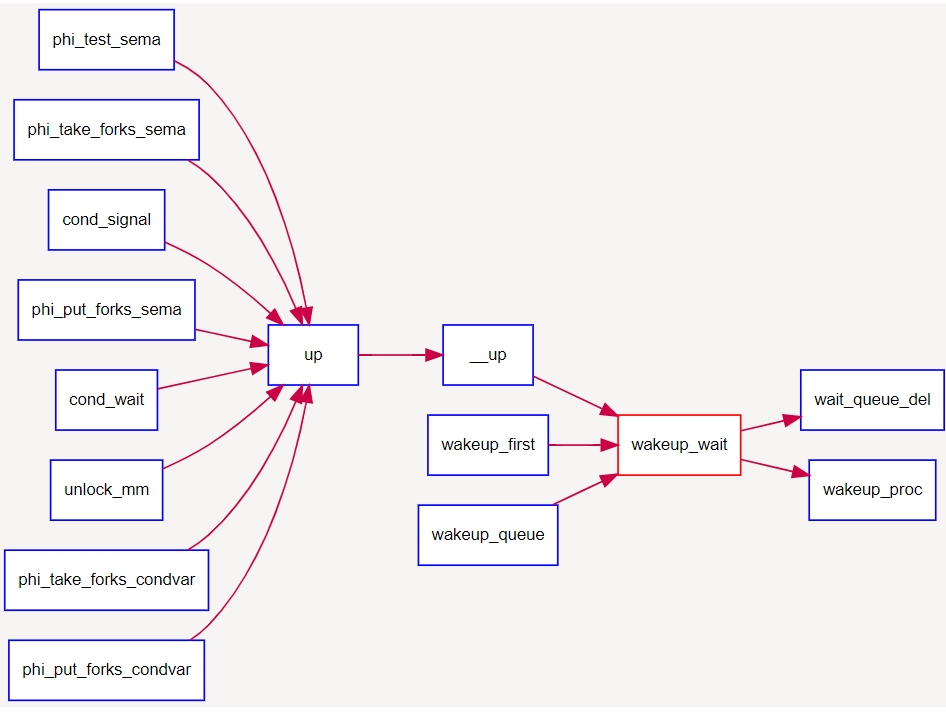
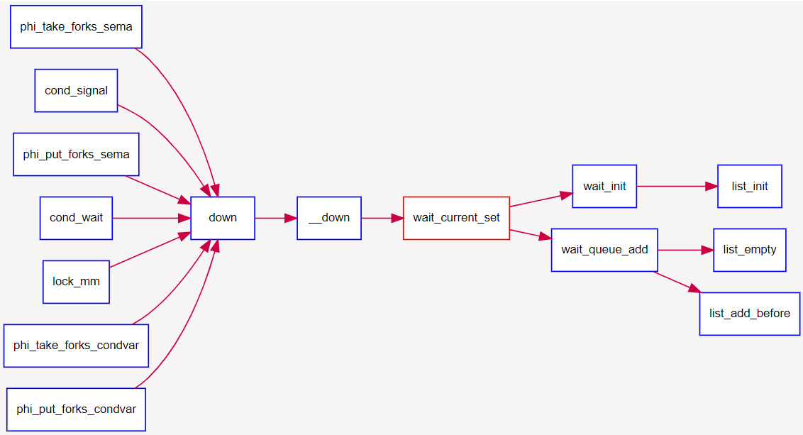

# lab7 同步互斥

## 实验目的

- 理解操作系统的同步互斥的设计实现；
- 理解底层支撑技术：禁用中断、定时器、等待队列；
- 在ucore中理解信号量（semaphore）机制的具体实现；
- 理解管程机制，在ucore内核中增加基于管程（monitor）的条件变量（condition variable）的支持；
- 了解经典进程同步问题，并能使用同步机制解决进程同步问题。

## 实验内容

在本章中我们来实现ucore中的同步互斥机制。

在之前的几章中我们已经实现了进程以及调度算法，可以让多个进程并发的执行。在现实的系统当中，有许多多线程的系统都需要协同的完成某一项任务。但是在协同的过程中，存在许多资源共享的问题，比如对一个文件读写的并发访问等等。这些问题需要我们提供一些同步互斥的机制来让程序可以有序的、无冲突的完成他们的工作，这也是这一章内我们要解决的问题。

我们最终实现的目标是解决“哲学家就餐问题”。“哲学家就餐问题”是一个非常有名的同步互斥问题：有五个哲学家围成一圈吃饭，每两个哲学家中间有一根筷子。每个需要就餐的哲学家需要两根筷子才可以就餐。哲学家处于两种状态之间：思考和饥饿。当哲学家处于思考的状态时，哲学家便无欲无求；而当哲学家处于饥饿状态时，他必须通过就餐来解决饥饿，重新回到思考的状态。如何让这5个哲学家可以不发生死锁的把这一顿饭吃完就是我们要解决的目标。

下面，我们先从一些同步互斥实现的机制讲起，慢慢的了解ucore中同步互斥机制的实现，最后解决哲学家就餐问题吧！

### 练习

本实验围绕“同步原语 -> 条件变量与管程 -> 经典同步问题”三条主线展开，核心目标是让内核从“已经具备进程调度、睡眠与唤醒以及信号量等基础同步能力”进一步走到“能够使用管程和条件变量组织复杂的线程协作”。对应的执行关系可以概括为 `哲学家线程 -> 管程 -> 条件变量 -> 信号量 -> 等待队列 -> 进程睡眠与唤醒 -> 进程调度`，其中底层的等待队列、信号量和调度机制由实验框架提供，学生主要通过设计提示词，借助 AI 完成条件变量和基于管程的哲学家就餐功能。

本实验依赖实验2/3/4/5/6。请把你做的实验2/3/4/5/6的代码填入本实验中代码中有“lab2”/“lab3”/“lab4”/“lab5”/“lab6”的注释相应部分。并确保编译通过。注意：为了能够正确执行lab7的测试应用程序，可能需对已完成的实验2/3/4/5/6的代码进行进一步改进。

#### 功能模块一：条件变量功能（设计提示词借助 ai 完成）

要求实现的函数有：

```c
void cond_wait(condvar_t *cv);(kern\sync\monitor.c)
void cond_signal(condvar_t *cv);(kern\sync\monitor.c)
```

整个功能模块的具体功能为：这个模块负责在已经实现的管程和内核信号量基础上提供条件变量同步机制，使多个内核线程能够围绕某个共享条件进行等待和通知。`cond_wait` 用于当前线程暂时无法继续执行时进入条件变量等待状态，并在被唤醒后重新获得管程的互斥访问权；`cond_signal` 用于通知等待在指定条件变量上的线程，使其中一个等待线程获得继续执行的机会。两个函数共同完成条件变量的等待与通知语义，是后续使用管程实现哲学家就餐问题的基础。

整个功能模块的注意事项为：条件变量本身不负责提供独立的互斥保护，其使用必须建立在管程互斥访问的基础上。调用 `cond_wait` 的线程在进入等待状态之前必须正确处理当前管程的占用关系，在被唤醒后还必须重新获得管程访问权；调用 `cond_signal` 时，如果条件变量上不存在等待线程，则不应该产生无意义的阻塞或唤醒操作，如果存在等待线程，则应按照管程的同步语义通知等待线程。实现过程中必须正确维护条件变量中的等待线程数量以及管程中的后续线程调度状态，不能通过忙等待实现同步，也不能破坏已有信号量、等待队列和进程调度机制。

整个功能模块应该满足的对外的接口为：`cond_wait(condvar_t *cv)` 应使当前正在管程中执行、但暂时不能继续执行的线程进入指定条件变量的等待状态，并在以后被唤醒后继续执行；`cond_signal(condvar_t *cv)` 应向指定条件变量上的等待线程发送一次通知，在存在等待者时至多唤醒一个等待线程，在不存在等待者时保持系统状态不变。两个函数都不能修改调用者规定之外的管程和条件变量数据结构。

整个功能模块可以借助的接口函数、结构体、数据结构为：这个模块主要依赖 `condvar_t`、`monitor_t`、`semaphore_t`、`wait_queue_t`、`proc_struct` 等已有结构，也可以使用 `up()`、`down()`、`sem_init()`、`wakeup_wait()`、`wakeup_first()`、`schedule()`、`local_intr_save()`、`local_intr_restore()` 等已有接口。条件变量中的 `sem`、`count` 以及所属管程的 `mutex`、`next`、`next_count` 等字段均由实验框架定义，学生不需要重新设计这些数据结构。

#### 功能模块二：基于管程的哲学家就餐功能（设计提示词借助 ai 完成）

要求实现的函数有：

```c
static void phi_test_condvar(i32_t i);(kern\sync\check_sync.c)
static void phi_take_forks_condvar(i32_t i);(kern\sync\check_sync.c)
static void phi_put_forks_condvar(i32_t i);(kern\sync\check_sync.c)
```

整个功能模块的具体功能为：这个模块负责使用前一个功能模块提供的管程和条件变量机制，实现经典的哲学家就餐问题。系统中共有若干个哲学家线程，每个哲学家需要在“思考、等待用餐、进餐”几个状态之间不断转换。哲学家只有在左右两把叉子均未被相邻哲学家占用时才能进入进餐状态；当哲学家完成进餐后，应释放自己占用的资源，并使可能已经具备用餐条件的相邻哲学家获得继续执行的机会。该模块的主要目标不是简单实现一个可以运行的程序，而是验证条件变量和管程能否正确协调多个并发线程对共享资源的访问。

整个功能模块的注意事项为：哲学家状态是多个线程共同访问的共享状态，因此相关状态变化必须受到管程互斥保护。任何时刻相邻的两个哲学家都不能同时处于 `EATING` 状态；处于 `HUNGRY` 状态的哲学家如果暂时无法同时获得左右两把叉子，应进入对应条件变量等待，而不能通过循环检查条件实现忙等待；当某个哲学家结束进餐后，应重新检查受到影响的相邻哲学家是否已经满足进餐条件，并通过条件变量通知机制推动系统继续运行。实现必须避免死锁，同时不能因为条件变量使用不正确而导致线程永久无法被唤醒。哲学家的状态变化、条件判断以及通知过程应保持在正确的管程同步语义下。

整个功能模块应该满足的对外的接口为：`phi_test_condvar(i)` 应根据哲学家 `i` 当前状态以及其左右邻居的状态判断其是否具备进入 `EATING` 状态的条件，并在条件满足时通过条件变量机制推动该哲学家继续执行；`phi_take_forks_condvar(i)` 应使哲学家 `i` 进入管程保护范围，将自身状态转换为等待用餐状态，在条件不满足时进入对应条件变量等待，在条件满足后进入 `EATING` 状态并返回；`phi_put_forks_condvar(i)` 应使哲学家完成进餐并释放共享资源，同时检查受到影响的相邻哲学家，使已经满足条件的等待线程能够继续执行。

整个功能模块可以借助的接口函数、结构体、数据结构为：这个模块主要依赖 `monitor_t`、`condvar_t`、`state[]`、`mtp`、`cv[]` 等已有数据结构，以及 `THINKING`、`HUNGRY`、`EATING` 等状态定义。可以使用 `cond_wait()`、`cond_signal()` 以及管程已经提供的互斥机制，也可以参考实验框架中已经提供的基于信号量实现的哲学家就餐版本，从同步语义和功能结果上理解两种实现方式的区别。哲学家线程创建、线程等待和整体测试框架由实验框架提供，学生不需要重新实现线程创建和调度逻辑。

#### 功能模块三：内核同步基础设施（理解题）

阅读实验框架提供的信号量和等待队列相关代码。假设线程 A 执行 `down(&sem)` 时信号量资源不可用，线程 A 因此进入等待状态；随后线程 B 执行 `up(&sem)`。

请分析这一过程中：

1.  `semaphore_t` 在其中承担什么作用？
2.  `wait_queue_t` 在其中承担什么作用？
3.  `down()` 为什么可能导致线程阻塞？
4.  `up()` 为什么可能导致等待线程被唤醒？
5.  被唤醒的线程为什么还需要经过调度才能继续运行？

请结合以下接口进行说明：

```c
void sem_init(semaphore_t *sem, int value);
void up(semaphore_t *sem);
void down(semaphore_t *sem);
bool try_down(semaphore_t *sem);

void wait_queue_init(wait_queue_t *queue);
void wait_current_set(wait_queue_t *queue, wait_t *wait);
void wakeup_wait(wait_t *wait, uint32_t wakeup_flags);
void wakeup_first(wait_queue_t *queue);
```

**要求：**

本题不要求修改实验框架代码。重点说明**信号量、等待队列、线程唤醒和调度之间的关系**，并能够根据函数接口解释一次线程从阻塞到重新获得 CPU 的完整过程。

#### 扩展练习 Challenge 1 ：　在ucore中实现简化的死锁和重入探测机制

在ucore下实现一种探测机制，能够在多进程/线程运行同步互斥问题时，动态判断当前系统是否出现了死锁产生的必要条件，是否产生了多个进程进入临界区的情况。如果发现，让系统进入monitor状态，打印出你的探测信息。

#### 扩展练习 Challenge 2 ：　参考Linux的RCU机制，在ucore中实现简化的RCU机制

在ucore下实现下Linux的RCU同步互斥机制。可阅读相关Linux内核书籍或查询网上资料，可了解RCU的设计实现细节，然后简化实现在ucore中。 要求有实验报告说明你的设计思路，并提供测试用例。下面是一些参考资料：

- http://www.ibm.com/developerworks/cn/linux/l-rcu/
- http://www.diybl.com/course/6_system/linux/Linuxjs/20081117/151814.html

### 项目组成

```
lab7
├── CMakeLists.txt
├── kern
│   ├── debug
│   │   ├── assert.h
│   │   ├── kdebug.c
│   │   ├── kdebug.h
│   │   ├── kmonitor.c
│   │   ├── kmonitor.h
│   │   ├── panic.c
│   │   └── stab.h
│   ├── driver
│   │   ├── clock.c
│   │   ├── clock.h
│   │   ├── console.c
│   │   ├── console.h
│   │   ├── dtb.c
│   │   ├── dtb.h
│   │   ├── intr.c
│   │   ├── intr.h
│   │   ├── kbdreg.h
│   │   ├── picirq.c
│   │   └── picirq.h
│   ├── init
│   │   ├── entry.S
│   │   └── init.c
│   ├── libs
│   │   ├── readline.c
│   │   └── stdio.c
│   ├── mm
│   │   ├── default_pmm.c
│   │   ├── default_pmm.h
│   │   ├── kmalloc.c
│   │   ├── kmalloc.h
│   │   ├── memlayout.h
│   │   ├── mmu.h
│   │   ├── pmm.c
│   │   ├── pmm.h
│   │   ├── vmm.c
│   │   └── vmm.h
│   ├── process
│   │   ├── entry.S
│   │   ├── proc.c
│   │   ├── proc.h
│   │   └── switch.S
│   ├── schedule
│   │   ├── default_sched_c
│   │   ├── default_sched.h
│   │   ├── default_sched_stride.c
│   │   ├── sched.c
│   │   └── sched.h
│   ├── sync
│   │   ├── check_sync.c
│   │   ├── monitor.c
│   │   ├── monitor.h
│   │   ├── sem.c
│   │   ├── sem.h
│   │   ├── sync.h
│   │   ├── wait.c
│   │   └── wait.h
│   ├── syscall
│   │   ├── syscall.c
│   │   └── syscall.h
│   └── trap
│       ├── trap.c
│       ├── trapentry.S
│       └── trap.h
├── lab7.md
├── libs
│   ├── atomic.h
│   ├── defs.h
│   ├── elf.h
│   ├── error.h
│   ├── hash.c
│   ├── list.h
│   ├── printfmt.c
│   ├── rand.c
│   ├── riscv.h
│   ├── sbi.h
│   ├── skew_heap.h
│   ├── stdarg.h
│   ├── stdio.h
│   ├── stdlib.h
│   ├── string.c
│   ├── string.h
│   └── unistd.h
├── Makefile
├── tools
│   ├── boot.ld
│   ├── function.mk
│   ├── gdbinit
│   ├── grade.sh
│   ├── kernel.ld
│   ├── sign.c
│   ├── user.ld
│   └── vector.c
└── user
    ├── badarg.c
    ├── badsegment.c
    ├── divzero.c
    ├── exit.c
    ├── faultread.c
    ├── faultreadkernel.c
    ├── forktest.c
    ├── forktree.c
    ├── hello.c
    ├── libs
    │   ├── initcode.S
    │   ├── panic.c
    │   ├── stdio.c
    │   ├── syscall.c
    │   ├── syscall.h
    │   ├── ulib.c
    │   ├── ulib.h
    │   └── umain.c
    ├── matrix.c
    ├── pgdir.c
    ├── priority.c
    ├── sleep.c
    ├── sleepkill.c
    ├── softint.c
    ├── spin.c
    ├── testbss.c
    ├── waitkill.c
    └── yield.c

15 directories, 109 files
```

简单说明如下：

- kern/schedule/{sched.h,sched.c}: 增加了定时器（timer）机制，用于进程/线程的do_sleep功能。
- kern/sync/sync.h: 去除了lock实现（这对于不抢占内核没用）。
- kern/sync/wait.[ch]:定义了等待队列wait_queue结构和等待entry的wait结构以及在此之上的函数，这是ucore中的信号量semophore机制和条件变量机制的基础，在本次实验中你需要了解其实现。
- kern/sync/sem.[ch]:定义并实现了ucore中内核级信号量相关的数据结构和函数，本次试验中你需要了解其中的实现，并基于此完成内核级条件变量的设计与实现。
- user/ libs/ {syscall.[ch],ulib.[ch]}与kern/sync/syscall.c：实现了进程sleep相关的系统调用的参数传递和调用关系。
- user/{ sleep.c,sleepkill.c}: 进程睡眠相关的一些测试用户程序。
- kern/sync/monitor.[ch]:基于管程的条件变量的实现程序，在本次实验中是练习的一部分，要求完成。
- kern/sync/check_sync.c：实现了基于管程的哲学家就餐问题，在本次实验中是练习的一部分，要求完成基于管程的哲学家就餐问题。
- kern/mm/vmm.[ch]：用信号量mm_sem取代mm_struct中原有的mm_lock。（本次实验不用管）

## 同步互斥的一些基本概念

虽然我们经常把同步和互斥放在一起说，但是这两个词是两个概念。**同步**指的是进程间的执行需要按照某种先后顺序，即访问是有序的。**互斥**指的是对于某些共享资源的访问不能同时进行，同一时间只能有一定数量的进程进行。这两种情况基本构成了我们在多线程执行中遇到的各种问题。

与同步互斥相关的另一个概念是**临界区**。临界区指的是进程的一段代码，其特征要求了同一时间段只能有一个进程执行，否则就有可能出现问题。一般而言，进程处理临界区的思路是设计一个协议，不同的进程遵守这个相同的协议来进行临界区的协调。在进入临界区前，进程请求进入的许可，这段代码称为**进入区**；退出临界区时，进程应该通过协议告知别的进程自己已经使用完临界区，这段代码称为**退出区**；临界区其他的部分称为**剩余区**。我们本章解决的问题，就是在进入区和退出区为进程提供同步互斥的机制。

为了提供同步互斥机制，操作系统有多种实现方法，包括时钟中断管理，屏蔽使能中断，等待队列，信号量，管程等等。下面我们来分别看一看上面提到的部分机制：

### 时钟中断管理

在lab3中我们已经实现了时钟中断。在ucore 中，时钟（timer）中断给操作系统提供了有一定间隔的时间事件，操作系统将其作为基本的调度和计时单位（我们记两次时间中断之间的时间间隔为一个时间片，timer splice）。

通过时钟中断，操作系统可以提供基于时间节点的事件。通过时钟中断，操作系统可以提供任意长度的等待唤醒机制，由此可以给应用程序机会来实现更加复杂的自定义调度操作。

- `sched.h`, `sched.c` 定义了有关timer的各种相关接口来使用 timer 服务，其中主要包括:
- `typedef struct {……} timer_t`: 定义了 timer_t 的基本结构，其可以用 `sched.h` 中的`timer_init`函数对其进行初始化。
- `void timer_init(timer t *timer, struct proc_struct *proc, int expires)`: 对某timer进行初始化，让它在 expires 时间片之后唤醒 proc进程。
- `void add_timer(timer t *timer)`: 向系统添加某个初始化过的timer_t，该timer在指定时间后被激活，并将对应的进程唤醒至runnable（如果当前进程处在等待状态）。
- `void del_timer(timer_t *time)`: 向系统删除（或者说取消）某一个timer。该timer在取消后不会被系统激活并唤醒进程。
- `void run_timer_list(void)`: 更新当前系统时间点，遍历当前所有处在系统管理内的timer，找出所有应该激活的计数器，并激活它们。该过程在且只在每次时钟中断时被调用。在ucore中，其还会调用调度器事件处理程序。

一个 timer_t 在系统中的存活周期可以被描述如下：

1.  timer_t 在某个位置被创建和初始化，并通过add_timer加入系统管理列表中。
2.  系统时间被不断累加，直到 run_timer_list 发现该 timer_t到期。
3.  run_timer_list更改对应的进程状态，并从系统管理列表中移除该timer_t。

尽管本次实验并不需要填充时钟相关的代码，但是作为系统重要的组件，你应该了解其相关机制和在ucore中的实现方法和使用方法。且在trap_dispatch函数中修改之前对时钟中断的处理，使得ucore能够利用时钟提供的功能完成调度和睡眠唤醒等操作。

### 屏蔽使能中断

这部分主要是处理内核内的同步互斥问题。因为内核在执行的过程中可能会被外部的中断打断，我们实现的ucore也是不可抢占的系统，所以可以在操作系统进行某些需要同步互斥的操作的时候先禁用中断，等执行完之后再使能。这样保证了操作系统在执行临界区的时候不会被打断，也就实现了同步互斥。

根据操作系统原理的知识，我们知道如果没有在硬件级保证读内存-修改值-写回内存的原子性，我们只能通过复杂的软件来实现同步互斥操作。但由于有开关中断和test_and_set_bit等原子操作机器指令的存在，使得我们在实现同步互斥原语上可以大大简化。

在ucore中提供的底层机制包括中断屏蔽/使能控制等。kern/sync.c中实现的开关中断的控制函数local_intr_save(x)和local_intr_restore(x)，它们是基于kern/driver文件下的intr_enable()、intr_disable()函数实现的。具体调用关系为：

```
关中断：local_intr_save --> __intr_save --> intr_disable --> cli
开中断：local_intr_restore--> __intr_restore --> intr_enable --> sti
```

最终的cli和sti是x86的机器指令，最终实现了关（屏蔽）中断和开（使能）中断，即设置了eflags寄存器中与中断相关的位。通过关闭中断，可以防止对当前执行的控制流被其他中断事件处理所打断。既然不能中断，那也就意味着在内核运行的当前进程无法被打断或被重新调度，即实现了对临界区的互斥操作。所以在单处理器情况下，可以通过开关中断实现对临界区的互斥保护，需要互斥的临界区代码的一般写法为：

```c
local_intr_save(intr_flag);
{
  临界区代码
}
local_intr_restore(intr_flag);
……
```

由于目前ucore只实现了对单处理器的支持，所以通过这种方式，就可简单地支撑互斥操作了。在多处理器情况下，这种方法是无法实现互斥的，因为屏蔽了一个CPU的中断，只能阻止本地CPU上的进程不会被中断或调度，并不意味着其他CPU上执行的进程不能执行临界区的代码。所以，开关中断只对单处理器下的互斥操作起作用。在本实验中，开关中断机制是实现信号量等高层同步互斥原语的底层支撑基础之一。

### 等待队列：

等待队列是操作系统提供的一种事件机制。一些进程可能会在执行的过程中等待某些特定事件的发生，这个时候进程进入睡眠状态。操作系统维护一个等待队列，把这个进程放进他等待的事件的等待队列中。当对应的事件发生之后，操作系统就唤醒相应等待队列中的进程。这也是ucore内部实现信号量的机制。

内核实现这一功能的一个底层支撑机制就是等待队列`wait_queue`，等待队列和每一个事件（睡眠结束、时钟到达、任务完成、资源可用等）联系起来。需要等待事件的进程在转入休眠状态后插入到等待队列中。当事件发生之后，内核遍历相应等待队列，唤醒休眠的用户进程或内核线程，并设置其状态为就绪状态（PROC_RUNNABLE），并将该进程从等待队列中清除。ucore在`kern/sync/{ wait.h, wait.c}`中实现了等待项wait结构和等待队列`wait_queue`结构以及相关函数），这是实现ucore中的信号量机制和条件变量机制的基础，进入wait queue的进程会被设为等待状态（PROC_SLEEPING），直到他们被唤醒。

#### 数据结构定义

```c
typedef  struct {
    struct proc_struct *proc;     //等待进程的指针
    uint32_t wakeup_flags;        //进程被放入等待队列的原因标记
    wait_queue_t *wait_queue;     //指向此wait结构所属于的wait_queue
    list_entry_t wait_link;       //用来组织wait_queue中wait节点的连接
} wait_t;

typedef struct {
    list_entry_t wait_head;       //wait_queue的队头
} wait_queue_t;

le2wait(le, member)               //实现wait_t中成员的指针向wait_t 指针的转化
```

#### 相关函数说明

与wait和wait queue相关的函数主要分为两层，底层函数是对wait queue的初始化、插入、删除和查找操作，相关函数如下：

```c
void wait_init(wait_t *wait, struct proc_struct *proc);    //初始化wait结构
bool wait_in_queue(wait_t *wait);                          //wait是否在wait queue中
void wait_queue_init(wait_queue_t *queue);                 //初始化wait_queue结构
void wait_queue_add(wait_queue_t *queue, wait_t *wait);    //把wait前插到wait queue中
void wait_queue_del(wait_queue_t *queue, wait_t *wait);    //从wait queue中删除wait
wait_t *wait_queue_next(wait_queue_t *queue, wait_t *wait);//取得wait的后一个链接指针
wait_t *wait_queue_prev(wait_queue_t *queue, wait_t *wait);//取得wait的前一个链接指针
wait_t *wait_queue_first(wait_queue_t *queue);             //取得wait queue的第一个wait
wait_t *wait_queue_last(wait_queue_t *queue);              //取得wait queue的最后一个wait
bool wait_queue_empty(wait_queue_t *queue);                //wait queue是否为空
```

高层函数基于底层函数实现了让进程进入等待队列`wait_current_set`，以及从等待队列中唤醒进程`wakeup_wait`，相关函数如下：

```c
//让wait与进程关联，且让当前进程关联的wait进入等待队列queue，当前进程睡眠
void wait_current_set(wait_queue_t *queue, wait_t *wait, uint32_t wait_state);
//把与当前进程关联的wait从等待队列queue中删除
wait_current_del(queue, wait);
//唤醒与wait关联的进程
void wakeup_wait(wait_queue_t *queue, wait_t *wait, uint32_t wakeup_flags, bool del);
//唤醒等待队列上挂着的第一个wait所关联的进程
void wakeup_first(wait_queue_t *queue, uint32_t wakeup_flags, bool del);
//唤醒等待队列上所有的等待的进程
void wakeup_queue(wait_queue_t *queue, uint32_t wakeup_flags, bool del);
```

#### 调用关系举例

如下图所示，对于唤醒进程的函数`wakeup_wait`，可以看到它会被各种信号量的V操作函数`up`调用，并且它会调用`wait_queue_del`函数和`wakup_proc`函数来完成唤醒进程的操作。



如下图所示，而对于让进程进入等待状态的函数`wait_current_set`，可以看到它会被各种信号量的P操作函数`down`调用，并且它会调用`wait_init`完成对等待项的初始化，并进一步调用`wait_queue_add`来把与要处于等待状态的进程所关联的等待项挂到与信号量绑定的等待队列中。



接下来的两节，我们来仔细看一看信号量和管程的实现。

## 信号量

信号量（semaphore）是一种同步互斥的实现。semaphore一词来源于荷兰语，原来是指火车信号灯。想象一些火车要进站，火车站里有n个站台，那么同一时间只能有n辆火车进站装卸货物。当火车站里已经有了n辆火车，信号灯应该通知后面的火车不能进站了。当有火车出站之后，信号灯应该告诉后面的火车可以进站。

这个问题放在操作系统的语境下就是有一个共享资源只能支持n个线程并行的访问，信号量统计目前有多少进程正在访问，当同时访问的进程数小于n时就可以让新的线程进入，当同时访问的进程数为n时想要访问的进程就需要等待。

在信号量中，一般用两种操作来刻画申请资源和释放资源：P操作申请一份资源，如果申请不到则等待；V操作释放一份资源，如果此时有进程正在等待，则唤醒该进程。在ucore中，我们使用`down`函数实现P操作，`up`函数实现V操作。

首先是信号量结构体的定义：

```c
typedef struct {
    int value;
    wait_queue_t wait_queue;
} semaphore_t;
```

其中的`value`表示信号量的值，其正值表示当前可用的资源数量，负值表示正在等待资源的进程数量。`wait_queue`即为这个信号量相对应的等待队列。

`down`函数实现的是P操作。首先关闭中断，然后判断信号量的值是否为正，如果是正值说明进程可以获得信号量，将信号量的值减一，打开中断然后函数返回即可。否则表示无法获取信号量，将自己的进程保存进等待队列，打开中断，调用`schedule`函数进行调度。等到V操作唤醒进程的时候，其会回到调用`schedule`函数后面，将自身从等待队列中删除（此过程需要关闭中断）并返回即可。具体的实现如下：

```c
static __noinline uint32_t __down(semaphore_t *sem, uint32_t wait_state) {
    bool intr_flag;
    local_intr_save(intr_flag);
    if (sem->value > 0) {
        sem->value --;
        local_intr_restore(intr_flag);
        return 0;
    }
    wait_t __wait, *wait = &__wait;
    wait_current_set(&(sem->wait_queue), wait, wait_state);
    local_intr_restore(intr_flag);

    schedule();

    local_intr_save(intr_flag);
    wait_current_del(&(sem->wait_queue), wait);
    local_intr_restore(intr_flag);

    if (wait->wakeup_flags != wait_state) {
        return wait->wakeup_flags;
    }
    return 0;
}
```

`up`函数实现了V操作。首先关闭中断，如果释放的信号量没有进程正在等待，那么将信号量的值加一，打开中断直接返回即可。如果有进程正在等待，那么唤醒这个进程，把它放进就绪队列，打开中断并返回。具体的实现如下：

```c
static __noinline void __up(semaphore_t *sem, uint32_t wait_state) {
    bool intr_flag;
    local_intr_save(intr_flag);
    {
        wait_t *wait;
        if ((wait = wait_queue_first(&(sem->wait_queue))) == NULL) {
            sem->value ++;
        }
        else {
            assert(wait->proc->wait_state == wait_state);
            wakeup_wait(&(sem->wait_queue), wait, wait_state, 1);
        }
    }
    local_intr_restore(intr_flag);
}
```

下一节，我们来看看如何使用信号量实现条件变量以及管程。

## 管程

我们已经有了基本的同步互斥机制实现，下面让我们用这些机制来实现一个管程，从而解决哲学家就餐问题。

为什么要使用管程呢？引入管程相当于将底层的同步互斥机制封装了起来，对外提供已经经过同步的接口供进程使用，大大降低了并行进程开发的门槛。管程主要由四个部分组成：

- 管程内部的共享变量
- 管程内部的条件变量
- 管程内部并发执行的进程
- 对局部于管程内部的共享数据设置初始值的语句

由此可见，管程把需要互斥访问的变量直接包装了起来，对共享变量的访问只能通过管程提供的相应接口，方便了多进程的编写。但是管程只有同步互斥是不够的，可能需要条件变量。条件变量类似于信号量，只不过在信号量中进程等待某一个资源可用，而条件变量中进程等待条件变量相应的资源为真。条件变量的结构体如下：

```c
typedef struct condvar{
    // 信号量
    semaphore_t sem;
    // 正在等待的线程数
    int count;
    // 自己属于哪一个管程
    monitor_t * owner;
} condvar_t;
```

我们主要需要实现两个函数，其中：

`cond_wait`表示当前线程暂时无法继续执行，需要等待某个条件成立。

调用该操作后，当前线程应当：不再继续占用管程执行权；进入相应条件变量的等待状态；等待其他线程通过 cond_signal 通知该条件可能已经满足；被唤醒后重新获得继续执行的机会。

`cond_signal`表示当前线程已经改变了某些共享状态，使得等待某个条件的线程可能可以继续执行。

调用该操作后，应当根据当前条件变量的等待情况，对相应等待线程进行唤醒。

**注意**：

本实验不直接给出 cond_wait() 和 cond_signal() 的具体实现算法。学生需要根据管程的数据结构、信号量接口以及上述行为要求完成实现。

管程的内部实现如下所示：

```c
typedef struct monitor{
    // 保证管程互斥访问的信号量
    semaphore_t mutex;
    // 里面放着正在等待进入管程执行的进程
    semaphore_t next;
    // 正在等待进入管程的进程数
    int next_count;
    // 条件变量
    condvar_t *cv;
} monitor_t;
```

条件变量`cv`被设置时，会使得当前在管程内的进程等待条件变量而睡眠，其他进程进入管程执行。当`cv`被唤醒的时候，之前等待这个条件变量的进程也会被唤醒，进入管程执行。由于管程内部只能由一个条件变量，所以通过设置`next`来维护下一个要运行的进程是哪一个。

在理解管程和条件变量之后，可以进一步使用它们解决经典的哲学家就餐问题。本实验设置 5 名哲学家。每名哲学家在“思考”和“进餐”之间不断切换。哲学家进餐需要同时获得自己左右两侧的叉子，因此多个哲学家之间存在资源竞争。

实验中使用以下状态表示哲学家的当前状态：

```
#define THINKING 0
#define HUNGRY   1
#define EATING   2
```

同时，实验框架已经提供以下共享状态：

```
int state_condvar[N];
```

以及管程：

```
monitor_t mt;
monitor_t *mtp = &mt;
```

每个哲学家还对应一个用于等待的条件变量。 使用管程实现哲学家就餐时，程序需要满足以下行为要求。

**要求一：哲学家进入进餐状态必须满足资源条件**

哲学家只有在：

- 自己处于饥饿状态；
- 左侧哲学家没有进餐；
- 右侧哲学家没有进餐；

时，才允许进入 `EATING` 状态。

否则，当前哲学家不能获得进餐所需要的两个叉子，应当等待。

**要求二：等待中的哲学家不能持续占用管程**

如果当前哲学家无法进餐，需要通过条件变量进入等待状态。

等待期间，其他哲学家应该能够进入管程并修改共享状态。

因此，不能让一个因为条件不满足而等待的线程一直占用管程。

**要求三：哲学家结束进餐后需要改变共享状态**

哲学家完成进餐后，需要从：

```
EATING
```

转换为：

```
THINKING
```

此时原来被该哲学家占用的资源重新变得可用。

其他处于 `HUNGRY` 状态的哲学家可能因此获得进餐机会。

**要求四：状态变化后需要考虑等待线程**

当某个哲学家的状态发生变化后，可能使相邻哲学家的进餐条件发生变化。

因此，实现中需要正确使用条件变量的通知机制，使满足条件的等待线程能够获得继续执行的机会。

**要求五：不能破坏管程的互斥语义**

对以下共享状态的修改必须在管程提供的同步机制下完成：

```
state_condvar[]
```

不能让多个哲学家线程同时无保护地修改共享状态。 具体的实现在`sync/check_sync.c`中完成

## 实验报告要求

1.  基于 `markdown` 格式完成实验报告，以文本说明为主。
2.  说明自己对本章节整体逻辑线的理解，即本章节是按照什么顺序、围绕哪些功能逐步实现的。
3.  说明自己对每个功能的核心函数或功能模块的理解。
4.  说明每个练习的 `spec` 是怎么写的，`prompt` 是怎么写的。
5.  说明在使用提示词让 AI 生成代码的过程中出现了什么 bug，以及你是怎么解决的。
6.  列出你认为本实验中重要的知识点，以及与对应 OS 原理中的知识点，并简要说明二者的含义、关系和差异。
7.  列出你认为 OS 原理中很重要、但在本实验中没有对应上的知识点。

从 oslab 网站上取得实验代码后，进入目录 `labcodes/lab7`，完成实验要求的各个练习。在目录 `labcodes/lab7` 下存放实验报告，推荐使用 `markdown` 格式。每个小组建立一个 gitee 或 github 仓库，对于 lab7 中的编程任务，完成编写之后，再通过 `git push` 命令把代码和报告上传到仓库，最后请提前或按时提交到 git 网站。

注意有“lab7”的注释，代码中所有需要完成的地方（challenge 除外）都有“lab7”和“YOUR CODE”的注释，请在提交时特别注意保持注释，并将“YOUR CODE”替换为自己的学号，并把所有标有对应注释的部分填上正确的代码。
