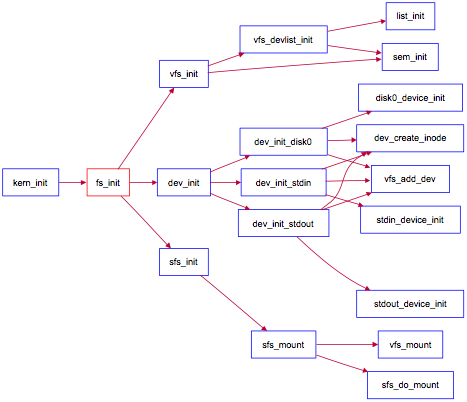
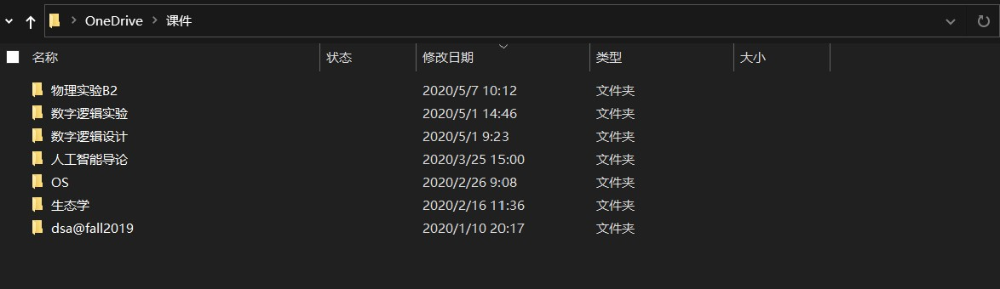
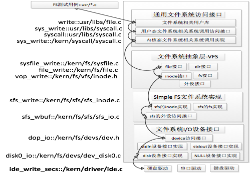
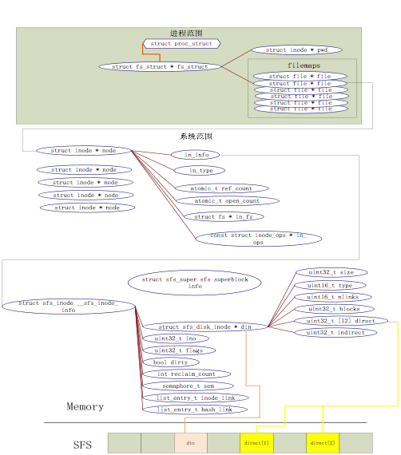

# lab8 文件系统

文件最早来自于计算机用户需要把数据持久保存在 持久存储设备 上的需求。由于放在内存中的数据在计算机关机或掉电后就会消失，所以应用程序要把内存中需要保存的数据放到 持久存储设备的数据块（比如磁盘的扇区等）中存起来。随着操作系统功能的增强，在操作系统的管理下，应用程序不用理解持久存储设备的硬件细节，而只需对 文件 这种持久存储数据的抽象进行读写就可以了，由操作系统中的文件系统和存储设备驱动程序一起来完成繁琐的持久存储设备的管理与读写。

## 实验目的

通过完成本次实验，希望能够达到以下目标

- 了解文件系统抽象层-VFS的设计与实现
- 了解基于索引节点组织方式的Simple FS文件系统与操作的设计与实现
- 了解“一切皆为文件”思想的设备文件设计
- 了解简单系统终端的实现

## 实验内容

实验八在实验七的进程、虚拟内存和同步机制基础上加入文件系统，围绕“文件读写”和“从文件系统加载并执行用户程序”两条主线展开。前一条主线要求理解 `sys_read -> sysfile_read -> file_read -> vop_read -> sfs_read -> sfs_io -> sfs_io_nolock` 的分层调用关系，并生成 SFS 文件读写的核心实现；后一条主线要求理解 `fork -> do_execve -> load_icode -> 用户态返回` 的执行过程，并生成从 ELF 文件建立用户地址空间、用户栈和执行现场的完整实现。

本实验需要完成两处核心功能代码：在 `kern/fs/sfs/sfs_inode.c` 中生成完整的 `sfs_io_nolock()`，在 `kern/process/proc.c` 中生成完整的 `load_icode()`。除此之外，文件描述符和用户地址空间能够正常工作的前提是更新 `alloc_proc()`、`proc_run()` 和 `do_fork()`，这些位置分别负责初始化 `filesp`、切换进程页表并刷新 TLB、复制父进程文件描述符状态。

与实验七相比，实验八增加了 VFS、SFS、设备文件和进程文件表，因此执行程序不再从内存中的二进制缓冲区加载，而是先通过文件系统打开 ELF 文件，再由 `load_icode()` 从文件描述符中读取程序内容。最终应能够启动文件系统中的 `sh`，并在 Shell 中执行 `exit`、`hello` 等用户程序。

### 练习

本实验围绕“文件系统分层读写 -> 进程文件表与地址空间更新 -> ELF 用户程序加载执行”三条相互衔接的主线展开。第一条主线从通用文件系统接口进入 SFS，最终通过块映射和磁盘块读写完成文件内容传输；第二条主线把文件描述符状态接入进程创建和进程切换，使进程能够继承文件访问能力并使用自己的页表；第三条主线从 `do_execve()` 打开的 ELF 文件中读取程序段，建立用户地址空间和用户栈，最后通过 `trapframe` 返回用户态。整体执行关系可以概括为 `kern_init -> fs_init -> proc_init -> user_main -> kernel_execve -> do_execve -> load_icode -> proc_run -> 用户态程序`，文件读取部分则贯穿 `sysfile_read -> file_read -> sfs_read -> sfs_io_nolock`。

本实验依赖实验2/3/4/5/6/7。请使用你此前设计的提示词生成相应实验代码，并将生成结果填写到本实验代码中标有“lab2”/“lab3”/“lab4”/“lab5”/“lab6”/“lab7”注释的对应位置，确保代码能够正确编译。由于实验八把文件系统接入了前面实验的进程和虚拟内存机制，补回前序代码后，还需要按照本实验的更新标记完成 `alloc_proc()`、`proc_run()` 和 `do_fork()` 的 Lab 8 更新。

#### 功能模块一：进程文件表与地址空间的必要更新（设计提示词借助 ai 完成）

本功能模块不是重新设计进程管理，而是在补回实验四、实验五和实验六代码的基础上，为文件系统执行程序补充三个必要的更新点。代码中的 `lab8 function1-1`、`lab8 function1-2` 和 `lab8 function1-3` 分别对应下面三个任务。生成或补回代码时，不能删除已有的 `copy_files()`、`put_files()`、`copy_mm()` 等框架辅助函数。

##### 任务一：更新进程控制块初始化

要求实现的函数有：

```c
static struct proc_struct *alloc_proc(void); (kern/process/proc.c)
```

在补回前序实验对 `proc_struct` 各字段的初始化后，需要在 `//lab8 function1-1 YOUR CODE update alloc_proc` 位置完成 Lab 8 更新。`proc_struct` 新增的 `filesp` 保存当前进程的文件表指针，新进程尚未拥有文件表时必须将其初始化为 `NULL`。不能假定 `kmalloc()` 返回的内存已经清零，也不能把一个未初始化的文件表指针交给 `copy_files()`、`files_closeall()` 或 `put_files()` 使用。

整个任务的具体功能为：保证每个新建进程在进入文件系统相关路径前具有确定的文件表初始状态。内核线程和用户进程的文件表后续由创建流程分别建立或复制，`alloc_proc()` 只负责完成进程控制块的安全初始化。

整个任务的注意事项为：需要保留此前实验已经完成的字段初始化，并只补充 `proc->filesp = NULL` 这一 Lab 8 状态。不能在这里创建共享文件表，也不能提前调用 `files_create()`，因为 idle 进程和普通子进程的文件表建立时机不同。

整个任务可以借助的接口函数、结构体和数据结构为：`struct proc_struct`、`struct files_struct`、`kmalloc()` 以及 `NULL`。文件表的创建和引用计数由 `files_create()`、`files_count_inc()` 和 `copy_files()` 等后续流程负责。

##### 任务二：更新进程切换中的地址空间处理

要求实现的函数有：

```c
void proc_run(struct proc_struct *proc); (kern/process/proc.c)
```

在补回实验四的上下文切换代码后，需要在 `//lab8 function1-2 YOUR CODE update proc_run` 位置完成 Lab 8 更新。切换到目标进程前，应在关中断保护下更新 `current`，加载目标进程的页表根地址，刷新 TLB，再调用 `switch_to()` 完成内核上下文切换；切换完成后恢复中断状态。

整个任务的具体功能为：让调度器切换到用户进程时真正使用该进程由 `load_icode()` 或 `copy_mm()` 建立的地址空间。`load_icode()` 会为用户程序建立新的页目录，若 `proc_run()` 只切换寄存器上下文而不切换地址空间，进程将继续使用旧页表，用户代码、用户栈和内核映射都会出现错误。

整个任务的注意事项为：必须保持 `current`、目标进程的页表寄存器和 TLB 状态一致；页表切换和上下文切换期间不能被中断打断；不能把用户页表直接当作内核页表使用。应使用当前代码框架提供的 `local_intr_save()`、`local_intr_restore()`、`lsatp()`、`flush_tlb()` 和 `switch_to()`，并保留实验四要求的进程上下文切换语义。

整个任务的对外接口为：`proc_run()` 接收一个已经初始化并可运行的 `struct proc_struct`，使其成为当前运行进程；如果传入的进程已经是 `current`，不需要重复切换。调度器通过该接口完成进程切换，不需要了解页表切换的内部细节。

##### 任务三：更新 fork 中的文件表复制与资源清理

要求实现的函数有：

```c
int do_fork(uint32_t clone_flags, uintptr_t stack, struct trapframe *tf); (kern/process/proc.c)
```

在补回实验四、实验五和实验六的进程创建流程后，需要在 `//lab8 function1-3 YOUR CODE update do_fork` 位置接入文件表处理。`do_fork()` 应在创建进程、分配内核栈、复制或共享地址空间的流程中正确调用 `copy_files()`，并在后续步骤失败时通过 `put_files()` 释放已经取得的文件表引用。

整个任务的具体功能为：使 `fork` 或 `clone` 创建的子进程拥有正确的文件访问状态。设置 `CLONE_FS` 时，子进程可以与父进程共享 `files_struct`；未设置时，应由 `copy_files()` 创建新的文件表并通过 `dup_files()` 复制打开文件状态。文件表复制成功后，进程的创建、加入进程链表、唤醒和返回子进程 PID 等前序实验流程仍必须完整执行。

整个任务的注意事项为：必须先补回前序实验代码，再将文件表复制接入正确的错误处理路径。`copy_files()` 失败时不能释放不存在的文件表；`copy_mm()` 或后续步骤失败时必须按相反顺序释放文件表、内核栈和 `proc_struct`；成功路径不能遗漏文件表引用计数。`copy_files()` 和 `put_files()` 本身是框架提供的辅助函数，本任务不要求重新实现它们。

整个任务的对外接口为：`do_fork()` 接收克隆标志、用户栈地址和父进程陷阱帧，成功时返回子进程 PID，失败时返回错误码；子进程必须拥有可用的进程控制块、内核栈、地址空间和文件表状态。

整个任务可以借助的接口函数、结构体和数据结构为：`alloc_proc()`、`setup_kstack()`、`copy_files()`、`copy_mm()`、`copy_thread()`、`hash_proc()`、`set_links()`、`get_pid()`、`wakeup_proc()`、`put_files()`、`put_kstack()`、`kfree()`、`struct files_struct`、`CLONE_FS` 和 `struct trapframe`。

#### 功能模块二：SFS 文件读写功能（设计提示词借助 ai 完成）

要求实现的函数有：

```c
static int sfs_io_nolock(struct sfs_fs *sfs, struct sfs_inode *sin, void *buf, off_t offset, size_t *alenp, bool write); (kern/fs/sfs/sfs_inode.c)
```

代码框架中的 `sfs_io_nolock()` 函数定义、局部变量、参数检查、`out:` 标签和文件大小更新逻辑已经全部移除，文件中只保留 `//lab8 function2 YOUR CODE`。请在该留白位置生成并填写完整的函数定义，而不是只填写首块、中间块或尾块的某一段代码。也就是说，生成结果必须自行包含函数签名、`din`、`endpos`、`blkoff`、读写函数指针、返回值、实际传输长度和错误清理所需的局部变量，以及原框架中的边界检查和 `out:` 收尾逻辑。

整个功能模块的具体功能为：`sfs_io_nolock()` 在文件偏移 `offset` 开始，把 `*alenp` 指定长度的数据在内存缓冲区和 SFS 磁盘块之间传输。`write` 为假时执行读操作，`write` 为真时执行写操作；两种操作共享块边界处理逻辑，但分别使用 `sfs_rbuf()`、`sfs_rblock()` 或 `sfs_wbuf()`、`sfs_wblock()`。实现需要依次处理首块非对齐区域、中间连续完整块和尾块非对齐区域，并将实际完成的字节数写回 `*alenp`。

整个功能模块的注意事项为：需要正确处理偏移为负、请求长度为零、超过 `SFS_MAX_FILE_SIZE`、读到文件尾以及读写区间跨越一个或多个块等情况。首块和尾块必须使用带块内偏移的缓冲区操作，中间完整块才能使用连续块操作；每一段操作前都要通过 `sfs_bmap_load_nolock()` 找到逻辑块对应的磁盘块。遇到磁盘读写或块映射错误时应立即返回，并保留已经成功传输的长度。写操作可能扩展文件大小，因此成功写入后需要正确更新 `sin->din->size` 和 `sin->dirty`；读操作不能把文件大小错误地扩大。

整个功能模块应该满足的对外接口为：`sfs_io_nolock()` 成功时返回零并通过 `*alenp` 返回实际读写长度，发生错误时返回相应错误码并保留已完成的传输长度。上层 `sfs_io()` 负责 inode 锁和 `iobuf` 位置更新，本函数不应重复获取 inode 锁，也不能绕过 `sfs_bmap_load_nolock()` 直接计算磁盘地址。

整个功能模块可以借助的接口函数、结构体和数据结构为：`struct sfs_fs`、`struct sfs_inode`、`struct sfs_disk_inode`、`sfs_bmap_load_nolock()`、`sfs_rbuf()`、`sfs_wbuf()`、`sfs_rblock()`、`sfs_wblock()`、`SFS_BLKSIZE`、`SFS_MAX_FILE_SIZE`、`E_INVAL` 以及 `sin->dirty`。`sfs_io()`、`sfs_read()` 和 `sfs_write()` 已经提供，不能删除或重新设计。

Tips：生成提示词时应明确要求 AI 同时支持读和写，覆盖“首块非对齐 -> 中间完整块 -> 尾块非对齐”的三段处理，并要求保留错误路径和实际长度更新。完成后应通过文件读写测试验证跨块读写、非对齐读写、EOF 读取和文件大小更新。

#### 功能模块三：基于文件系统的用户程序加载与执行（设计提示词借助 ai 完成）

要求实现的函数有：

```c
static int load_icode(int fd, int argc, char **kargv); (kern/process/proc.c)
```

代码框架中的 `load_icode()` 函数定义和函数体已经全部移除，文件中只保留 `//lab8 function3 YOUR CODE`。请在该留白位置生成并填写完整的函数定义，必须使用上述固定函数签名；不能只补充 ELF 读取循环，也不能自行修改函数名、参数类型或返回值类型，因为 `do_execve()` 会直接调用该固定接口。

整个功能模块的具体功能为：`load_icode()` 负责把文件描述符 `fd` 对应的 ELF 用户程序加载到当前进程的新地址空间中。函数需要创建 `mm_struct` 和页目录，读取并检查 ELF 头，遍历程序头，为可加载段建立 VMA，分配并填充代码段和数据段页面，将 BSS 区域清零，建立用户栈，按 ABI 约定把 `argc` 和参数字符串写入用户栈，设置当前进程的 `mm`、页表寄存器和 `trapframe`，使进程从 ELF 入口地址返回用户态执行。

整个功能模块的注意事项为：必须区分 `p_filesz` 和 `p_memsz`，只从文件读取 `p_filesz` 字节，并把剩余的 BSS 区域清零；程序段可能不是页对齐的，需要正确处理首尾页面的偏移和长度。需要为每个程序段根据 `ELF_PF_R`、`ELF_PF_W` 和 `ELF_PF_X` 设置 VMA 标志和页表权限。用户栈必须映射在 `USTACKTOP - USTACKSIZE` 到 `USTACKTOP` 范围内，并保证写入参数时使用新地址空间中的有效页面。ELF 魔数错误、文件读取失败、内存分配失败或 VMA 创建失败时，都必须释放已经创建的 VMA、页表、物理页和 `mm_struct`，不能留下半初始化地址空间。

整个功能模块应该满足的对外接口为：`load_icode()` 接收已经打开的 ELF 文件描述符、参数数量和内核地址中的参数数组，成功时返回零并让当前进程具备返回用户态执行的完整现场，失败时返回错误码并清理临时资源。文件读取应通过 `load_icode_read()` 完成，该辅助函数负责定位文件偏移和读取指定长度，学生不需要删除或重新实现它。

整个功能模块可以借助的接口函数、结构体和数据结构为：`mm_create()`、`setup_pgdir()`、`load_icode_read()`、`mm_map()`、`pgdir_alloc_page()`、`mm_count_inc()`、`PADDR()`、`lsatp()`、`exit_mmap()`、`put_pgdir()`、`mm_destroy()`、`struct elfhdr`、`struct proghdr`、`ELF_MAGIC`、`ELF_PT_LOAD`、`ELF_PF_R`、`ELF_PF_W`、`ELF_PF_X`、`VM_READ`、`VM_WRITE`、`VM_EXEC`、`VM_STACK`、`USTACKTOP`、`USTACKSIZE`、`PTE_USER` 和 `struct trapframe`。

Tips：提示词应明确要求 AI 生成完整的 ELF 加载函数，包括成功路径、参数入栈、页表切换、陷阱帧设置和失败清理路径。完成后执行 `make qemu`，确认能够启动 `sh`，并在 Shell 中执行 `exit`、`hello` 以及其他位于 SFS 文件系统中的用户程序；还应检查 `fork` 后的子进程能否继续使用文件描述符。

对实验报告的要求：

- 基于 Markdown 格式完成报告，以文字分析为主。
- 提交功能模块一、功能模块二以及功能模块三每个任务所使用的完整 `prompt`。
- 说明功能模块一中 `alloc_proc()`、`proc_run()` 和 `do_fork()` 三个更新点与前序实验代码的关系，以及文件表、页表和 TLB 为什么必须保持一致。
- 分析 `sfs_io_nolock()` 如何处理首块、中间完整块和尾块，并说明读写共用实现的原因。
- 分析 `load_icode()` 如何从 ELF 文件建立 VMA、装载程序段、清零 BSS、建立用户栈并设置 `trapframe`。
- 展示 `make qemu` 的运行结果，说明是否成功进入 `sh`，并记录 `exit`、`hello` 等程序的执行情况。

#### 扩展练习 Challenge1：完成基于“UNIX的PIPE机制”的设计方案

如果要在ucore里加入UNIX的管道（Pipe）机制，至少需要定义哪些数据结构和接口？（接口给出语义即可，不必具体实现。数据结构的设计应当给出一个（或多个）具体的C语言struct定义。在网络上查找相关的Linux资料和实现，请在实验报告中给出设计实现”UNIX的PIPE机制“的概要设方案，你的设计应当体现出对可能出现的同步互斥问题的处理。）

#### 扩展练习 Challenge2：完成基于“UNIX的软连接和硬连接机制”的设计方案

如果要在ucore里加入UNIX的软连接和硬连接机制，至少需要定义哪些数据结构和接口？（接口给出语义即可，不必具体实现。数据结构的设计应当给出一个（或多个）具体的C语言struct定义。在网络上查找相关的Linux资料和实现，请在实验报告中给出设计实现”UNIX的软连接和硬连接机制“的概要设方案，你的设计应当体现出对可能出现的同步互斥问题的处理。）

### 项目组成

#### Lab8 项目组成

```
lab8
├── CMakeLists.txt
├── giveitatry.pyq
├── kern
│   ├── debug
│   │   ├── assert.h
│   │   ├── kdebug.c
│   │   ├── kdebug.h
│   │   ├── kmonitor.c
│   │   ├── kmonitor.h
│   │   ├── panic.c
│   │   └── stab.h
│   ├── driver
│   │   ├── clock.c
│   │   ├── clock.h
│   │   ├── console.c
│   │   ├── console.h
│   │   ├── dtb.c
│   │   ├── dtb.h
│   │   ├── ide.c
│   │   ├── ide.h
│   │   ├── intr.c
│   │   ├── intr.h
│   │   ├── kbdreg.h
│   │   ├── picirq.c
│   │   ├── picirq.h
│   │   ├── ramdisk.c
│   │   └── ramdisk.h
│   ├── fs
│   │   ├── devs
│   │   │   ├── dev.c
│   │   │   ├── dev_disk0.c
│   │   │   ├── dev.h
│   │   │   ├── dev_stdin.c
│   │   │   └── dev_stdout.c
│   │   ├── file.c
│   │   ├── file.h
│   │   ├── fs.c
│   │   ├── fs.h
│   │   ├── iobuf.c
│   │   ├── iobuf.h
│   │   ├── sfs
│   │   │   ├── bitmap.c
│   │   │   ├── bitmap.h
│   │   │   ├── sfs.c
│   │   │   ├── sfs_fs.c
│   │   │   ├── sfs.h
│   │   │   ├── sfs_inode.c
│   │   │   ├── sfs_io.c
│   │   │   └── sfs_lock.c
│   │   ├── swap
│   │   │   ├── swapfs.c
│   │   │   └── swapfs.h
│   │   ├── sysfile.c
│   │   ├── sysfile.h
│   │   └── vfs
│   │       ├── inode.c
│   │       ├── inode.h
│   │       ├── vfs.c
│   │       ├── vfsdev.c
│   │       ├── vfsfile.c
│   │       ├── vfs.h
│   │       ├── vfslookup.c
│   │       └── vfspath.c
│   ├── init
│   │   ├── entry.S
│   │   └── init.c
│   ├── libs
│   │   ├── readline.c
│   │   ├── stdio.c
│   │   └── string.c
│   ├── mm
│   │   ├── default_pmm.c
│   │   ├── default_pmm.h
│   │   ├── kmalloc.c
│   │   ├── kmalloc.h
│   │   ├── memlayout.h
│   │   ├── mmu.h
│   │   ├── pmm.c
│   │   ├── pmm.h
│   │   ├── vmm.c
│   │   └── vmm.h
│   ├── process
│   │   ├── entry.S
│   │   ├── proc.c
│   │   ├── proc.h
│   │   └── switch.S
│   ├── schedule
│   │   ├── default_sched.c
│   │   ├── default_sched.h
│   │   ├── default_sched_stride.c
│   │   ├── sched.c
│   │   └── sched.h
│   ├── sync
│   │   ├── check_sync.c
│   │   ├── monitor.c
│   │   ├── monitor.h
│   │   ├── sem.c
│   │   ├── sem.h
│   │   ├── sync.h
│   │   ├── wait.c
│   │   └── wait.h
│   ├── syscall
│   │   ├── syscall.c
│   │   └── syscall.h
│   └── trap
│       ├── trap.c
│       ├── trapentry.S
│       └── trap.h
├── lab5.md
├── libs
│   ├── atomic.h
│   ├── defs.h
│   ├── dirent.h
│   ├── elf.h
│   ├── error.h
│   ├── hash.c
│   ├── list.h
│   ├── printfmt.c
│   ├── rand.c
│   ├── riscv.h
│   ├── sbi.h
│   ├── skew_heap.h
│   ├── stat.h
│   ├── stdarg.h
│   ├── stdio.h
│   ├── stdlib.h
│   ├── string.c
│   ├── string.h
│   └── unistd.h
├── Makefile
├── tools
│   ├── boot.ld
│   ├── function.mk
│   ├── gdbinit
│   ├── grade-rv64-patch.sh
│   ├── kernel.ld
│   ├── mksfs.c
│   ├── sign.c
│   ├── user.ld
│   └── vector.c
└── user
    ├── badarg.c
    ├── badsegment.c
    ├── divzero.c
    ├── exit.c
    ├── faultread.c
    ├── faultreadkernel.c
    ├── forktest.c
    ├── forktree.c
    ├── hello.c
    ├── libs
    │   ├── dir.c
    │   ├── dir.h
    │   ├── file.c
    │   ├── file.h
    │   ├── initcode.S
    │   ├── lock.h
    │   ├── panic.c
    │   ├── stdio.c
    │   ├── syscall.c
    │   ├── syscall.h
    │   ├── ulib.c
    │   ├── ulib.h
    │   └── umain.c
    ├── matrix.c
    ├── pgdir.c
    ├── priority.c
    ├── sh.c
    ├── sleep.c
    ├── sleepkill.c
    ├── softint.c
    ├── spin.c
    ├── testbss.c
    ├── waitkill.c
    └── yield.c

20 directories, 155 files
```

本次实验主要是理解`kern/fs`目录中的部分文件，并可用`user/*.c`测试所实现的`Simple FS`文件系统是否能够正常工作。本次实验涉及到的代码包括：

- 文件系统测试用例： `user/*.c`：对文件系统的实现进行测试的测试用例；

- 通用文件系统接口

  `user/libs/file.[ch]` | `dir.[ch]` | `syscall.c`：与文件系统操作相关的用户库实行；

  `kern/syscall.[ch]`：文件中包含文件系统相关的内核态系统调用接口

  `kern/fs/sysfile.[ch]` | `file.[ch]`：通用文件系统接口和实行

- 文件系统抽象层-VFS

  `kern/fs/vfs/*.[ch]`：虚拟文件系统接口与实现

- Simple FS文件系统

  `kern/fs/sfs/*.[ch]`：`SimpleFS`文件系统实现

- 文件系统的硬盘IO接口

  `kern/fs/devs/dev.[ch]` | `dev_disk0.c`：`disk0`硬盘设备提供给文件系统的I/O访问接口和实现

- 辅助工具

  `tools/mksfs.c`：创建一个Simple FS文件系统格式的硬盘镜像。（理解此文件的实现细节对理解SFS文件系统很有帮助）

- 对内核其它模块的扩充

  `kern/process/proc.[ch]`：增加成员变量 `struct files_struct *filesp`，用于支持进程对文件的访问；重写了 `do_execve`、`load_icode` 等函数以支持执行文件系统中的文件。

  `kern/init/init.c`：增加调用初始化文件系统的函数 `fs_init`。

#### Lab8文件系统初始化过程

与实验七相比，实验八增加了文件系统，并因此实现了通过文件系统来加载可执行文件到内存中运行的功能，导致对进程管理相关的实现比较大的调整。我们来简单看看文件系统是如何初始化并能在`ucore`的管理下正常工作的。

首先看看`kern_init`函数，可以发现与`lab7`相比增加了对`fs_init`函数的调用。`fs_init`函数就是文件系统初始化的总控函数，它进一步调用了虚拟文件系统初始化函数`vfs_init`，与文件相关的设备初始化函数`dev_init`和`Simple FS`文件系统的初始化函数`sfs_init`。这三个初始化函数联合在一起，协同完成了整个虚拟文件系统、`SFS`文件系统和文件系统对应的设备（键盘、串口、磁盘）的初始化工作。其函数调用关系图如下所示：



**文件系统初始化调用关系图**

参考上图，并结合源码分析，可大致了解到文件系统的整个初始化流程。`vfs_init`主要建立了一个`device_list`双向链表`vdev_list`，为后续具体设备（键盘、串口、磁盘）以文件的形式呈现建立查找访问通道。`dev_init`函数通过进一步调用`disk0/stdin/stdout_device_init`完成对具体设备的初始化，把它们抽象成一个设备文件，并建立对应的`inode`数据结构，最后把它们链入到`vdev_list`中。这样通过虚拟文件系统就可以方便地以文件的形式访问这些设备了。`sfs_init`是完成对`Simple FS`的初始化工作，并把此实例文件系统挂在虚拟文件系统中，从而让`ucore`的其他部分能够通过访问虚拟文件系统的接口来进一步访问到`SFS`实例文件系统。

## 文件系统

**文件系统(`file system`)**，指的是操作系统中管理（硬盘上）持久存储数据的模块。

### **文件系统概述**

#### 为啥需要文件/文件系统？

能够"持久存储数据的设备", 可能包括: 机械硬盘(`HDD, hard disk drive`), 固态硬盘(`solid-state storage device`), 光盘（加上它的驱动器），软盘，U盘，甚至磁带或纸带等等。一般来说，每个设备上都会连出很多针脚（这些针脚很可能符合某个特定协议，如`USB`协议，`SATA`协议），它们都可以按照事先约定的接口/协议把数据从设备中读到内存里，或者把内存里的数据按照一定的格式储存到设备里。

我们希望做到的第一件事情，就是把以上种种存储设备当作“同样的设备”进行使用。不管机械硬盘的扇区有多少个，或者一块固态硬盘里有多少存储单元，我们希望都能用同样的接口进行使用，提供“把硬盘的第`a`到第`b`个字节读出来”和“把内存里这些内容写到硬盘的从第`a`个字节开始的位置”的接口，在使用时只会感受到不同设备速度的不同。否则，我们还需要自己处理什么`SATA`协议，`NVMe`协议啥的。处理具体设备，具体协议并向上提供简单接口的软件，我们叫做**设备驱动(`device driver`)，简称驱动**。

文件的概念在我们脑子里根深蒂固，但“文件”其实也是一种抽象。理论上，只要提供了上面提到的读写两个接口，我们就可以进行编程，而并不需要什么文件的概念。只要你自己在小本本上记住，你的某些数据存储在硬盘上从某个地址开始的多么长的位置，以及硬盘上哪些位置是没有被占用的。编程的时候，如果用到/修改硬盘上的数据， 就把小本本上记录的位置给硬编码到程序里。

但这很不灵活！如果你的小本本丢了，你就再也无法使用硬盘里的数据了，因为你不知道那些数据都是谁跟谁。另外，你也可能一不小心修改到无关的数据。最后，这个小本本经常需要修改，你很容易出错。

显然，我们应该把这个小本本交给计算机来保存和自动维护。这就是**文件系统**。

我们把一段逻辑上相关联的数据看作一个整体，叫做**文件**。

除了硬盘，我们还可以把其他设备（如标准输入`stdin`，标准输出`stdout`）看成是文件，由文件系统进行统一的管理。

#### 虚拟文件系统

我们可以实现一个**虚拟文件系统（`virtual filesystem, VFS`）**, 作为操作系统和更具体的文件系统之间的接口。所谓“具体文件系统”，指的是更接近具体设备和文件系统的内部实现，而“虚拟文件系统”更接近用户使用的接口。

1.  电脑上本地的硬盘和远程的云盘(例如清华云盘，`OneDrive`）的具体文件管理方式很可能不同，但是操作系统可以让我们用相同的操作访问这两个地方的文件，可以认为用到了虚拟文件系统。



例如，远程的云盘`OneDrive`，在`Windows`资源管理器(可以看作是虚拟文件系统提供给用户的接口)里，看起来和本地磁盘上的文件夹一模一样，也可以做和本地的文件夹相同的操作，复制，粘贴，打开。虽然背后有着网络传输，可能速度会慢，但是接口一致。（理论上可以在`OneDrive`的远程存储服务器上使用`linux`操作系统）。

1.  在`Linux`系统中，如`/floppy`是一块`MS-DOS`文件系统的软盘的挂载点，`/tmp/test`是`Ext2`文件系统的一个目录，我们执行`cp /floppy/TEST /tmp/test`, 进行目录的拷贝，相当于执行下面这段代码：

    ```c
    inf = open("/floppy/TEST", O_RDONLY, 0);
    outf = open("/tmp/test", O_WRONLY|O_CREAT|O_TRUNC, 0600);
    do {
        i = read(inf, buf, 4096);
        write(outf, buf, i);
    } while (i);
    close(outf);
    close(inf);
    ```

    对于不同文件系统的目录，我们可以使用相同的`open`，`read`，`write`，`close`接口，好像它们在同一个文件系统里一样。这是虚拟文件系统的功能。

> **扩展**
>
> 最早的虚拟文件系统： `Sun Microsystems’s SunOS` ，1986
>
> `linux`的`VFS`支持虚拟块设备（`virtual block devices`), 可以把当前文件系统中的某个文件，认为是”一块具备虚拟文件系统的磁盘”进行挂载，也就是说这个文件里包含一个完整的文件系统，如同“果壳里的宇宙”。
>
> 这种设备也叫做`loop device`，可以用来简易地在现有文件系统上进行磁盘分区。
>
> **扩展**
>
> When a filesystem is mounted on a directory, the contents of the directory in the parent filesystem are no longer accessible, because every pathname, including the mount point, will refer to the mounted filesystem. However,the original directory’s content shows up again when the filesystem is unmounted. This somewhat surprising feature of Unix filesystems is used by system administrators to hide files; they simply mount a filesystem on the directory containing the files to be hidden.
>
> 《understanding linux kernel》

#### UNIX文件系统

`ucore` 的文件系统模型和传统的 `UNIX`文件系统类似。

`UNIX` 文件中的内容可理解为是一段有序的字节 ，占用磁盘上可能连续或不连续的一些空间（实际占用的空间可能比你存储的数据要多）。每个文件都有一个方便应用程序识别的文件名（也可以称作路径`path`），另外有一个文件系统内部使用的编号（用户程序不知道这个底层编号）。你可以对着一个文件又读又写（写的太多的时候可能会自动给文件分配更多的硬盘存储空间），也可以创建或删除文件。

**目录(`directory`)** 是特殊的文件，一个目录里包含若干其他文件或目录。

在 `UNIX` 中，文件系统可以被安装在一个特定的文件路径位置，这个位置就是**挂载点（`mount point`）**。所有的已安装文件系统都作为根文件系统树中的叶子出现在系统中。比如当你把U盘插进来，系统检测到U盘之后，会给U盘的文件系统一个挂载点，这个挂载点是原先的`UNIX`操作系统的叶子，但也可以认为是U盘文件系统的根节点。

`UNIX`的文件系统中，有一个**通用文件模型（`Common File Model`）**，所有具体的文件系统（不管是`Ext4`，`ZFS`还是`FAT`)，都需要提供通用文件模型所约定的行为。我们可以认为，通用文件模型是面向对象的，由若干对象(`Object`)组成，每个对象有成员属性和函数接口。类`UNIX`系统的内核一般使用`C`语言实现，”成员函数“一般体现为函数指针。

通用文件模型定义了一些对象:

- **超级块(`superblock`)**：存储整个文件系统的相关信息。对于磁盘上的文件系统，对应磁盘里的**文件系统控制块(`filesystem control block`)**
- **索引节点（`inode`)**：存储关于某个文件的元数据信息（如访问控制权限、大小、拥有者、创建时间、数据内容等等），通常对应磁盘上的**文件控制块（`file control block`)**. 每个索引节点有一个编号，唯一确定文件系统里的一个文件。
- **文件(`file`)**: 这里定义的`file object`不是指磁盘上的一个”文件“， 而是指一个进程和它打开的一个文件之间的关系，这个对象存储在内核态的内存中，仅当某个进程打开某个文件的时候才存在。
- **目录项（`dentry`）**：维护从”目录里的某一项“到”对应的文件“的链接/指针。一个目录也是一个文件，包含若干个子目录和其他文件。从某个子目录、文件的名称，对应到具体的文件/子目录的地址(或者索引节点`inode`)的链接，通过**目录项(`dentry`)**来描述。

上述抽象概念形成了 `UNIX` 文件系统的逻辑数据结构，并需要通过一个具体文件系统的架构，把上述信息映射并储存到磁盘介质上，从而在具体文件系统的磁盘布局（即数据在磁盘上的物理组织）上体现出上述抽象概念。比如文件元数据信息存储在磁盘块中的索引节点上。当文件被载入内存时，内核需要使用磁盘块中的索引点来构造内存中的索引节点。又比如`dentry`对象在磁盘上不存在，但是当一个目录包含的某一项（可能是子目录或文件）的信息被载入到内存时，内核会构建对应的`dentry`对象，如`/tmp/test`这个路径，在解析的过程中，内核为根目录`/`创建一个`dentry`对象，为根目录的成员`tmp`构建一个`dentry`对象，为`/tmp`目录的成员`test`也构建一个`dentry`对象。

#### ucore 文件系统总体介绍

我们将在`ucore`里用虚拟文件系统管理三类设备：

- 硬盘，我们管理硬盘的具体文件系统是`Simple File System`（地位和`Ext2`等文件系统相同）
- 标准输出（控制台输出），只能写不能读
- 标准输入（键盘输入），只能读不能写

其中，标准输入和标准输出都是比较简单的设备。管理硬盘的`Simple File System`相对而言比较复杂。

我们的“硬盘”依然需要通过用一块内存来模拟。

`lab8`的`Makefile`和之前不同，我们分三段构建内核镜像。

- `sfs.img`: 一块符合`SFS`文件系统的硬盘，里面存储编译好的用户程序
- `swap.img`: 一段初始化为0的硬盘交换区
- `kernel objects`: `ucore`内核代码的目标文件

这三部分共同组成`ucore.img`, 加载到`QEMU`里运行。`ucore`代码中，我们通过链接时添加的首尾符号，把`swap.img`和`sfs.img`两段“硬盘”（实际上对应两段内存空间）找出来，然后作为“硬盘”进行管理。

注意，我们要在`ucore`内核开始执行之前，构造好“一块符合`SFS`文件系统的硬盘”，这就得另外写个程序做这个事情。这个程序就是`tools/mksfs.c`。它有500多行，如果感兴趣的话可以通过它了解`Simple File System`的结构。

`ucore` 模仿了 `UNIX` 的文件系统设计，`ucore` 的文件系统架构主要由四部分组成：

- 通用文件系统访问接口层：该层提供了一个从用户空间到文件系统的标准访问接口。这一层访问接口让应用程序能够通过一个简单的接口获得 `ucore` 内核的文件系统服务。
- 文件系统抽象层：向上提供一个一致的接口给内核其他部分（文件系统相关的系统调用实现模块和其他内核功能模块）访问，向下提供一个同样的抽象函数指针列表和数据结构屏蔽不同文件系统的实现细节。
- `Simple FS` 文件系统层：一个基于索引方式的简单文件系统实例。向上通过各种具体函数实现以对应文件系统抽象层提出的抽象函数，向下访问外设接口。
- 外设接口层：向上提供 `device` 访问接口屏蔽不同硬件细节。向下实现访问各种具体设备驱动的接口，比如 `disk` 设备接口 / 串口设备接口 / 键盘设备接口等。

对照上面的层次我们再大致介绍一下文件系统的访问处理过程，加深对文件系统的总体理解。假如应用程序操作文件（打开/创建/删除/读写），首先需要通过文件系统的通用文件系统访问接口层给用户空间提供的访问接口进入文件系统内部，接着由文件系统抽象层把访问请求转发给某一具体文件系统（比如 `SFS` 文件系统），具体文件系统（`Simple FS` 文件系统层）把应用程序的访问请求转化为对磁盘上的 `block` 的处理请求，并通过外设接口层交给磁盘驱动例程来完成具体的磁盘操作。结合用户态写文件函数 `write` 的整个执行过程，我们可以比较清楚地看出 `ucore` 文件系统架构的层次和依赖关系。



#### **ucore 文件系统总体结构**

从 `ucore` 操作系统不同的角度来看，`ucore` 中的文件系统架构包含四类主要的数据结构, 它们分别是：

- 超级块（`SuperBlock`），它主要从文件系统的全局角度描述特定文件系统的全局信息。它的作用范围是整个 `OS` 空间。
- 索引节点（`inode`）：它主要从文件系统的单个文件的角度它描述了文件的各种属性和数据所在位置。它的作用范围是整个 `OS` 空间。
- 目录项（`dentry`）：它主要从文件系统的文件路径的角度描述了文件路径中的一个特定的目录项（注：一系列目录项形成目录/文件路径）。它的作用范围是整个 `OS` 空间。对于 `SFS` 而言，`inode`(具体为 `struct sfs_disk_inode`)对应于物理磁盘上的具体对象，`dentry`（具体为 `struct sfs_disk_entry`）是一个内存实体，其中的 `ino` 成员指向对应的 `inode number`，另外一个成员是 `file name`(文件名).
- 文件（`file`），它主要从进程的角度描述了一个进程在访问文件时需要了解的文件标识，文件读写的位置，文件引用情况等信息。它的作用范围是某一具体进程。

如果一个用户进程打开了一个文件，那么在 `ucore` 中涉及的相关数据结构和关系如下图所示：



### 文件系统抽象层VFS

文件系统抽象层是把不同文件系统的对外共性接口提取出来，形成一个函数指针数组，这样，通用文件系统访问接口层只需访问文件系统抽象层，而不需关心具体文件系统的实现细节和接口。

#### `file` & `dir` 接口

`file` & `dir` 接口层定义了进程在内核中直接访问的文件相关信息，这定义在 `file` 数据结构中，具体描述如下：

```c
// kern/fs/file.h
struct file {
    enum {
        FD_NONE, FD_INIT, FD_OPENED, FD_CLOSED,
    } status;                         //访问文件的执行状态
    bool readable;                    //文件是否可读
    bool writable;                    //文件是否可写
    int fd;                           //文件在fd_array中的索引值
    off_t pos;                        //访问文件的当前位置
    struct inode *node;               //该文件对应的内存inode指针
    int open_count;                   //打开此文件的次数
};
```

而在 `kern/process/proc.h` 中的 `proc_struct` 结构中加入了描述了进程访问文件的数据接口 `files_struct`，其数据结构定义如下：

```c
// kern/fs/fs.h
struct files_struct {
    struct inode *pwd;                //进程当前执行目录的内存inode指针
    struct file *fd_array;            //进程打开文件的数组
    int files_count;                  //访问此文件的线程个数
    semaphore_t files_sem;            //确保对进程控制块中files_struct的互斥访问
};
```

当创建一个进程后，该进程的 `files_struct` 将会被初始化或复制父进程的 `files_struct`。当用户进程打开一个文件时，将从 `fd_array` 数组中取得一个空闲 `file` 项，然后会把此 `file` 的成员变量 `node` 指针指向一个代表此文件的 `inode` 的起始地址。

#### `inode` 接口

`index node` 是位于内存的索引节点，它是 `VFS` 结构中的重要数据结构，因为它实际负责把不同文件系统的特定索引节点信息（甚至不能算是一个索引节点）统一封装起来，避免了进程直接访问具体文件系统。其定义如下：

```c
// kern/fs/vfs/inode.h
struct inode {
    union {                                 //包含不同文件系统特定inode信息的union成员变量
        struct device __device_info;          //设备文件系统内存inode信息
        struct sfs_inode __sfs_inode_info;    //SFS文件系统内存inode信息
    } in_info;
    enum {
        inode_type_device_info = 0x1234,
        inode_type_sfs_inode_info,
    } in_type;                          //此inode所属文件系统类型
    int ref_count;                      //此inode的引用计数
    int open_count;                     //打开此inode对应文件的个数
    struct fs *in_fs;                   //抽象的文件系统，包含访问文件系统的函数指针
    const struct inode_ops *in_ops;     //抽象的inode操作，包含访问inode的函数指针
};
```

在 `inode` 中，有一成员变量为 `in_ops`，这是对此 `inode` 的操作函数指针列表，其数据结构定义如下：

```c
struct inode_ops {
    unsigned long vop_magic;
    int (*vop_open)(struct inode *node, uint32_t open_flags);
    int (*vop_close)(struct inode *node);
    int (*vop_read)(struct inode *node, struct iobuf *iob);
    int (*vop_write)(struct inode *node, struct iobuf *iob);
    int (*vop_getdirentry)(struct inode *node, struct iobuf *iob);
    int (*vop_create)(struct inode *node, const char *name, bool excl, struct inode **node_store);
    int (*vop_lookup)(struct inode *node, char *path, struct inode **node_store);
……
 };
```

参照上面对 `SFS` 中的索引节点操作函数的说明，可以看出 `inode_ops` 是对常规文件、目录、设备文件所有操作的一个抽象函数表示。对于某一具体的文件系统中的文件或目录，只需实现相关的函数，就可以被用户进程访问具体的文件了，且用户进程无需了解具体文件系统的实现细节。

### 硬盘文件系统`SFS`

我们从[ucore实验指导书](https://learningos.github.io/ucore_os_webdocs/lab8/lab8_3_3_1_fs_layout.html)摘抄一段关于`Simple File System`的介绍。

通常文件系统中，磁盘的使用是以扇区（`Sector`）为单位的，但是为了实现简便，`SFS` 中以 `block` （4K，与内存 `page` 大小相等）为基本单位。

`SFS` 文件系统的布局如下表所示。

| `superblock` | `root-dir inode` | `freemap`  | `inode`、`File Data`、`Dir Data Blocks` |
| ------------ | ---------------- | ---------- | --------------------------------------- |
| 超级块       | 根目录索引节点   | 空闲块映射 | 目录和文件的数据和索引节点              |

第 0 个块（4K）是超级块（`superblock`），它包含了关于文件系统的所有关键参数，当计算机被启动或文件系统被首次接触时，超级块的内容就会被装入内存。其定义如下：

```c
struct sfs_super {
    uint32_t magic;                                  /* magic number, should be SFS_MAGIC */
    uint32_t blocks;                                 /* # of blocks in fs */
    uint32_t unused_blocks;                         /* # of unused blocks in fs */
    char info[SFS_MAX_INFO_LEN + 1];                /* infomation for sfs  */
};
```

可以看到，包含一个成员变量魔数 `magic`，其值为 `0x2f8dbe2a`，内核通过它来检查磁盘镜像是否是合法的 `SFS img`；成员变量 `blocks` 记录了 `SFS` 中所有 `block` 的数量，即 `img` 的大小；成员变量 `unused_blocks` 记录了 `SFS` 中还没有被使用的 `block` 的数量；成员变量 `info` 包含了字符串`simple file system`。

第 1 个块放了一个 `root-dir` 的 `inode`，用来记录根目录的相关信息。有关 `inode` 还将在后续部分介绍。这里只要理解 `root-dir` 是 `SFS` 文件系统的根结点，通过这个 `root-dir` 的 `inode` 信息就可以定位并查找到根目录下的所有文件信息。

从第 2 个块开始，根据 `SFS` 中所有块的数量，用 1 个 `bit` 来表示一个块的占用和未被占用的情况。这个区域称为 `SFS` 的 `freemap` 区域，这将占用若干个块空间。为了更好地记录和管理 `freemap` 区域，专门提供了两个文件 `kern/fs/sfs/bitmap.[ch]`来完成根据一个块号查找或设置对应的 `bit` 位的值。

最后在剩余的磁盘空间中，存放了所有其他目录和文件的 `inode` 信息和内容数据信息。需要注意的是虽然 `inode` 的大小小于一个块的大小（4096B），但为了实现简单，每个 `inode` 都占用一个完整的 `block`。

在 `sfs_fs.c` 文件中的 `sfs_do_mount` 函数中，完成了加载位于硬盘上的 `SFS` 文件系统的超级块 `superblock` 和 `freemap` 的工作。这样，在内存中就有了 `SFS` 文件系统的全局信息。

> 趣闻 **"魔数"是怎样工作的?**
>
> 我们经常需要检查某个文件/某块磁盘是否符合我们需要的格式。一般会按照这个文件的完整格式，进行一次全面的分析。
>
> 在一个较早的版本，`UNIX`的可执行文件格式最开头包含一条`PDP-11`平台上的跳转指令，使得在`PDP-11`硬件平台上能够正常运行，而在其他平台上，这条指令就是“魔数”（`magic number`)，只能用作文件类型的标识。
>
> `Java`类文件（编译到字节码）以十六进制`0xCAFEBABE` 开头
>
> `JPEG`图片文件以`0xFFD8`开头，`0xFFD9`结尾
>
> `PDF`文件以“%PDF"的`ASCII`码开头，十六进制`25 50 44 46`
>
> 进行这样的约定之后，我们发现，如果文件开头的”魔数“不符合要求，那么这个文件的格式一定不对。这让我们立刻发现文件损坏或者搞错文件类型的情况。由于不同类型的文件有不同的魔数，当你把`JPEG`文件当作`PDF`打开的时候，立即就会出现异常。
>
> 下面是一个摇滚乐队和巧克力豆的故事，有助于你理解魔数的作用。
>
> 美国著名重金属摇滚乐队`Van Halen`的演出合同中有此一条：演出后台必须提供`M&M`巧克力豆，但是绝对不许出现棕色豆。如有违反，根据合同，乐队可以取消演出。实际情形中乐队甚至会借此发飙，砸后台，主办方也只好承担所有经济损失。这一条款长期被媒体用来作为摇滚乐队耍大牌的典型例子，有传言指某次由于主唱在后台发现了棕色`M&M`豆，大发其飙地砸了后台，造成损失高达八万五千美元（当时是八十年代，八万五千还是不少钱）。`Van Halen`乐队对此从不回应。
>
> 多年以后，主唱`David Lee Roth` 在自传中揭示了这一无厘头条款的来由：`Van Halen` 乐队在当时是把大型摇滚现场演唱会推向高校及二／三线地区的先锋，由于常常会遇到没有处理过这种大场面的承办者，因此合同里有大量条款来确认演出承办者把场地，器材，工作人员安排等等细节都严格按要求准备好。合同里有成章成章的技术细节，包括场地的承重要求，各类出入口的宽度，电源要求，以至于插座的数量和插座之间的间隔。因此，乐队把棕色豆条款夹带在合同里，以确认承办方是否“仔仔细细阅读了所有条款”。`David`说：“如果我在后台的`M&M`里找到棕色豆，我就会立马知道承办方（十有八九）是没好好读完全部技术要求，我们肯定会碰上技术问题。某些技术问题绝对会毁了这场演出，甚至害死人。”
>
> 回到上文，八万五千美元的损失是怎么来的？某次在某大学体育场办演唱会，主唱来到后台，发现了棕色`M&M`豆，当即发飙，砸了后台化妆室，财物损坏大概值一万二。但实际上更糟糕的是，主办方没有细读演出演出场地的承重要求，结果整个舞台压垮（似乎是压穿）了体育场地面，损失高达八万多。
>
> 事后媒体的报道是，由于主唱看到棕色`M&M`豆后发飙砸了后台，造成高达八万五的损失...

#### 索引节点

在 `SFS` 文件系统中，需要记录文件内容的存储位置以及文件名与文件内容的对应关系。`sfs_disk_inode` 记录了文件或目录的内容存储的索引信息，该数据结构在硬盘里储存，需要时读入内存（从磁盘读进来的是一段连续的字节，我们将这段连续的字节强制转换成`sfs_disk_inode`结构体；同样，写入的时候换一个方向强制转换）。`sfs_disk_entry` 表示一个目录中的一个文件或目录，包含该项所对应 `inode` 的位置和文件名，同样也在硬盘里储存，需要时读入内存。

**磁盘索引节点**

SFS 中的磁盘索引节点代表了一个实际位于磁盘上的文件。首先我们看看在硬盘上的索引节点的内容：

```c
// kern/fs/sfs/sfs.h
/*inode (on disk)*/
struct sfs_disk_inode {
    uint32_t size;                              //如果inode表示常规文件，则size是文件大小
    uint16_t type;                              //inode的文件类型
    uint16_t nlinks;                            //此inode的硬链接数
    uint32_t blocks;                            //此inode的数据块数的个数
    uint32_t direct[SFS_NDIRECT];               //此inode的直接数据块索引值（有SFS_NDIRECT个）
    uint32_t indirect;                          //此inode的一级间接数据块索引值
};
```

通过上表可以看出，如果 `inode` 表示的是文件，则成员变量 `direct[]`直接指向了保存文件内容数据的数据块索引值。`indirect` 间接指向了保存文件内容数据的数据块，`indirect` 指向的是间接数据块（indirect block），此数据块实际存放的全部是数据块索引，这些数据块索引指向的数据块才被用来存放文件内容数据。

默认的，ucore 里 `SFS_NDIRECT` 是 12，即直接索引的数据页大小为 `12 * 4k = 48k`；当使用一级间接数据块索引时，ucore 支持最大的文件大小为 `12 * 4k + 1024 * 4k = 48k + 4m`。数据索引表内，0 表示一个无效的索引，inode 里 `blocks` 表示该文件或者目录占用的磁盘的 block 的个数。`indiret` 为 0 时，表示不使用一级索引块。（因为 block 0 用来保存 super block，它不可能被其他任何文件或目录使用，所以这么设计也是合理的）。

对于普通文件，索引值指向的 block 中保存的是文件中的数据。而对于目录，索引值指向的数据保存的是目录下所有的文件名以及对应的索引节点所在的索引块（磁盘块）所形成的数组。数据结构如下：

```c
// kern/fs/sfs/sfs.h
/* file entry (on disk) */
struct sfs_disk_entry {
    uint32_t ino;                                   //索引节点所占数据块索引值
    char name[SFS_MAX_FNAME_LEN + 1];               //文件名
};
```

操作系统中，每个文件系统下的 inode 都应该分配唯一的 inode 编号。SFS 下，为了实现的简便（偷懒），每个 inode 直接用他所在的磁盘 block 的编号作为 inode 编号。比如，root block 的 inode 编号为 1；每个 `sfs_disk_entry` 数据结构中，`name` 表示目录下文件或文件夹的名称，`ino` 表示磁盘 block 编号，通过读取该 block 的数据，能够得到相应的文件或文件夹的 inode。`ino` 为 0 时，表示一个无效的 entry。

此外，和 inode 相似，每个 `sfs_disk_entry`也占用一个 block。

**内存中的索引节点**

```c
// kern/fs/sfs/sfs.h
/* inode for sfs */
struct sfs_inode {
    struct sfs_disk_inode *din;                /* on-disk inode */
    uint32_t ino;                              /* inode number */
    bool dirty;                                /* true if inode modified */
    int reclaim_count;                         /* kill inode if it hits zero */
    semaphore_t sem;                           /* semaphore for din */
    list_entry_t inode_link;                   /* entry for linked-list in sfs_fs */
    list_entry_t hash_link;                    /* entry for hash linked-list in sfs_fs */
};
```

可以看到 `SFS` 中的内存 `inode` 包含了 `SFS`的硬盘 `inode` 信息，而且还增加了其他一些信息，这属于是便于进行是判断否改写、互斥操作、回收和快速地定位等作用。需要注意，一个内存 `inode` 是在打开一个文件后才创建的，如果关机则相关信息都会消失。而硬盘 `inode` 的内容是保存在硬盘中的，只是在进程需要时才被读入到内存中，用于访问文件或目录的具体内容数据

为了方便实现上面提到的多级数据的访问以及目录中 entry 的操作，对 inode SFS 实现了一些辅助的函数：

（在`kern/fs/sfs/sfs_inode.c`实现）

1.  `sfs_bmap_load_nolock`：将对应 `sfs_inode` 的第 `index` 个索引指向的 block 的索引值取出存到相应的指针指向的单元（`ino_store`）。该函数只接受 `index <= inode->blocks` 的参数。当 `index == inode->blocks` 时，该函数理解为需要为 inode 增长一个 block。并标记 inode 为 dirty（所有对 inode 数据的修改都要做这样的操作，这样，当 inode 不再使用的时候，sfs 能够保证 inode 数据能够被写回到磁盘）。`sfs_bmap_load_nolock` 调用的 `sfs_bmap_get_nolock` 来完成相应的操作，阅读 `sfs_bmap_get_nolock`，了解他是如何工作的。（`sfs_bmap_get_nolock` 只由 `sfs_bmap_load_nolock` 调用）
2.  `sfs_bmap_truncate_nolock`：将多级数据索引表的最后一个 entry 释放掉。他可以认为是 `sfs_bmap_load_nolock` 中，`index == inode->blocks` 的逆操作。当一个文件或目录被删除时，sfs 会循环调用该函数直到 `inode->blocks` 减为 0，释放所有的数据页。函数通过 `sfs_bmap_free_nolock` 来实现，他应该是 `sfs_bmap_get_nolock` 的逆操作。和 `sfs_bmap_get_nolock` 一样，调用 `sfs_bmap_free_nolock` 也要格外小心。
3.  `sfs_dirent_read_nolock`：将目录的第 `slot` 个 entry 读取到指定的内存空间。他通过上面提到的函数来完成。
4.  `sfs_dirent_search_nolock`：是常用的查找函数。他在目录下查找 `name`，并且返回相应的搜索结果（文件或文件夹）的 `inode` 的编号（也是磁盘编号），和相应的 entry 在该目录的 index 编号以及目录下的数据页是否有空闲的 `entry`。（`SFS` 实现里文件的数据页是连续的，不存在任何空洞；而对于目录，数据页不是连续的，当某个 `entry` 删除的时候，`SFS` 通过设置 `entry->ino` 为 0 将该 `entry` 所在的 `block` 标记为 `free`，在需要添加新 `entry` 的时候，`SFS` 优先使用这些 `free` 的 `entry`，其次才会去在数据页尾追加新的 `entry）`

注意，这些后缀为 `nolock` 的函数，只能在已经获得相应 `inode` 的 `semaphore` 才能调用。

**Inode 的文件操作函数**

```c
// kern/fs/sfs/sfs_inode.c
static const struct inode_ops sfs_node_fileops = {
    .vop_magic                      = VOP_MAGIC,
    .vop_open                       = sfs_openfile,
    .vop_close                      = sfs_close,
    .vop_read                       = sfs_read,
    .vop_write                      = sfs_write,
    ……
};
```

上述 `sfs_openfile`、`sfs_close`、`sfs_read` 和 `sfs_write` 分别对应用户进程发出的 open、close、read、write 操作。其中 `sfs_openfile` 不用做什么事；`sfs_close` 需要把对文件的修改内容写回到硬盘上，这样确保硬盘上的文件内容数据是最新的；`sfs_read` 和 `sfs_write` 函数都调用了一个函数 `sfs_io`，并最终通过访问硬盘驱动来完成对文件内容数据的读写。

**Inode 的目录操作函数**

```c
// kern/fs/sfs/sfs_inode.c
static const struct inode_ops sfs_node_dirops = {
    .vop_magic                      = VOP_MAGIC,
    .vop_open                       = sfs_opendir,
    .vop_close                      = sfs_close,
    .vop_getdirentry                = sfs_getdirentry,
    .vop_lookup                     = sfs_lookup,
    ……
};
```

对于目录操作而言，由于目录也是一种文件，所以 `sfs_opendir`、`sys_close` 对应户进程发出的 `open、close` 函数。相对于 `sfs_open`，`sfs_opendir` 只是完成一些 `open` 函数传递的参数判断，没做其他更多的事情。目录的 `close` 操作与文件的 `close` 操作完全一致。由于目录的内容数据与文件的内容数据不同，所以读出目录的内容数据的函数是 `sfs_getdirentry()`，其主要工作是获取目录下的文件 `inode` 信息。

这里用到的`inode_ops`结构体，在`kern/fs/vfs/inode.h`定义，作用是：把关于`inode`的操作接口，集中在一个结构体里， 通过这个结构体，我们可以把Simple File System的接口（如`sfs_openfile()`）提供给上层的VFS使用。可以想象我们除了Simple File System, 还在另一块磁盘上使用完全不同的文件系统Complex File System，显然`vop_open(),vop_read()`这些接口的实现都要不一样了。对于同一个文件系统这些接口都是一样的，所以我们可以提供”属于SFS的文件的`inode_ops`结构体", “属于CFS的文件的`inode_ops`结构体"。

下面的注释里详细解释了每个接口的用途。当然，不必现在就详细了解每一个接口。

```c
// kern/fs/vfs/inode.h
struct inode_ops {
    unsigned long vop_magic;
    int (*vop_open)(struct inode *node, uint32_t open_flags);
    int (*vop_close)(struct inode *node);
    int (*vop_read)(struct inode *node, struct iobuf *iob);
    int (*vop_write)(struct inode *node, struct iobuf *iob);
    int (*vop_fstat)(struct inode *node, struct stat *stat);
    int (*vop_fsync)(struct inode *node);
    int (*vop_namefile)(struct inode *node, struct iobuf *iob);
    int (*vop_getdirentry)(struct inode *node, struct iobuf *iob);
    int (*vop_reclaim)(struct inode *node);
    int (*vop_gettype)(struct inode *node, uint32_t *type_store);
    int (*vop_tryseek)(struct inode *node, off_t pos);
    int (*vop_truncate)(struct inode *node, off_t len);
    int (*vop_create)(struct inode *node, const char *name, bool excl, struct inode **node_store);
    int (*vop_lookup)(struct inode *node, char *path, struct inode **node_store);
    int (*vop_ioctl)(struct inode *node, int op, void *data);
};

/*
 * Abstract operations on a inode.
 *
 * These are used in the form VOP_FOO(inode, args), which are macros
 * that expands to inode->inode_ops->vop_foo(inode, args). The operations
 * "foo" are:
 *
 *    vop_open        - Called on open() of a file. Can be used to
 *                      reject illegal or undesired open modes. Note that
 *                      various operations can be performed without the
 *                      file actually being opened.
 *                      The inode need not look at O_CREAT, O_EXCL, or
 *                      O_TRUNC, as these are handled in the VFS layer.
 *
 *                      VOP_EACHOPEN should not be called directly from
 *                      above the VFS layer - use vfs_open() to open inodes.
 *                      This maintains the open count so VOP_LASTCLOSE can
 *                      be called at the right time.
 *
 *    vop_close       - To be called on *last* close() of a file.
 *
 *                      VOP_LASTCLOSE should not be called directly from
 *                      above the VFS layer - use vfs_close() to close
 *                      inodes opened with vfs_open().
 *
 *    vop_reclaim     - Called when inode is no longer in use. Note that
 *                      this may be substantially after vop_lastclose is
 *                      called.
 *
 *****************************************
 *
 *    vop_read        - Read data from file to uio, at offset specified
 *                      in the uio, updating uio_resid to reflect the
 *                      amount read, and updating uio_offset to match.
 *                      Not allowed on directories or symlinks.
 *
 *    vop_getdirentry - Read a single filename from a directory into a
 *                      uio, choosing what name based on the offset
 *                      field in the uio, and updating that field.
 *                      Unlike with I/O on regular files, the value of
 *                      the offset field is not interpreted outside
 *                      the filesystem and thus need not be a byte
 *                      count. However, the uio_resid field should be
 *                      handled in the normal fashion.
 *                      On non-directory objects, return ENOTDIR.
 *
 *    vop_write       - Write data from uio to file at offset specified
 *                      in the uio, updating uio_resid to reflect the
 *                      amount written, and updating uio_offset to match.
 *                      Not allowed on directories or symlinks.
 *
 *    vop_ioctl       - Perform ioctl operation OP on file using data
 *                      DATA. The interpretation of the data is specific
 *                      to each ioctl.
 *
 *    vop_fstat        -Return info about a file. The pointer is a
 *                      pointer to struct stat; see stat.h.
 *
 *    vop_gettype     - Return type of file. The values for file types
 *                      are in sfs.h.
 *
 *    vop_tryseek     - Check if seeking to the specified position within
 *                      the file is legal. (For instance, all seeks
 *                      are illegal on serial port devices, and seeks
 *                      past EOF on files whose sizes are fixed may be
 *                      as well.)
 *
 *    vop_fsync       - Force any dirty buffers associated with this file
 *                      to stable storage.
 *
 *    vop_truncate    - Forcibly set size of file to the length passed
 *                      in, discarding any excess blocks.
 *
 *    vop_namefile    - Compute pathname relative to filesystem root
 *                      of the file and copy to the specified io buffer.
 *                      Need not work on objects that are not
 *                      directories.
 *
 *****************************************
 *
 *    vop_creat       - Create a regular file named NAME in the passed
 *                      directory DIR. If boolean EXCL is true, fail if
 *                      the file already exists; otherwise, use the
 *                      existing file if there is one. Hand back the
 *                      inode for the file as per vop_lookup.
 *
 *****************************************
 *
 *    vop_lookup      - Parse PATHNAME relative to the passed directory
 *                      DIR, and hand back the inode for the file it
 *                      refers to. May destroy PATHNAME. Should increment
 *                      refcount on inode handed back.
 */
```

### 设备

在本实验中，为了统一地访问设备(`device`)，我们可以把一个设备看成一个文件，通过访问文件的接口来访问设备。目前实现了 `stdin` 设备文件文件、`stdout` 设备文件、`disk0` 设备。`stdin` 设备就是键盘，`stdout` 设备就是控制台终端的文本显示，而 `disk0` 设备是承载 SFS 文件系统的磁盘设备。下面看看 ucore 是如何让用户把设备看成文件来访问。

#### 设备的定义

为了表示一个设备，需要有对应的数据结构，ucore 为此定义了 `struct device`，如下：

可以认为`struct device`是一个比较抽象的“设备”的定义。一个具体设备，只要实现了`d_open()`打开设备， `d_close()`关闭设备，`d_io()`(读写该设备，write参数是true/false决定是读还是写)，`d_ioctl()`(input/output control)四个函数接口，就可以被文件系统使用了。

```c
// kern/fs/devs/dev.h
/*
 * Filesystem-namespace-accessible device.
 * d_io is for both reads and writes; the iobuf will indicates the direction.
 */
struct device {
    size_t d_blocks;
    size_t d_blocksize;
    int (*d_open)(struct device *dev, uint32_t open_flags);
    int (*d_close)(struct device *dev);
    int (*d_io)(struct device *dev, struct iobuf *iob, bool write);
    int (*d_ioctl)(struct device *dev, int op, void *data);
};

#define dop_open(dev, open_flags)           ((dev)->d_open(dev, open_flags))
#define dop_close(dev)                      ((dev)->d_close(dev))
#define dop_io(dev, iob, write)             ((dev)->d_io(dev, iob, write))
#define dop_ioctl(dev, op, data)            ((dev)->d_ioctl(dev, op, data))
```

这个数据结构能够支持对块设备（比如磁盘）、字符设备（比如键盘）的表示，完成对设备的基本操作。

但这个设备描述没有与文件系统以及表示一个文件的 inode 数据结构建立关系，为此，还需要另外一个数据结构把 device 和 inode 联通起来，这就是 `vfs_dev_t` 数据结构。

利用 `vfs_dev_t` 数据结构，就可以让文件系统通过一个链接 `vfs_dev_t` 结构的双向链表找到 device 对应的 inode 数据结构，一个 inode 节点的成员变量 `in_type` 的值是 0x1234，则此 inode 的成员变量 `in_info` 将成为一个 device 结构。这样 inode 就和一个设备建立了联系，这个 inode 就是一个设备文件。

```c
// kern/fs/vfs/vfsdev.c
// device info entry in vdev_list
typedef struct {
    const char *devname;
    struct inode *devnode;
    struct fs *fs;
    bool mountable;
    list_entry_t vdev_link;
} vfs_dev_t;
#define le2vdev(le, member)                         \
    to_struct((le), vfs_dev_t, member) //为了使用链表定义的宏, 做到现在应该对它很熟悉了

static list_entry_t vdev_list;     // device info list in vfs layer
static semaphore_t vdev_list_sem; // 互斥访问的semaphore
static void lock_vdev_list(void) {
    down(&vdev_list_sem);
}
static void unlock_vdev_list(void) {
    up(&vdev_list_sem);
}
```

ucore 虚拟文件系统为了把这些设备链接在一起，还定义了一个设备链表，即双向链表 `vdev_list`，这样通过访问此链表，可以找到 ucore 能够访问的所有设备文件。

注意这里的`vdev_list`对应一个`vdev_list_sem`。在文件系统中，互斥访问非常重要，所以我们将看到很多的`semaphore`。

我们使用`iobuf`结构体传递一个IO请求（要写入设备的数据当前所在内存的位置和长度/从设备读取的数据需要存储到的位置）

```c
struct iobuf {
    void *io_base;     // the base addr of buffer (used for Rd/Wr)
    off_t io_offset;   // current Rd/Wr position in buffer, will have been incremented by the amount transferred
    size_t io_len;     // the length of buffer  (used for Rd/Wr)
    size_t io_resid;   // current resident length need to Rd/Wr, will have been decremented by the amount transferred.
};
```

注意设备文件的inode也有一个`inode_ops`成员, 提供设备文件应具备的接口。

```c
// kern/fs/devs/dev.c
/*
 * Function table for device inodes.
 */
static const struct inode_ops dev_node_ops = {
    .vop_magic                      = VOP_MAGIC,
    .vop_open                       = dev_open,
    .vop_close                      = dev_close,
    .vop_read                       = dev_read,
    .vop_write                      = dev_write,
    .vop_fstat                      = dev_fstat,
    .vop_ioctl                      = dev_ioctl,
    .vop_gettype                    = dev_gettype,
    .vop_tryseek                    = dev_tryseek,
    .vop_lookup                     = dev_lookup,
};
```

#### `stdin`设备

`trap.c`改变了对`stdin`的处理, 将`stdin`作为一个设备(也是一个文件), 通过`sys_read()`接口读取标准输入的数据。

注意，既然我们把`stdin`, `stdout`看作文件， 那么也需要先打开文件，才能进行读写。在执行用户程序之前，我们先执行了`umain.c`建立一个运行时环境，这里主要做的工作，就是让程序能够使用`stdin`, `stdout`。

```c
// user/libs/file.c
//这是用户态程序可以使用的“系统库函数”，从文件fd读取len个字节到base这个位置。
//当fd = 0的时候，表示从stdin读取
int read(int fd, void *base, size_t len) {
    return sys_read(fd, base, len);
}
// user/libs/umain.c
int main(int argc, char *argv[]);

static int initfd(int fd2, const char *path, uint32_t open_flags) {
    int fd1, ret;
    if ((fd1 = open(path, open_flags)) < 0) {
        return fd1;
    }//我们希望文件描述符是fd2, 但是分配的fd1如果不等于fd2, 就需要做一些处理
    if (fd1 != fd2) {
        close(fd2);
        ret = dup2(fd1, fd2);//通过sys_dup让两个文件描述符指向同一个文件
        close(fd1);
    }
    return ret;
}

void umain(int argc, char *argv[]) {
    int fd;
    if ((fd = initfd(0, "stdin:", O_RDONLY)) < 0) {
        warn("open <stdin> failed: %e.\n", fd);
    }//0用于描述stdin，这里因为第一个被打开，所以stdin会分配到0
    if ((fd = initfd(1, "stdout:", O_WRONLY)) < 0) {
        warn("open <stdout> failed: %e.\n", fd);
    }//1用于描述stdout
    int ret = main(argc, argv); //真正的“用户程序”
    exit(ret);
}
```

这里我们需要把命令行的输入转换成一个文件，于是需要一个缓冲区：把已经在命令行输入，但还没有被读取的数据放在缓冲区里。这里遇到一个问题：每当控制台输入一个字符，我们都要及时把它放到`stdin`的缓冲区里。一般来说，应当有键盘的外设中断来提醒我们。但是我们在QEMU里收不到这个中断，于是采取一个措施：借助时钟中断，每次时钟中断检查是否有新的字符，这效率比较低，不过也还可以接受。

```c
// kern/trap/trap.c
void interrupt_handler(struct trapframe *tf) {
    intptr_t cause = (tf->cause << 1) >> 1;
    switch (cause) {
       /*...*/
        case IRQ_S_TIMER:
            clock_set_next_event();

            if (++ticks % TICK_NUM == 0 && current) {
                // print_ticks();
                current->need_resched = 1;
            }
            run_timer_list();
            //按理说用户程序看到的stdin是“只读”的
            //但是，一个文件，只往外读，不往里写，是不是会导致数据"不守恒"?
            //我们在这里就是把控制台输入的数据“写到”stdin里(实际上是写到一个缓冲区里)
            //这里的cons_getc()并不一定能返回一个字符,可以认为是轮询
            //如果cons_getc()返回0, 那么dev_stdin_write()函数什么都不做
            dev_stdin_write(cons_getc());
            break;
    }
}
// kern/driver/console.c

#define CONSBUFSIZE 512

static struct {
    uint8_t buf[CONSBUFSIZE];
    uint32_t rpos;
    uint32_t wpos; //控制台的输入缓冲区是一个队列
} cons;

/* *
 * cons_intr - called by device interrupt routines to feed input
 * characters into the circular console input buffer.
 * */
void cons_intr(int (*proc)(void)) {
    int c;
    while ((c = (*proc)()) != -1) {
        if (c != 0) {
            cons.buf[cons.wpos++] = c;
            if (cons.wpos == CONSBUFSIZE) {
                cons.wpos = 0;
            }
        }
    }
}
/* serial_proc_data - get data from serial port */
int serial_proc_data(void) {
    int c = sbi_console_getchar();
    if (c < 0) {
        return -1;
    }
    if (c == 127) {
        c = '\b';
    }
    return c;
}

/* serial_intr - try to feed input characters from serial port */
void serial_intr(void) {
    cons_intr(serial_proc_data);
}
/* *
 * cons_getc - return the next input character from console,
 * or 0 if none waiting.
 * */
int cons_getc(void) {
    int c = 0;
    bool intr_flag;
    local_intr_save(intr_flag);
    {
        // poll for any pending input characters,
        // so that this function works even when interrupts are disabled
        // (e.g., when called from the kernel monitor).
        serial_intr();

        // grab the next character from the input buffer.
        if (cons.rpos != cons.wpos) {
            c = cons.buf[cons.rpos++];
            if (cons.rpos == CONSBUFSIZE) {
                cons.rpos = 0;
            }
        }
    }
    local_intr_restore(intr_flag);
    return c;
}
```

我们来看`stdin`设备的实现:

```c
// kern/fs/devs/dev_stdin.c

#define STDIN_BUFSIZE               4096
static char stdin_buffer[STDIN_BUFSIZE];
//这里又有一个stdin设备的缓冲区, 能否和之前console的缓冲区合并?
static off_t p_rpos, p_wpos;
static wait_queue_t __wait_queue, *wait_queue = &__wait_queue;

void dev_stdin_write(char c) { //把其他地方的字符写到stdin缓冲区, 准备被读取
    bool intr_flag;
    if (c != '\0') {
        local_intr_save(intr_flag);//禁用中断
        {
            stdin_buffer[p_wpos % STDIN_BUFSIZE] = c;
            if (p_wpos - p_rpos < STDIN_BUFSIZE) {
                p_wpos ++;
            }
            if (!wait_queue_empty(wait_queue)) {
                wakeup_queue(wait_queue, WT_KBD, 1);
                //若当前有进程在等待字符输入, 则进行唤醒
            }
        }
        local_intr_restore(intr_flag);
    }
}
static int dev_stdin_read(char *buf, size_t len) { //读取len个字符
    int ret = 0;
    bool intr_flag;
    local_intr_save(intr_flag);
    {
        for (; ret < len; ret ++, p_rpos ++) {
        try_again:
            if (p_rpos < p_wpos) {//当前队列非空
                *buf ++ = stdin_buffer[p_rpos % STDIN_BUFSIZE];
            }
            else {
                //希望读取字符, 但是当前没有字符, 那么进行等待
                wait_t __wait, *wait = &__wait;
                wait_current_set(wait_queue, wait, WT_KBD);
                local_intr_restore(intr_flag);

                schedule();

                local_intr_save(intr_flag);
                wait_current_del(wait_queue, wait);
                if (wait->wakeup_flags == WT_KBD) {
                    goto try_again; //再次尝试
                }
                break;
            }
        }
    }
    local_intr_restore(intr_flag);
    return ret;
}
static int stdin_io(struct device *dev, struct iobuf *iob, bool write) {
    //对应struct device 的d_io()
    if (!write) {
        int ret;
        if ((ret = dev_stdin_read(iob->io_base, iob->io_resid)) > 0) {
            iob->io_resid -= ret;
        }
        return ret;
    }
    return -E_INVAL;
}
```

#### `stdout`设备

`stdout`设备只需要支持写操作，调用`cputchar()`把字符打印到控制台。

```c
// kern/fs/devs/dev_stdout.c
static int stdout_io(struct device *dev, struct iobuf *iob, bool write) {
    //对应struct device 的d_io()
    if (write) {
        char *data = iob->io_base;
        for (; iob->io_resid != 0; iob->io_resid --) {
            cputchar(*data ++);
        }
        return 0;
    }
    //if !write:
    return -E_INVAL;//对stdout执行读操作会报错
}
```

#### `disk0`设备

封装了一下`ramdisk`的接口，每次读取或者写入若干个block。

```c
// kern/fs/devs/dev_disk0.c
static char *disk0_buffer;
static semaphore_t disk0_sem;

static void
lock_disk0(void) {
    down(&(disk0_sem));
}

static void
unlock_disk0(void) {
    up(&(disk0_sem));
}

static void disk0_read_blks_nolock(uint32_t blkno, uint32_t nblks) {
    int ret;
    uint32_t sectno = blkno * DISK0_BLK_NSECT, nsecs = nblks * DISK0_BLK_NSECT;
    if ((ret = ide_read_secs(DISK0_DEV_NO, sectno, disk0_buffer, nsecs)) != 0) {
        panic("disk0: read blkno = %d (sectno = %d), nblks = %d (nsecs = %d): 0x%08x.\n",
                blkno, sectno, nblks, nsecs, ret);
    }
}

static void disk0_write_blks_nolock(uint32_t blkno, uint32_t nblks) {
    int ret;
    uint32_t sectno = blkno * DISK0_BLK_NSECT, nsecs = nblks * DISK0_BLK_NSECT;
    if ((ret = ide_write_secs(DISK0_DEV_NO, sectno, disk0_buffer, nsecs)) != 0) {
        panic("disk0: write blkno = %d (sectno = %d), nblks = %d (nsecs = %d): 0x%08x.\n",
                blkno, sectno, nblks, nsecs, ret);
    }
}

static int disk0_io(struct device *dev, struct iobuf *iob, bool write) {
    off_t offset = iob->io_offset;
    size_t resid = iob->io_resid;
    uint32_t blkno = offset / DISK0_BLKSIZE;
    uint32_t nblks = resid / DISK0_BLKSIZE;

    /* don't allow I/O that isn't block-aligned */
    if ((offset % DISK0_BLKSIZE) != 0 || (resid % DISK0_BLKSIZE) != 0) {
        return -E_INVAL;
    }

    /* don't allow I/O past the end of disk0 */
    if (blkno + nblks > dev->d_blocks) {
        return -E_INVAL;
    }

    /* read/write nothing ? */
    if (nblks == 0) {
        return 0;
    }

    lock_disk0();
    while (resid != 0) {
        size_t copied, alen = DISK0_BUFSIZE;
        if (write) {
            iobuf_move(iob, disk0_buffer, alen, 0, &copied);
            assert(copied != 0 && copied <= resid && copied % DISK0_BLKSIZE == 0);
            nblks = copied / DISK0_BLKSIZE;
            disk0_write_blks_nolock(blkno, nblks);
        }
        else {
            if (alen > resid) {
                alen = resid;
            }
            nblks = alen / DISK0_BLKSIZE;
            disk0_read_blks_nolock(blkno, nblks);
            iobuf_move(iob, disk0_buffer, alen, 1, &copied);
            assert(copied == alen && copied % DISK0_BLKSIZE == 0);
        }
        resid -= copied, blkno += nblks;
    }
    unlock_disk0();
    return 0;
}
```

这些设备的实现看起来比较复杂，实际上属于比较麻烦的设备驱动的部分。

### open 系统调用的执行过程

下面我们通过打开文件的系统调用`open()`的执行过程, 看看文件系统的不同层次是如何交互的。

#### **通用文件访问接口层的处理流程**

首先，经过`syscall.c`的处理之后，进入内核态，执行`sysfile_open()`函数

```c
// kern/fs/sysfile.c
/* sysfile_open - open file */
int sysfile_open(const char *__path, uint32_t open_flags) {
    int ret;
    char *path;
    if ((ret = copy_path(&path, __path)) != 0) {
        return ret;
    }
    ret = file_open(path, open_flags);
    kfree(path);
    return ret;
}
```

到了这里，需要把位于用户空间的字符串`__path`拷贝到内核空间中的字符串`path`中，然后调用了`file_open`， `file_open`调用了`vfs_open`， 使用了VFS的接口,进入到文件系统抽象层的处理流程完成进一步的打开文件操作中。

#### **文件系统抽象层的处理流程**

1、分配一个空闲的`file`数据结构变量`file`在文件系统抽象层的处理中，首先调用的是`file_open`函数，它要给这个即将打开的文件分配一个`file`数据结构的变量，这个变量其实是当前进程的打开文件数组`current->filesp->fd_array[]`中的一个空闲元素（即还没用于一个打开的文件），而这个元素的索引值就是最终要返回到用户进程并赋值给变量`fd`。到了这一步还仅仅是给当前用户进程分配了一个`file`数据结构的变量，还没有找到对应的文件索引节点。

```c
// kern/fs/file.c
// open file
int file_open(char *path, uint32_t open_flags) {
    bool readable = 0, writable = 0;
    switch (open_flags & O_ACCMODE) { //解析 open_flags
    case O_RDONLY: readable = 1; break;
    case O_WRONLY: writable = 1; break;
    case O_RDWR:
        readable = writable = 1;
        break;
    default:
        return -E_INVAL;
    }
    int ret;
    struct file *file;
    if ((ret = fd_array_alloc(NO_FD, &file)) != 0) { //在当前进程分配file descriptor
        return ret;
    }
    struct inode *node;
    if ((ret = vfs_open(path, open_flags, &node)) != 0) { //打开文件的工作在vfs_open完成
        fd_array_free(file); //打开失败，释放file descriptor
        return ret;
    }
    file->pos = 0;
    if (open_flags & O_APPEND) {
        struct stat __stat, *stat = &__stat;
        if ((ret = vop_fstat(node, stat)) != 0) {
            vfs_close(node);
            fd_array_free(file);
            return ret;
        }
        file->pos = stat->st_size; //追加写模式，设置当前位置为文件尾
    }
    file->node = node;
    file->readable = readable;
    file->writable = writable;
    fd_array_open(file); //设置该文件的状态为“打开”
    return file->fd;
}
```

为此需要进一步调用`vfs_open`函数来找到`path`指出的文件所对应的基于`inode`数据结构的VFS索引节点`node`。`vfs_open`函数需要完成两件事情：通过`vfs_lookup`找到`path`对应文件的`inode`；调用`vop_open`函数打开文件。`vfs_open`是一个比较复杂的函数，这里我们使用的打开文件的`flags`， 基本是参照linux，如果希望详细了解，可以阅读[linux manual: open](https://man7.org/linux/man-pages/man2/open.2.html)。

```c
// kern/fs/vfs/vfsfile.c

// open file in vfs, get/create inode for file with filename path.
int vfs_open(char *path, uint32_t open_flags, struct inode **node_store) {
    bool can_write = 0;
    // 解析open_flags并做合法性检查
    switch (open_flags & O_ACCMODE) {
    case O_RDONLY:
        break;
    case O_WRONLY:
    case O_RDWR:
        can_write = 1;
        break;
    default:
        return -E_INVAL;
    }

    if (open_flags & O_TRUNC) {
        if (!can_write) {
            return -E_INVAL;
        }
    }
/*
linux manual
       O_TRUNC
              If the file already exists and is a regular file and the
              access mode allows writing (i.e., is O_RDWR or O_WRONLY) it
              will be truncated to length 0.  If the file is a FIFO or ter‐
              minal device file, the O_TRUNC flag is ignored.  Otherwise,
              the effect of O_TRUNC is unspecified.
*/
    int ret;
    struct inode *node;
    bool excl = (open_flags & O_EXCL) != 0;
    bool create = (open_flags & O_CREAT) != 0;
    ret = vfs_lookup(path, &node); // vfs_lookup根据路径构造inode

    if (ret != 0) {//要打开的文件还不存在，可能出错，也可能需要创建新文件
        if (ret == -E_NOENT && (create)) {
            char *name;
            struct inode *dir;
            if ((ret = vfs_lookup_parent(path, &dir, &name)) != 0) {
                return ret;//需要在已经存在的目录下创建文件，目录不存在，则出错
            }
            ret = vop_create(dir, name, excl, &node);//创建新文件
        } else return ret;
    } else if (excl && create) {
        return -E_EXISTS;
        /*
        linux manual
              O_EXCL Ensure that this call creates the file: if this flag is
              specified in conjunction with O_CREAT, and pathname already
              exists, then open() fails with the error EEXIST.
        */
    }
    assert(node != NULL);

    if ((ret = vop_open(node, open_flags)) != 0) {
        vop_ref_dec(node);
        return ret;
    }

    vop_open_inc(node);
    if (open_flags & O_TRUNC || create) {
        if ((ret = vop_truncate(node, 0)) != 0) {
            vop_open_dec(node);
            vop_ref_dec(node);
            return ret;
        }
    }
    *node_store = node;
    return 0;
}
```

`vfs_lookup`函数是一个针对目录的操作函数，它会调用`vop_lookup`函数来找到SFS文件系统中的目录下的文件。为此，`vfs_lookup`函数首先调用`get_device`函数，并进一步调用`vfs_get_bootfs`函数（其实调用了）来找到根目录`“/”`对应的`inode`。这个`inode`就是位于`vfs.c`中的`inode`变量`bootfs_node`。这个变量在`init_main`函数（位于`kern/process/proc.c`）执行时获得了赋值。通过调用`vop_lookup`函数来查找到根目录`“/”`下对应文件`sfs_filetest1`的索引节点，，如果找到就返回此索引节点。

```c
/*
 * get_device- Common code to pull the device name, if any, off the front of a
 *             path and choose the inode to begin the name lookup relative to.
 */

static int get_device(char *path, char **subpath, struct inode **node_store) {
    int i, slash = -1, colon = -1;
    for (i = 0; path[i] != '\0'; i ++) {
        if (path[i] == ':') { colon = i; break; }
        if (path[i] == '/') { slash = i; break; }
    }
    if (colon < 0 && slash != 0) {
      /* *
      * No colon before a slash, so no device name specified, and the slash isn't leading
      * or is also absent, so this is a relative path or just a bare filename. Start from
      * the current directory, and use the whole thing as the subpath.
      * */
        *subpath = path;
        return vfs_get_curdir(node_store); //把当前目录的inode存到node_store
    }
    if (colon > 0) {
        /* device:path - get root of device's filesystem */
        path[colon] = '\0';

        /* device:/path - skip slash, treat as device:path */
        while (path[++ colon] == '/');
        *subpath = path + colon;
        return vfs_get_root(path, node_store);
    }

    /* *
     * we have either /path or :path
     * /path is a path relative to the root of the "boot filesystem"
     * :path is a path relative to the root of the current filesystem
     * */
    int ret;
    if (*path == '/') {
        if ((ret = vfs_get_bootfs(node_store)) != 0) {
            return ret;
        }
    }
    else {
        assert(*path == ':');
        struct inode *node;
        if ((ret = vfs_get_curdir(&node)) != 0) {
            return ret;
        }
        /* The current directory may not be a device, so it must have a fs. */
        assert(node->in_fs != NULL);
        *node_store = fsop_get_root(node->in_fs);
        vop_ref_dec(node);
    }

    /* ///... or :/... */
    while (*(++ path) == '/');
    *subpath = path;
    return 0;
}

/*
 * vfs_lookup - get the inode according to the path filename
 */
int vfs_lookup(char *path, struct inode **node_store) {
    int ret;
    struct inode *node;
    if ((ret = get_device(path, &path, &node)) != 0) {
        return ret;
    }
    if (*path != '\0') {
        ret = vop_lookup(node, path, node_store);
        vop_ref_dec(node);
        return ret;
    }
    *node_store = node;
    return 0;
}

/*
 * vfs_lookup_parent - Name-to-vnode translation.
 *  (In BSD, both of these are subsumed by namei().)
 */
int vfs_lookup_parent(char *path, struct inode **node_store, char **endp){
    int ret;
    struct inode *node;
    if ((ret = get_device(path, &path, &node)) != 0) {
        return ret;
    }
    *endp = path;
    *node_store = node;
    return 0;
}
```

我们注意到，这个流程中，有大量以`vop`开头的函数，它们都通过一些宏和函数的转发，最后变成对`inode`结构体里的`inode_ops`结构体的“成员函数”（实际上是函数指针）的调用。对于SFS文件系统的`inode`来说，会变成对`sfs`文件系统的具体操作。

#### SFS文件系统层的处理流程

这里需要分析文件系统抽象层中没有彻底分析的`vop_lookup`函数到底做了啥。下面我们来看看。在`sfs_inode.c`中的`sfs_node_dirops`变量定义了“.vop_lookup = sfs_lookup”，所以我们重点分析`sfs_lookup`的实现。注意：在lab8中，为简化代码，`sfs_lookup`函数中并没有实现能够对多级目录进行查找的控制逻辑（在ucore_plus中有实现）。

```c
/*
 * sfs_lookup - Parse path relative to the passed directory
 *              DIR, and hand back the inode for the file it
 *              refers to.
 */
static int
sfs_lookup(struct inode *node, char *path, struct inode **node_store) {
    struct sfs_fs *sfs = fsop_info(vop_fs(node), sfs);
    assert(*path != '\0' && *path != '/');
    vop_ref_inc(node);
    struct sfs_inode *sin = vop_info(node, sfs_inode);
    if (sin->din->type != SFS_TYPE_DIR) {
        vop_ref_dec(node);
        return -E_NOTDIR;
    }
    struct inode *subnode;
    int ret = sfs_lookup_once(sfs, sin, path, &subnode, NULL);

    vop_ref_dec(node);
    if (ret != 0) {
        return ret;
    }
    *node_store = subnode;
    return 0;
}
```

`sfs_lookup`有三个参数：`node`，`path`，`node_store`。其中`node`是根目录`“/”`所对应的`inode`节点；`path`是文件`sfs_filetest1`的绝对路径`/sfs_filetest1`而`node_store`是经过查找获得的`sfs_filetest1`所对应的`inode`节点。

`sfs_lookup`函数以`“/”`为分割符，从左至右逐一分解`path`获得各个子目录和最终文件对应的`inode`节点。在本例中是调用`sfs_lookup_once`查找以根目录下的文件`sfs_filetest1`所对应的`inode`节点。当无法分解`path`后，就意味着找到了`sfs_filetest1`对应的`inode`节点，就可顺利返回了。

```c
/*
 * sfs_lookup_once - find inode corresponding the file name in DIR's sin inode
 * @sfs:        sfs file system
 * @sin:        DIR sfs inode in memory
 * @name:       the file name in DIR
 * @node_store: the inode corresponding the file name in DIR
 * @slot:       the logical index of file entry
 */
static int
sfs_lookup_once(struct sfs_fs *sfs, struct sfs_inode *sin, const char *name, struct inode **node_store, int *slot) {
    int ret;
    uint32_t ino;
    lock_sin(sin);
    {   // find the NO. of disk block and logical index of file entry
        ret = sfs_dirent_search_nolock(sfs, sin, name, &ino, slot, NULL);
    }
    unlock_sin(sin);
    if (ret == 0) {
        // load the content of inode with the the NO. of disk block
        ret = sfs_load_inode(sfs, node_store, ino);
    }
    return ret;
}
```

当然这里讲得还比较简单，`sfs_lookup_once`将调用`sfs_dirent_search_nolock`函数来查找与路径名匹配的目录项，如果找到目录项，则根据目录项中记录的`inode`所处的数据块索引值找到路径名对应的SFS磁盘`inode`，并读入SFS磁盘`inode`对的内容，创建SFS内存`inode`。

### read 系统调用的执行过程

读文件是从已经打开的普通文件中读取数据。用户进程有如下语句：

```c
read(fd, data, len);
```

即读取`fd`对应文件，读取长度为`len`，存入`data`中。下面来分析一下读文件的实现。

#### 通用文件访问接口层的处理流程

先进入通用文件访问接口层的处理流程，即进一步调用如下用户态函数：`read->sys_read->syscall`，从而引起系统调用进入到内核态。

```c
int
read(int fd, void *base, size_t len) {
    return sys_read(fd, base, len);
}
```

到了内核态以后，通过中断处理例程，会调用到`sys_read`内核函数，并进一步调用`sysfile_read`内核函数，进入到文件系统抽象层处理流程完成进一步读文件的操作。

```c
static int
sys_read(uint64_t arg[]) {
    int fd = (int)arg[0];
    void *base = (void *)arg[1];
    size_t len = (size_t)arg[2];
    return sysfile_read(fd, base, len);
}
```

#### 文件系统抽象层的处理流程

1.  检查错误，即检查读取长度是否为0和文件是否可读。
2.  分配`buffer`空间，即调用`kmalloc`函数分配4096字节的`buffer`空间。
3.  读文件过程

**1. 实际读文件**

循环读取文件，每次读取`buffer`大小。每次循环中，先检查剩余部分大小，若其小于4096字节，则只读取剩余部分的大小。然后调用`file_read`函数（详细分析见后）将文件内容读取到`buffer`中，`alen`为实际大小。调用`copy_to_user`函数将读到的内容拷贝到用户的内存空间中，调整各变量以进行下一次循环读取，直至指定长度读取完成。最后函数调用层层返回至用户程序，用户程序收到了读到的文件内容。

```c
int
sysfile_read(int fd, void *base, size_t len) {
    struct mm_struct *mm = current->mm;
    if (len == 0) {
        return 0;
    }
    if (!file_testfd(fd, 1, 0)) {
        return -E_INVAL;
    }
    void *buffer;
    if ((buffer = kmalloc(IOBUF_SIZE)) == NULL) {
        return -E_NO_MEM;
    }

    int ret = 0;
    size_t copied = 0, alen;
    while (len != 0) {
        if ((alen = IOBUF_SIZE) > len) {
            alen = len;
        }
        ret = file_read(fd, buffer, alen, &alen);
        if (alen != 0) {
            lock_mm(mm);
            {
                if (copy_to_user(mm, base, buffer, alen)) {
                    assert(len >= alen);
                    base += alen, len -= alen, copied += alen;
                }
                else if (ret == 0) {
                    ret = -E_INVAL;
                }
            }
            unlock_mm(mm);
        }
        if (ret != 0 || alen == 0) {
            goto out;
        }
    }

out:
    kfree(buffer);
    if (copied != 0) {
        return copied;
    }
    return ret;
}
```

**2. `file_read`函数**

这个函数是读文件的核心函数。函数有4个参数，`fd`是文件描述符，`base`是缓存的基地址，`len`是要读取的长度，`copied_store`存放实际读取的长度。函数首先调用`fd2file`函数找到对应的`file`结构，并检查是否可读。调用`fd_array_acquire`函数使打开这个文件的计数加1。调用`vop_read`函数将文件内容读到`iob`中（详细分析见后）。调整文件指针偏移量`pos`的值，使其向后移动实际读到的字节数`iobuf_used(iob)`。最后调用`fd_array_release`函数使打开这个文件的计数减1，若打开计数为0，则释放`file`。

```c
// read file
int
file_read(int fd, void *base, size_t len, size_t *copied_store) {
    int ret;
    struct file *file;
    *copied_store = 0;
    if ((ret = fd2file(fd, &file)) != 0) {
        return ret;
    }
    if (!file->readable) {
        return -E_INVAL;
    }
    fd_array_acquire(file);

    struct iobuf __iob, *iob = iobuf_init(&__iob, base, len, file->pos);
    ret = vop_read(file->node, iob);

    size_t copied = iobuf_used(iob);
    if (file->status == FD_OPENED) {
        file->pos += copied;
    }
    *copied_store = copied;
    fd_array_release(file);
    return ret;
}
```

#### SFS文件系统层的处理流程

`vop_read`函数实际上是对`sfs_read`的包装。在`sfs_inode.c`中`sfs_node_fileops`变量定义了`.vop_read = sfs_read`，所以下面来分析`sfs_read`函数的实现。

```c
static int
sfs_read(struct inode *node, struct iobuf *iob) {
    return sfs_io(node, iob, 0);
}
```

`sfs_read`函数调用`sfs_io`函数。它有三个参数，`node`是对应文件的`inode`，`iob`是缓存，`write`表示是读还是写的布尔值（0表示读，1表示写），这里是0。函数先找到`inode`对应`sfs`和`sin`，然后调用`sfs_io_nolock`函数进行读取文件操作，最后调用`iobuf_skip`函数调整`iobuf`的指针。

```c
/*
 * sfs_io - Rd/Wr file. the wrapper of sfs_io_nolock
            with lock protect
 */
static inline int
sfs_io(struct inode *node, struct iobuf *iob, bool write) {
    struct sfs_fs *sfs = fsop_info(vop_fs(node), sfs);
    struct sfs_inode *sin = vop_info(node, sfs_inode);
    int ret;
    lock_sin(sin);
    {
        size_t alen = iob->io_resid;
        ret = sfs_io_nolock(sfs, sin, iob->io_base, iob->io_offset, &alen, write);
        if (alen != 0) {
            iobuf_skip(iob, alen);
        }
    }
    unlock_sin(sin);
    return ret;
}
```

在`sfs_io_nolock`函数中完成操作如下：

1.  先计算一些辅助变量，并处理一些特殊情况（比如越界），然后根据`write`参数设置缓冲区和整块读写操作：读操作使用`sfs_rbuf`、`sfs_rblock`，写操作使用`sfs_wbuf`、`sfs_wblock`。
2.  接着进行实际操作，先处理起始的没有对齐到块的部分，再以块为单位循环处理中间的部分，最后处理末尾剩余的部分。
3.  每部分中都调用`sfs_bmap_load_nolock`函数得到`blkno`对应的`inode`编号，并调用相应的缓冲区或整块读写函数处理数据（中间部分使用整块操作，起始和末尾部分使用带偏移的缓冲区操作），调整相关变量。
4.  完成后如果`offset + alen > din->size`（写文件时会出现这种情况，读文件时不会出现这种情况，`alen`为实际读写的长度），则调整文件大小为`offset + alen`并设置`dirty`变量。`sfs_io_nolock`的完整实现由本实验练习生成，这里不再展示函数框架或留白代码。

`sfs_bmap_load_nolock`函数将对应`sfs_inode`的第`index`个索引指向的block的索引值取出存到相应的指针指向的单元（`ino_store`）。它调用`sfs_bmap_get_nolock`来完成相应的操作。`sfs_rbuf`和`sfs_rblock`函数最终都调用`sfs_rwblock_nolock`函数完成操作，而`sfs_rwblock_nolock`函数调用`dop_io->disk0_io->disk0_read_blks_nolock->ide_read_secs`完成对磁盘的操作。

```c
static int
sfs_bmap_load_nolock(struct sfs_fs *sfs, struct sfs_inode *sin, uint32_t index, uint32_t *ino_store) {
    struct sfs_disk_inode *din = sin->din;
    assert(index <= din->blocks);
    int ret;
    uint32_t ino;
    bool create = (index == din->blocks);
    if ((ret = sfs_bmap_get_nolock(sfs, sin, index, create, &ino)) != 0) {
        return ret;
    }
    assert(sfs_block_inuse(sfs, ino));
    if (create) {
        din->blocks ++;
    }
    if (ino_store != NULL) {
        *ino_store = ino;
    }
    return 0;
}
```

### 用户程序加载与终端执行

这是ucore step by step tutorial的最后一节: 实现一个简单的终端(`shell`)。

我们的操作系统之旅，从内核初始化开始，最终在终端中与用户程序交互结束。

#### 程序的执行

我们的终端需要实现这样的功能: 根据输入的程序名称, 从文件系统里加载对应的程序并执行。我们采取`fork()` `exec()`的方式来加载执行程序，`exec()`的一系列接口都需要重写来使用文件系统。以`do_execve()`为例，

以前的函数原型从内存的某个位置加载程序

```c
int do_execve(const char *name, size_t len, unsigned char *binary, size_t size) ;
```

现在则调用文件系统接口加载程序，首先为加载新的执行码做好用户态内存空间清空准备。如果`mm`不为`NULL`，则设置页表为内核空间页表，且进一步判断`mm`的引用计数减`1`后是否为`0`，如果为`0`，则表明没有进程再需要此进程所占用的内存空间，为此将根据`mm`中的记录，释放进程所占用户空间内存和进程页表本身所占空间。最后把当前进程的`mm`内存管理指针为空。由于此处的`initproc`是内核线程，所以`mm`为`NULL`，整个处理都不会做。

```c
// kern/process/proc.c
// do_execve - call exit_mmap(mm)&put_pgdir(mm) to reclaim memory space of current process
//           - call load_icode to setup new memory space accroding binary prog.
int
do_execve(const char *name, int argc, const char **argv) {
    static_assert(EXEC_MAX_ARG_LEN >= FS_MAX_FPATH_LEN);
    struct mm_struct *mm = current->mm;
    if (!(argc >= 1 && argc <= EXEC_MAX_ARG_NUM)) {
        return -E_INVAL;
    }

    char local_name[PROC_NAME_LEN + 1];
    memset(local_name, 0, sizeof(local_name));

    char *kargv[EXEC_MAX_ARG_NUM];
    const char *path;

    int ret = -E_INVAL;

    lock_mm(mm);
    if (name == NULL) {
        snprintf(local_name, sizeof(local_name), "<null> %d", current->pid);
    }
    else {
        if (!copy_string(mm, local_name, name, sizeof(local_name))) {
            unlock_mm(mm);
            return ret;
        }
    }
    if ((ret = copy_kargv(mm, argc, kargv, argv)) != 0) {
        unlock_mm(mm);
        return ret;
    }
    path = argv[0];
    unlock_mm(mm);
    files_closeall(current->filesp);

    /* sysfile_open will check the first argument path, thus we have to use a user-space pointer, and argv[0] may be incorrect */
    int fd;
    if ((ret = fd = sysfile_open(path, O_RDONLY)) < 0) {
        goto execve_exit;
    }
    if (mm != NULL) {
        lsatp(boot_pgdir_pa);
        if (mm_count_dec(mm) == 0) {
            exit_mmap(mm);
            put_pgdir(mm);
            mm_destroy(mm);
        }
        current->mm = NULL;
    }
    ret= -E_NO_MEM;;
    if ((ret = load_icode(fd, argc, kargv)) != 0) {
        goto execve_exit;
    }
    put_kargv(argc, kargv);
    set_proc_name(current, local_name);
    return 0;

execve_exit:
    put_kargv(argc, kargv);
    do_exit(ret);
    panic("already exit: %e.\n", ret);
}
```

接下来的一步是加载应用程序执行码到当前进程的新创建的用户态虚拟空间中。这里涉及到读ELF格式的文件，申请内存空间，建立用户态虚存空间，加载应用程序执行码等。`load_icode`函数完成了整个复杂的工作。

```c
static int
load_icode(int fd, int argc, char **kargv)
```

`load_icode`函数的主要工作就是给用户进程建立一个能够让用户进程正常运行的用户环境。此函数完成了如下重要工作：

1.  调用`mm_create`函数来申请进程的内存管理数据结构`mm`所需内存空间，并对`mm`进行初始化；调用`setup_pgdir`来申请一个页目录表所需的一个页大小的内存空间，并把描述ucore内核虚空间映射的内核页表（`boot_pgdir`所指）的内容拷贝到此新目录表中，最后让`mm->pgdir`指向此页目录表，这就是进程新的页目录表了，且能够正确映射内核虚空间；
2.  根据应用程序文件的文件描述符（`fd`）通过调用`load_icode_read（）`函数来加载和解析此ELF格式的执行程序，并调用`mm_map`函数根据ELF格式的执行程序说明的各个段（代码段、数据段、BSS段等）的起始位置和大小建立对应的`vma`结构，并把`vma`插入到`mm`结构中，从而表明了用户进程的合法用户态虚拟地址空间；
3.  调用根据执行程序各个段的大小分配物理内存空间，并根据执行程序各个段的起始位置确定虚拟地址，并在页表中建立好物理地址和虚拟地址的映射关系，然后把执行程序各个段的内容拷贝到相应的内核虚拟地址中，至此应用程序执行码和数据已经根据编译时设定地址放置到虚拟内存中了；
4.  需要给用户进程设置用户栈，为此调用`mm_map`函数建立用户栈的`vma`结构，明确用户栈的位置在用户虚空间的顶端，大小为`256`个页，即`1MB`，并分配一定数量的物理内存且建立好栈的虚地址<-->物理地址映射关系；
5.  至此,进程内的内存管理`vma`和`mm`数据结构已经建立完成，于是通过`lsatp(PADDR(mm->pgdir))`将新页表的物理地址写入`SATP`寄存器，即更新了用户进程的虚拟内存空间，设置`uargc`和`uargv`在用户栈中。此时的`initproc`已经被代码和数据覆盖，成为了第一个用户进程，但此时这个用户进程的执行现场还没建立好；
6.  先清空进程的中断帧，再重新设置进程的中断帧，使得在执行中断返回指令`“sret”`后，能够让CPU转到用户态特权级，并回到用户态内存空间，使用用户态的代码段、数据段和堆栈，且能够跳转到用户进程的第一条指令执行，并确保在用户态能够响应中断；

实验8和实验5中`load_icode（）`函数代码最大不同的地方在于读取ELF文件的方式，实验5中是通过获取ELF在内存中的位置，根据ELF的格式进行解析，而在实验8中则是通过ELF文件的文件描述符调用`load_icode_read（）`函数来进行解析程序。`load_icode_read()`的函数实现如下：

```c
static int
load_icode_read(int fd, void *buf, size_t len, off_t offset) {
    int ret;
    if ((ret = sysfile_seek(fd, offset, LSEEK_SET)) != 0) {
        return ret;
    }
    if ((ret = sysfile_read(fd, buf, len)) != len) {
        return (ret < 0) ? ret : -1;
    }
    return 0;
}
```

这个函数是用来从文件描述符`fd`指向的文件中读取数据到`buf`中的。函数的入参包括`fd`（文件描述符）、`buf`（指向读取数据的缓冲区）、`len`（要读取的数据长度）和`offset`（文件中的偏移量）。

函数首先调用`sysfile_seek`函数将文件指针移动到指定的偏移量处。如果`sysfile_seek`返回错误码，则`load_icode_read`直接返回该错误码。

接着，函数调用`sysfile_read`函数从文件中读取指定长度的数据到`buf`中。如果读取的数据长度不等于要求的长度`len`，则`load_icode_read`返回错误码`-1`；如果读取过程中发生了错误，则`load_icode_read`返回`sysfile_read`函数的错误码。

最后，如果函数执行成功，则`load_icode_read`返回`0`。

#### 终端的实现

我们还要看一下终端程序的实现。可以发现终端程序需要对命令进行词法和语法分析。

```c
// user/sh.c
#include <ulib.h>
#include <stdio.h>
#include <string.h>
#include <dir.h>
#include <file.h>
#include <error.h>
#include <unistd.h>

#define printf(...)                     fprintf(1, __VA_ARGS__)
#define putc(c)                         printf("%c", c)

#define BUFSIZE                         4096
#define WHITESPACE                      " \t\r\n"
#define SYMBOLS                         "<|>&;"

char shcwd[BUFSIZE];

int
gettoken(char **p1, char **p2) {
    char *s;
    if ((s = *p1) == NULL) {
        return 0;
    }
    while (strchr(WHITESPACE, *s) != NULL) {
        *s ++ = '\0';
    }
    if (*s == '\0') {
        return 0;
    }

    *p2 = s;
    int token = 'w';
    if (strchr(SYMBOLS, *s) != NULL) {
        token = *s, *s ++ = '\0';
    }
    else {
        bool flag = 0;
        while (*s != '\0' && (flag || strchr(WHITESPACE SYMBOLS, *s) == NULL)) {
            if (*s == '"') {
                *s = ' ', flag = !flag;
            }
            s ++;
        }
    }
    *p1 = (*s != '\0' ? s : NULL);
    return token;
}

char * readline(const char *prompt) {
    static char buffer[BUFSIZE];
    if (prompt != NULL) {
        printf("%s", prompt);
    }
    int ret, i = 0;
    while (1) {
        char c;
        if ((ret = read(0, &c, sizeof(char))) < 0) {
            return NULL;
        }
        else if (ret == 0) {
            if (i > 0) {
                buffer[i] = '\0';
                break;
            }
            return NULL;
        }

        if (c == 3) {
            return NULL;
        }
        else if (c >= ' ' && i < BUFSIZE - 1) {
            putc(c);
            buffer[i ++] = c;
        }
        else if (c == '\b' && i > 0) {
            putc(c);
            i --;
        }
        else if (c == '\n' || c == '\r') {
            putc(c);
            buffer[i] = '\0';
            break;
        }
    }
    return buffer;
}

void
usage(void) {
    printf("usage: sh [command-file]\n");
}

int
reopen(int fd2, const char *filename, uint32_t open_flags) {
    int ret, fd1;
    close(fd2);
    if ((ret = open(filename, open_flags)) >= 0 && ret != fd2) {
        close(fd2);
        fd1 = ret, ret = dup2(fd1, fd2);
        close(fd1);
    }
    return ret < 0 ? ret : 0;
}

int
testfile(const char *name) {
    int ret;
    if ((ret = open(name, O_RDONLY)) < 0) {
        return ret;
    }
    close(ret);
    return 0;
}

int
runcmd(char *cmd) {
    static char argv0[BUFSIZE];
    static const char *argv[EXEC_MAX_ARG_NUM + 1];//must be static!
    char *t;
    int argc, token, ret, p[2];
again:
    argc = 0;
    while (1) {
        switch (token = gettoken(&cmd, &t)) {
        case 'w':
            if (argc == EXEC_MAX_ARG_NUM) {
                printf("sh error: too many arguments\n");
                return -1;
            }
            argv[argc ++] = t;
            break;
        case '<':
            if (gettoken(&cmd, &t) != 'w') {
                printf("sh error: syntax error: < not followed by word\n");
                return -1;
            }
            if ((ret = reopen(0, t, O_RDONLY)) != 0) {
                return ret;
            }
            break;
        case '>':
            if (gettoken(&cmd, &t) != 'w') {
                printf("sh error: syntax error: > not followed by word\n");
                return -1;
            }
            if ((ret = reopen(1, t, O_RDWR | O_TRUNC | O_CREAT)) != 0) {
                return ret;
            }
            break;
        case '|':
          //  if ((ret = pipe(p)) != 0) {
          //      return ret;
          //  }
            if ((ret = fork()) == 0) {
                close(0);
                if ((ret = dup2(p[0], 0)) < 0) {
                    return ret;
                }
                close(p[0]), close(p[1]);
                goto again;
            }
            else {
                if (ret < 0) {
                    return ret;
                }
                close(1);
                if ((ret = dup2(p[1], 1)) < 0) {
                    return ret;
                }
                close(p[0]), close(p[1]);
                goto runit;
            }
            break;
        case 0:
            goto runit;
        case ';':
            if ((ret = fork()) == 0) {
                goto runit;
            }
            else {
                if (ret < 0) {
                    return ret;
                }
                waitpid(ret, NULL);
                goto again;
            }
            break;
        default:
            printf("sh error: bad return %d from gettoken\n", token);
            return -1;
        }
    }

runit:
    if (argc == 0) {
        return 0;
    }
    else if (strcmp(argv[0], "cd") == 0) {
        if (argc != 2) {
            return -1;
        }
        strcpy(shcwd, argv[1]);
        return 0;
    }
    if ((ret = testfile(argv[0])) != 0) {
        if (ret != -E_NOENT) {
            return ret;
        }
        snprintf(argv0, sizeof(argv0), "/%s", argv[0]);
        argv[0] = argv0;
    }
    argv[argc] = NULL;
    return __exec(argv[0], argv);
}

int main(int argc, char **argv) {
    cputs("user sh is running!!!");
    int ret, interactive = 1;
    if (argc == 2) {
        if ((ret = reopen(0, argv[1], O_RDONLY)) != 0) {
            return ret;
        }
        interactive = 0;
    }
    else if (argc > 2) {
        usage();
        return -1;
    }
    //shcwd = malloc(BUFSIZE);
    assert(shcwd != NULL);

    char *buffer;
    while ((buffer = readline((interactive) ? "$ " : NULL)) != NULL) {
        shcwd[0] = '\0';
        int pid;
        if ((pid = fork()) == 0) {
            ret = runcmd(buffer);
            exit(ret);
        }
        assert(pid >= 0);
        if (waitpid(pid, &ret) == 0) {
            if (ret == 0 && shcwd[0] != '\0') {
                ret = 0;
            }
            if (ret != 0) {
                printf("error: %d - %e\n", ret, ret);
            }
        }
    }
    return 0;
}
```

如果我们能够把终端运行起来，并能输入命令执行用户程序，就说明程序运行正常。

## 实验报告要求

1.  基于`markdown`格式完成实验报告，以文本说明为主。
2.  说明自己对本章节整体逻辑的理解，即本章节是按照什么顺序、围绕哪些功能逐步实现的。
3.  说明自己对每个功能的核心函数或功能模块的理解。
4.  说明每个练习的`spec`是怎么写的，`prompt`是怎么写的。
5.  说明在使用提示词让 AI 生成代码的过程中出现了什么 bug，以及你是怎么解决的。
6.  列出你认为本实验中重要的知识点，以及与对应的 OS 原理中的知识点，并简要说明二者的含义、关系和差异。
7.  列出你认为 OS 原理中很重要、但在本实验中没有对应上的知识点。

从 oslab 网站取得实验代码后，进入目录`labcodes/lab8`，完成实验要求的各项任务，并在实验报告中回答任务提出的问题。实验报告存放在`labcodes/lab8`目录下，推荐使用`markdown`格式。每个小组建立一个 Gitee 或 GitHub 仓库，完成 Lab 8 的编程任务后，通过 Git 将代码和实验报告提交到仓库，并按要求及时提交。

注意有“lab8”的注释，代码中所有需要完成的地方（challenge 和要求自行创建文件的任务除外）都有“lab8”和“YOUR CODE”的注释，请在提交时特别注意保持注释，并将“YOUR CODE”替换为自己的学号，并且将所有标有对应注释的部分填上正确的代码。
